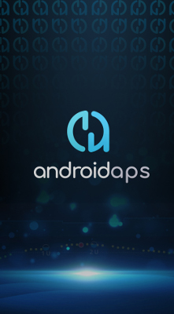

# Телефоны

<!-- List of hidden pages to avoid overcrowding the menu -->

```{toctree}
:hidden:

../CompatiblePhones/Jelly.md
../CompatiblePhones/Huawei.md
```

The current version of **AAPS** (4.0) requires an Android smartphone with Google **Android 12.0 or above**. Если вы собираетесь купить новый телефон, то (на январь 2026 г.) **лучше выбрать Android 16**, Android 15 не рекомендуется.

Последние новости на эту тему смотрите в [Facebook или Discord](../GettingHelp/WhereCanIGetHelp.md).

Ради безопасности мы настоятельно рекомендуем пользователям всегда обновлять свою сборку **AAPS**. Для пользователей, которые не могут использовать устройство с Android 12.0 или новее, по-прежнему доступны более ранние версии **AAPS** для старых версий Android, см. [Примечания к изменениям в версиях](#maintenance-android-version-aaps-version).

- [Настройки Jelly Pro](../CompatiblePhones/Jelly.md)
- [Настройки Huawei](../CompatiblePhones/Huawei.md)

(Phones-list-of-tested-phones)=

## List of tested phones

Мы ведем список [проверенных наборов устройств](https://docs.google.com/spreadsheets/u/1/d/e/2PACX-1vScCNaIguEZVTVFAgpv1kXHdsHl3fs6xT6RB2Z1CeVJ561AvvqGwxMhlmSHk4J056gMCAQE02sAWJvT/pubhtml?gid=683363241&single=true), который можно [просматривать в удобном интерфейсе](https://vnniyb.github.io/androidAPS_testedHardwareEasyBrowser/). Помогите нам: заполните [форму Google](https://docs.google.com/forms/d/e/1FAIpQLSfoGKLYEx4aUAJ5RWL3xLJeNdmRyxtXmDzpGhuU3Rfcj2H_Jw/viewform) и добавьте свой набор устройств!

В этом списке пользователи рассказывают, как работает телефон с **AAPS** и определенной помпой и CGM. Он поможет проверить, использовали ли уже другие пользователи ваш телефон / помпу / CGM успешно.

Документ доступен только для чтения. With CTRL-F, you can search in the text of the Google sheet.

Чтобы записать результаты проверки своего набора устройств, заполните эту [форму](https://docs.google.com/forms/d/e/1FAIpQLSfoGKLYEx4aUAJ5RWL3xLJeNdmRyxtXmDzpGhuU3Rfcj2H_Jw/viewform). After you fill in the form data, the sheet is updated automatically every 5 minutes.

Any problems with the spreadsheet, please contact its maintainer, *@theodoor5137*, on Discord, or see the page on [how to get help](../GettingHelp/WhereCanIGetHelp.md).

## Я не нашел свой телефон

Если у вас есть вопросы о конкретной модели телефона, поищите ответ или спросите в нашем [сообществе в Facebook или Discord](../GettingHelp/WhereCanIGetHelp.md).

Чтобы пожертвовать модель смартфона или смарт-часов, которую еще нужно проверить, напишите письмо на <donations@androidaps.org>.

(Phones-phone-wallpaper)=

## Phone wallpaper

Если вы хотите украсить свой телефон символикой **AAPS**, скачайте фоновое изображение [здесь](../images/bg_phone.jpg)!



Дизайн: Thiago :)