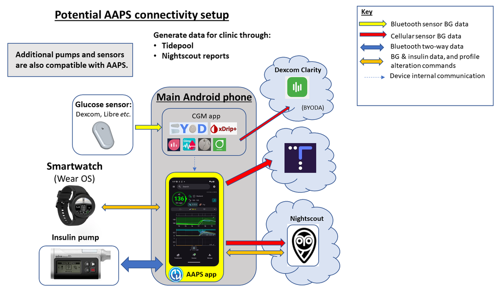
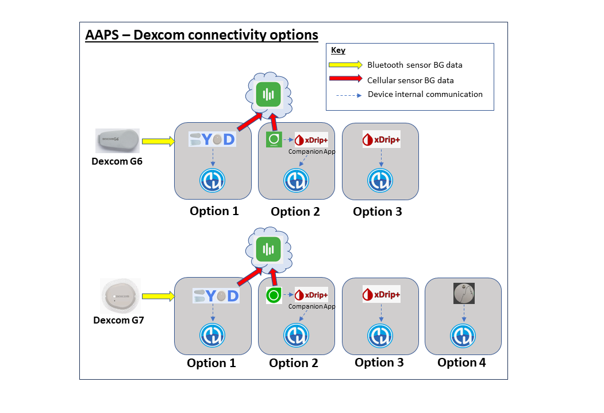
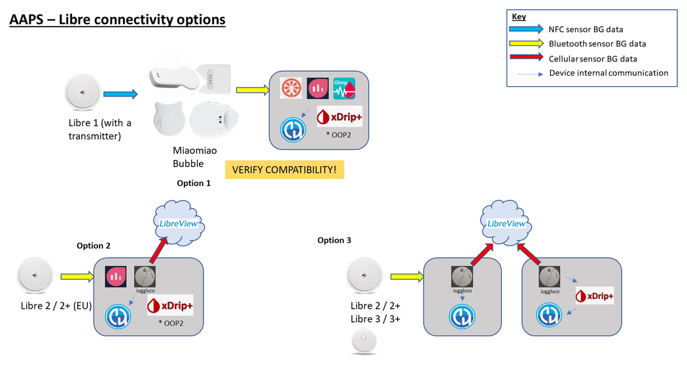
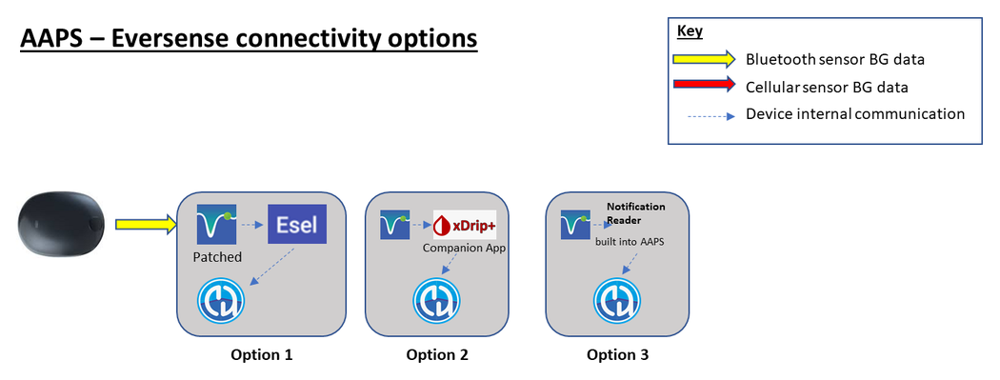

# Подготовка к работе с AAPS

Добро пожаловать. This documentation aims to guide users who are preparing to set up and start using the Android Artificial Pancreas System (**AAPS**).

## Как ориентироваться в документации

**Оглавление** и описание структуры документации можно найти [здесь](../index.md), а также открыть, нажав на символ **AAPS** слева вверху документации. Там вы найдете обзор того, для чего нужны разные разделы документации. Для перемещения по документации можно также использовать заголовки слева на этой странице. Наконец, есть удобный поиск прямо под символом **AAPS**.

Мы стремимся упростить определение как возможностей, так и ограничений **AAPS**. Будет обидно, если после долгого чтения документации окажется, что ваша инсулиновая помпа или CGM не совместимы или что **AAPS** работает не так, как вы надеялись.

Многие детали в документации **AAPS**, связанные с опытом, становятся понятнее, когда вы на самом деле работаете с **AAPS** в реальном времени. Точно так же, как трудно освоить вид спорта, только читая правила, необходимо изучать правила безопасной эксплуатации **AAPS**, и применять эти правила, начав использовать **AAPS**.

(подготовка-безопасность-приоритет) =

## Безопасность прежде всего
“С большими возможностями приходит большая ответственность…"

### Техническая безопасность
**AAPS** имеет широкий набор функций безопасности. These impose constraints which are gradually removed through staged completion of a series of [Objectives](../SettingUpAaps/CompletingTheObjectives.md) which involve testing specific parameters and answering multiple choice questions. Важные функции системы **AAPS** становятся доступны после успешного завершения Целей. Этот процесс позволяет пользователю поэтапно и безопасно перейти от открытого цикла к замкнутому и при этом изучить разные функции **AAPS**.

[Цели](../SettingUpAaps/CompletingTheObjectives.md) созданы, чтобы как можно лучше познакомить вас с **AAPS**, с учетом типичных ошибок и общих тенденций, которые разработчики **AAPS** видели у новых пользователей. Ошибки возникают из-за неопытности новичков и их желания начать работу с **AAPS** как можно быстрее, без изучения необходимых материалов. The [Objectives](../SettingUpAaps/CompletingTheObjectives.md) aim to minimize these issues.

### Медицинская безопасность
```{admonition} Avoid permanent and painful damage to your eyes and nerves
:class: danger
Будьте осторожны при быстром улучшении контроля глюкозы и снижении HbA1c 
```

An important safety consideration is that a **rapid reduction in HbA1c and improved blood glucose control in those who have had elevated glucose levels for some time can cause permanent damage**. Many people with diabetes are unaware of this, and not all clinicians make their patients aware of this issue.

Такие нарушения могут включать **потерю зрения и необратимую нейропатию (боль)**. Этих нарушений можно избежать, если снижать средний уровень глюкозы медленнее. Если у вас сейчас повышенный HbA1c и вы переходите на **AAPS** (или любую другую систему замкнутого цикла), _обязательно_ обсудите этот возможный риск с вашими врачами до начала и согласуйте с ними сроки постепенного снижения безопасных целевых значений глюкозы. You can easily set higher glucose targets in **AAPS** initially (currently, the highest target you can select is 11.1 mmol/L but you can also maintain a purposefully weak profile if needed), and then reduce the target as the months pass.

#### Как быстро можно понижать HbA1c без риска необратимых последствий?

One retrospective [study](https://pubmed.ncbi.nlm.nih.gov/1464975/) of 76 patients reported that the risk of progression of retinopathy increased by 1.6 times, 2.4 times and 3.8 times if the HbA1c dropped 1%, 2% or 3% respectively over a 6 month period. Они предположили, что **«снижение HbA1c за любой 6-месячный период должно быть меньше 2%, чтобы предотвратить прогрессирование ретинопатии... Слишком быстрое снижение в начале контроля гликемии может вызвать тяжелое или временное ухудшение ретинопатии»**

N.B. If you use different HbA1c units (mmol/mol rather than %), click [here](https://www.diabetes.co.uk/hba1c-units-converter.html) for an HbA1c calculator tool.

В другой ретроспективной [оценке](https://academic.oup.com/brain/article/138/1/43/337923) 954 пациентов исследователи отметили:

**«При снижении HbA1c на 2–3 процентных пункта за 3 месяца абсолютный риск развития нейропатии, вызванной лечением диабета, составлял 20%, при снижении HbA1c на >4 процентных пункта за 3 месяца абсолютный риск развития нейропатии, вызванной лечением диабета, превышал 80%».**

В [комментарии](https://academic.oup.com/brain/article/138/1/2/340563) к этой работе авторы согласились, что для предотвращения осложнений **цель – снижать A1c на <2% за 3 месяца.** Другие обзоры по этой теме можно прочитать [здесь](https://www.ncbi.nlm.nih.gov/pmc/articles/PMC6587545/pdf/DOM-21-454.pdf) и [здесь](https://www.mdpi.com/1999-4923/15/7/1791).

It is generally recognized that _newly_ diagnosed type 1 diabetics (who often have very high HbA1c at diagnosis, before starting insulin therapy) appear to be able to rapidly reduce their HbA1c immediately after diagnosis without encountering these risks to the same extent, because they have not had elevated blood glucose levels for such a sustained period. However, it is still a consideration which you should discuss with your clinician.

(PreparingForAaps-no-sglt-2-inhibitors)=
### Не использовать SGLT-2 ингибиторы

```{admonition} NO SGLT-2 inhibitors
:class: danger
Ингибиторы SGLT-2, их также называют глифлозинами, подавляют обратное всасывание глюкозы в почках. Gliflozins incalculably lower blood sugar levels, and so you MUST NOT take them while using a closed loop system like AAPS! There would be a significant risk of ketoacidosis and/or hypoglycemia! The combination of this medication with a system that lowers basal rates in order to increase BG is especially dangerous. 

In a nutshell:
- **Example 1: risk of Hypo**
>During lunch, you use **AAPS** to bolus based on consuming 45 g of carbs. The problem is that, unbeknownst to AAPS, the inhibitors cause the body to eliminate some of the carbs. This leaves your body with too much insulin compared to the absorbed carbs, resulting in hypoglycemia.

- **Example 2: risk of Ketoacidosis**
>The inhibitors eliminate some of the carbs in the background, causing a reduction in your BG. **AAPS** will automatically instruct the pump to decrease insulin intake, including basal. Over time this can result in your BG remaining below target value, to the point where the body does not have enough background insulin to absorb any carbs, resulting in ketoacidosis. Ordinarily, ketoacidosis develops in T1D patients because their pump fails, which would trigger alerts on their phone and be noticeable due to a high BG value. However, the danger with gliflozins is that there would be no AAPS alerts, as the pump remains operational and the BG potentially remains within target.

Распространенные названия ингибиторов SGLT-2 включают: Invokana, Farxiga, Jardiance, Glyxambi, Synjardy, Steglatro, и Xigduo XR и др.
```


### Главные принципы работы системы ИПЖ на базе AAPS

Основные принципы и концепции должны быть поняты пользователем до начала работы с системой **AAPS**. Это достигается чтением документации **AAPS** и прохождением целей, которые направлены на безопасную и эффективную работу **AAPS**. Объем документации **AAPS** может вначале ошеломить, но терпение и правильный подход приведут вас к цели!

Скорость прогресса зависит от индивидуума, но имейте в виду, что выполнение всех задач обычно занимает от 6 до 9 недель. Many people start to build, install and set up **AAPS** well in advance of starting to use it. Для содействия этому система имеет "виртуальную помпу", которая может помочь при прохождении начальных целей **AAPS** без реальной подачи инсулина. A detailed breakdown of the timeline is given below, be aware that by objective 7 of **AAPS** you are closed looping, the later objectives add in additional features like **SMB** and **automations** which are useful to some users, but not essential to the core function of **AAPS**.

Для успеха с **AAPS** нужны активный подход, готовность анализировать данные ГК и гибкость, чтобы вносить в **AAPS** нужные изменения и улучшать результаты. Невозможно научиться играть в спортивные игры, только изучая правила, То же самое можно сказать и о **AAPS**.

#### Планируйте задержки и незначительные затруднения при настройке и запуске AAPS

На предварительных стадиях работы с **AAPS**, есть вероятность столкнуться с трудностями при настройке всех компонентов цикла, а также при отладке настроек. Некоторые шероховатости не могут быть устранены до повседневного использования **AAPS**, но помощь всегда доступна в группе Facebook и на Discord. Планируйте грамотно и выбирайте "хорошее" время, как например тихие утренние часы в выходные (т.е. не поздно ночью или когда вы устали, или перед большим совещанием или командировкой) для исправления неполадок.

#### Совместимость с технологиями

**AAPS** совместим только с определенными типами инсулиновых помп, систем мониторинга и телефонов; некоторые технологии могут быть недоступными в каких-то странах. Чтобы избежать разочарования, прочитайте разделы [CGM](../Getting-Started/CompatiblesCgms.md), [помпы](../Getting-Started/CompatiblePumps.md) и [телефоны](../Getting-Started/Phones.md).

#### Время сборки приложения и переход к полному циклу

The time to build the **AAPS** app depends on your level of expertise and technical ability. Обычно у неопытных пользователей сборка **AAPS** может занять до полудня, а иногда и целый день (при поддержке от сообщества). Этот процесс значительно ускорится при сборке новых версий **AAPS**, когда появится больше опыта.

Several parts of this documentation are dedicated to helping you through the build process:

- [Building AAPS](../SettingUpAaps/BuildingAaps.md) takes you step-by-step through building the app and installing it on your phone;

- the [FAQ](../UsefulLinks/FAQ.md) answers common questions and explains the errors most likely to occur; and

- the [Troubleshooting](../GettingHelp/GeneralTroubleshooting.md) hub collects solutions to the most frequent problems, organised by topic.

How long it takes to get to closed looping depends on the individual; an approximate timeline for reaching full looping with **AAPS** is given [below](#preparing-how-long-will-it-take).


#### Хранилище ключей &  файл экспорта настроек конфигурации

«Хранилище ключей» (файл с расширением.jks) - это защищенный паролем файл, уникальный для вашей копии **AAPS**. Телефон использует его, чтобы не дать посторонним без ключа обновить ваш экземпляр программы. Короче говоря, в рамках сборки **AAPS** вам следует:

1.  Save your keystore file (.jks file used to sign your app) in a safe place;

2.  Запишите пароль для файла хранилища ключей.

How you save the keystore depends on your build method:

- **Android Studio (computer) build**: the keystore is created during the build — see [Generate signed APK](#Building-APK-generate-signed-apk) for instructions on where to save it.
- **AAPS Builder**: keep the backup file `aaps-keystore.jks` the setup page offered when you created your key, with its password and alias. If you uploaded your own keystore, keep that file.
- **Browser build with a fork**: use the dedicated [Export keystore](#ci-keystore-export) workflow to download a copy to your Google Drive.

Это гарантирует, что каждый раз при создании новой версии **AAPS** можно использовать один и тот же файл ключей. В среднем каждый год нужно 2 обновления **AAPS**.

Кроме того, в **AAPS** можно [экспортировать все настройки конфигурации](../Maintenance/ExportImportSettings.md). Это гарантирует, что вы можете безопасно восстановить вашу систему при смене телефонов, обновлении/переустановке приложения с минимальными затратами времени. 

#### Устранение неполадок

Не стесняйтесь связаться с сообществом AAPS, даже если уверены в том, что у вас глупый вопрос! Всем пользователям с опытом разного уровня рекомендуется при необходимости задавать вопросы. Благодаря большому числу пользователей **AAPS** ответы на вопросы обычно приходят быстро.

##### [спросить в группе AAPS на Facebook](https://www.facebook.com/groups/AndroidAPSUsers/)

##### [спросить в канале AAPS в Discord](https://discord.gg/4fQUWHZ4Mw)


#### [Where to go for help](../GettingHelp/WhereCanIGetHelp.md)?

Целью этого раздела является предоставление новым пользователям ссылок на ресурсы помощи, включая доступ к поддержке сообщества, состоящего как из новых, так и из опытных пользователей, которые могут ответить на вопросы и устранить ошибки, при работе с AAPS.

#### [Раздел для медицинских работников](../UsefulLinks/ClinicianGuideToAaps.md)

Это [раздел специально для врачей](../UsefulLinks/ClinicianGuideToAaps.md), которые хотят больше узнать об AAPS и технологии искусственной поджелудочной железы с открытым кодом. Во «Введении» также есть советы о том, [как говорить с вашими врачами](#introduction-how-can-i-approach-discussing-aaps-with-my-clinical-team).

## Что мы будем собирать и устанавливать?

Эта схема дает обзор основных компонентов (оборудования и программ) системы **AAPS**:




Кроме трех основных устройств (телефон, помпа, сенсор глюкозы), нам также нужны: 1) приложение **AAPS** 2) сервер отчетности и 3) приложение для системы непрерывного мониторинга глюкозы (CGM)

### 1) Приложение для телефона Android: **AAPS**

**AAPS** is an app that runs on Android smartphones & devices. Вы сами соберете приложение **AAPS** (файл apk) по пошаговой инструкции: скачаете исходный код **AAPS** с GitHub, установите нужные программы (Android Studio, GitHub desktop) на компьютер и соберете свою копию приложения **AAPS**. После чего приложение **AAPS** будет перенесено на смартфон (по электронной почте, USB кабелю _и т. д._) и установлено.

### 2) A reporting server: Nightscout (Tidepool*)

In order to fully take advantage of **AAPS**, you need to set up a Nightscout server. Вы можете [сделать это сами](https://nightscout.github.io/nightscout/new_user/#free-diy) или за небольшую плату заказать [управляемый сервис Nightscout](https://nightscout.github.io/#nightscout-as-a-service), который настроят для вас. Nightscout используется для сбора данных от **AAPS** и может генерировать подробные отчеты по мониторингу ГК и инсулинотерапии за выбранные периоды времени. Кроме того, опекунам предоставляется возможность работать с Nightscout на удаленной связи с приложением **AAPS** для контроля за диабетом их ребенка. Такие функции удаленной связи включают в себя мониторинг уровня ГК и инсулина, удаленную подачу болюсов (с помощью смс) и информирование о приемах пищи. Attempting to analyze your diabetes performance by looking at CGM data separately from the pump data is like driving a car where the driver is blind and the passenger describes the scene. Tidepool is also available as an alternative to Nightscout.

### 3) Приложение для сенсора CGM

В зависимости от вашего сенсора глюкозы/CGM вам нужно совместимое приложение, которое получает значения глюкозы и отправляет их в **AAPS**. Разные варианты показаны ниже, а больше информации есть в разделе [Совместимые CGM](../Getting-Started/CompatiblesCgms.md):

  

### Обслуживание системы **AAPS**

И **Nightscout** и **AAPS** должны обновляться примерно один раз в год по мере выхода улучшенных версий. В одних случаях обновление может задержаться, в других - настоятельно рекомендуется т. к. имеет важное значение для безопасности. Уведомления об этих обновлениях будут предоставляться в группах Facebook и на серверах Discord. В примечаниях к выпуску будет ясно сказано, какой это случай. Вероятно, многие люди будут задавать схожие вопросы во время обновления, но у всех будет поддержка.

(preparing-how-long-will-it-take)=
## Сколько времени займет настройка?

Как уже упоминалось ранее, работа с **AAPS** похожа на «путешествие», требующее вложений в виде вашего личного времени. Это не одноразовая установка. Сейчас считается, что сборка **AAPS**, установка и настройка **AAPS** и программ **CGM** и переход от открытого цикла к гибридному замкнутому циклу с **AAPS** занимают в целом около 4–6 месяцев. Поэтому советуем как можно раньше собрать приложение **AAPS** и пройти первые цели, даже если вы пока пользуетесь другой системой подачи инсулина (до цели 5 можно использовать виртуальную помпу).

Для некоторых целей должно пройти определенное количество дней, чтобы вы точно поняли новые функции. It is not possible to bypass this waiting time; these minimum waiting times have been set for your own safety.

Вот примерные сроки:

| Задачи                                                       |      Примерное время       |
| ------------------------------------------------------------ |:--------------------------:|
| Initial reading of the documentation                         |          1-2 дня           |
| Configuring GitHub to allow the browser build                |         1-4 hours          |
| Настройка сервера отчетности                                 |           1 hour           |
| Installing a CGM app (xDrip, BYODA, …)                       |           1 hour           |
| Configuring CGM → xDrip → AAPS initially                     |           1 hour           |
| Первоначальная настройка AAPS → помпа                        |           1 hour           |
| Настройка AAPS → Nightscout/Tidepool (только отчеты)         |           1 hour           |
| Optional: Configuring Nightscout ↔ **AAPS** & NSFollowers    |           1 hour           |
| Цель 1: Настройка визуализации и мониторинга                 |           1 hour           |
| Цель 2: Научитесь контролировать AAPS                        |          2 hours           |
| Цель 3: Подтвердите ваши знания                              |         До 14 дней         |
| Цель 4: Начните с открытого цикла                            |       Минимум 7 дней       |
| Цель 5: Понимание вашего открытого цикла                     |           7 дней           |
| Цель 6: Начало замыкания цикла (Приостановка на низкой ГК)   |   Минимум 5, до 14 дней    |
| Цель 7: Настройка замкнутого цикла                           | Минимум 1 день, до 7 дней  |
| Цель 8: Настройка базала и коэффициентов, включение Autosens | Минимум 7 дней, до 14 дней |
| Цель 9: Включение супер микроболюсов (SMB)                   |      Минимум 28 дней       |
| Цель 10: Автоматизация                                       |      Минимум 28 дней       |

Даже когда **AAPS** полностью работает, вам все равно нужно регулярно уточнять настройки, чтобы улучшать общий контроль диабета.

## Что потребуется:

### Медицинские соображения

In addition to the medical warnings in the [safety section](#preparing-safety-first) there are also different parameters, depending on which insulin you are using in the pump.

#### Выбор инсулина

Расчеты **AAPS** основаны на концентрации инсулина 100 ед./мл (как и стандарт для помп). You configure your insulin in **Manage → Insulin settings**: set its **Peak** and **DIA**, or use **Load peak from** to fill in the standard peak time of one of the presets:

- **Novorapid** (also for Humalog and NovoLog)
- **Fiasp**
- **Lyumjev**

Advanced users can enter any peak time (35 to 120 minutes) directly, for example for a mixture of insulins. See [Insulin settings](#Config-Builder-insulin).


### Технические вопросы

Цель документации - максимально сократить требуемые технические знания и опыт. To build the **AAPS** app, you have several options — see [Building AAPS](../SettingUpAaps/BuildingAaps.md) for an overview:

- **Browser build** (recommended): build the app directly from your smartphone using GitHub Actions, with no computer or Android Studio required. With [AAPS Builder](../SettingUpAaps/BrowserBuildAapsBuilder.md) you only need a GitHub account: you download the app directly from GitHub. The fork method also needs a Google account to store the app in your Google Drive.
- **Android Studio build**: build the app on your computer using Android Studio. This is mostly used by developers who intend to make code changes.
- **Command-line build**: for users who prefer to build locally without installing Android Studio.

Beyond building the app, you also need to set up a reporting server, configure several Android phone apps and develop expertise in diabetes management. This can be achieved by moving step-by-step, being patient, and with help from the **AAPS** community. If you are already able to navigate the internet and manage your own Gmail emails, building **AAPS** is a feasible task. Просто не торопитесь.

### Смартфоны

#### AAPS и версии Android

The current version of **AAPS** (4.0) requires an Android smartphone with Google **Android 12.0 or above**. Если вы думаете о покупке нового телефона, то (на январь 2026 года) лучше выбрать Android 16.<br/> Настоятельно рекомендуем ради безопасности использовать актуальную сборку **AAPS**. Но для тех, кто не может использовать устройство с Android 12.0 или новее, остаются доступны более ранние версии **AAPS** для старых версий Android, см. [Примечания к изменениям в версиях](#maintenance-android-version-aaps-version).

#### Выбор модели смартфона
Модель, которую вы покупаете, зависит от желаемых функций. На странице [Телефоны](../Getting-Started/Phones.md) вы найдете рекомендации и отзывы пользователей о рабочих конфигурациях.

Рекомендуется обновлять версию Android на телефоне, в том числе обновления безопасности. Но если вы новичок в **AAPS** или не разбираетесь в технике, лучше подождать с обновлением телефона, пока другие не обновятся и не подтвердят на наших форумах, что это безопасно.

```{admonition} Delaying Samsung phone updates
:class: warning
Samsung has an unfortunate track record of forcing updates on their phones, which can cause Bluetooth connectivity issues. To disable these forced updates, you need to switch the phone to "developer mode":

1. Go to **Settings** > **About phone** > **Software information**, then tap **Build number** until it confirms you have unlocked developer mode.
2. Go back to the main **Settings** menu, where you should see a new **Developer options** menu item.
3. Open **Developer options**, scroll to find **Auto system update**, and turn it off.
```

```{admonition} Google Play Protect potential issue
:class: warning
Есть несколько сообщений о том, что Google Play Protect каждое утро без причины закрывает **AAPS**. If this happens, you will have to go to the Google Play options and disable **Google Play Protect**. Not all phone models or all Android versions are affected.
```

```{admonition} Android developer verification
:class: note
From September 2026, Google is gradually introducing [Android developer verification](#android-developer-verification), which changes how a self-built app is installed on the phone. Building **AAPS** is not affected, and free installation methods remain available — see the linked page for details.
```

