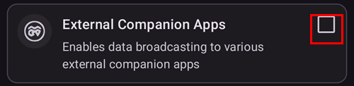
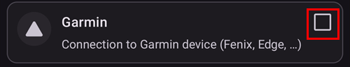
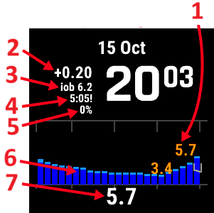
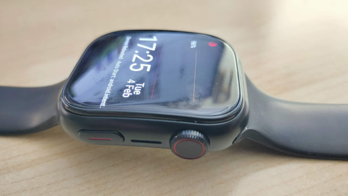

# Смарт-часы и AAPS

Разные смарт-часы можно использовать, чтобы показывать часть информации из **AAPS** или выполнять удаленные действия.

Чтобы смарт-часы напрямую управляли **AAPS** (помпой и сенсором), нужны полноценные часы на Android (их можно считать маленькими [смартфонами](./Phones.md)).

Некоторые смарт-часы позволяют вводить терапию и не только, но **AAPS** при этом по-прежнему управляет сам телефон.

Смарт-часы все чаще используются с **AAPS** _и_ для взрослых с диабетом и опекунов/родителей детей с диабетом.

## Преимущества смарт-часов в связке с **AAPS**


Смарт-часы - в зависимости от модели - могут найти различное применение с **AAPS**. С их помощью можно полностью или частично контролировать работу **AAPS**, а также проверять уровни гликемии, количество активного инсулина и другие параметры.

Интеграция смарт-часов с **AAPS** может быть полезна во многих ситуациях, включая вождение автомобиля, мотоцикла, велосипеда, во время занятий спортом и т. п. Некоторые считают, что взглянуть на часы (на встрече, вечеринке, за обеденным столом и т. д.) менее заметно, чем смотреть в телефон. С точки зрения безопасности смарт-часы также удобны в дороге: телефон **AAPS** можно хранить вне поля зрения (например, в сумке), а смарт-часы использовать для удаленного управления.

## Конкретные преимущества **AAPS** для родителей/опекунов

Если телефон **AAPS** ребенка находится рядом, опекун может с помощью смарт-часов следить за данными или вносить изменения, не используя телефон **AAPS**. Это может пригодиться, например, если телефон **AAPS** скрыт в поясе для помпы.

Смарт-часы можно использовать _вместе_ с вариантами на основе ТЕЛЕФОНА для удаленного управления или _вместо_ них, а также для слежения (см. [Слежение за работой AAPS (без взаимодействия с системой)](../RemoteFeatures/FollowingOnly.md)).

Кроме того, в отличие от телефонов фолловеров у родителей или опекунов (которым нужна мобильная сеть или Wi-Fi), смарт-часы, подключенные по Bluetooth, могут быть полезны в удаленных местах: в пещере, в лодке или на полпути к вершине горы. Если оба устройства (телефон **AAPS** и смарт-часы) подключены к одной сети Wi-Fi, они могут также использовать Wi-Fi.

## Различные типы взаимодействия смарт-часов и AAPS

В настоящее время существует пять основных способов использования смарт-часов в связке с **AAPS**. Эти данные приводятся ниже в таблице: 

| Настройка часов             | Функции                                      | Что потребуется:                                                                                                                                                                                                                                                                                                                               |
| --------------------------- | -------------------------------------------- | ---------------------------------------------------------------------------------------------------------------------------------------------------------------------------------------------------------------------------------------------------------------------------------------------------------------------------------------------- |
| Автономно                   | AAPS без телефона                            | Полноценные смарт-часы на Android (проверьте минимальную версию Android)</br> с **app-fullRelease**                                                                                                                                                                                                                                            |
| Полное удаленное управление | Большинство функций AAPS                     | Часы на Android **Wear OS** (проверьте версию Android/API)</br>с **wear-fullRelease**                                                                                                                                                                                                                                                          |
| Удаленное управление        | Функции AAPSClient                           | Часы на Android **Wear OS** (проверьте версию Android/API)</br>с **[wear-aapsclientRelease](https://github.com/nightscout/AndroidAPS/releases)**                                                                                                                                                                                               |
| Удаленное управление        | Часть функций AAPSClient                     | Часы Garmin</br>(только старые настройки Samsung Tizen и Fitbit, не рекомендуется)</br>См. ниже.                                                                                                                                                                                                                                               |
| Только отображение          | ГК, тренд, IOB, COB, состояние цикла и помпы | Многие смарт-часы через приложение-компаньон на телефоне **AAPS**, которое получает данные через трансляцию [Внешние приложения-компаньоны](#watches-external-companion-apps): [WatchDrip+](https://bigdigital.home.blog/) (Xiaomi, Amazfit), [GlucoDataHandler](https://github.com/pachi81/GlucoDataHandler) (Wear OS), G-Watch</br>См. ниже. |

## Перед тем как купить смарт-часы…

Модель, которую вы покупаете, зависит от желаемых функций. Полезную информацию можно найти на странице [Телефоны](#Phones-list-of-tested-phones), в том числе список проверенных телефонов, в котором есть и некоторые смарт-часы.

Популярные марки часов: Samsung Galaxy, Garmin, Fossil и Mi Band. Разные варианты из таблицы выше подробнее описаны ниже, чтобы помочь вам решить, какие смарт-часы подходят для вашей ситуации.

Если вы интегрируете смарт-часы с телефоном **AAPS** чтобы удаленно взаимодействовать с **AAPS**, нужно учитывать, совместимы ли оба устройства друг с другом, особенно если у вас устаревший или необычный телефон.

В общем, если вы хотите только следить за гликемией и не взаимодействовать с **AAPS**, то имеется большой выбор доступных и простых смарт-часов.

Лучший способ выбрать смарт-часы – поискать посты о часах («watch») в группах **AAPS** в Discord или Facebook. Почитайте об опыте других и задайте свои вопросы, если в старых постах нет ответа.

## Полноценные часы на Android

Похоже на привлекательный вариант? Однако сейчас **AAPS** на автономных часах пробуют лишь немногие энтузиасты. Смарт-часов с удобным интерфейсом, которые к тому же хорошо работают с автономным **AAPS** и вашим приложением CGM, немного. Популярные модели: LEMFO LEM 15 Pro и 16. На них потребуется установить "полноценное" приложение **AAPS** (которое обычно устанавливается на телефон), а не приложение  **AAPS** "wear".

Пока нет четкой спецификации, которая поможет узнать, будут ли часы самостоятельно работать с **AAPS**, но ориентиром будут следующие параметры:

1)  Android 12 or newer. 2) Возможность выключать "квадратный" режим для увеличения и упрощения чтения текста. 3) Очень хороший срок службы батареи. 4) Хороший радиус действия Bluetooth.

Большинство разочарований от автономных часов с **AAPS** происходит от взаимодействия с крошечным экраном, и то, что текущий полный интерфейс AAPS не был разработан для часов. Из-за маленького экрана для изменения настроек **AAPS** на часах может быть удобнее стилус, и некоторые кнопки AAPS могут быть не видны на экране часов.

Дополнительные проблемы заключаются в том, что трудно получить хороший срок службы батареи, а часы с хорошей батареей часто громоздкие и толстые. Пользователи сообщают о борьбе с операционной системой и настройками энергосбережения, о трудностях с запуском сенсоров на часах, о малом радиусе действия Bluetooth (для поддержания связи и с сенсором, и с помпой) и о сомнительной водонепроницаемости. Примеры показаны на фото ниже.


Если вы хотите настроить автономные часы, для получения дополнительной информации почитайте посты и комментарии в группе **AAPS** в Facebook (хорошие слова для поиска – «standalone» и «Lemfo») и в Discord.

## Wear OS

Код **AAPS** содержит дополнительное приложение, которое можно установить на [смарт-часы с **Wear OS**](https://wearos.google.com/#oem-carousel).


Убедитесь, что ваши смарт-часы соответствуют [требованиям](#maintenance-android-version-aaps-version) **AAPS**.

### Что _такое_ Wear OS?

Первые три варианта требуют, чтобы на смарт-часах была установлена операционная система **Wear OS**.

**Wear OS** - это операционная система некоторых современных смарт-часов Android. Если в описании смарт-часов указывается только _совместимость_ с Android и iOS - это не означает, что они работают под управлением Wear OS. Это может быть какая-то другая специальная операционная система, не совместимая с **AAPS**. Чтобы на смарт-часы можно было установить и использовать любую версию **AAPS** или **AAPSClient**, на них должна работать **Wear OS 3.0, 3.2 или 3.5** (Android 11, уровень API 30) **или новее**. Каждая версия Wear OS соответствует версии Android, на которой она основана: **Wear OS 3** – это Android 11 (уровень API 30), **Wear OS 4** – Android 13 (уровень API 33), **Wear OS 5** – Android 14 (уровень API 34), а **Wear OS 6** – Android 16 (уровень API 36). На часах с Wear OS 2 **AAPS** работать не может.

Если вы установите **AAPS** wear.apk на часы с **Wear OS**, можно выбрать один из разных циферблатов **AAPS**. Также можно использовать стандартный циферблат часов, на котором информация **AAPS** показана в маленьких плитках, которые называются «дополнения». Дополнение – это любой элемент, который показан на циферблате кроме времени.

```{note}
Последние изменения в **Wear OS** постепенно нарушают работу собственных циферблатов **AAPS** (чем выше версия Wear OS, тем сильнее), но **дополнения** продолжают работать. Прежде чем покупать или обновлять часы, прочитайте раздел [Изменения циферблатов в Wear OS](#wearos-watchface-changes).
```


### Как могут выглядеть мои смарт-часы?

После [установки **AAPS** на часы](../WearOS/WearOsSmartwatch.md) вы сразу сможете выбрать нужный циферблат из этих циферблатов **AAPS**. На большинстве часов нужно просто долго нажать на главный экран, пока он не уменьшится, и провести пальцем вправо, чтобы выбрать другой экран:


Это основные экраны, встроенные в **AAPS**; есть и [другие циферблаты](#WearOS_changing-to-AAPS-watchface), а также можно использовать [дополнения](#Watchfaces-complications).

### Как пользоваться часами Wear OS каждый день?

Подробнее о циферблатах и ежедневном использовании, а также о том, как создать собственный циферблат (и поделиться им), читайте в разделе [Настройка AAPS на часах Wear OS](../WearOS/WearOsSmartwatch.md).

(Watchfaces-tizen)= (watches-external-companion-apps)=

## Внешние приложения-компаньоны

**AAPS** может транслировать свое состояние другим приложениям, установленным на том же телефоне: ГК и тренд, IOB, COB, базал и временный базал, название профиля, состояние цикла, заряд батареи телефона и помпы, уровень инсулина в резервуаре и ход болюса. Несколько приложений-компаньонов для часов читают эту трансляцию и показывают данные на часах, которые **AAPS** не поддерживает напрямую. Чтобы отправлять данные, включите **Внешние приложения-компаньоны** в разделе **Конфигурация** > **Связь** (см. [Внешние приложения-компаньоны](#external-companion-apps) на странице «Конфигурация»). Трансляция отправляется с каждым новым показанием, и запросить ее нельзя: кнопка обновления в приложении-компаньоне никак не влияет на **AAPS**.



Приложения-компаньоны, которые используют эту трансляцию:

- [WatchDrip+](https://bigdigital.home.blog/) для часов Xiaomi и Amazfit, см. [Часы Xiaomi и Amazfit](#watches-xiaomi-amazfit) ниже.
- [GlucoDataHandler](https://github.com/pachi81/GlucoDataHandler) для часов Wear OS, как дополнение или виджет. Это полезный запасной вариант для версий Wear OS, на которых циферблаты **AAPS** работают ненадежно, см. [Настройка AAPS на часах Wear OS](../WearOS/WearOsSmartwatch.md). Его приложение-компаньон GlucoDataAuto показывает те же данные в машине с Android Auto.
- [Приложение G-Watch](https://play.google.com/store/apps/details?id=sk.trupici.g_watch) для часов Samsung Tizen и его более поздняя версия для Wear OS. В более ранних версиях **AAPS** этот модуль назывался **Samsung Tizen** по названию этого приложения.

```{warning}
**Приложение G-Watch** и его версия для **Wear OS** больше не поддерживаются, а Samsung перевела свои смарт-часы с Tizen на Wear OS. G-Watch имеет смысл только для существующих старых настроек и не рекомендуется для новой установки. Последние новости смотрите в специальной [группе Facebook](https://www.facebook.com/groups/gwatchapp).
```

(Watchfaces-garmin)=

## Garmin

В магазине Garmin ConnectIQ есть несколько циферблатов для Garmin, которые работают с [AAPS](https://apps.garmin.com/search?keywords=androidaps).



[AAPS Glucose Watch](https://apps.garmin.com/apps/3d163641-8b13-456e-84c3-470ecd781fb1) работает напрямую с **AAPS**. Он показывает данные о состоянии цикла (активный инсулин, временный базал) вместе с показаниями ГК и отправляет в **AAPS** данные о пульсе. Он доступен в магазине ConnectIQ; включите модуль **Garmin** в разделе **Конфигурация → Связь**. 

1. Самое высокое и самое низкое значения ГК на графике
2. Изменение ГК за минуту
3. Insulin on board (IOB)
4. Время с последнего показания ГК (минуты:секунды)
5. Временный базал в процентах от базальной скорости профиля
6. График ГК за последние 2 часа
7. Текущее значение глюкозы


## Fitbit

```{warning}
Google переводит Fitbit в Google Health и удаляет сторонние приложения и циферблаты с часов Fitbit в ЕС. Поэтому циферблаты Fitbit **больше не рекомендуются**, и покупать Fitbit для использования с **AAPS** не рекомендуется.
```

Для уже имеющихся часов Fitbit на [страницах Nightscout](https://nightscout.github.io/nightscout/wearable/#fitbit) перечислены некоторые варианты только для мониторинга, например [Glance](https://glancewatchface.com/). Это тоже сторонние циферблаты, поэтому то же ограничение в ЕС действует и для них.

## Только слежение

Эти смарт-часы показывают часть информации **AAPS**, для некоторых нужны другие приложения.

Существует множество доступных смарт-часов, которые дают только отображение ГК. Если вы пользуетесь сайтом Nightscout, то хороший обзор вариантов дан [здесь](https://nightscout.github.io/nightscout/wearable/#)

Ниже некоторые варианты часов только для слежения, популярные у пользователей **AAPS**:

(watches-xiaomi-amazfit)=
### Часы Xiaomi и Amazfit

**WatchDrip+** – это приложение-компаньон, созданное сообществом, которое показывает данные ГК и цикла на разных моделях смарт-часов, в основном марок Xiaomi (_например_, Mi Band) и Amazfit:


Начиная с версии 0.5 **WatchDrip+** читает данные напрямую из **AAPS**, без xDrip+ в качестве посредника. На телефоне **AAPS**:

1. Включите **Внешние приложения-компаньоны** в разделе **Конфигурация** > **Связь**, см. [выше](#watches-external-companion-apps). Так передаются текущая ГК, дельта, стрелка тренда, IOB и состояние помпы.
2. Включите модуль **xDrip** в разделе **Конфигурация** > **Связь** и в его настройках включите **Отправлять статус в xDrip+**. Так передается строка состояния IOB/COB, а график ГК на часах заполняется после нескольких показаний.
3. Если на телефоне установлен xDrip+, отключите в нем **Broadcast Service API** (xDrip+ > Settings > Inter-app settings), чтобы часы не получали данные дважды. Если xDrip+ только передавал данные на часы, его можно удалить.

Кнопка обновления в WatchDrip+ не действует с **AAPS**: данные приходят с каждым новым показанием.


Подробнее о них, в том числе о настройке, можно прочитать на [сайте WatchDrip+](https://bigdigital.home.blog/). Преимущество этих часов в том, что они маленькие и относительно недорогие. Они особенно популярны как часы для детей и людей с небольшими запястьями.

### Часы Pebble


Часы Pebble ([сейчас сняты с производства](https://en.wikipedia.org/wiki/Pebble_(watch))) продавались с 2013 по 2016 год, и их еще можно найти б/у. Активы Pebble перешли к Fitbit. Пользователи Pebble могут пользоваться циферблатом Urchin для просмотра данных Nightscout. Отображаемые данные включают активный инсулин IOB, действующий временный базал и прогнозирование. Если вы используете открытый цикл, можно с помощью IFTTT создать апплет: если от **AAPS** пришло уведомление, отправить SMS или уведомление Pushover.

### [Часы Bluejay](https://bluejay.website/)





Это уникальные устройства, которые могут получать данные ГК **напрямую** от трансмиттера Dexcom. Мало кто знает, что трансмиттеры Dexcom G6/G7 на самом деле передают текущие данные ГК по _двум_ отдельным каналам: каналу для телефона и медицинскому каналу. Часы Bluejay можно настроить на прием данных ГК по любому из каналов, поэтому если **AAPS** использует канал для телефона, часы Bluejay могут использовать медицинский канал.

Главное преимущество в том, что часы не зависят ни от телефона, ни от системы замкнутого цикла. Например, если вы отключили помпу и оставили телефон **AAPS** на пляже или в парке развлечений и находитесь вне зоны действия телефона **AAPS**, вы все равно можете получать показания Dexcom прямо на часы Bluejay.

Первая модель **Bluejay GTS** снята с производства и не может читать данные Dexcom G7. Более поздние модели (U1, затем текущая **U3**, которая на момент написания продается в раннем доступе) – это полноценные часы на Android с xDrip, которые получают данные от Dexcom G6 и G7 напрямую. Производитель описывает часы как инструмент для исследований, а не медицинское изделие. Среди недостатков пользователи называют то, что часы не всегда получают показание каждые 5 минут и что батарею нужно часто заряжать. Текущую модель и наличие уточняйте на [сайте Bluejay](https://bluejay.website/).

### Apple Watch

См. [Nightscout на ваших часах](https://nightscout.github.io/nightscout/wearable/#).

Apple Watch теперь поддерживает прямое подключение к G7 и может использоваться одновременно с **AAPS**.

