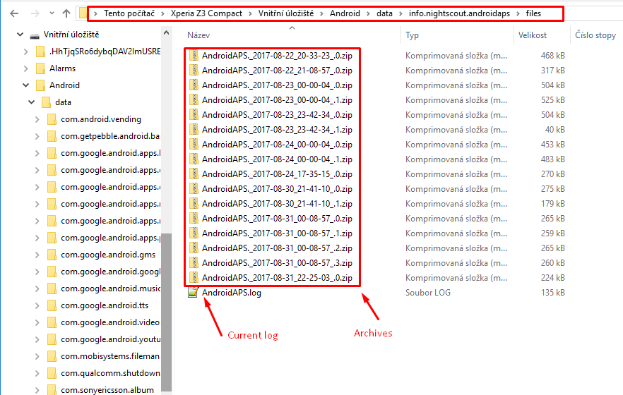

(Accessing-logfiles-accessing-logfiles)=

# Чтение лог-файлов

* Подключите телефон к компьютеру в режиме передачи файлов
* Найдите файлы журнала в папке AAPS по пути `Android\data\info.nightscout.androidaps\files`.  
    Имя корневой папки может немного отличаться в зависимости от телефона.
* Используйте путь `Android\data\info.nightscout.aapsclient\files` для [AAPSClient](#RemoteControl_aapsclient).
* Примечание: в **AAPS 3.3** место хранения журналов изменилось. При необходимости ознакомьтесь с документацией предыдущих версий.

* Текущий журнал – это файл .log. Его можно открыть разными способами: в [LogCat](https://developer.android.com/studio/debug/am-logcat.html) в Android Studio, в любом приложении для просмотра журналов на Android или просто как обычный текст. 
* Предыдущие файлы журналов архивируются и хранятся в папках по датам/времени. 
* Если вы делитесь своим лог-файлом в [discord](https://discord.gg/4fQUWHZ4Mw), чтобы рассказать о потенциальной ошибке, распакуйте и загрузите файл до возникновения ошибки.