(bluetoothtroubleshooting-bluetooth-related-issues)=

# Проблемы, связанные с Bluetooth

Некоторые пользователи сталкиваются с проблемами при активации Omnipod DASH, проблемами подключения Medtrum Nano и другими ошибками патч-помп, которые связаны с работой Bluetooth. Большинство этих проблем связаны с причинами, описанными ниже.

Некоторые из этих проблем, вероятно, могут возникнуть и у других помп, использующих Bluetooth. Например, и у Medtrum Nano и у Omnipod DASH наблюдается проблема, связанная с разрешениями для устройств поблизости.

---

(bluetoothtroubleshooting-cannot-start-omnipod-with-android-16)=

## Невозможно запустить Omnipod на Android 16
- Для правильной работы Omnipod DASH на Android 16 нужна версия **AAPS** не ниже 3.3.2.1, так как в этой версии исправлены известные проблемы Omnipod, появившиеся в Android 16.

---

(bluetoothtroubleshooting-bluetooth-battery-optimisation)=

## Оптимизация энергопотребления Bluetooth-устройств

В новых версиях Android для системного приложения Bluetooth включена оптимизация батареи. Известно, что это может вызывать проблемы с помпами и CGM, которые работают через Bluetooth.

Если вы прошли [Мастер установки AAPS](../SettingUpAaps/SetupWizard.md) и выполнили настройки из раздела [Оптимизация энергопотребления Bluetooth-устройств](#setup-wizard-bluetooth-battery-optimisation), эта настройка должна быть верной. Но если вы следовали старой версии этого руководства, возможно, вы не изменили эту настройку.

Если у вас бывают отключения помпы и CGM, проверьте, что это настроено правильно.

---

(bluetoothtroubleshooting-apps-using-nearby-device-permission)=

## Приложения, использующие разрешение "Устройства поблизости", могут вызывать потерю соединения или проблемы активации подов

Android allows you to control what each app is able to do or access on your phone via a permission model. Для каждого установленного приложения можно разрешить или запретить определенные действия, например доступ к файлам на устройстве, доступ к Bluetooth, поиск устройств поблизости и т. д.

Для работы **AAPS** нужен ряд определенных разрешений; одно из них, необходимое для работы подов, — разрешение "Устройства поблизости". There are many other applications which also require this permission, the community is finding that a number of applications when they are granted this permission can cause issues with activating new Pods on some devices.

(bluetoothtroubleshooting-apps-using-nearby-device-permission-known-apps)=

### Apps that use "Nearby device" permissions and are known to have caused problems:

Приложения из этого списка неоднократно обсуждались в сообществе как вызывающие проблемы в работе Omnipod DASH, а в некоторых случаях и Medtrum Nano.

```{admonition} Updating the list
:class: note
Обратитесь к @XiTatiON на канале #omnipod-dash в Discord, чтобы обсудить добавление новых приложений в этот список.
```

- **myBMW** MyBMW interrupted Medtrum Nano and Omnipod DASH. Приложение MyBMW запрашивает разрешение «Поиск устройств поблизости» только один раз; если вы его не дадите, приложение все равно работает без проблем

- **Amazon Alexa**  У некоторых людей отзыв разрешения "Устройства поблизости" у приложения Alexa решил проблему, но после этого нельзя выполнить сопряжение с устройствами умного дома Matter

- **MINI app**  Похоже, это приложение основано на приложении myBMW и поэтому может вести себя так же

- **BM2** Приложение для контроля солнечной батареи, которое используют в некоторых кемперах и солнечных системах для кемпинга: когда приложение работало, оно мешало активации нового пода. Обойти проблему можно, принудительно остановив приложение на время активации нового пода. После этого работа приложения, судя по всему, не мешала работе Dash (на Pixel 8 Pro с Android 16).

(bluetoothtroubleshooting-revoke-nearby-device-permission)=

### How to revoke "Nearby device" permissions for other apps:
Если у вас проблемы с активацией нового пода, а вы используете правильную поддерживаемую версию **AAPS** для вашей версии Android, может понадобиться отозвать разрешение у других приложений на время активации нового пода.

Выполните эту процедуру, чтобы отозвать разрешение "Устройства поблизости" у всех приложений, кроме **AAPS**:

```{admonition} Menus and settings
:class: note
Скриншоты и инструкции в этом руководстве даны для ванильного Android 16 на смартфоне Google Pixel 8 Pro. Перевод на русский сделан в соответствии с локалью Samsung S25. Меню и описания настроек у других производителей и устройств, скорее всего, будут немного отличаться. Адаптируйте шаги к своему устройству, а если не получается, посмотрите раздел [Где получить помощь по Dash](#omnipod-dash-where-to-get-help-for-dash), чтобы узнать, как обратиться за поддержкой к сообществу.
```

1. Откройте настройки Android на телефоне, прокрутите вниз и выберите раздел **Безопасность и конфиденциальность (1)**.

    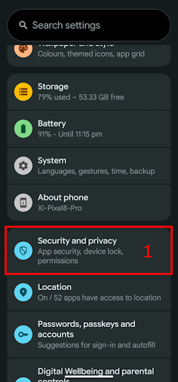

2. Прокрутите вниз и выберите **Другие настройки конфиденциальности (1)**.

   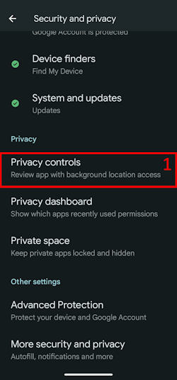

3. Выберите **Диспетчер разрешений (1)**.

   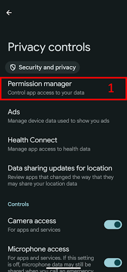

3. Прокрутите вниз и выберите **Устройства поблизости (1)**.

   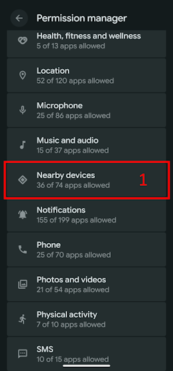

4. Посмотрите список приложений и выберите те, для которых хотите отозвать разрешение **Устройства поблизости**.

   В этой инструкции мы отзовем разрешение у приложения **Android Auto (1)**.

   Чтобы избежать "окирпичивания" подов мы рекомендуем отозвать разрешение у всех приложений, кроме **AAPS**.

```{admonition} Which app to select?
:class: tip
Если вы не уверены, какое именно приложение вызывает проблему, отзовите разрешение у всех (сперва отзовите разрешение у известных проблемных приложений) и если вы можете позволить себе загубить несколько подов - возвращайте разрешение по одному перед каждой новой активацией пода до тех пор, пока не выясните какое именно приложение вызывает проблему с подами у вас. Если вы обнаружили новые проблемные приложения, пожалуйста, дайте нам знать о них на канале #omnipod-dash в Discord.
```

   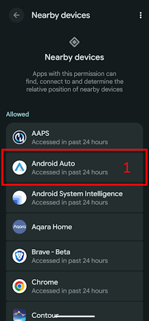

5. Чтобы отозвать разрешение, нажмите на **Запретить (1)**, затем нажмите **Все равно запретить (2)**. Если все сделано правильно, будет выбрана опция **Запретить (3)**. Теперь вы можете вернуться в меню **Устройства поблизости**, нажав **стрелку "Назад" (4)** и изменив это разрешение в других приложениях.

   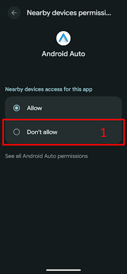 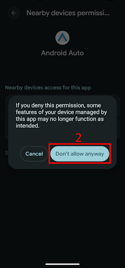  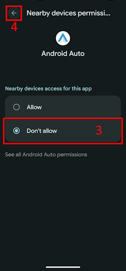

(bluetoothtroubleshooting-re-enable-nearby-device-permission)=

### Как снова дать разрешение "Устройства поблизости" системным и другим приложениям:

1. При необходимости посмотрите раздел **«Как отозвать разрешения "Устройства поблизости" для других приложений»**, чтобы узнать, как открыть настройки конфиденциальности приложений. Затем в настройке **Устройства поблизости** перейдите к шагу 2.

2. Посмотрите список приложений и выберите приложение, которому хотите дать разрешение **Устройства поблизости**.

   В этой инструкции мы даем разрешение приложению **Android Auto (1)**.

   Вы заметите, что после отзыва разрешения приложения **Android Auto (1)** нет в списке. Это потому, что **Android Auto** — **системное приложение**, а системные приложения по умолчанию скрыты.

   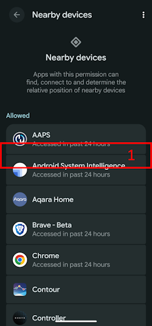

3. Чтобы показать скрытые системные приложения, нажмите **меню с тремя точками (⋮) (1)** в правом верхнем углу, затем нажмите **«Показать системные процессы» (2)**. Теперь вы должны увидеть в списке скрытое системное приложение **Android Auto (3)**.

```{admonition} Find your app
:class: tip
Если разрешение у приложения отозвано, прокрутите вниз, пока не увидите ниже в списке приложения с отозванным разрешением.
```

   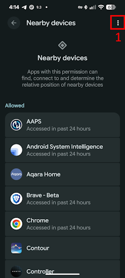 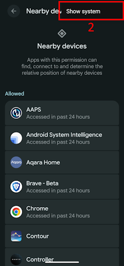 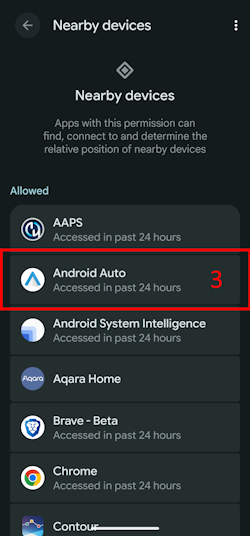

5. Выполните инструкции раздела **«Как отозвать разрешения "Устройства поблизости" для других приложений»** в обратном порядке, чтобы снова дать разрешения каждому приложению.

---

(bluetoothtroubleshooting-android-15-bluetooth-connection-problems)=

## Android 15 Frequent Bluetooth connection problems

After upgrading Android or moving to a recent phone, **AAPS** frequently loses Bluetooth connection to the pump. Проблема временно исчезает после перезагрузки телефона. Если вы используете **Omnipod DASH** и на вашем телефоне Android 15, включение настройки **Привязка Bluetooth** может сделать соединение Bluetooth стабильнее. Чтобы включить ее:

```{admonition} Android 16
:class: warning
Включайте настройку **Привязка Bluetooth** только на Android 15 и только если у вас есть проблемы с подключением. НЕ включайте привязку на Android 16.
```

1. Откройте [настройки Dash](#omnipod-dash-settings): откройте экран помпы DASH через **Управление** > **Помпа** и нажмите значок **Настройки** (шестеренка) в правом верхнем углу.

   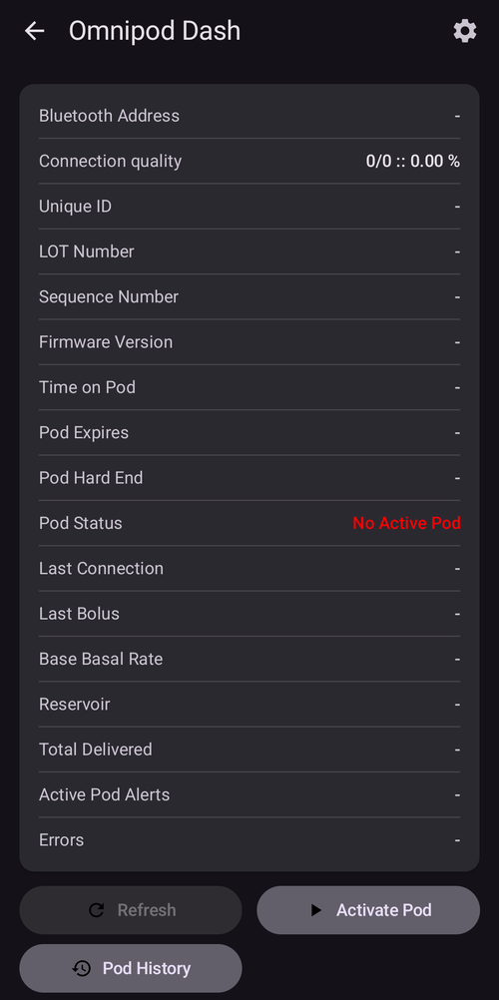

2. Откройте раздел **Дополнительные настройки** и включите **Привязка Bluetooth**.

   

3. Если телефон покажет запрос на сопряжение, примите его.

4. Restart your phone.
