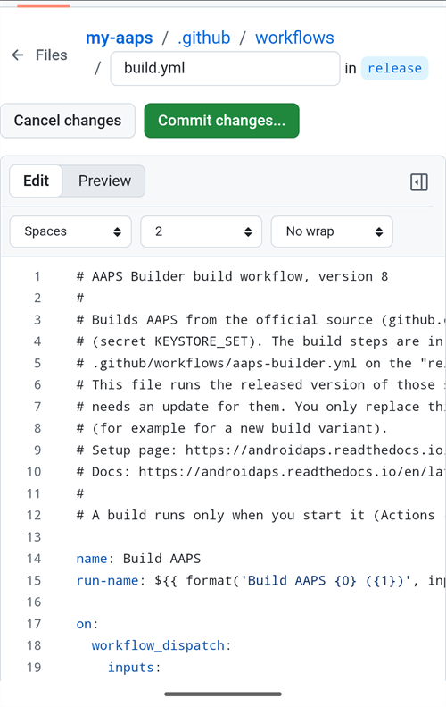
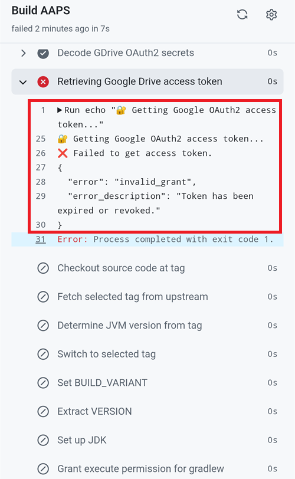
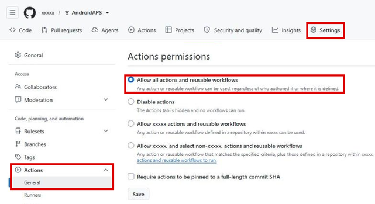

(aaps-ci-troubleshooting)=

# Сборка через браузер: устранение неполадок

```{note}
На этой странице собраны советы по устранению неполадок для раздела [Сборка через браузер](../SettingUpAaps/BrowserBuild.md).
```

(aaps-builder-troubleshooting)=

## AAPS Builder

### Шаг 1: репозиторий

(aaps-builder-ts-repo-exists)=

#### "my-aaps already exists in this account"


У вас уже есть этот репозиторий, например после прошлой попытки. Закройте вкладку GitHub, оставьте это имя в шаге 1 страницы настройки и продолжайте. Если вы уже выполнили для него шаги 2 и 3, ваш ключ все еще в нем: переходите к [шагу 4](#aaps-builder-step4). Если он был создан более ранней версией страницы настройки, один раз обновите его workflow, как описано в разделе [Обновление AAPS](#aaps-builder-updates). Хотите начать с нуля? Введите другое имя, например `my-aaps-2`, и используйте то же хранилище ключей в шаге 2.

(aaps-builder-ts-user-not-found)=

#### «Пользователь GitHub с таким именем не найден»


- **«Пользователь GitHub с таким именем не найден»** в шаге 1: введите свое имя пользователя GitHub, как оно показано в вашем профиле GitHub, а не адрес электронной почты.
- **Нет кнопки «Build AAPS» или «Run workflow», или репозиторий пуст**: репозиторий был создан не из шаблона. Удалите его (**Settings** → внизу страницы → **Delete this repository**) и снова выполните [шаг 1](#aaps-builder-step1) с помощью кнопки **Создать мой приватный репозиторий**.

### Шаг 3: секрет

(aaps-builder-ts-404)=

#### "Page not found" (404)


- **«Page not found» (404), когда страница настройки открывает GitHub**: войдите на github.com в этом же браузере (если вы не вошли, GitHub показывает 404 для приватных репозиториев). Если вы вошли, значит, имя пользователя или название репозитория в шаге 1 страницы настройки не совпадает с вашим репозиторием. Введите точные имена.

### Шаг 4: сборка

(aaps-builder-ts-workflow-not-found)=

#### "This workflow does not exist"


Сразу после создания репозитория GitHub может еще не прочитать его файл workflow: на вкладке **Actions** нет **Build AAPS** и нет кнопки **Run workflow**. Любое небольшое изменение файла заставляет GitHub прочитать его:

1. В вашем репозитории откройте **Code**, затем папку `.github`, затем `workflows`, затем файл `build.yml`.
2. Нажмите меню **⋯** вверху справа от файла, затем **Edit file… In place** (на компьютере нажмите на карандаш).

   

3. Нажмите в самом конце текста и добавьте пустую строку (Enter). Нажмите **Commit changes…** вверху.

   

4. Снова нажмите **Commit changes**.

   

5. Снова откройте вкладку **Actions**: теперь **Build AAPS** есть в списке workflow (на телефоне список открывается значком слева от **All workflows**). Нажмите на него, затем на **Run workflow**.

   

(aaps-builder-ts-build-failed)=

#### Сборка не удалась (красный крестик)

1. На странице настройки нажмите **Открыть мои сборки** и нажмите на сборку с красным крестиком.

   

2. На странице сборки показано **Failure** (ошибка) и какая часть не удалась: **AAPS / Check** (репозиторий, секрет, версия или вариант: ничего не было собрано) или **AAPS / Build AAPS**.

   

3. Прокрутите вниз до **Annotations**, держа палец на тексте, а не на схеме. Красные строки объясняют проблему: нажмите **Show more**, чтобы прочитать сообщение целиком, затем найдите его ниже.

   

- **"Secret KEYSTORE_SET is missing"**: выполните шаг 3 страницы настройки.
- **Сборка останавливается с сообщением "This repository is PUBLIC"**: в вашем репозитории откройте **Settings** → **General** → **Danger Zone** → **Change visibility** → **Private**, затем соберите снова.
- **"Version … does not exist"**: собрать можно только выпущенные версии **AAPS** – те, что есть на [странице тегов](https://github.com/nightscout/AndroidAPS/tags) nightscout/AndroidAPS, например `3.3.2.0`. Имя ветки, например `dev`, не подходит. Используйте `latest` или введите тег точно так, как он указан в списке.
- **"Variant … is not supported"**: у вас старая версия файла workflow. Замените его, как описано в разделе [Обновление AAPS](#aaps-builder-updates).
- **"The secret is too short"**, **"The secret is not a valid code"** или **"The secret does not contain a keystore"**: в секрет вставлен не тот текст, часто само слово `KEYSTORE_SET` или только часть кода. В вашем репозитории откройте **Settings** → **Secrets and variables** → **Actions**, измените `KEYSTORE_SET` и снова вставьте длинный код из **Копировать секрет** (если вы закрыли страницу настройки, сначала повторите шаг 2).
- **"Keystore, password or alias is wrong"**: проверьте пароль и псевдоним вашего хранилища ключей, затем повторите шаги 2 и 3 страницы настройки.
- **"Google Drive access has expired or was revoked"**: повторите [шаг 6](#aaps-builder-google-drive) и обновите секрет `GDRIVE_OAUTH2`.
- **«Process completed with exit code 1» и красная строка только со ссылкой на `services.gradle.org`** меньше чем через минуту: сборка не смогла скачать Gradle – инструмент, который нужен для сборки приложения. Сайт Gradle не отвечал. С вашим репозиторием и настройками все в порядке. Подождите полчаса, затем [запустите сборку снова](#aaps-ci-rerun).
- **Другая ошибка**: [прочитайте журнал сборки](#aaps-ci-read-the-logs), затем [запустите сборку снова](#aaps-ci-rerun). Если она снова не удается так же, попросите помощи и укажите название шага, который не удался, и строки с ошибкой. Никогда не сообщайте содержимое ваших секретов.

### Шаг 5: приложение

- **Нет ссылки Download, или открылось приложение GitHub**: приложение GitHub не может скачивать сборки. Откройте сборку в Chrome, как описано в [шаге 5](#aaps-builder-step5). Чтобы ссылки GitHub не открывались в приложении: **Настройки** Android → **Приложения** → **GitHub** → **Открывать по умолчанию** → выключите **Открывать поддерживаемые ссылки**.

## Устранение неполадок AAPS-CI

(aaps-ci-read-the-logs)=
### Сначала: выясните, что пошло не так

Если сборка не удалась, GitHub сохраняет журнал каждого шага. Журнал показывает, какой шаг не удался и почему. Прочитайте его, прежде чем пробовать что-то еще: сообщение об ошибке – это то, что вы ищете на этой странице, и то, что попросят у вас помощники.

1. В вашей копии AndroidAPS на GitHub откройте **Actions**. Неудачная сборка отмечена красным крестиком. Нажмите на ее название.

   

2. В сводке запуска показано **Failure** (ошибка), а ниже – задание, которое не удалось (**Build AAPS**, с красным крестиком).

   

3. Прокрутите вниз до **Annotations** и нажмите на красную строку **Build AAPS**.

   

4. Откроется задание. Шаги с серой галочкой выполнены успешно. Шаг с красным крестиком – тот, который не удался: GitHub открывает его для вас. Шаги после него были пропущены (серый кружок).

   

5. Прочитайте строки прямо над `Error: Process completed with exit code 1.`: они объясняют проблему. В этом примере шаг **Retrieving Google Drive access token** не удался с `invalid_grant` и `Token has been expired or revoked.`, см. [Срок действия токена обновления Google истек](#aaps-ci-google-token-expired).

   

```{tip}
Просите помощи? Сообщите название шага, который не удался, и строки с ошибкой (подойдет снимок экрана, как выше). Никогда не сообщайте содержимое ваших секретов.
```

(aaps-ci-update-secret)=
#### Обновите секрет

Многие исправления сводятся к замене значения секрета. В вашей копии AndroidAPS на GitHub перейдите в **Settings** → **Secrets and variables** → **Actions** и нажмите на карандаш рядом с секретом.


Введите или вставьте новое значение и нажмите **Update secret**. GitHub никогда не показывает старое значение: поле всегда пустое.


(aaps-ci-rerun)=
#### Запустите сборку снова после исправления

Когда вы устранили причину, не нужно начинать все сначала: откройте неудачный запуск, нажмите **...** (вверху справа), затем **Re-run failed jobs**.


Нажмите **Re-run jobs**. Новую сборку можно также запустить через **Run workflow**, как обычно.


(aaps-ci-preparation-web)=
### Веб-страница aaps-ci-preparation
  - Страницу подготовки показывает временный локальный сервер (например, Simple Web Server на компьютере), который также получает токен обновления Google.
  - Если вы видите экран ниже, локальный сервер остановлен или недоступен.
  - Закройте страницу подготовки, проверьте, что локальный сервер работает, затем снова откройте aaps-ci-preparation.html так же, как в шаге 2, и выполните оставшиеся шаги. Это особенно нужно, когда при настройке вы впервые создаете подключение к Google.

  

(aaps-ci-google-token-expired)=
### Срок действия токена обновления Google истек
  - Токены обновления Google OAuth2 перестают действовать, если ими не пользоваться 6 месяцев. Они также могут стать недействительными и в других случаях (например, если вы сменили пароль учетной записи Google или сами отозвали доступ). Подробнее см. [документацию Google OAuth2](https://developers.google.com/identity/protocols/oauth2).
  - В [журнале сборки](#aaps-ci-read-the-logs) шаг **Retrieving Google Drive access token** завершается ошибкой `invalid_grant` и `Token has been expired or revoked.`:

  

  - Если сборка не удалась из-за истекшего или отозванного токена обновления Google, нужно повторить шаги [авторизации Google Диска](#aaps-ci-google-drive-auth), чтобы получить новый токен `GDRIVE_OAUTH2`, [обновить секрет](#aaps-ci-update-secret) в вашем репозитории GitHub, а затем [запустить сборку снова](#aaps-ci-rerun).
  - Если авторизация снова не удалась или Google больше не спрашивает вашего согласия, сначала удалите существующий доступ AAPS из вашей учетной записи Google, см. [ниже](#aaps-ci-google-remove-access).

(aaps-ci-google-remove-access)=
### Удалите доступ AAPS из учетной записи Google и начните авторизацию заново
  - Если авторизация Google Диска постоянно не удается или вы хотите начать заново с чистого листа, сначала удалите доступ, который вы раньше дали AAPS, а затем повторите авторизацию.
  - На телефоне откройте [https://myaccount.google.com](https://myaccount.google.com), нажмите **Security** (Безопасность), прокрутите вниз до **Your connections to third-party apps & services** (ваши подключения к сторонним приложениям и сервисам) и откройте список связанных приложений. Можно также сразу перейти на [https://myaccount.google.com/connections](https://myaccount.google.com/connections).
  - Нажмите **AAPS** в списке.

  

  - На странице показан доступ, который вы дали AAPS (файлы Google Диска, которые использует приложение). Нажмите **Delete all** (удалить все), чтобы удалить подключение, или **See details** (подробнее), чтобы сначала его проверить.

  

  - На странице с подробностями нажмите **Remove all access** (удалить весь доступ).

  

  - Нажмите **Confirm** (подтвердить).

  

  - Google подтверждает, что у AAPS больше нет доступа. AAPS больше нет в списке связанных приложений.

  

  - Теперь начните авторизацию заново: закройте **и** страницу подготовки, и приложение файлового менеджера, снова откройте aaps-ci-preparation.html из файлового менеджера и повторите шаги [авторизации Google Диска](#aaps-ci-google-drive-auth). Google снова попросит вас дать доступ, и страница выдаст новый токен `GDRIVE_OAUTH2`.
  - [Обновите секрет `GDRIVE_OAUTH2`](#aaps-ci-update-secret) в вашем репозитории GitHub, указав новый токен, затем [запустите сборку снова](#aaps-ci-rerun).

(aaps-ci-disable-software)=
### Отключите программы, которые могут мешать проверке OAuth
  - Перед получением ключа OAuth отключите на телефоне любой VPN и любые приложения безопасности (брандмауэр, антивирус и т. п.).

(aaps-ci-actions-permission)=
### Проверьте настройки разрешений GitHub Actions
  - Убедитесь, что для политик GitHub Actions выбрано «Allow all actions and reusable workflows» (Settings → Actions → General). Если вы что-то изменили, нажмите **Save** под параметрами.

  

`actions/checkout@v4` and `actions/setup-java@v4` are not allowed to be used in `xxxxx/AndroidAPS`. Actions in this workflow must be: within a repository owned by `xxxxx`

(aaps-ci-workflow-permissions)=
### Проверьте настройки разрешений workflow в GitHub
  - Если сборка сразу завершается ошибкой «Invalid workflow file», похожей на пример ниже, значит, разрешения workflow по умолчанию в вашем репозитории слишком строгие:

```
Invalid workflow file
The workflow is not valid. .github/workflows/aaps-ci.yml (Line: 361, Col: 3):
Error calling workflow 'xxxxx/AndroidAPS/.github/workflows/cleanup-workflow-runs.yml@...'.
The nested job 'cleanup' is requesting 'actions: write', but is only allowed 'actions: none'.
```

  - Убедитесь, что для Workflow permissions выбрано «Read and write permissions» (Settings → Actions → General → Workflow permissions), затем сохраните и снова запустите workflow сборки.

  

(aaps-ci-password-special-characters)=
### Сборка не проходит проверку пароля хранилища ключей
  - В [журнале сборки](#aaps-ci-read-the-logs) шаг **Validating keystore, alias and password** завершается ошибкой `Either KEYSTORE_BASE64, KEYSTORE_PASSWORD, KEY_PASSWORD, or KEY_ALIAS is incorrect`, а за ней следует `Keystore was tampered with, or password was incorrect`. На этом сборка останавливается: хранилище ключей и пароли проверяются до сборки AAPS.

  

  - Workflow сборки сохраняет каждый символ ваших паролей без изменений. Вводите `KEYSTORE_PASSWORD` и `KEY_PASSWORD` точно такими, какие они есть, без обратной косой черты и других экранирующих символов. Если вы добавили обратные косые черты, [обновите секреты](#aaps-ci-update-secret), указав пароль точно таким, какой он есть. Пример ниже неверный: пароль – `Example2026`, обратная косая черта была добавлена.

  

  - Если сборка все равно не удается при подписи APK, хотя пароль верный, и в пароле есть `$`, обратный апостроф, `"` или `\`, значит, файл workflow в вашем fork старше сентября 2026 года и все еще обрабатывает эти символы. [Синхронизируйте свой fork](#Update-to-new-version-update-your-repo) с последней версией dev, затем снова запустите workflow сборки.
  - Вертикальная черта `|` – особый случай. Страница подготовки [Варианта 1](#aaps-ci-option1) объединяет хранилище ключей, пароли и псевдоним в один секрет `KEYSTORE_SET`, разделяя их символом `|`, а workflow разбивает его по этому символу. Пароль, который создает страница подготовки, содержит только буквы и цифры, поэтому с Вариантом 1 такого не бывает. Это возможно, только если вы сами собрали секрет `KEYSTORE_SET` с паролем, в котором есть `|`. В этом случае удалите `KEYSTORE_SET` и вместо него введите отдельные секреты [Варианта 2](#aaps-ci-option2).
