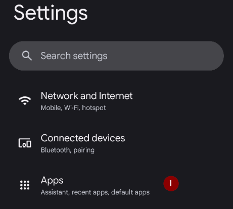
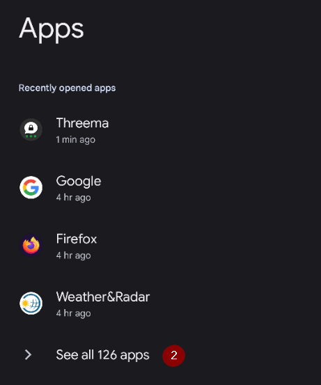
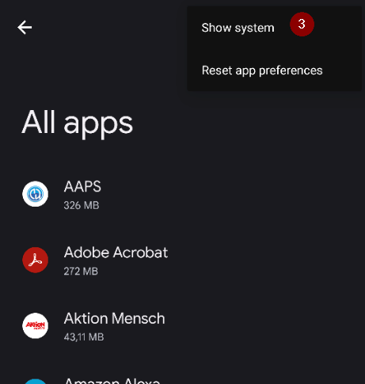
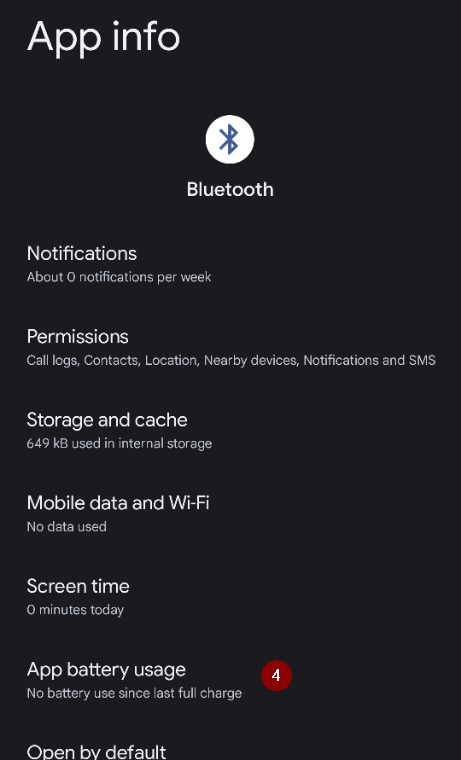
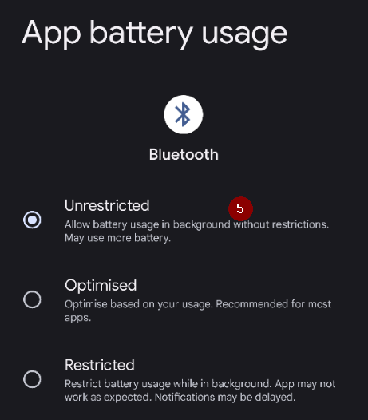
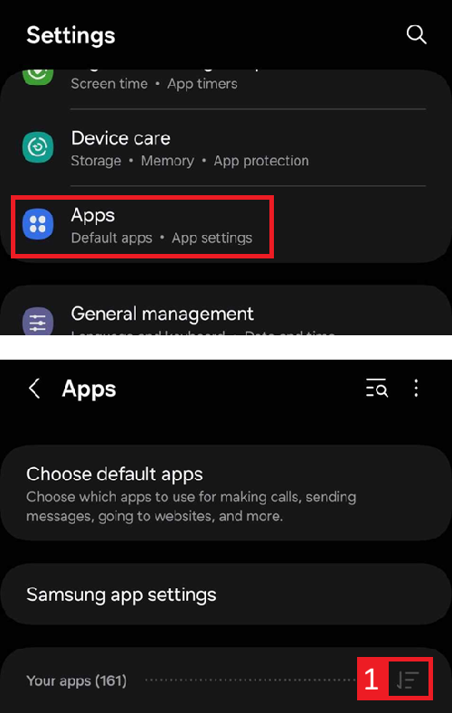
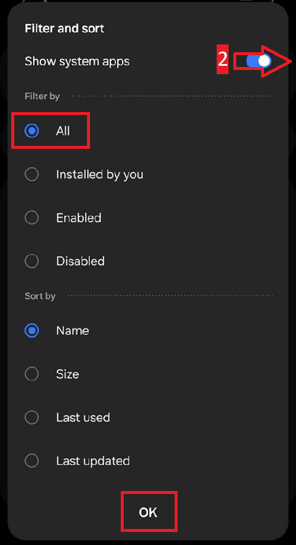
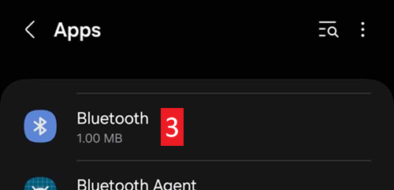
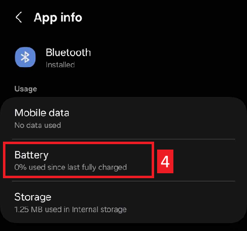
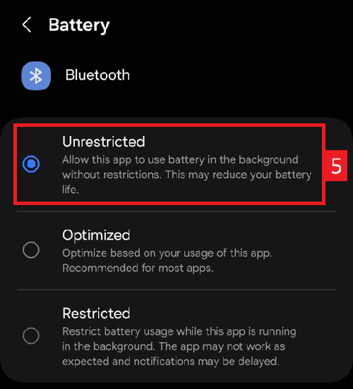

(generaltroubleshooting)=

# Устранение неполадок

**Начните здесь, если что-то не работает.** Информация об устранении неполадок есть на многих страницах документации. Эта страница собирает ее вместе: это один набор ссылок, отсортированных по темам, который поможет решить самые частые проблемы.

Если вы не нашли ответ ниже, посмотрите также:

* [Часто задаваемые вопросы по работе ИПЖ](../UsefulLinks/FAQ.md) – ответы на частые вопросы, и
* [Настройка профиля AAPS](ProfileTuning.md), если цикл работает, но контроль глюкозы нужно улучшить.

```{admonition} Still stuck?
:class: tip
Если ни одна ссылка не решила вашу проблему, см. [Где получить помощь?](WhereCanIGetHelp.md), чтобы спросить сообщество (Facebook, Discord), или отправьте разработчикам свои [файлы журналов](AccessingLogFiles.md).
```

---

(generaltroubleshooting-aaps-app)=

## Приложение AAPS

### Сборка и обновление

* Если сборка не удалась, см. [Если сборка не удалась](#building-aaps-troubleshooting): там указан раздел устранения неполадок для каждого способа сборки:
  * [AAPS Builder](#aaps-builder-troubleshooting)
  * [Сборка через браузер](#aaps-ci-troubleshooting)
  * [Android Studio](TroubleshootingAndroidStudio.md)
* Хранилище ключей потеряно или новое хранилище ключей: [Переустановка AAPS](#reinstall-aaps)
* Обновление **AAPS**: [с AAPS Builder](#aaps-builder-updates), [при сборке через браузер (fork)](#update-browser-build-troubleshooting), [через Android Studio](#update-computer-build-troubleshooting)

### Установка

* [Предупреждение Google Play Защиты](#transferring-installing-play-protect-warning): приложение отмечено как небезопасное.
* Установка **заблокирована** с сообщением о непроверенном разработчике: бесплатные способы установки см. в разделе [Проверка разработчиков Android](#android-developer-verification).

### Настройки

* [Профиль: «Базальная скорость несовместима с текущей помпой»](#your-aaps-profile-basal-not-compatible)
* [Помпа: «Данные поступают с другой помпы»](#config-builder-wrong-pump-data)
* [Nightscout Client](TroubleshootingNsClient.md)
* **«Не удается прочитать настройки AAPS»** при запуске: настройки зашифрованы ключом, который Android хранит для **AAPS**, и этот ключ больше не открывает их, например после сброса хранилища ключей телефона. Пока этот экран показан, **AAPS** не работает и не управляет помпой. Нажмите **Повторить**: **AAPS** закроется и запустится снова. Если это не помогает, перезапустите телефон. Используйте **Начать заново**, только если ничего другого не помогает: нечитаемый файл настроек откладывается в сторону (он переименовывается и сохраняется), и **AAPS** запускается с пустыми настройками. Затем импортируйте последний [экспорт настроек](../Maintenance/ExportImportSettings.md).

### Usage

* [Неверные значения углеводов (медленное усвоение углеводов)](#CobCalculation-detection-of-wrong-cob-values)
* [Автоматизация](#automations-troubleshooting)
* [Автономный замкнутый цикл](#full-closed-loop-troubleshooting)

---

(generaltroubleshooting-bluetooth-related-issues)=


## Проблемы, связанные с Bluetooth

Об известных проблемах с соединением Bluetooth, обрывах связи с помпой или Pod, а также о проблемах активации и соединения см. [Проблемы с Bluetooth](../GettingHelp/BluetoothTroubleshooting.md)

---

(generaltroubleshooting-android-related-issues)=

## Проблемы, связанные с Android

### Оптимизация батареи

**AAPS** может помочь найти правильные настройки для вашего телефона: откройте **меню** (☰) > **О программе** и нажмите **Не останавливать приложение?**. Откроются инструкции для вашей марки телефона на сайте [Don't kill my app](https://dontkillmyapp.com/). [Мастер установки](#setup-wizard-bluetooth-battery-optimisation) тоже просит отключить оптимизацию батареи для **AAPS** и Bluetooth.

В Android есть настройки экономии батареи, которые включены по умолчанию. Эти настройки автоматически приостанавливают приложения, которые не нужны для работы системы, чтобы снизить расход батареи приложениями, которым не нужно работать все время.

Если она включена, это, скорее всего, вызовет проблемы у **AAPS** и других вспомогательных приложений, например **xDrip**.

Важно отключить оптимизацию батареи, чтобы **AAPS** и другие вспомогательные приложения все время оставались активными.

В зависимости от модели и производителя телефона это может понадобиться отключить в нескольких местах и настройках.

***ПРИМЕЧАНИЕ:** Выполните шаги ниже, чтобы отключить оптимизацию батареи для службы Bluetooth, если на вашем телефоне есть такая возможность. Те же шаги подходят для **AAPS** и других приложений, но снимки экрана показывают это только для службы Bluetooth.*

#### Телефоны Pixel (чистый Android)

* Перейдите в настройки Android и выберите «Приложения».

  

* Выберите "Просмотреть все приложения"

  

* В меню справа выберите "Показать системные приложения".

  

* Теперь найдите и выберите приложение "Bluetooth".

  

* Нажмите «Использование батареи приложением» и выберите «Без ограничений» (в некоторых старых версиях Android – «Не оптимизировать»).

  


#### Телефоны Samsung

* Перейдите в настройки Android и выберите "Приложения"

* На значке, который вроде бы изменяет алгоритм сортировки (1), выберите "Показать системные приложения" (2).

  

  

* Теперь найдите приложение Bluetooth и выберите его, чтобы открыть его настройки.

  

* Выберите "Батарея".

  

* Установите «Без ограничений» (в некоторых старых версиях Android – «Не оптимизировать»).

  

#### Телефоны Huawei

См. это руководство: [Bluetooth и оптимизация батареи на Huawei](../CompatiblePhones/Huawei.md)

---

(generaltroubleshooting-cgm)=

## Непрерывный мониторинг гликемии

Полезные ссылки на известные проблемы с CGM и способы их решения.

* [General](#general-cgm-troubleshooting)
* [Dexcom G6](#DexcomG6-troubleshooting-g6)
* [Libre 2 с Minimal Looper](#minimallooper-troubleshooting)
* [Libre 3](#libre3-experiences-and-troubleshooting)
* [xDrip - нет данных CGM](#xdrip-identify-receiver)
* [xDrip - Устранение неполадок Dexcom](#xdrip-troubleshooting-dexcom-g5-g6-and-xdrip)

---

(generaltroubleshooting-pumps)=

## Помпы

Полезные ссылки на известные проблемы с помпами и способы их решения

* [Accu-Chek Combo](#combov2-tips-for-basic-usage)
* [Accu-Chek Insight](#Accu-Chek-Insight-Pump-insight-specific-errors)
* [CareLevo](#carelevo-alarms-and-notifications)
* [DanaRS](#DanaRS-Insulin-Pump-dana-rs-specific-errors)
* [Diaconn G8](#diaconn-g8-bluetooth-troubleshooting)
* [EOPatch2](#eopatch2-alarms-and-warnings)
* [Medtronic + RileyLink](#MedtronicPump-what-to-do-if-i-loose-connection-to-rileylink-and-or-pump)
* [Medtrum Nano](#medtrum-nano-troubleshooting)
* [Помпа Omnipod DASH](#omnipod-dash-troubleshooting)
* [Omnipod Eros](#OmnipodEros-troubleshooting)

---

(generaltroubleshooting-phones)=

## Телефоны

Полезные ссылки на известные проблемы с телефонами и способы их решения

* [Список проверенных телефонов и устройств](https://docs.google.com/spreadsheets/u/1/d/e/2PACX-1vScCNaIguEZVTVFAgpv1kXHdsHl3fs6xT6RB2Z1CeVJ561AvvqGwxMhlmSHk4J056gMCAQE02sAWJvT/pubhtml?gid=683363241&single=true)
* [Jelly](../CompatiblePhones/Jelly.md)
* [Bluetooth и оптимизация батареи на Huawei](../CompatiblePhones/Huawei.md)

---

(generaltroubleshooting-remote-control)=

## Удаленное управление

* [AAPSClient и удаленное управление (сопряжение, команды не доходят)](#client-master-control-troubleshooting)
* [Проблемы с «Кодом доступа Nightscout»](#remotecontrol-nightscout-access-token)
* [SMS-команды](#SMSCommands-troubleshooting)
* [Android Auto](#android-auto-troubleshooting)

---

(generaltroubleshooting-smartwatches)=

## Смарт-часы

Полезные ссылки на известные проблемы со смарт-часами и способы их решения

* [Устранение неполадок в приложении Wear](#Watchfaces-troubleshooting-the-wear-app)
* [Часы и телефон не связываются](#wear-os-watch-phone-communication)
* [Wear OS 5](#wear-os-5-troubleshooting)
* [Сборка приложения AAPS для Wear](#building-aaps-wear-os-troubleshooting)
