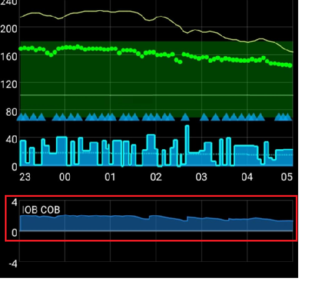
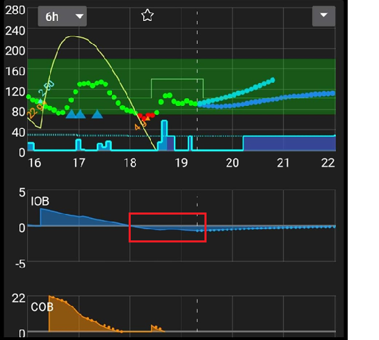
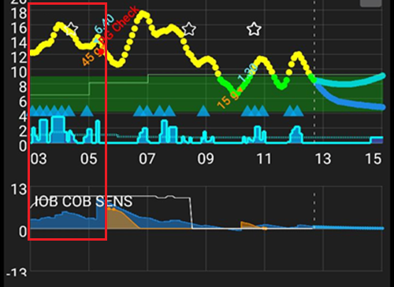
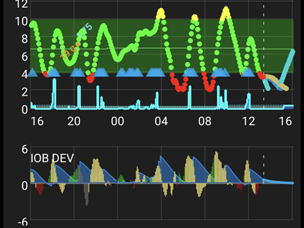
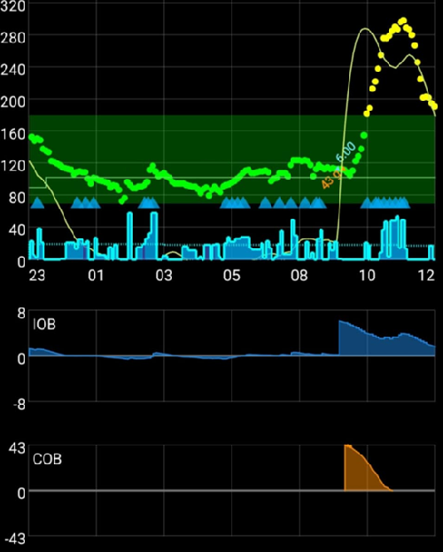

# Настройка профиля AAPS

```{admonition} This is NOT a medical advice
:class: warning
Обращайтесь к вашей медицинской команде за поддержкой и советами по лечению диабета.</br>
Используйте это руководство, только когда вы [правильно настроили свой **профиль**](https://androidaps.readthedocs.io/en/latest/SettingUpAaps/YourAapsProfile.md) и выполнили все цели **AAPS**.
```

Это руководство объясняет логику результатов алгоритма OpenAPS при заданном __профиле__ и рассказывает, какие значения в **AAPS** можно изменить, если вы видите определенные ситуации или повторяющиеся картины. Советы по проверке базала ниже могут отличаться от рекомендаций вашей медицинской команды.

Использование **замкнутого цикла** может облегчить проверку базала и значительно снизить риск гипогликемии, если базал в вашем __профиле__ слишком сильный.

## Как менять настройки профиля

1. Прочитайте и поймите рекомендуемые настройки и советы __AAPS__, приведенные ниже. Если не следовать этим советам, настройка может стать сложной, и хорошо настроенный __профиль__ получить будет труднее
2. Внимательно наблюдайте и сравнивайте **в течение нескольких дней**, что происходит с вашей __ГК__ и __IOB__.
3. Ищите в **AAPS** повторяющиеся картины, которые возникают (почти) каждый день примерно в одно и то же время.
4. Важно делать это в течение нескольких дней. Если решения об изменении __профиля__ принимаются по данным одного дня, результаты обычно плохие.
5. Только когда вы увидели повторяющуюся картину, например в 13:00 у вас скачок __ГК__ или отрицательное значение __IOB__, начинайте вносить небольшие изменения в __профиль__.
6. Важно менять только что-то одно за раз. Например, увеличьте базал на 10% около 13:00.
7. После каждого изменения важно следить за его влиянием на __ГК__ и __IOB__ в течение следующих нескольких дней.
8. Повторяйте этот цикл: наблюдайте, решайте, при необходимости снова корректируйте

Не спешите, действуйте медленно!

## Рекомендуемые настройки и советы при настройке базала

- Проводите все проверки с [включенным замкнутым циклом](#AapsScreens-loop-status).
- **<u>ВЫКЛЮЧИТЕ</u> всю [автоматизацию](../DailyLifeWithAaps/Automations.md)**
- **<u>ВЫКЛЮЧИТЕ</u> [DynISF](#Open-APS-features-DynamicISF), [AutoISF](#Open-APS-features-auto-isf), [AutoSens](#Open-APS-features-autosens)**, чтобы они не пытались подстраивать ваш профиль.
- Во время проверки не выполняйте ручных действий (ручной болюс, временные цели и т. п.): пусть система использует только настройки **профиля**.
- Для [дополнительных графиков](#AapsScreens-section-g-additional-graphs): на графике 1 используйте «Активный инсулин» и «Базал». На графике 2 используйте «Активные углеводы» (и «Изменение чувствительности»). На графике 3 используйте «Отклонения» и «Влияние на ГК». Когда вы просите совета, всегда показывайте их на своих снимках экрана.
- COB=0[*](#profiletuning-cob-zero)

Другие факторы, которых лучше избегать, так как они влияют на данные и могут привести к неверным выводам:
- Никакой физической активности.
- Никакого стресса.
- Никаких болезней.
- Никакой экстремальной погоды, например очень высокой или очень низкой температуры.
- Никаких сбоев сессий помпы или CGM.
- Никаких углеводов, не введенных в систему.

Также обратите внимание:
- Если ваш [профиль базальной скорости](#your-aaps-profile-basal-rates) правильный, то при ГК в целевом диапазоне с COB=0[*](#profiletuning-cob-zero) и IOB=0 вы будете постоянно оставаться в целевом диапазоне, каким бы ни был ваш **ISF** (**ISF** используется, только когда ГК выше вашей целевой **ГК**).
- Нужно смотреть не только текущий **IOB**, но и график **IOB**, чтобы видеть, как **IOB** менялся в последние несколько часов.

(profiletuning-cob-zero)=

***COB = 0**

Это значит, что еда переварена и углеводов в организме больше нет.

**AAPS** может показывать [COB=0, хотя активные углеводы у вас еще есть](../DailyLifeWithAaps/CobCalculation.md).

## Определения [профиля](../SettingUpAaps/YourAapsProfile.md)

Слишком **сильный профиль** означает одно или несколько из следующего:

- Число [ISF](#your-aaps-profile-insulin-sensitivity-factor) слишком маленькое.
- Число [базала](#your-aaps-profile-basal-rates) слишком большое.
- Число [I:C](#your-aaps-profile-insulin-to-carbs-ratio) слишком маленькое.

## Наблюдения за IOB

*Примечание: чтобы видеть IOB за несколько дней, можно также использовать график IOB Loopalyzer в отчетах Nightscout.*

Если через несколько дней вы видите следующие картины, рассмотрите такие изменения:

### IOB положительный

- Базал в **профиле** может быть недостаточно сильным (причиной также могут быть, например, не введенная в систему еда, болезнь, плохое всасывание в месте установки и т. п.)



### IOB отрицательный

- Базовый базал слишком сильный.
- Возможно, это последствия недавней нагрузки или физической активности.


- Предыдущая еда: слишком большой болюс (что привело к очень долгому нулевому временному базалу)



## Наблюдения за целевой ГК

### ГК держится высокой

- Число __ISF__ высокое и недостаточно сильное (рассчитанного инсулина слишком мало)



- Базал в __профиле__ может быть недостаточно сильным (у **SMB** нет достаточного «запаса базала»)
- Возможно, сработало ограничение безопасности ([MaxIOB](#Open-APS-features-maximum-total-iob-openaps-cant-go-over)?), и оно ограничивает введение инсулина. Проверьте на экране модуля **APS** (**Конфигурация → APS → Открыть модуль**); см. [SMB](#Open-APS-features-super-micro-bolus-smb).
- Техническая проблема: всасывание в месте установки, инфузионный набор, ...

### ГК держится низкой

- __ISF__ слишком сильный, и число нужно увеличить
- Базал в __профиле__ слишком сильный (если IOB тоже отрицательный)

### Американские горки (подъемы и спады)

- **ISF** слишком сильный? См. [Ваш профиль AAPS](#your-aaps-profile-insulin-sensitivity-factor)



## Наблюдения за ГК после еды

### Быстрый рост, ГК становится высокой

- В еде есть быстрые углеводы (например, фруктовый сок).
- Попробуйте сделать преболюс или сделать его немного раньше.
- Болюс (IC или процент вводимого болюса) недостаточно сильный.



### Быстрый рост, затем ГК становится низкой

- Попробуйте сделать преболюс; ваш **профиль** может быть слишком агрессивным (избыточная коррекция подъема)
- Болюс слишком сильный.


## [Как рассчитать I:C](#your-aaps-profile-insulin-to-carbs-ratio)

1. Сначала в вашем **профиле** должны быть правильные базовые настройки базала.
2. Начинайте с ГК в целевом диапазоне, лучше без отрицательного IOB.
3. Запишите общее количество введенного инсулина из **Управление → Помпа** (или из истории помпы) и назовите его «начальный инсулин». Очень точно отмерьте известную порцию углеводов и запишите время начала и начальный IOB. Затем введите углеводы и болюс в **AAPS** с помощью мастера (с текущим настроенным I:C). Не забудьте съесть углеводы ;)
4. Через несколько часов, когда COB=0[*](#profiletuning-cob-zero) и вы снова в целевом диапазоне, запишите время окончания и конечный IOB, проверьте, как и раньше, общее количество введенного инсулина и назовите его «конечный инсулин». *ПРИМЕЧАНИЕ: длительность периода НЕ важна, если она больше времени переваривания*
5. Из разницы между начальным и конечным количеством инсулина вычтите или прибавьте разницу «конечный IOB − начальный IOB». Затем вычтите базальный инсулин, рассчитанный по настройкам вашего **профиля**.
6. Если __ГК__ в целевом диапазоне, вы получите общее количество инсулина, которое ушло на «переваривание» углеводов. Рассчитайте ваш **I:C**.

### Пояснения к расчету I:C

- Если в **профиле** правильная базовая базальная скорость, то в любой период вы должны оставаться в целевом диапазоне с IOB около 0. Вы получаете только базал из **профиля**.
- К этому вы добавляете углеводы и болюс. Подождите, пока организм переварит все углеводы и **ГК** вернется к цели. Расход инсулина будет суммой базала и инсулина, нужного на углеводы. Вы рассчитываете инсулин, который ушел на базал (по вашему **профилю**), а остаток будет инсулином, который ушел на углеводы.
- Если период слишком короткий, часть углеводов не будет переварена, и ваш «инсулин, нужный на углеводы» будет неверным.
- Если период слишком длинный, ничего плохого не случится. Все углеводы будут усвоены, и вы просто получите больше базала. В конце вы вычтете базал из общего количества инсулина, поэтому более длинный период (с большим расходом базала) не повлияет на результат.

Первоначально написано @Robby (Discord) как советы по настройке вашего **профиля AAPS**; проверено и отредактировано сообществом (спасибо!).
