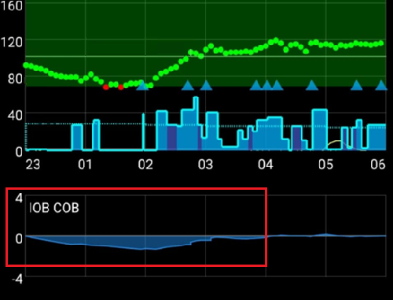

# Tweaking the AAPS' Profile

```{admonition} This is NOT a medical advice
:class: warning
Обращайтесь к вашей медицинской команде за поддержкой и советами по лечению диабета.</br>
Используйте это руководство, только когда вы [правильно настроили свой **профиль**](https://androidaps.readthedocs.io/en/latest/SettingUpAaps/YourAapsProfile.md) и выполнили все цели **AAPS**.
```

This guide explains the logic of the OpenAPS algorithm results with a given __Profile__, and provides information about which values in **AAPS** may be adjusted when certain situations or patterns are observed. The suggestions about basal testing below may diverge from what your care team advises.

Using **closed loop** may make basal testing easier and may significantly reduce the hypo risk if your __Profile__ basal is too strong.

## Changing profile's settings, how to proceed

1. Прочитайте и поймите рекомендуемые настройки и советы __AAPS__, приведенные ниже. Not following this advice may make the adjusting process problematic and less likely to get a well tuned __Profile__
2. Внимательно наблюдайте и сравнивайте **в течение нескольких дней**, что происходит с вашей __ГК__ и __IOB__.
3. Keep an eye out for patterns with **AAPS** that happen around the same time (almost) everyday.
4. Важно делать это в течение нескольких дней. Если решения об изменении __профиля__ принимаются по данным одного дня, результаты обычно плохие.
5. Только когда вы увидели повторяющуюся картину, например в 13:00 у вас скачок __ГК__ или отрицательное значение __IOB__, начинайте вносить небольшие изменения в __профиль__.
6. Важно менять только что-то одно за раз. Например, увеличьте базал на 10% около 13:00.
7. После каждого изменения важно следить за его влиянием на __ГК__ и __IOB__ в течение следующих нескольких дней.
8. Повторяйте этот цикл: наблюдайте, решайте, при необходимости снова корректируйте

Не спешите, действуйте медленно!

## Recommended settings and advice while tweaking basal

- Проводите все проверки с [включенным замкнутым циклом](#AapsScreens-loop-status).
- **<u>ВЫКЛЮЧИТЕ</u> всю [автоматизацию](../DailyLifeWithAaps/Automations.md)**
- **Turn <u>OFF</u> [DynISF](#Open-APS-features-DynamicISF), [AutoISF](#Open-APS-features-auto-isf), [AutoSens](#Open-APS-features-autosens)** so that they will not try to adapt your profile.
- Во время проверки не выполняйте ручных действий (ручной болюс, временные цели и т. п.): пусть система использует только настройки **профиля**.
- For the [additional graphs](#AapsScreens-section-g-additional-graphs): on graph 1, use Insulin On Board and Basal. On graph 2, use Carbs On Board (and Sensitivity change). On graph 3, use Deviations and Blood Glucose Impact. Когда вы просите совета, всегда показывайте их на своих снимках экрана.
- COB=0[*](#profiletuning-cob-zero)

Other considerations that should ideally be avoided, as they influence the data and can lead to poor conclusions:
- Никакой физической активности.
- Никакого стресса.
- Никаких болезней.
- Никакой экстремальной погоды, например очень высокой или очень низкой температуры.
- No failed pump or CGM sessions.
- No unannounced carbs.

Also note:
- If your [basal rate profile](#your-aaps-profile-basal-rates) is correct, when you are on target with COB=0[*](#profiletuning-cob-zero) and IOB=0, you will remain constantly on target whatever your **ISF** (**ISF** is only used when you are higher than your **BG** target).
- You need to check the actual **IOB** but also the **IOB** chart, to observe how the **IOB** evolved during the past few hours.

(profiletuning-cob-zero)=

***COB = 0**

Это значит, что еда переварена и углеводов в организме больше нет.

**AAPS** might indicate [COB=0 while you still have carbs on board](../DailyLifeWithAaps/CobCalculation.md).

## Определения [профиля](../SettingUpAaps/YourAapsProfile.md)

Слишком **сильный профиль** означает одно или несколько из следующего:

- [ISF](#your-aaps-profile-insulin-sensitivity-factor) number is too small.
- The [basal](#your-aaps-profile-basal-rates) number is too big.
- [I:C](#your-aaps-profile-insulin-to-carbs-ratio) number is too small.

## Наблюдения за IOB

*Примечание: чтобы видеть IOB за несколько дней, можно также использовать график IOB Loopalyzer в отчетах Nightscout.*

If you observe the following patterns after a few days, consider the following changes:

### IOB положительный

- Базал в **профиле** может быть недостаточно сильным (причиной также могут быть, например, не введенная в систему еда, болезнь, плохое всасывание в месте установки и т. п.)


### IOB отрицательный

- Default basal too strong.
- May be the effect from past exercise/physical activity.



- Предыдущая еда: слишком большой болюс (что привело к очень долгому нулевому временному базалу)


## Наблюдения за целевой ГК

### ГК держится высокой

- __ISF's__ number is high and not strong enough (calculated insulin is too weak)


- __Profile__ basal might not be strong enough (**SMBs** do not have enough "basal stock" to use)
- Возможно, сработало ограничение безопасности ([MaxIOB](#Open-APS-features-maximum-total-iob-openaps-cant-go-over)?), и оно ограничивает введение инсулина. Verify in the **APS** plugin screen (**Configuration → APS → Open plugin**); see [SMB](#Open-APS-features-super-micro-bolus-smb).
- Техническая проблема: всасывание в месте установки, инфузионный набор, ...

### ГК держится низкой

- __ISF__ слишком сильный, и число нужно увеличить
- Базал в __профиле__ слишком сильный (если IOB тоже отрицательный)

### Американские горки (подъемы и спады)

- **ISF** слишком сильный? См. [Ваш профиль AAPS](#your-aaps-profile-insulin-sensitivity-factor)


## Наблюдения за ГК после еды

### Быстрый рост, ГК становится высокой

- Food contains fast carbs (like fruit juice).
- Consider doing a pre-bolus or a slightly earlier pre-bolus.
- Bolus (IC or injected %) not strong enough.


### Быстрый рост, затем ГК становится низкой

- Consider doing a pre-bolus, your **Profile** might be too aggressive (over correction of the raise)
- Bolus too strong.


## [Как рассчитать I:C](#your-aaps-profile-insulin-to-carbs-ratio)

1. Сначала в вашем **профиле** должны быть правильные базовые настройки базала.
2. Начинайте с ГК в целевом диапазоне, лучше без отрицательного IOB.
3. Record the total insulin given in **Manage → Pump** (or pump history) and call it Start insulin. Очень точно отмерьте известную порцию углеводов и запишите время начала и начальный IOB. Then enter carbs and bolus information into **AAPS** using the wizard (with the current configured I:C). Не забудьте съесть углеводы ;)
4. Через несколько часов, когда COB=0[*](#profiletuning-cob-zero) и вы снова в целевом диапазоне, запишите время окончания и конечный IOB, проверьте, как и раньше, общее количество введенного инсулина и назовите его «конечный инсулин». *ПРИМЕЧАНИЕ: длительность периода НЕ важна, если она больше времени переваривания*
5. Из разницы между начальным и конечным количеством инсулина вычтите или прибавьте разницу «конечный IOB − начальный IOB». Then subtract the basal insulin calculated from your **Profile's** settings.
6. Если __ГК__ в целевом диапазоне, вы получите общее количество инсулина, которое ушло на «переваривание» углеводов. Рассчитайте ваш **I:C**.

### Пояснения к расчету I:C

- Если в **профиле** правильная базовая базальная скорость, то в любой период вы должны оставаться в целевом диапазоне с IOB около 0. Вы получаете только базал из **профиля**.
- К этому вы добавляете углеводы и болюс. Подождите, пока организм переварит все углеводы и **ГК** вернется к цели. Расход инсулина будет суммой базала и инсулина, нужного на углеводы. Вы рассчитываете инсулин, который ушел на базал (по вашему **профилю**), а остаток будет инсулином, который ушел на углеводы.
- Если период слишком короткий, часть углеводов не будет переварена, и ваш «инсулин, нужный на углеводы» будет неверным.
- Если период слишком длинный, ничего плохого не случится. Все углеводы будут усвоены, и вы просто получите больше базала. В конце вы вычтете базал из общего количества инсулина, поэтому более длинный период (с большим расходом базала) не повлияет на результат.

Originally written up by @Robby (Discord) on tips and tricks to help tune your **AAPS Profile**, reviewed and edited by the community (thank you!).
