(reinstall-aaps)=
# Переустановка AAPS с новым хранилищем ключей

Каждый apk **AAPS** подписан **хранилищем ключей**. Обновление устанавливается поверх текущей версии **AAPS**, только если оно подписано **тем же хранилищем ключей**: тогда все ваши настройки и данные сохраняются. Поэтому рекомендуется хранить хранилище ключей и его пароль в надежном месте.

Если вы попытаетесь установить apk, подписанный другим хранилищем ключей, вы получите сообщение об ошибке: установка не удалась!

(reinstall-aaps-when)=
## Когда нужна переустановка?

Удалить и снова установить **AAPS** нужно, если ваш новый apk подписан другим хранилищем ключей, например:

- Вы не можете найти старое хранилище ключей или его пароль.
- Вы создали новое хранилище ключей, например с помощью [варианта 1 сборки через браузер](../SettingUpAaps/BrowserBuildKeystore.md) или кнопки **Создать новый ключ** в [AAPS Builder](../SettingUpAaps/BrowserBuildAapsBuilder.md).
- Вы собираете приложение на новом компьютере и не скопировали на него хранилище ключей.

Если ваше хранилище ключей у вас есть, эта страница вам не нужна: используйте его снова и [обновите **AAPS**](../Maintenance/UpdateToNewVersion.md) поверх старой версии.

(reinstall-aaps-before)=
## Перед началом

- Удаление **AAPS** стирает все его настройки, ваши [цели](../SettingUpAaps/CompletingTheObjectives.md) и текущее подключение к помпе. Вы вернете их, импортировав **файл настроек**, поэтому убедитесь, что у вас есть свежий файл.
- Файл настроек не содержит историю терапии и глюкозы. Если вы загружаете данные в [Nightscout](../SettingUpAaps/SettingUpTheReportingServer.md), после переустановки их можно загрузить обратно (шаг 8).
- Вам нужен [**главный пароль**](#Preferences-master-password): файл настроек зашифрован им. Сброс забытого главного пароля здесь не поможет: файл настроек можно импортировать только с тем паролем, с которым он был экспортирован (см. [Как сбросить главный пароль?](#FAQ-reset-master-password)).
- **Пользователи Omnipod и Medtrum:** сначала прочитайте раздел [Помпы без трубки](#ExportImportSettings-tubeless-pumps). Ваш файл настроек должен быть экспортирован во время работы Pod или патча, который вы носите сейчас.
- При необходимости перед началом [настройте приемник вашего CGM / источника ГК](../Getting-Started/CompatiblesCgms.md).

(reinstall-aaps-steps)=
## Шаги

На рисунках показан переход с **AAPS** 3.4 (шаги 1–3) на **AAPS** 4 (шаги 6–8). В других версиях экраны выглядят немного иначе.

(reinstall-aaps-export)=
### 1. Export your settings

Экспортируйте настройки в **AAPS**, который сейчас установлен на вашем телефоне. Подробнее см. [Экспорт настроек](#ExportImportSettings-Settings-Export).

В **AAPS** 3.4: откройте **Обслуживание** и нажмите **Параметры экспорта**. В разделе **Пользовательские настройки** отметьте **Локальное хранилище** и нажмите **OK**.

*Примечание: для резервной копии на всякий случай можно также использовать [облачное хранилище](#preferences-maintenance-cloud). Это хорошая идея, но оставьте и локальное хранилище, чтобы быстро восстановить настройки.*

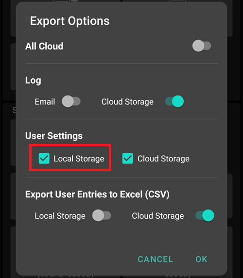

Теперь на кнопке написано **Экспорт настроек (локально)**. Нажмите ее.

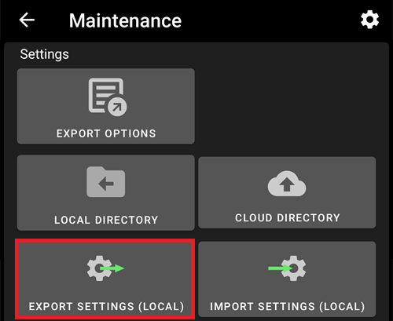

**AAPS** показывает имя файла, который будет создан. Нажмите **OK**, введите главный пароль и нажмите **OK**.

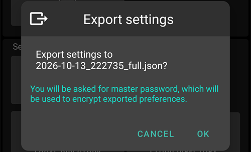

В **AAPS** 4: откройте **Обслуживание**, выберите плашку **Локально** рядом с **Экспорт настроек** и нажмите **Экспорт настроек**.

(reinstall-aaps-copy)=
### 2. Скопируйте файл настроек с телефона

Файл находится в папке **preferences** вашей [папки **AAPS**](#SetupWizard-StoragePermission), его имя похоже на `2026-10-13_222735_full.json`. Скопируйте или загрузите его в другое место (например, на компьютер, в облачное хранилище...). Обычно файл остается на телефоне после удаления приложения, но на всякий случай храните копию в другом месте.

(reinstall-aaps-nightscout-before)=
### 3. Синхронизируйте с Nightscout

Этот шаг не обязателен, но рекомендуется, если вы используете [DynISF](#Open-APS-features-DynamicISF): так вы сможете сразу продолжить с текущими настройками и не ждать 5 дней, пока модуль соберет нужные данные. NSClient V3 должен быть [включен и настроен](../SettingUpAaps/SettingUpTheReportingServer.md).

Перед удалением убедитесь, что в Nightscout есть все ваши данные.

Откройте **клиент NS**, нажмите кнопку **Полная синхронизация** внизу экрана, затем **OK**.

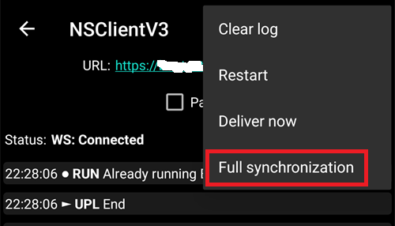

*Примечание: нужное время зависит от сервиса, на котором размещен ваш Nightscout.*

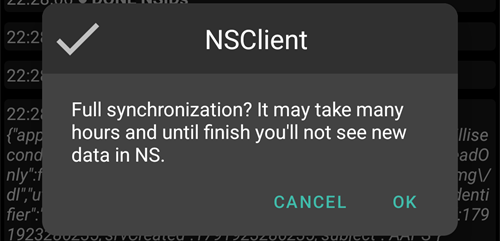

Затем **AAPS** предлагает очистить свою базу данных. **OK** удаляет с телефона данные старше 3 месяцев, и синхронизация проходит намного быстрее. **Отменить** выполняет синхронизацию без очистки. База данных на телефоне все равно удаляется при удалении приложения, поэтому подходят оба варианта.

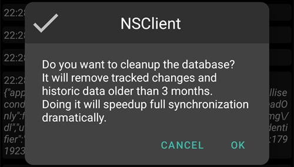

Не закрывайте **AAPS**, пока синхронизация не завершится.

(reinstall-aaps-build)=
### 4. Соберите новый apk

[Соберите](../SettingUpAaps/BuildingAaps.md) новый подписанный apk с новым хранилищем ключей и перенесите его на телефон.

(reinstall-aaps-uninstall)=
### 5. Удалите AAPS

На телефоне откройте **Настройки** > **Приложения** > **AAPS**, нажмите **Удалить** и подтвердите кнопкой **OK**.

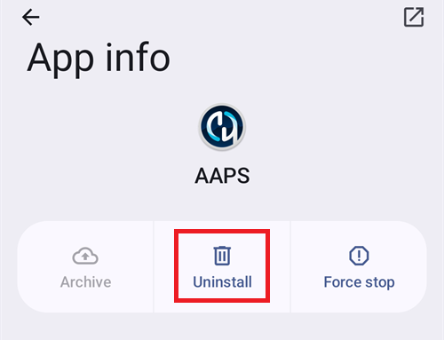

(reinstall-aaps-install)=
### 6. Установите и запустите новый AAPS

[Установите](../SettingUpAaps/TransferringAndInstallingAaps.md) новый apk и запустите **AAPS**. [Мастер установки](../SettingUpAaps/SetupWizard.md) запрашивает разрешения, которые нужны **AAPS**: нажмите **Предоставить** для каждого из них. Так также снова отключается [оптимизация батареи](#setup-wizard-bluetooth-battery-optimisation).

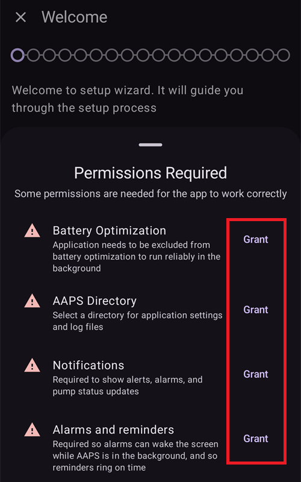

В пункте **Папка AAPS** выберите ту же папку **AAPS**, что и раньше (ту, в которой есть папка **preferences**), нажмите **Использовать эту папку** и **Разрешить**.

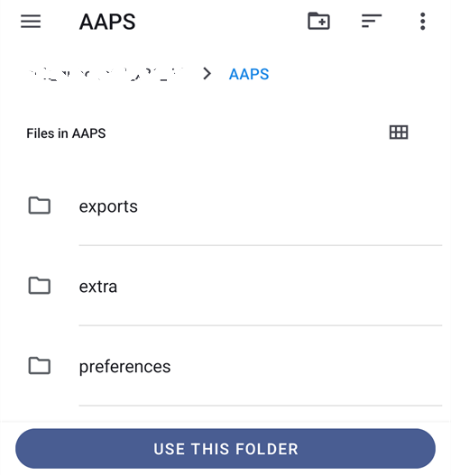

Когда **AAPS** находит экспортированные настройки, мастер установки показывает экран [Найдены сохраненные параметры](#setup-wizard-import-settings), где их можно импортировать. Можно также закрыть мастер и импортировать настройки в разделе **Обслуживание**, как описано ниже.

(reinstall-aaps-import)=
### 7. Import your settings

Если файла настроек больше нет на телефоне, скопируйте его обратно в папку **preferences** вашей папки **AAPS**.

Откройте меню (☰) > **Обслуживание**, выберите плашку **Локально** рядом с **Импортировать настройки** и нажмите **Импортировать настройки**.

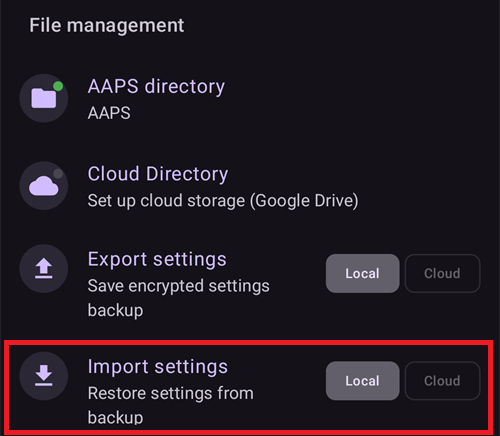

В списке для каждого файла показаны версия **AAPS** и его возраст. Выберите файл, который вы экспортировали на шаге 1.

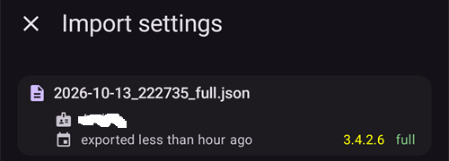

Сначала задавать главный пароль в новом **AAPS** не нужно. Введите главный пароль, который вы использовали при экспорте, в поле **Пароль для расшифровки** и нажмите **Расшифровать**. Сообщение **Файл зашифрован другим паролем** — это нормально: новый **AAPS** еще не знает ваш пароль. Импорт восстановит его вместе с другими настройками.

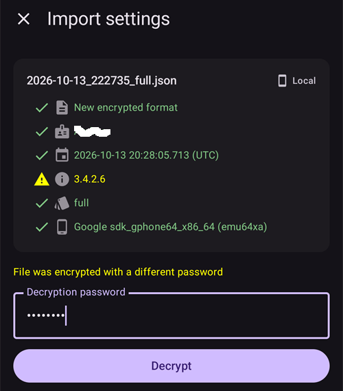

Отметьте **Также заменить настройки помпы**: без этого ваша помпа и ее настройки не будут восстановлены. Пользователи Omnipod и Medtrum: отмечайте это, только если файл был экспортирован во время работы вашего текущего Pod или патча (см. [Помпы без трубки](#ExportImportSettings-tubeless-pumps)).

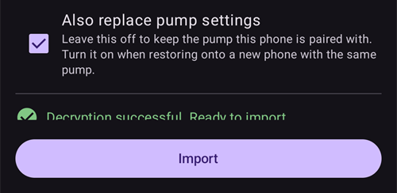

Нажмите **Импортировать**, затем **OK**, чтобы применить настройки, и еще раз **OK** в окне **Настройки применены**.

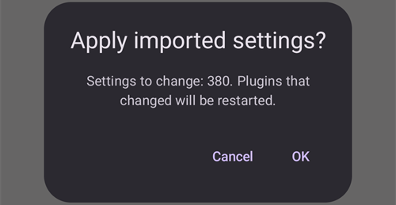

(reinstall-aaps-nightscout-after)=
### 8. Верните историю из Nightscout

Откройте меню (☰) > [**Конфигурация**](../SettingUpAaps/ChangeAapsConfiguration.md) > **Связь** и нажмите **Открыть модуль** под **NSClientV3**. Проверьте, что в статусе указано **Подключено**. Если нет, см. [Устранение неполадок NSClient](TroubleshootingNsClient.md).

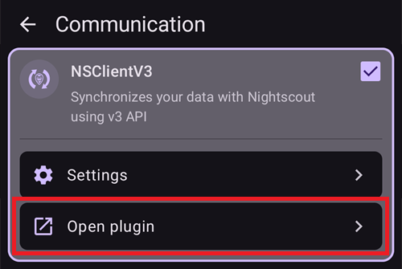

Нажмите кнопку **Полная синхронизация** внизу экрана и **OK**. База данных новая, поэтому на вопрос об очистке можно ответить любым вариантом.

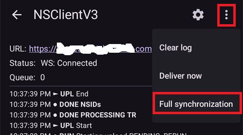

**AAPS** загружает ваши данные из Nightscout. Когда загрузка закончится, в журнале появится **Полная синхронизация завершена**.

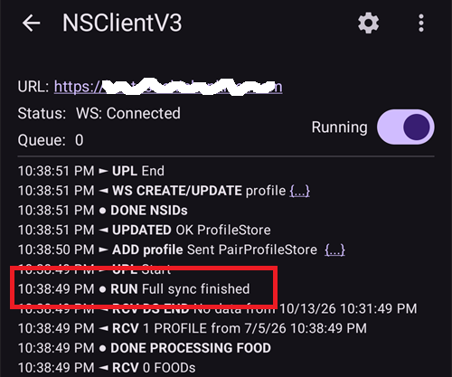

(reinstall-aaps-check)=
### 9. Проверьте работу и продолжайте пользоваться циклом

Проверьте, что помпа подключена и значения CGM поступают, затем продолжайте пользоваться циклом.

(reinstall-aaps-afterwards)=
## После этого

С этого момента всегда используйте новое хранилище ключей и храните его вместе с паролем в надежном месте не на телефоне. См. [Создание и восстановление резервных копий](../Maintenance/ExportImportSettings.md).
