(troubleshooting_androidstudio-troubleshooting-android-studio)=

# Устранение неполадок Android Studio

```{contents} List of common issues
:depth: 2
:local: true
```

(troubleshooting_androidstudio-lost-keystore)=
## Потеряно хранилище ключей
Если вы потеряли хранилище ключей или его пароль, apk, подписанный новым хранилищем ключей, не сможет обновить ваш текущий **AAPS**: его нужно удалить и установить заново. См. [Переустановка AAPS с новым хранилищем ключей](#reinstall-aaps).

## Ошибка синхронизации Gradle
Синхронизация Gradle может завершиться ошибкой по разным причинам. Если вы получили сообщение «gradle sync failed», откройте вкладку «Build» (1) внизу Android Studio и посмотрите, какое сообщение об ошибке (2) там показано.

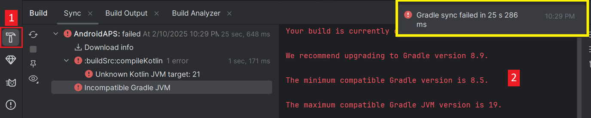

```{contents} Likely reasons for gradle sync failures are:
:depth: 1
:local: true
```

*Важно*: После того как вы выполнили инструкции для вашей проблемы, нужно снова запустить [синхронизацию Gradle](#gradle-resync).

(troubleshooting_androidstudio-uncommitted-changes)=
### Непринятые изменения

Если вы получили такое сообщение об ошибке:

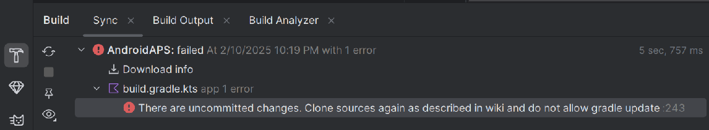

```
Build file 'C:\Data\50-Android\AndroidAPS\app\build.gradle.kts' line: 243

There are uncommitted changes.
Скачайте исходный код заново, как описано в документации, и не разрешайте обновление gradle
```

#### Шаг 1 - Проверьте установку git
  * Откройте вкладку терминала (1) внизу Android Studio, скопируйте следующий текст и вставьте его в терминал (или введите вручную) (2).
    ```
    версия git
    ```

    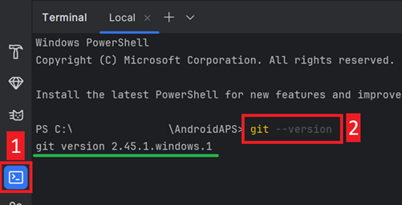

    Примечание: между git и version стоит пробел и два дефиса!

  * Вы должны получить сообщение о том, какая версия Git установлена, как на снимке экрана выше. В этом случае перейдите к [шагу 2](#troubleshooting-android-studio-check-for-uncommitted-changes).

  * Если вы получили сообщение
    ```
    Git: команда не найдена
    ```
    то Git установлен неправильно.

  * [Проверьте установку git](#BuildingAaps-steps-for-installing-git)

  * Если у вас Windows и Git был только что установлен, перезагрузите компьютер, чтобы после установки Git стал доступен везде

  * Если Git установлен, вы перезагрузили компьютер (если у вас Windows), а Git все равно не находится:

  * Выполните поиск в компьютере файла "git.exe".

    Запишите себе, в какой папке он сохранен.

  * Откройте переменные среды в Windows, выберите переменную «PATH» и нажмите «Изменить». Добавьте папку, в которой вы нашли установленный Git.

  * Сохраните и закройте.

  * Перезапустите Android Studio.

(troubleshooting-android-studio-check-for-uncommitted-changes)=
#### Шаг 2: Проверьте незафиксированные изменения.

  * В Android Studio откройте вкладку «Commit» (1) слева. 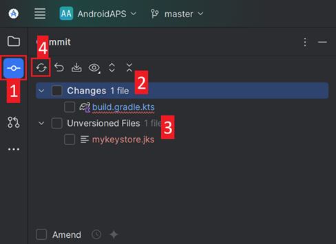
  * Вы увидите либо «Changes» (в старых версиях Android Studio — «Default changeset») (2), либо «Unversioned Files» (3):

    * Если это «Changes», вы, вероятно, обновили Gradle или по ошибке изменили содержимое каких-то файлов.

    * Щелкните правой кнопкой мыши по «Changes» и выберите «Rollback…» (1)

      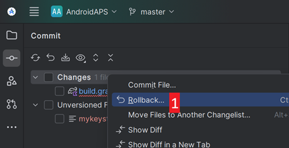

    * Файлы снова загрузятся с Git сервера. Если других изменений на вкладке Commit нет, перейдите к [шагу 3](#gradle-resync).

  * Если вы видите «Unversioned Files», возможно, вы по ошибке сохранили файлы в папке с исходным кодом. Возможно, это важные файлы, например файл хранилища ключей, который нужно перенести в другое место. Если вы не знаете, что это за файлы, и не создавали их сами, их можно удалить.

    * С помощью обычного проводника на компьютере переместите этот файл (или вырежьте и вставьте его) в надежное место.

    * Вернитесь в Android Studio и нажмите кнопку обновления (Refresh) (4) на вкладке Commit, чтобы убедиться, что файла больше нет в папке **AAPS**.

      Если других изменений на вкладке Commit нет, перейдите к [шагу 3](#gradle-resync).


#### Шаг 3: Пересинхронизация Gradle (повторно)

Выполните инструкции из раздела [Повторная синхронизация Gradle](#gradle-resync).

### Git Pull Failed - Please tell me who you are

Если вы видите это сообщение, Git просит вас представиться.

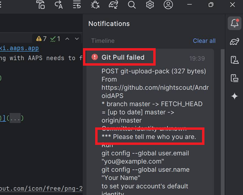

Откройте терминал и введите следующие две команды, одну за другой.

```
git config --global user.name "Your name here"
git config --global user.email your.email@here.com
```

Ваше имя нужно написать в кавычках.

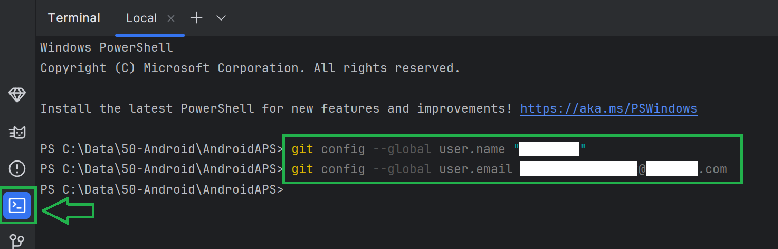

(troubleshooting_androidstudio-android-gradle-plugin-requires-java-11-to-run)=

(incompatible-gradle-jvm)=
### Несовместимая Gradle JVM

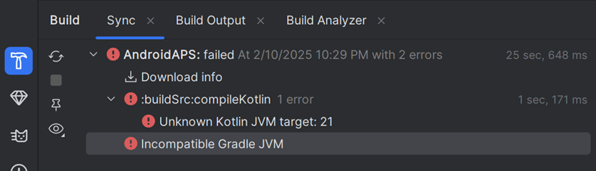

```
Your build is currently configured to use incompatible Java 21.0.3 and Gradle 8.2.
Cannot sync the project.

We recommend upgrading to Gradle version 8.9.

The minimum compatible Gradle version is 8.5.

The maximum compatible Gradle JVM version is 19.
```

Or:

```
Cause: error: invalid source release: 21
```

Если вы видите это сообщение об ошибке, нужно скачать правильную версию JVM, прежде чем пробовать собрать снова:

1.  Посмотрите в [таблице требований](#Building-APK-recommended-specification-of-computer-for-building-apk-file), какая версия JVM нужна для версии **AAPS**, которую вы собираете, и запишите ее.

2. Откройте панель Gradle, нажав на слона (1) справа в Android Studio, откройте настройки (2) и выберите **Gradle Settings** (3):


3.  В поле **Gradle JDK** проверьте, выбрана ли подходящая версия (1). Если нет, нажмите на поле и посмотрите, есть ли она уже в списке. В примере ниже JVM 21 обозначена как «jbr-21». Если вы ее нашли, просто выберите ее, и все готово. Если ее нет, выберите **Download JDK** (2).


4. В поле Version (1) выберите JDK, который нужен для вашей версии **AAPS** (тот, который вы записали, когда смотрели таблицу требований). В поле Vendor (2) выберите любого поставщика. Location (3): не меняйте. Нажмите **Download** (4).

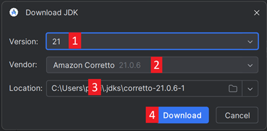

5.  Закройте окно **Settings** кнопкой **OK**.
6. Теперь нужно снова запустить синхронизацию Gradle (Gradle Sync). Выполните инструкции из раздела [Повторная синхронизация Gradle](#gradle-resync).

(incompatible-version-of-android-gradle-plugin)=
### Incompatible version of Android Gradle plugin

  Если вы сталкиваетесь со следующими ошибками

`The project is using an incompatible version (AGP x.x.x) of the Android Gradle plugin. Latest supported version is AGP x.x.x`

  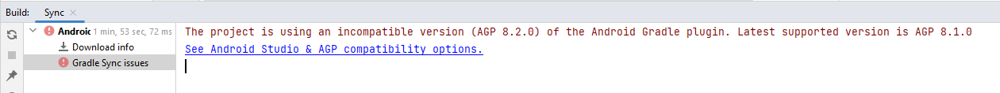

  Вы используете устаревшую версию Android Studio. В меню выберите Help > Check for updates и установите все найденные обновления Android Studio и ее плагинов.

(troubleshooting_androidstudio-could-not-resolve-no-cached-version)=
### Не удалось разрешить/Нет кэшированной версии

  Вы можете столкнуться с этой ошибкой:

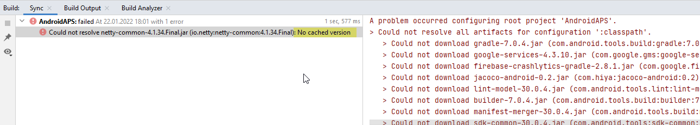

  * С правой стороны откройте вкладку Gradle (1).

    Убедитесь, что кнопка, показанная на (2), *НЕ* выбрана.

    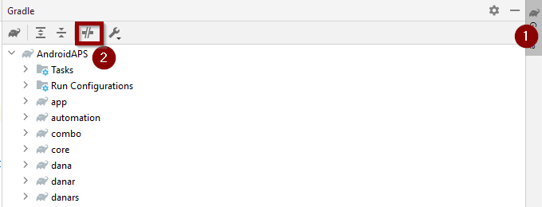

  * Теперь нужно запустить [повторную синхронизацию Gradle](#gradle-resync)

(troubleshooting_androidstudio-unable-to-start-daemon-process)=
### Не удается запустить демон процесс

  Если вы видите подобное сообщение об ошибке, вы, вероятно, используете ОС Windows 10, 32-bit. Android Studio 3.5.1 и новее это не поддерживает, и, к сожалению, разработчики **AAPS** ничего не могут с этим сделать!

  В интернете есть информация о том, как узнать, 32-битная у вас ОС или 64-битная, например [эта статья](https://support.microsoft.com/en-us/windows/32-bit-and-64-bit-windows-frequently-asked-questions-c6ca9541-8dce-4d48-0415-94a3faa2e13d).

  

(gradle-resync)=
### Повторная синхронизация Gradle

  Если вы все еще видите сообщение о том, что синхронизация gradle не удалась, выберите ссылку **Try again** (1). 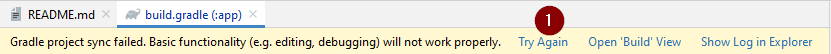


  Если вы больше не видите это сообщение, синхронизацию все равно можно запустить вручную:

  * Откройте вкладку Gradle (1) на правой границе Android Studio.

    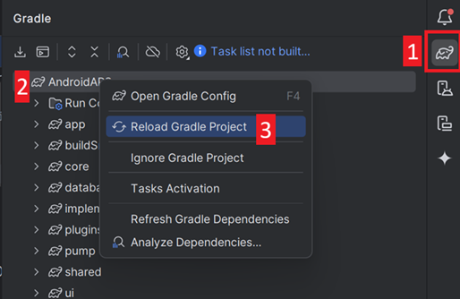

  * Щелкните правой кнопкой мыши по AAPS (2)

  * Нажмите «Reload Gradle Project» (3).

## Generate Signed APK успешно сгенерировано с 0 вариантами сборки

При создании подписанного apk вы можете получить уведомление, что создание прошло успешно, но было создано «0 build variants»:

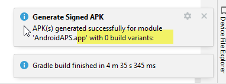

Это неверное предупреждение. Откройте папку, которую вы выбрали как «Destination folder» при создании APK (шаг [Generate Signed APK](#Building-APK-generate-signed-apk)), и вы найдете там созданный apk!


## Приложение было создано с предупреждениями компилятора/kotlin

Если ваша сборка успешно завершена, но получено предупреждения компилятора или kotlin (обозначенные желтым или синим восклицательным знаком), то эти предупреждения можно просто проигнорировать.

 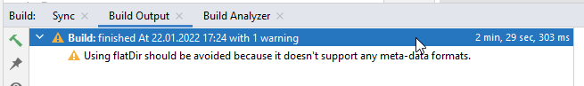

Ваш apk успешно собран, его можно перенести на телефон!


## AAPS не получает данные мониторинга CGM

* Если вы используете пропатченное приложение Dexcom G6: это приложение устарело. Вместо него используйте приложение [BYODA](#DexcomG6-if-using-g6-with-build-your-own-dexcom-app).

* Если вы используете xDrip: настройте определение получателя, как описано на [странице настроек xDrip](#xdrip-identify-receiver).


## Apk не устанавливается

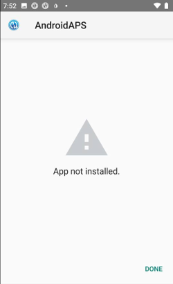

* Убедитесь, что вы передали файл «app-full-release.apk» на телефон.
* Обычно эта ошибка значит, что новый apk подписан другим хранилищем ключей, чем установленный **AAPS**. Если у вас еще есть прежнее хранилище ключей, выберите его и соберите apk снова. Иначе см. [Переустановка AAPS с новым хранилищем ключей](#reinstall-aaps).
* Если на телефоне появилось сообщение "приложение не установлено", то выполните следующее:

1. [Экспорт настроек](../Maintenance/ExportImportSettings.md) (в версии AAPS, которая уже установлена на телефоне)
2. Удалите **AAPS** с телефона.
3. Включите режим полета и выключите Bluetooth.
4. Установите новую версию («app-full-release.apk»)
5. [Выполните импорт настроек](../Maintenance/ExportImportSettings.md)
6. Снова включите Bluetooth и выключите режим полета

## Apk установлен, но версия старая

Если вы успешно собрали приложение, перенесли его на телефон и установили, но номер версии остался прежним, возможно, вы забыли [обновить локальную копию](#Update-to-new-version-update-your-local-copy)

## Ничего из вышеперечисленного не сработало

Если ни один из советов выше не помог, попробуйте собрать apk заново:

1. [Экспорт настроек](../Maintenance/ExportImportSettings.md) (в версии AAPS, которая уже установлена на телефоне)

2. Have your key password and key store password ready.

    Или просто создайте новый файл хранения ключей.

3. Соберите apk заново, как описано [здесь](#Building-APK-download-AAPS-code).

4. Когда apk будет успешно собран, удалите старый apk на телефоне, перенесите новый apk на телефон и установите его.
5. Снова выполните [импорт настроек](../Maintenance/ExportImportSettings.md), чтобы восстановить ваши цели и настройки.
6. Проверьте параметры оптимизации батареи и отключите их снова.

## Сценарий худшего варианта

Если это не решило проблему со сборкой, можно попробовать полностью удалить Android Studio и собрать все заново.  Некоторым пользователям это помогает решить проблему со сборкой.  При удалении Android Studio не удаляйте пользовательские настройки Android и **обязательно удалите все файлы, связанные с Android Studio.** Если не удалить Android Studio полностью, со всеми скрытыми файлами, удаление может вызвать новые проблемы вместо того, чтобы решить старые. Руководства по полной деинсталляции можно найти в Интернете, напр.

[https://stackoverflow.com/questions/39953495/how-to-completely-uninstall-android-studio-from-windowsv10](https://stackoverflow.com/questions/39953495/how-to-completely-uninstall-android-studio-from-windowsv10).

Установите Android Studio заново, как описано [здесь](#Building-APK-install-android-studio).
