# Создание и восстановление резервных копий

Когда вы устанавливаете AAPS на телефон, он становится «медицинским устройством», на которое вы полагаетесь каждый день. Настоятельно рекомендуется иметь резервный план на экстренный случай: если телефон сломается, его украдут или вы его потеряете. Therefore, it is essential to prepare by asking yourself: "What if?"

Чтобы восстановить настройку AAPS на имеющемся или новом телефоне, важно хранить следующие элементы в надежном месте (то есть не на телефоне). Лучше всего хранить как минимум две отдельные резервные копии: на локальном жестком диске, USB-накопителе и (предпочтительно) в облачном хранилище, например Google Диск или Microsoft 365 OneDrive. Если хранить резервные копии в облаке, у вас всегда будет доступ ко всему нужному с телефона, чтобы восстановить настройку где угодно и когда угодно.

Подумайте о запасном резервном телефоне и потренируйтесь восстанавливать на нем AAPS, чтобы убедиться, что запасной телефон работает как нужно. Этот шаг даст вам уверенность, что ваш план действий в экстренной ситуации работает и что вы сможете без перерыва продолжить пользоваться AAPS, если ваш основной телефон станет недоступен.

```{admonition} Android backups and phone-transfer tools do not carry your AAPS settings
:class: warning
Since **AAPS** 4.0 the settings are kept in an encrypted store on the phone, and they are left out of the Google backup and of the phone-to-phone transfer of a new phone. A settings export, as described on this page, is the only way to carry them over.
```

Для восстановления важно иметь под рукой следующее:

- Ваш **файл хранилища ключей Android Studio** и его **пароль**: нужны для (повторной) сборки установочного файла AAPS .APK.
- Свежая копия **установочного файла AAPS .APK**
- Свежий файл **экспорта настроек**: для восстановления важных настроек (в том числе ваших целей!).
- Ваш **главный пароль AAPS**
- Backups of additional utilities: Such as BYODA and/or xDrip.
- Личные заметки о вашей настройке.

Ниже перечислены элементы, для которых рекомендуется хранить резервные копии.

## Создание резервных копий

### Файл хранилища ключей с компьютера, на котором вы собирали APK
При сборке установочного файла .APK в Android Studio используются **файл хранилища ключей и пароль, чтобы подписать установочный файл .APK**. Чтобы обновить текущую установку AAPS, установочный файл обновления .APK нужно подписать тем же хранилищем ключей, что и при первой установке. При обновлении все настройки и база данных AAPS сохраняются. Note that without this, you are required to first uninstall the current application and then [reinstall](#reinstall-aaps) and reconfigure AAPS.

Если вы сохраните хранилище ключей и его пароль, обновлять APK в будущем будет намного проще, особенно если нужно собрать приложение на новом компьютере. Подробнее об использовании хранилища ключей при сборке нового APK см. в разделе [Обновление до новой версии или ветки](../Maintenance/UpdateToNewVersion.md).

**Когда делать резервную копию:** сделайте резервную копию хранилища ключей после первой сборки установочного файла .APK **AAPS**.

**Как сделать резервную копию:** найдите путь к хранилищу ключей. Если вы его не помните, его можно найти в Android Studio, выбрав **Build > APK > Next**. Путь будет указан в поле “Key store path”. С помощью файлового менеджера перейдите по этому пути и сделайте копию файла хранилища ключей (с расширением `.jks`). Сохраните его в надежном облачном хранилище на случай, если ваш компьютер станет недоступен. Обязательно запишите также пароль хранилища ключей, псевдоним ключа (key alias) и пароль ключа.

### Копии последнего APK
Если ваш основной телефон с **AAPS** потерян или поврежден, копия APK позволит быстро продолжить работу с **AAPS** на новом телефоне. Примечание: вам также понадобится резервная копия настроек, как описано ниже.

**Когда делать резервную копию:** храните резервную копию последнего APK, который вы установили на основной телефон с **AAPS**. Возможно, стоит хранить также одну более раннюю версию на случай, если по какой-либо причине понадобится вернуться к ней.

**Как сделать резервную копию:** храните копию на компьютере, на котором вы собирали APK в Android Studio. Кроме того, рекомендуется хранить копию установочного APK в облачном хранилище. Убедитесь, что вы знаете, где найти обе резервные копии, когда они понадобятся. Подумайте о том, чтобы создать отдельные папки для хранения этих резервных копий.

### Файл настроек AAPS (его также называют «Preferences»)

```{admonition} Where are preferences stored on my phone?
:class: tip
You will find your settings in the **AAPS Directory** you have selected during [AAPS setup](#SetupWizard-StoragePermission).</br>
You can also change the **AAPS directory** on the **Maintenance** screen (**menu** (☰) > **Maintenance**), see [Setting the local AAPS directory](#preferences-maintenance-logdirectory).
```

С копией установочного файла APK (см. выше) и файлом **Настроек** вы сможете быстро начать работу на имеющемся или новом телефоне.

Файл **Настроек** используется, чтобы настроить приложение AAPS под вашу конкретную систему. They encompass details such as your **Configuration** settings, objective status, third-party communication settings (e.g., Nightscout, Tidepool), automations, and profiles.

Экспорт настроек AAPS в файл позволяет восстановить конфигурацию на определенный момент времени. Как уже сказано, кроме всех параметров конфигурации, файл экспорта содержит также состояние ваших целей, которое нужно восстановить при **(повторной) установке** AAPS. Без него вам придется заново пройти все цели с самого начала, чтобы включить замкнутый цикл. Файлы настроек также позволяют восстановить «последние рабочие» настройки, чтобы отменить изменения конфигурации.

**Когда делать резервную копию настроек AAPS:**
* Каждый раз, когда вы выполняете цель, чтобы не потерять свой прогресс. _Без копии ваших **Настроек** вам придется снова пройти все цели, если нужно переустановить AAPS или заменить телефон._

* Каждый раз, когда вы планируете существенно изменить конфигурацию (изменить настройки SMB, тип инсулина, помпу, автоматизации), сделайте резервную копию **Настроек** до и после изменений. Так у вас будут самые последние настройки, а также копия того, какими они были до изменений, если понадобится к ним вернуться.

* Tubeless pumps (Such as Omnipod and Medtrum) users only: the **Settings** file contains connection details on your current pod and can be used to restore connection to that pod with a new phone. Если у вас нет копии настроек, экспортированной после запуска текущего Pod, то при замене телефона вам придется запустить новый Pod.

**Как сделать резервную копию вручную:**

1. If this is your first time importing or exporting **Settings** you will need to set a master password in [Settings > Protection](#Preferences-master-password). Задайте пароль и запишите его в надежном месте. _Без этого пароля вы не сможете открыть резервные копии **Настроек**._

2. From the **AAPS** main screen, open the **menu** (☰) > **Maintenance**. Choose where to save the file with the **Local** and **Cloud** chips next to **Export settings** (see **Exporting or Importing Settings** below), then tap **Export settings**. **AAPS** shows where the file will go: the file name for **Local**, **Google Drive** for **Cloud**. Tap **OK**.

   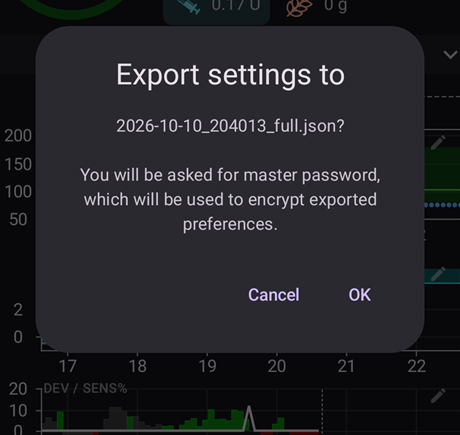

   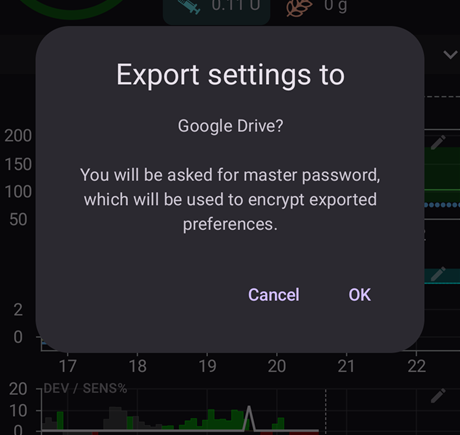

   Type the master password set above and tap **OK**.

   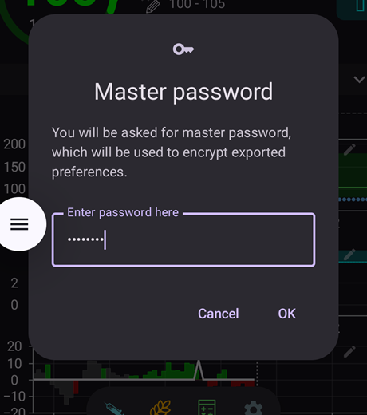

   **Settings exported** (local) or **Cloud export successful** (cloud) confirms the export.

   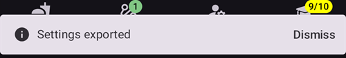

   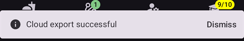

3. С помощью файлового менеджера на телефоне (обычно он называется «Файлы» или «Мои файлы») перейдите: Внутренняя память > AAPS > preferences. Здесь вы увидите копии всех экспортированных файлов настроек. Имя файла должно быть `YYYY-MM-DD_Time_appname.json`. Загрузите этот файл в облачное хранилище, которое вы выбрали. Затем скачайте копию из облачного хранилища также на свой компьютер.

(ExportImportSettings-Settings-Export)=

## Settings Export

```{admonition} Where are preferences stored on my phone?
:class: tip
You will find your settings in the **AAPS Directory** you have selected during [AAPS setup](#SetupWizard-StoragePermission).</br>
You can also change the **AAPS directory** on the **Maintenance** screen (**menu** (☰) > **Maintenance**), see [Setting the local AAPS directory](#preferences-maintenance-logdirectory).
```

Рекомендуется регулярно экспортировать настройки, особенно до и после изменения конфигурации. Экспорт можно выполнять **вручную или (предпочтительно) с помощью автоматизации**. Обязательно запишите главный пароль AAPS и сделайте резервную копию файлов настроек: скопируйте их с телефона, например, в облачное хранилище.

**Примечание**: _Экспортированные настройки шифруются вашим главным паролем AAPS: без главного пароля, который использовался при экспорте, вы не сможете импортировать файл настроек!_

If you forgot your master password, you can [reset it](#FAQ-reset-master-password), but settings files exported with the old password still need the old one.

### Экспорт или импорт настроек
To export or import settings, open the **menu** (☰) and select **Maintenance**. Under **File management**, the **Local** and **Cloud** chips next to **Export settings** and **Import settings** choose where the settings file is saved to or read from: **Local** is the AAPS directory on your phone, **Cloud** is available once a [Cloud Directory](#preferences-maintenance-cloud) is set up. Tapping a chip turns it on or off; at least one always stays selected, and both rows share the same choice. Then tap **Export settings** or **Import settings** itself to start.

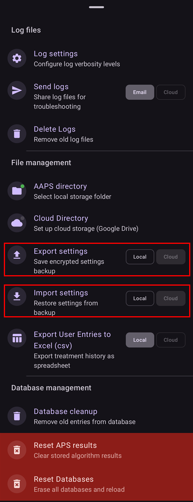

(ExportImportSettings-Automating-Settings-Export)=
### Автоматизация экспорта настроек

To automate settings exports [(**see Automation**)](../DailyLifeWithAaps/Automations.md#automating-preference-settings-export) open [**Settings** > **Maintenance**](#preferences-maintenance-settings), expand **Unattended Settings Export** and switch on **Enable automated settings export**.

Теперь вы можете настроить [Автоматизацию](../DailyLifeWithAaps/Automations.md#automating-preference-settings-export), чтобы экспортировать настройки регулярно (_например,_ каждую неделю) или после замены Pod.

_**Note:** On importing settings, the user always needs to enter the AAPS master password!_

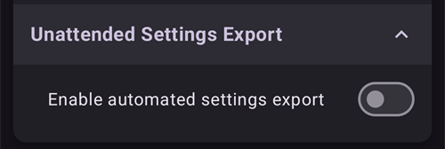

(ExportImportSettings-restoring-from-your-backups-on-a-new-phone-or-fresh-installation-of-aaps)=
## Восстановление из резервных копий на новом телефоне или в новой установке AAPS

```{admonition} Where are preferences stored on my phone?
:class: tip
You will find your settings in the **AAPS Directory** you have selected during [AAPS setup](#SetupWizard-StoragePermission).</br>
You can also change the **AAPS directory** on the **Maintenance** screen (**menu** (☰) > **Maintenance**), see [Setting the local AAPS directory](#preferences-maintenance-logdirectory).</br>
If **AAPS** loses access to that directory (this can happen after a reinstall or after clearing the app's storage), it shows an **Access to the AAPS directory was lost** notification and stops saving settings to the phone until you [select the directory again](#preferences-maintenance-logdirectory).
```

Use these instructions if you have a back-up of your APK and **Settings** that you want to load on to a new phone or if you needed to delete and reinstall the APK on your existing phone for any reason.

_Если вы обновляете **AAPS** с помощью APK, собранного с тем же хранилищем ключей, этот процесс вам не нужен. Однако перед установкой обновления все равно рекомендуется создать резервную копию._

Если вы обновляете **AAPS** после того, как потеряли или заменили исходное хранилище ключей (например, собираете на новом компьютере, не перенеся хранилище ключей), обязательно сделайте резервную копию всех настроек, как описано выше, а затем удалите текущую версию **AAPS** с телефона. See [Reinstalling AAPS with a new keystore](#reinstall-aaps) for the full procedure.

При необходимости перед выполнением шагов ниже [настройте приемник вашего CGM/источника ГК](../Getting-Started/CompatiblesCgms.md)

(ExportImportSettings-tubeless-pumps)=
```{admonition} Tubeless pumps (Omnipod and Medtrum) users
:class: warning
The **Preferences** file contains the session of the pod or patch that was active when you exported it.
- **Export right after every pod or patch activation** and copy the file off your phone.
- **Same phone, pod still running:** leave **Also replace pump settings** unticked. Your current pod is kept and only the other settings are imported.
- **New phone taking over the pod:** tick **Also replace pump settings**, and only use a file exported during the pod you are wearing now. A file from an earlier pod replaces your current pod session, and you will need to start a new pod.
- **An old pod session was imported by mistake:** **AAPS** keeps trying to reach that pod and you cannot activate a new one. Deactivate it; if that fails, discard it (see for example [Discarding a pod](#omnipod-dash-discard-pod) for Omnipod DASH).
```

```{admonition} Pump settings are kept unless you say otherwise
:class: note
By default, an import leaves your pump settings alone: the pump selected in **Configuration**, its pairing and all its other settings stay as they are on this phone. Tick **Also replace pump settings** on the import screen only when you restore onto a new phone that should take over the same pump. Settings that are not in the file are never deleted by an import.
```

1. С помощью резервной копии APK (см. выше) выполните инструкции для [новой установки](../SettingUpAaps/TransferringAndInstallingAaps.md)

2. Запустите **AAPS** и дайте все запрошенные разрешения

3. Выйдите из Мастера установки. We will be importing all the necessary settings from the back-up copy of **Settings**

4. From the **AAPS** main screen press **Grant** and allow all permissions listed in the **Permissions Required** panel on the top

5. From the **AAPS** main screen, set the master password in [Settings > Protection](#Preferences-master-password) to the same password as you used with your back-ups.

6. If you haven't done it yet, [set the **AAPS directory**](#preferences-maintenance-logdirectory): from the **AAPS** main screen, open the **menu** (☰) > **Maintenance** > **AAPS directory**.

7. From the **AAPS** main screen, open the **menu** (☰) > **Maintenance** > **Export settings** > type in the master password set above > **OK**. Это создаст папку preferences, если ее еще нет на вашем телефоне.

8. Скачайте резервную копию файла **Настроек** из облачного хранилища.

9. С помощью файлового менеджера (обычно он называется «Файлы» или «Мои файлы») переместите файл из папки загрузок в `/internal storage/AAPS/preferences`, если ваша **Папка AAPS** задана как `/internal storage/AAPS`

10. From the **AAPS** main screen, open the **menu** (☰) > **Maintenance** and tap **Import settings**. Select the preferences file you want to restore from (the newest is at the top). Make sure you select the correct preferences file, all .json files from the preferences folder (or from the cloud directory, with **Cloud**) will be shown.

    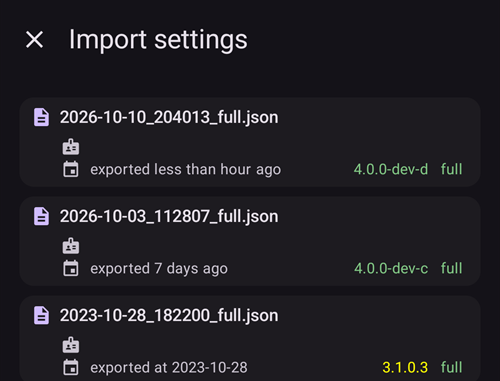

    **AAPS** shows the details of the file. Type the master password set above and tap **Decrypt & Review**.

11. Once the file is decrypted, decide what to do with the pump settings. On a new phone that takes over the same pump, tick **Also replace pump settings** so the pairing and the pump settings come from the file. Leave the box unticked to keep the pump this phone is already paired with. Then tap **Import**.

    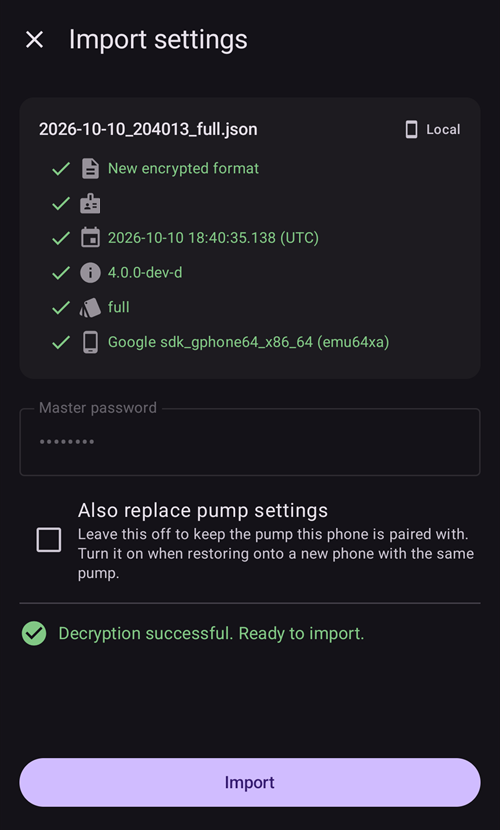

12. **AAPS** asks **Apply imported settings?** and tells you how many settings will change and, if you left the box unticked, how many pump settings are kept. Nothing has been written yet, so **Cancel** leaves your phone exactly as it was. Tap **OK** to apply.

    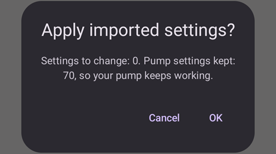

13. **AAPS** applies the imported settings straight away, without restarting. Only the plugins whose settings changed are restarted. While this runs, **AAPS** shows **Applying settings…**; if the pump is busy, it shows **Waiting for pump…** and applies the settings once the pump is idle. If the pump is still busy after one minute, **AAPS** offers to try again. A **Settings applied** message confirms that the imported settings are in use. Any treatment you had queued while the import ran is dropped and **AAPS** tells you that it was cancelled, so nothing is sent to the pump twice.

    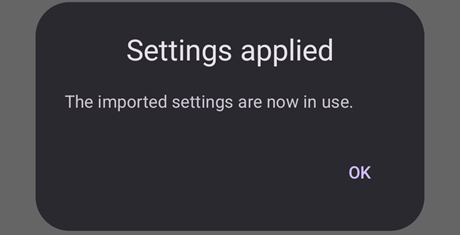

If the file selected a pump that this version of **AAPS** does not have, **AAPS** falls back to the **Virtual Pump** and tells you so. Select your pump again in **Configuration** and check its settings.

14. Tubeless pumps (Omnipod and Medtrum) users only - if you ticked **Also replace pump settings** and your **Preferences** were not backed up from the same pod you are currently using, you will need to start a new pod to begin insulin delivery.

**Troubleshooting:** if you are unable to get an active profile set from the **AAPS** main screen, open the **menu** (☰) in the top left > **Configuration** > **Pump** > switch to **Virtual Pump** > then switch back to your pump type

### Примечание для пользователей Dana RS

- If you ticked **Also replace pump settings**, the pump connection settings are imported too: **AAPS** on your new phone will already "know" the pump and therefore not start a Bluetooth scan.
- Выполните сопряжение нового телефона и помпы вручную.