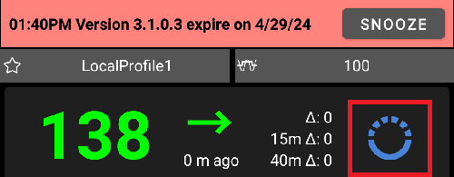
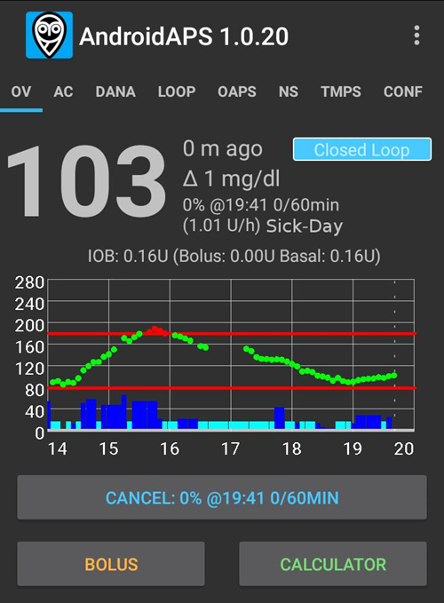

# Примечания к изменениям в версиях

```{toctree}
:hidden:

Update2_7.md
Update3_0.md
UpdateAaps3204.md
```

Чтобы обновиться до новой версии, следуйте инструкциям в [руководстве по обновлению](UpdateToNewVersion.md). Раздел устранения неполадок на странице руководства по обновлению также описывает самые частые трудности при обновлении **AAPS**.

```{admonition} Upgrading from AAPS v3?
:class: tip
Важные изменения в поведении — функции, которые были перемещены, переименованы или удалены, — см. на странице [Что изменилось в AAPS v4](V4Changes.md).
```

Когда доступно новое обновление, вы получите такое уведомление:



Если вы не обновитесь до даты окончания срока действия, **AAPS** перейдет в режим открытого цикла.

Даты окончания поддержки версий AAPS см. на странице [Окончание поддержки](EndOfLife.md).

**Не игнорируйте это уведомление.** Новые версии **AAPS** содержат важные исправления безопасности. Поэтому каждый пользователь **AAPS** должен как можно скорее обновиться до последней версии. Это попытка повысить безопасность каждого пользователя **AAPS** и всего сообщества DIY. Спасибо за понимание.

(maintenance-android-version-aaps-version)=

## Версия Android и версия AAPS

Если на вашем смартфоне версия Android старше Android 12, вы не сможете использовать AAPS v3.4 и новее, так как нужен как минимум Android 12.

Чтобы пользователи более старой версии Android могли применять старые версии AAPS для них была изменена только проверка версий. Никаких других улучшений не включено.

Найдите свою версию Android в таблице ниже и используйте подходящую версию **AAPS**. Код скачивается с <https://github.com/nightscout/AndroidAPS> из указанной ветки.

| Ваша версия Android | Какую версию AAPS использовать | Ветка для скачивания                                              |
| ------------------- | ------------------------------ | ----------------------------------------------------------------- |
| Android 12 and up   | Последняя версия               | [master](https://github.com/nightscout/AndroidAPS) (по умолчанию) |
| Android 11          | **3.3.2.1**                    | [3.3.2.1](https://github.com/nightscout/AndroidAPS/tree/3.3.2.1)  |
| Android 9, 10       | **3.2.0.4**                    | [3.2.0.4](https://github.com/nightscout/AndroidAPS/tree/3.2.0.4)  |
| Android 8           | **2.8.2.1**                    | [2.8.2.1](https://github.com/nightscout/AndroidAPS/tree/2.8.2.1)  |
| Android 7           | **2.6.2**                      | [2.6.2](https://github.com/nightscout/AndroidAPS/tree/2.6.2)      |

## Версия WearOS

- Для AAPS нужна WearOS 3.0, 3.2 или 3.5 (Android 11, API level 30) или новее. Часы с WearOS 2 не поддерживаются.

```{tip}
WearOS 5, API level 34 (Android 14) имеет [ограничения](#BuildingAapsWearOs-WearOS5).
```

Версии с заголовком — последний выпуск для каждой версии Android (см. таблицу выше). Остальные выпуски идут между ними, с их описанием или ссылкой на него на GitHub.

(latestrelease)=

(version400)=

## Version 4.0.0

Release date: 31-10-2026

**Новые функции**

- Новый интерфейс: приложение для телефона переписано на Jetpack Compose @MilosKozak
- [Глобальный поиск](../DailyLifeWithAaps/GlobalSearch.md) @MilosKozak
- Переход на Kotlin Multiplatform, клиент для Windows, Mac, Linux (компьютер) и iOS @MilosKozak
- [Сценарии](../DailyLifeWithAaps/Scenes.md): сохраните набор действий и запускайте их вместе @MilosKozak
- [Управление «основной телефон ↔ клиент»](../RemoteFeatures/ClientMasterControl.md): отправка команд с телефона-клиента на основной телефон @MilosKozak
  - [Роли клиентов](#client-master-control-roles): Только чтение, Питание, Опекун или Администратор для каждого клиента @MilosKozak
  - [Защищенный режим](#client-master-control-hardened-mode): при включенном управлении с клиентов основной телефон принимает изменения только от сопряженных клиентов @MilosKozak
  - Сопряжение с помощью QR-кода, который также настраивает Nightscout на клиенте, или с помощью PIN-кода; секрет сопряжения заменяется сразу после сопряжения @MilosKozak
  - [Собственный токен Nightscout](#client-master-control-own-token) для каждого клиента, только с теми правами, которые нужны клиенту @MilosKozak
- Поддержка [концентрации инсулина](../AdvancedOptions/InsulinConcentration.md) (U200, U500) в помпах, мастере болюса и профилях @Philoul @MilosKozak
- Управление инсулинами: каталог инсулинов, короткие имена, выбор в профиле и мастере болюса @Philoul
- Модуль калибровки @MilosKozak
- [Сглаживание](../CompatibleCgms/SmoothingBloodGlucoseData.md): Unscented Kalman Filter (UKF) @piecycle
- Новые [действия автоматизации](#automations-automation-action): **Изменить сглаживание** @olorinmaia, а также **Запустить**, **Включить** или **Отключить сценарий** @MilosKozak
- [Места установки](#Aapsscreens-site-rotation): учет и чередование мест установки @Philoul @MilosKozak
- Переработка [Autotune](../AdvancedOptions/Autotune.md) @Philoul
- Новые [виджеты](../DailyLifeWithAaps/Widgets.md) @MilosKozak @t1dude
- Специальные возможности: приложение для телефона работает с программой чтения с экрана — названия элементов управления, озвучивание статуса, описания графиков и заголовки для быстрого просмотра @MilosKozak
- [Импорт настроек](../Maintenance/ExportImportSettings.md): можно сохранить настройки помпы @MilosKozak
- Постоянное уведомление использует живые обновления Android (Live Updates), с поддержкой Samsung Now bar и показом дельты @premnirmal
- График ГК: [нажмите и удерживайте](#aaps-screens-graph-press-and-hold), чтобы увидеть значения в момент измерения, на каждом графике главного экрана @t1dude @olorinmaia
- Улучшена производительность @MilosKozak
- Автоматические растянутые углеводы (eCarbs) в мастере болюса @MilosKozak

**Новые устройства**

- **CareLevo**: новый [драйвер помпы](../CompatiblePumps/CareLevo.md) @Kisu-Choi @MilosKozak
- **Dana-i2**: поддержка @MilosKozak
- **Instara**: новый источник CGM @leohunt

**Улучшения драйверов помп**

- Переработаны экраны помпы для Insight, Medtronic, Medtrum, Omnipod, Dana, Diaconn и Equil @MilosKozak
- **Omnipod DASH**: коды Ref как на PDM и понятные описания ошибок, компенсация дрейфа всегда включена, более точная информация о типе болюса @nl-ruud
- **Omnipod**: жесткая дата окончания для Dash & Eros @mcnelson
- **DanaR, RS**: эмулятор помпы для тестирования @MilosKozak
- **Equil**: эмулятор помпы для тестирования @MilosKozak
- Много исправлений для помп и цикла @MilosKozak и другие

**Wear OS**

- [Приложение для часов](../WearOS/WearOsSmartwatch.md) переписано на Compose, новые карточки и дополнения, автоматическая установка циферблата (Watch Face Push) на Wear OS 6+ @olorinmaia @Philoul
- CustomWatchface доступен для WearOS 6.0 (GW7, GW8, GW9...) с отдельным циферблатом WFF @Philoul @olorinmaia
- CustomWatchface теперь может содержать 5 настраиваемых слотов дополнений (новая функция только для старых часов) @Philoul
- Новый [циферблат WFF на основе дополнений AAPS](#wearos-complications-watchface-setup) @olorinmaia
- Исправления в результатах мастера болюса и мастера быстрых настроек @olorinmaia
- Новые экраны графика ГК и режима работы в главном меню @olorinmaia
- Мастер болюса: страница [типа приема пищи](#WearOsSmartwatch-wizard-meal-type), которая делит углеводы как мастер на телефоне, и [время приема углеводов](#WearOsSmartwatch-wizard-carb-time) с напоминанием *время есть* на часах @olorinmaia
- [Сигналы тревоги телефона на часах](#WearOsSmartwatch-phone-alarms): часы показывают сигнал и предлагают «Без звука» и «Без звука 5 мин» @olorinmaia

**Сборка**

- Процессы CI для сборок по тегу/ветке, сопоставление версий JDK @Angus-repo

**Участники**

@MilosKozak @Philoul @olorinmaia @Kisu-Choi @leohunt @piecycle @Angus-repo @mcnelson @t1dude @premnirmal @nl-ruud

Полный список изменений: <https://github.com/nightscout/AndroidAPS/compare/3.4.2.6...4.0.0>

---

(version3426)=

## Version 3.4.2.6

- Equil: улучшена стабильность @MilosKozak

---

(version3425)=

**Version 3.4.2.5**

- Equil: исправлено состояние гонки @MilosKozak

---

(version3424)=

**Version 3.4.2.4**

- Исправления Equil @MilosKozak
- Исправлена синхронизация профиля с NS @MilosKozak

---

(version3423)=

**Version 3.4.2.3**

- Dash: устранение дрейфа @nl-ruud
- NSClientV3: исправлен пропуск данных после переподключения @MilosKozak
- Автоматизация: исправлена десериализация @MilosKozak
- Equil: исправлен отчет о батарее @MilosKozak
- Очистка workflow @vanelsberg
- Equil: улучшено восстановление после ошибок @MilosKozak
- DanaRS: исправлена связь с помпами для внутреннего рынка (domestic) @MilosKozak
- Insight: исправлена синхронизация временного базала (TBR) @MilosKozak
- Dash: исправлена ошибка активации @nl-ruud

---

(version3422)=

**Version 3.4.2.2**

- Исправлены проблемы с Equil и Medtronic
- Повышена безопасность Medtrum

---

(version3421)=

**Version 3.4.2.1**

- Equil: исправлены сопряжение и диалог прогресса @MilosKozak

---

(version3420)=

**Version 3.4.2.0**

Release date: 02-04-2026

- Equil: исправлено сопротивление для разных моделей @hhfcvmars
- Tidepool: исправлена сессия @MilosKozak
- Medtrum: исправлен порядок активации, двойное заполнение больше невозможно @MilosKozak
- COB: исправлен расчет COB (закрывает опасный пограничный случай) @MilosKozak

---

(version3410)=

**Version 3.4.1.0**

Release date: 08-03-2026

**Ядро**

- Исправлена обработка перехода на летнее время @MilosKozak
- Улучшено и унифицировано определение обычной цели (мг/дл > 99, ммоль/л > 5,5) @MilosKozak
- SMS: команда RESTART защищена PIN-кодом @MilosKozak
- Обслуживание: предупреждение, если выбрана неверная папка @MilosKozak

**Улучшения драйверов помп**

- **Omnipod DASH**: код BLE-драйвера перенесен в модуль omnipod/common @jwoglom
- **Omnipod DASH**: попытка исправить состояние соединения @MilosKozak
- **Omnipod**: проверка профиля перед активацией Pod, чтобы не тратить Pod зря (#4534) @brianV
- **Medtronic**: исправлено отображение одного и того же типа кодирования в диалоге настроек @mifi100
- **Medtronic**: подготовка общих классов помп (подготовка к Tandem) @andy-rozman
- **RileyLink**: исправление кодирования (#4519) @mifi100
- **Equil**: расширена совместимость с помпами по префиксу серийного номера (#4510) @hhfcvmars
- **Equil**: добавлено журналирование @MilosKozak
- **Diaconn G8**: исправлена ошибка синхронизации журнала и добавлена поддержка прошивки 3.58+ @miyeongkim
- **Diaconn**: исправлен пересчет единиц длительности временного базала (TBR) @miyeongkim
- **Diaconn**: для синхронизации истории используется commandQueue.loadEvents() @miyeongkim
- Разрешена подача инсулина, когда цикл приостановлен, но помпа доступна @cschuijt

**Облако / резервное копирование**

- Добавлено резервное копирование на Google Диск @Angus-repo
- Интерфейс получает уведомление при изменении состояния ошибки облачного хранилища @Angus-repo
- Можно одновременно использовать локальное и облачное хранилище @Angus-repo

**Tidepool**

- Улучшен переход Tidepool на OAuth2 @MilosKozak
- Исправлено бесконечное состояние Tidepool BLOCKED, исправлено отклонение пустых SSID @michaeln-synapse

**клиент NS**

- NSCv3: улучшено переподключение @MilosKozak

**Wear OS**

- Показ нового IOB в результате мастера болюса, если IOB используется в расчетах @olorinmaia
- Исправлен BolusProgress на часах с общим количеством @Philoul

**Интерфейс**

- Улучшен значок ic_none для мест установки @Philoul
- Исправлено: настройка помпы для мест установки не использовалась @samfundev

**Участники**

@MilosKozak @Philoul @olorinmaia @jwoglom @mifi100 @andy-rozman @Angus-repo @brianV @cschuijt @hhfcvmars @miyeongkim @samfundev @michaeln-synapse

---

(version3400)=

**Version 3.4.0.0**

Release date: 31-12-2025

**Перед обновлением:**

* Для этой версии нужен Google Android 12.0 или новее. Перед обновлением проверьте версию Android на телефоне.
* Обновите Android Studio до последней версии или, лучше, используйте сборку через браузер.

**Новые функции**

* Режим работы @MilosKozak
  * Показ [истории статуса цикла](#AapsScreens-running-mode) на вкладках терапии
  * Показ и изменение [статуса цикла из AAPSClient](#RemoteControl_aapsclient).<br>Важно: нужна настройка [NSClient > Синхронизация > Получать события режима работы](#Preferences-nsclient-synchronization)
* [Новые CGM](../Getting-Started/CompatiblesCgms.md): Glunovo, Intelligo, Sinocare
* Поддержка [мест установки](#Aapsscreens-site-rotation) @Philoul
* Новое [действие автоматизации](#automations-automation-action): включить или отключить SMB @MilosKozak
* CGM Syai — [надежный источник](#GettingStarted-TrustedBGSource), поддерживает расширенную фильтрацию @MilosKozak

**Улучшения Wear OS**

* значительно снижен расход батареи @MilosKozak
* Улучшения и исправления интерфейса @olorinmaia
* код почти полностью переписан под текущие версии библиотек (раньше WearOS 2) @MilosKozak
* 2 новых дополнения для расширенных данных @Philoul
* Переход на современный поставщик дополнений с DataStore @MilosKozak

**Исправления утечек памяти**

* Исправлены утечки памяти в коде @MilosKozak
* Добавлены отчеты LeakCanary об утечках памяти в Firebase Crashlytics @MilosKozak

**Улучшения драйверов помп**

* **DanaI**: исправлены проблемы с отключением @MilosKozak
* **RileyLink**: связь ускорена за счет уменьшения задержек @mifi100
* **Medtrum**: добавлен показ времени активации и возраста патча @vanelsberg, исправлен пароль в верхнем регистре @MilosKozak
* **Combo**: исправлены состояния гонки в тестах @MilosKozak @dv1
* **Equil**: оптимизировано соединение, снижен расход батареи @MilosKozak

**Синхронизация с Nightscout**

* Улучшено удаление дубликатов при сбое NS @MilosKozak

**Улучшения интерфейса и удобства**

* различные улучшения @MilosKozak @Philoul @olorinmaia

**Автоматизация**

* Новое действие управления SMB — включение/отключение SMB через автоматизацию @MilosKozak

**Тестирование**

* Добавлены подробные модульные тесты для помп Equil, Eopatch, Dana и Medtronic @MilosKozak
* Повышены стабильность и покрытие тестов в нескольких модулях @MilosKozak

**Tidepool**

* Tidepool OAUTH2 (поддержка новой аутентификации Tidepool) @MilosKozak

---

(version3321)=

## Version 3.3.2.1

Release date: 13-08-2025

- Исправлено соединение Omnipod по Bluetooth на Android 16
- Процесс CI (сборка через браузер)
- Исправлен пересчет ммоль/л – мг/дл
- Исправлен неверный выбор времени в диалогах в некоторых часовых поясах
- Исправлено чтение ключей в простом режиме
- Исправлены пропущенные прогнозы на часах
- Улучшен Конфигуратор
- Улучшена полная синхронизация NSCv3

---

(version3300)=

**Version 3.3.2.0**

Release date: 27-03-2025

**Как обновиться**

* Для сборки этой версии нужна [версия Android Studio «Meerkat»](#Building-APK-recommended-specification-of-computer-for-building-apk-file) или новее. Если вы уже собирали версию 3.3.x, вам нужно снова обновить Android Studio.

(version-enforcement)=

**Начиная с этой версии, уведомления и обязательное обновление версии упрощены и смягчены и работают так:**

*  Срок действия не истекает, если устройство офлайн (нет подключения к интернету). Это значит, что льготных периодов 60 и 90 дней больше нет.
*  После окончания срока действия включается режим LGS (приостановка на низкой ГК)
*  Предупреждения и уведомления будут приходить реже:
   - Осталось 28 дней и больше: каждые 7 дней
   - Осталось 27–14 дней: каждые 3 дня
   - затем раз в день
   - Уведомление появляется после полудня, чтобы не беспокоить вас ночью
* Есть только 2 вида уведомлений
   - Доступна новая версия (не влияет на работу AAPS)
   - Срок действия приложения истекает в определенный день в будущем (еще не влияет на работу AAPS) / истек (AAPS переходит в режим LGS)

**Новое**

* SMS-команда RESTART @MilosKozak
* Параметры переключения профиля на часах @olorinmaia
* Темный режим циферблата AAPS V2 @olorinmaia
* Улучшен обмен данными G7 @olorinmaia
* Настройка виджета @MilosKozak
* Улучшен интерфейс переключателей (Radiobuttons) @olorinmaia
* Автоматизация: выбор места на карте @MilosKozak
* Версия видна на главных экранах @MilosKozak
* Обязательна сборка с существующей системой git (без скачивания zip)
* Показ версии на главном экране @MilosKozak
* Улучшена загрузка в Tidepool @ConstantinMatheis

**Исправления ошибок**

* Исправлен разрыв связи (unbonding) Dash @Andreas
* Исправления Garmin @robertbuessow @suside
* Исправлен показ IOB в диалогах @olorinmaia
* Улучшены орфография и проверка в целях @MilosKozak
* Исправлено отображение эмулированных временных базалов @MilosKozak
* Исправлен обход защиты @tdrkDev

---

**Version 3.3.1.3**

Release date: 21-01-2025

**Исправления ошибок**

* Dash: привязка (bonding) необязательна (по умолчанию выключена) @MilosKozak
* Equil: исправлен болюс 10+ ед, улучшены сигналы @EquilHack
* Garmin: улучшения для часов @swissalpine
* Улучшения для часов @olorinmaia
* Управление статусом цикла с часов @tdrkDev
* Stability improvements

*  **Может понадобиться заново [настроить Authenticator](#sms-commands-authenticator-setup).**

---

**Version 3.3.1.2**

Release date: 15-01-2025

**Как обновиться**

* Для сборки этой версии нужна [версия Android Studio «Ladybug Feature Drop»](#Building-APK-recommended-specification-of-computer-for-building-apk-file) или новее. **Это не то же самое, что просто «Ladybug».** Если вы уже собирали версию 3.3.x, вам нужно снова обновить Android Studio.

**Исправления ошибок**

* Dash: используется привязка (bonding) на Android 15+
* Возвращена кнопка Dexcom на главном экране
* Equil: можно удалить неработающую помпу
* Предупреждение, если коэффициент коррекции DynISF равен нулю
* NSCv3: исправлена связь через websocket на телефонах с немного отличающимся временем
* SMS-команды: исправлен OneTimePassword. **Может понадобиться заново [настроить Authenticator](#sms-commands-authenticator-setup).**
* Исправлена проблема, когда некоторые настройки больше нельзя было изменить.
* Исправлен сброс главного пароля с виртуальной помпой.
* Исправлен импорт больших файлов резервной копии настроек.

---

**Version 3.3.1.0**

Release date: 06-01-2025

**Изменения интерфейса**

* [Добавлены цвета, чтобы различать AAPSClient и AAPSClient2](#RemoteControl_aapsclient) @MilosKozak
* Улучшены макет и значки действий пользователя

**Другие функции**

* Новый триггер автоматизации: [число шагов](#screen-heart-rate-steps) @Roman Rihter
* Можно получать все данные при полной синхронизации NSCv3 (включая данные, которые раньше не синхронизировались, например временный базал) @MilosKozak
* NSClient v3: работают оповещения (_т. е._ из AAPSClient в AAPS) @MilosKozak

**Технические изменения и исправления ошибок**

* Исправлен сбой Insight @philoul
* Исправлено создание слишком большого числа записей deviceStatus в Nightscout @MilosKozak
* Исправлено усвоение углеводов @MilosKozak
* Исправлен цвет переключателей (RadioButtons) и флажков (CheckBoxes) @MilosKozak
* Исправлена ошибка при переносе процента DynISF @MilosKozak
* Исправлено неправильное место уведомления DynISF @MilosKozak
* Исправлена ошибка в циферблатах @philoul

---

**Version 3.3.0.0**

Release date: 29-12-2024

**Основные функции**

* Функция **[Динамический ISF](../DailyLifeWithAaps/DynamicISF.md)** больше не отдельный модуль, теперь это опция модуля [OpenAPS SMB](#Config-Builder-aps), и ее поведение немного изменилось:
  * **Переключение профиля** и **процент профиля** теперь учитываются в **Динамическом ISF** для силы динамической чувствительности
  * Рассчитывается средний **ISF** за последние 24 ч, и это значение используется для мастера болюса и расчета **COB**. Значение **ISF из профиля** не используется совсем (кроме запасного варианта, когда нет данных истории)
  * Страница документации о динамическом ISF переписана. Прочитайте важный раздел [Что учесть при включении динамического ISF](#dyn-isf-things-to-consider-when-activating-dynamicisf).
* [Включить «SMB всегда» и «SMB после углеводов»](#Open-APS-features-enable-smb-always) для пользователей FreeStyle Libre 2 и Libre 3
  * Примечание: нужна последняя версия xDrip+ или Juggluco.
* Новые триггеры **Автоматизации**
* Автоматический экспорт настроек

**Как обновиться**

* Перед обновлением:
  * **<span style="color:red">Для этой версии нужен Google Android 11.0 или новее</span>**. Перед обновлением проверьте версию Android на телефоне.
  * Если вы используете «старый» драйвер Combo с устройством ruffy, перед обновлением перейдите на [нативный драйвер Combo](../CompatiblePumps/Accu-Chek-Combo-Pump-v2.md)
  * При обновлении вы потеряете [дополнительные графики](#AapsScreens-section-g-additional-graphs) на главном экране: при необходимости запишите их текущую настройку, чтобы потом создать их заново.
  * [Проблемы с Bluetooth на Android 15](../Getting-Started/Phones.md), которые бывают у некоторых пользователей, этим выпуском **НЕ** решены (это проблема Android, а не **AAPS**). Исправление есть в 3.3.1.2.
  * Кнопка BYODA на главном экране больше недоступна из-за ограничений Android. Это исправлено в 3.3.1.2.
* Инструкции по обновлению: следуйте руководству [Обновление до новой версии или ветки](../Maintenance/UpdateToNewVersion.md).
  * Для сборки этой версии нужна [версия Android Studio «Ladybug»](#Building-APK-recommended-specification-of-computer-for-building-apk-file) или новее. Если у вас уже установлена более старая версия Android Studio, может понадобиться <span style="color:red">установить версию JVM 21</span>. См. [Устранение неполадок Android Studio > Incompatible Gradle JVM](#incompatible-gradle-jvm).
  * Совет: если вы не хотите потерять историю **AAPS**, ВСЕГДА выполняйте ОБНОВЛЕНИЕ, а НЕ УДАЛЕНИЕ/УСТАНОВКУ. На всякий случай сохраните резервную копию текущих настроек **AAPS** и старый APK, чтобы вернуться к старой версии, если что-то пойдет не так.
* После обновления:
  * Задайте новую [настройку «Папка AAPS»](#preferences-maintenance-logdirectory) на вкладке «Обслуживание».

**Подробные изменения**

**CGM и помпы**

* [Включить «SMB всегда» и «SMB после углеводов»](#Open-APS-features-enable-smb-always) для пользователей FreeStyle Libre 2 и Libre 3 @MilosKozak
* Улучшения [драйвера Medtrum](../CompatiblePumps/MedtrumNano.md) @jbr77rr
  * Улучшена связь, включая новую настройку для обхода проблем на некоторых смартфонах
  * Показ уровня резервуара в начале активации
  * Исправлена ошибка, при которой активация возвращалась к началу и пользователь не мог ее завершить
  * Обратная связь о статусе синхронизации и другие пояснения
* Новая поддерживаемая помпа: [Equil 5.3](../CompatiblePumps/Equil5.3.md) @EquilHack
* Новые поддерживаемые CGM: [Ottai](../CompatibleCgms/OttaiM8.md) @ottai-developer и [Syai Tag](../CompatibleCgms/SyaiTagX1.md) @syai-dev
* Драйвер Insight переписан на kotlin @Philoul
* Удален старый драйвер Combo, зависящий от ruffy

**Изменения интерфейса**

* [Простой режим](#preferences-simple-mode) включен по умолчанию при новой установке @MilosKozak
* Новые опции [мастера быстрых настроек](#Preferences-quick-wizard) @radicalb
  * Мастер быстрых настроек теперь использует ту же логику расчета и показа болюса, что и калькулятор. Теперь можно использовать поле «время приема углеводов» в мастере быстрых настроек для предварительного болюса.
* Новое [меню масштаба графика](#aaps-screens-main-graph); улучшения интерфейса [меню дополнительных графиков](#AapsScreens-activate-optional-information) @Philoul
* [Улучшен макет Конфигуратора](../SettingUpAaps/ConfigBuilder.md) @MilosKozak
  * Разделы теперь по умолчанию свернуты. Чтобы развернуть, нажмите на стрелку.
* Переменная чувствительность видна в AAPSClient
* Улучшения интерфейса мастера болюса @kenzo44
* Исправлен показ текста на вкладках помп при светлой теме @jbr77rr

**Другие функции**

* [Автоматический экспорт настроек](#ExportImportSettings-Automating-Settings-Export) @vanelsberg
* Новый [триггер автоматизации](#automations-automation-triggers) @vanelsberg
  * Активация Pod (только для патч-помп)
* Новые [триггеры автоматизации](#automations-automation-triggers) @jbr77rr
  * Возраст катетера, возраст инсулина, возраст батареи, возраст сенсора, уровень резервуара, уровень заряда батареи помпы
* Разрешен ввод отрицательных углеводов @MilosKozak
* Новый параметр [«Папка AAPS»](#preferences-maintenance-settings) для выбора папки хранения, отличной от папки по умолчанию.
* Разрешены [записи инсулина, когда помпа приостановлена](#aaps-screens-buttons-insulin) @jbr77rr
* Обновлена [Цель 2](#objectives-objective2) @MilosKozak
  * Проверка, что главный пароль задан и известен
* Случайные углеводы в тестовом режиме @MilosKozak
* Исправлена ошибка в расчете TDD @MilosKozak
* SMS-команды: можно [**не** отправлять SMS о смене профиля](#sms-commands-too-many-messages), пришедшей из NS @MilosKozak

**Смарт-часы**

* улучшения часов и циферблатов @Philoul @MilosKozak @olorinmaia
* Карточки на часах из действий автоматизации @Philoul
* Объединенные циферблаты из AAPS, AAPSClient и AAPSClient2 для наблюдения за несколькими пациентами @Philoul @MilosKozak
* EXTRA: show\_user\_actions\_on\_watch\_only @MilosKozak

**Технические изменения**

* [изменено расположение файлов журналов](#Accessing-logfiles-accessing-logfiles)
* новая внутренняя структура модулей @MilosKozak
* слой хранения данных отделен от основного кода @MilosKozak
* файлы сборки переписаны на kts @MilosKozak
* алгоритмы переписаны на kotlin для лучшей производительности @MilosKozak
* очень много новых модульных тестов @MilosKozak и другие
* больше кода переведено на kotlin @MilosKozak
* новое управление настройками, xml \-\> kotlin @MilosKozak
* новая конфигурация CI, CI работает на собственных серверах @MilosKozak
* библиотеки обновлены до последних версий, toml @MilosKozak
* переход на kotlin 2.0, java 21 @MilosKozak

---

(version3204)=

## [Version 3.2.0.4](https://github.com/nightscout/AndroidAPS/releases/tag/3.2.0.4)

Release date: 27-02-2024

Это последняя версия с поддержкой Android 10. Если вы не можете обновиться до Android 11, [обновите AAPS до 3.2.0.4](#update-aaps-3204).

**Изменения**

- Поддержка G7 через xDrip
- Исправления Medtrum
- Исправлен значок автоматизации
- Исправлено прохождение цели 1

---

(version3200)=

**Version 3.2.0.0 dedicated to @Philoul**

Release date: 23-10-2023

**Important hints**

- NS 15 is required
- При использовании веб-сокетов в модуле NS v3 терапия, введенная через интерфейс NS (кнопка «плюс») и другими приложениями, использующими API v1, не отправляется в AAPS. This will be fixed in future release of NS. Всегда используйте один и тот же клиент (v1 или v3) в AAPS и AAPSClient, пока NS полностью не перейдет на v3 внутри. The same is valid for AAPS and AAPSClient itself.
- Веб-сокеты в модуле v3 работают так же, как в модуле v1. Without websockets enabled AAPS schedules regularly downloads from NS which should lead to lower power consumption because NS is not permanently connected. С другой стороны, это означает задержки при обмене данными. Перед использованием обязательно прочитайте [здесь](#Important-comments-on-using-v3-versus-v1-API-for-Nightscout-with-AAPS) важные комментарии команды разработчиков!
- If you are using xdrip as cgm source you must select it again after update due to internal changes
- Tidepool can be used as a replacement of NS to pass first objective
- If you send to xDrip+ you must configure xDrip synchronization plugin. In order to receive BGs from AAPS in xDrip, “xDrip+ Sync Follower” must be selected as source
- If you want to switch to ComboV2 driver, Ruffy must be uninstalled and pump paired again to AAPS
- In order to use DynISF plugin you have to start Objective 11 (all previous must be in finished state to allow start of 11)

**Изменения**

- EOPatch2 / GlucomenDay pump driver @jungsomyeonggithub @MilosKozak
- ComboV2 pump driver (no need of Ruffy) @dv1
- Medtrum Nano driver @jbr7rr
- Поддержка корейской Dana-i @MilosKozak
- Glunovo CGM support @christinadamianou
- G7 support @MilosKozak @rICTx-T1D @khskekec
- NSClient v3 plugin @MilosKozak
- Tidepool support @MilosKozak
- Smoothing plugin @MilosKozak, @justmara, Exponential smoothing @nichi (Tsunami), Average smoothing @jbr7rr
- DynamicISF plugin @Chris Wilson, @tim2000s
- Garmin watchface & HeartRate support @buessow
- New logo @thiagomsoares
- New watchface @Philoul
- исправлено очень много ошибок версии 3.1
- больше мест для добавления заметок @Sergey Zorchenko
- UI fixes @MilosKozak @osodebailar @Andries-Smit @yodax @Philoul @dv1 @paravoid
- new SMS commands LOOP LGS/CLOSED @pzadroga
- wear translations @Andries-Smit
- xdrip communication moved to separate module @MilosKozak
- internal changes: updated libs versions, rx3 migration, new modules structure @MilosKozak
- Diaconn driver fixes @miyeongkim
- more database maintenance options @MilosKozak
- AAPSClient показывает, подключен ли основной телефон к зарядке @MilosKozak
- Изменение в мастере болюса. If CGM is not available percentage is ignored (ie 100% is used)
- migration to kts build system @MilosKozak
- improved CI integration @MilosKozak @buessow
- очистка тестов @ryanhaining @MilosKozak
- new 110k+ lines of code, changed 240k lines, 6884 changed files

(Important-comments-on-using-v3-versus-v1-API-for-Nightscout-with-AAPS)= **Важные комментарии об использовании API v3 и v1 для Nightscout с AAPS**

v1 is the old protocol used for exchanging data between NS web site and NS server. It has many limitations
- v1 sends only 2 days of data
- v1 при каждом переподключении отправляет все данные за 2 дня
- использование веб-сокетов обязательно = постоянное соединение, больше расход батареи
- during frequent disconnects to NS connection is paused for 15 minutes to prevent high data usage

v3 is new protocol. More safe and efficient
- while using tokens you can better define access rights
- protocol is more efficient on both sides (AAPS & NS)
- It can read up to 3 months of data from NS
- можно выбрать, использовать или не использовать веб-сокеты на каждом устройстве (использование — более быстрые обновления, без них — меньше расход энергии, но обновления медленнее, т. е. раз в несколько минут)
- NSClient is not paused on disconnections

LIMITATIONS
- NS 15 must be used with AAPS 3.2
- v3 doesn't see updates done by v1 protocol (probably it will be resolved in some future version of NS)
- в обратном направлении, из-за старого неэффективного способа отслеживания изменений, v1 видит изменения, сделанные через v3
- помните, что NS пока внутри еще использует v1, поэтому при использовании v3 нельзя вводить данные через веб-интерфейс NS. Чтобы вводить данные удаленно, используйте AAPSClient или SMS

RECOMMENDED SETTING
- because of all above you should choose only one method and use it on all devices (remember all other uploaders at time of writing this are using v1). If you decide to go to v3, select v3 in AAPS and all AAPSClients
- v3 предпочтительнее, так как эффективнее
- using websockets or not using with v3 depends on your preference
- НАСТОЯТЕЛЬНО рекомендуется, чтобы AAPS собирал все данные и затем загружал их в NS как единственный загрузчик. All other devices/applications should only read from NS. By doing it you'll prevent conflicts and sync errors. This is valid for getting BG data to NS using Dexcom Share connector etc. too

---

(version3100)=

**Version 3.1.0**

Release date: 19-07-2022

[Примечания к изменениям в версиях](https://github.com/nightscout/AndroidAPS/releases/tag/3.1.0)

---

**Version 3.0.0**

Release date: 31-01-2022

[Примечания к изменениям в версиях](https://github.com/nightscout/AndroidAPS/releases/tag/3.0.0)

---

(version2821)=

## Version 2.8.2.1

Release date: 05-10-2021

Это последняя версия с поддержкой Android 8. [Примечания к выпуску](https://github.com/nightscout/AndroidAPS/releases/tag/2.8.2.1)

---

**Версия 2.8.2**

Дата выпуска: 23-01-2021

[Примечания к изменениям в версиях](https://github.com/nightscout/AndroidAPS/releases/tag/2.8.2)

---

(version-2811)= (important-hints-2-8-1-1)=

**Version 2.8.1.1**

Release date: 12-01-2021

[Примечания к изменениям в версиях](https://github.com/nightscout/AndroidAPS/releases/tag/2.8.1.1)

---

(Releasenotes-version-2-8-0)=

**Version 2.8.0**

Release date: 01-01-2021

[Примечания к изменениям в версиях](https://github.com/nightscout/AndroidAPS/releases/tag/2.8.0)

---

(Releasenotes-version-2-7-0)=

**Version 2.7.0**

Release date: 24-09-2020

[Примечания к изменениям в версиях](https://github.com/nightscout/AndroidAPS/releases/tag/2.7.0)

---

(Releasenotes-version-2-6-1-4)=

**Version 2.6.1.4**

Release date: 04-05-2020

[Примечания к изменениям в версиях](https://github.com/openaps/AndroidAPSdocs/blob/e7e2e73cae3dd16af3391ce770fb48b3b3388c1b/docs/EN/Maintenance/ReleaseNotes.md#version-2614)

---

**Version 2.6.1.3**

Release date: 03-05-2020

[Примечания к изменениям в версиях](https://github.com/openaps/AndroidAPSdocs/blob/e7e2e73cae3dd16af3391ce770fb48b3b3388c1b/docs/EN/Maintenance/ReleaseNotes.md#version-2613)

---

**Version 2.6.1.2**

Release date: 19-04-2020

[Примечания к изменениям в версиях](https://github.com/openaps/AndroidAPSdocs/blob/e7e2e73cae3dd16af3391ce770fb48b3b3388c1b/docs/EN/Maintenance/ReleaseNotes.md#version-2612)

---

**Version 2.6.1.1**

Release date: 06-04-2020

[Примечания к изменениям в версиях](https://github.com/openaps/AndroidAPSdocs/blob/e7e2e73cae3dd16af3391ce770fb48b3b3388c1b/docs/EN/Maintenance/ReleaseNotes.md#version-2611)

---

**Version 2.6.1**

Release date: 21-03-2020

[Примечания к изменениям в версиях](https://github.com/openaps/AndroidAPSdocs/blob/e7e2e73cae3dd16af3391ce770fb48b3b3388c1b/docs/EN/Maintenance/ReleaseNotes.md#version-261)

---

(Releasenotes-version-2-6-0)=

**Version 2.6.0**

Release date: 29-02-2020

[Примечания к изменениям в версиях](https://github.com/openaps/AndroidAPSdocs/blob/e7e2e73cae3dd16af3391ce770fb48b3b3388c1b/docs/EN/Maintenance/ReleaseNotes.md#version-260)

---

**Version 2.5.1**

Release date: 31-10-2019

[Примечания к изменениям в версиях](https://github.com/openaps/AndroidAPSdocs/blob/e7e2e73cae3dd16af3391ce770fb48b3b3388c1b/docs/EN/Maintenance/ReleaseNotes.md#version-251)

---

(Releasenotes-version-2-5-0)=

**Version 2.5.0**

Release date: 26-10-2019

[Примечания к изменениям в версиях](https://github.com/openaps/AndroidAPSdocs/blob/e7e2e73cae3dd16af3391ce770fb48b3b3388c1b/docs/EN/Maintenance/ReleaseNotes.md#version-250)

---

**Version 2.3**

Release date: 25-04-2019

[Примечания к изменениям в версиях](https://github.com/openaps/AndroidAPSdocs/blob/e7e2e73cae3dd16af3391ce770fb48b3b3388c1b/docs/EN/Maintenance/ReleaseNotes.md#version-23)

---

**Version 2.2.2**

Release date: 07-04-2019

[Примечания к изменениям в версиях](https://github.com/openaps/AndroidAPSdocs/blob/e7e2e73cae3dd16af3391ce770fb48b3b3388c1b/docs/EN/Maintenance/ReleaseNotes.md#version-222)

---

**Version 2.2**

Release date: 29-03-2019

[Примечания к изменениям в версиях](https://github.com/openaps/AndroidAPSdocs/blob/e7e2e73cae3dd16af3391ce770fb48b3b3388c1b/docs/EN/Maintenance/ReleaseNotes.md#version-22)

---

**Version 2.1**

Release date: 03-03-2019

[Примечания к изменениям в версиях](https://github.com/openaps/AndroidAPSdocs/blob/e7e2e73cae3dd16af3391ce770fb48b3b3388c1b/docs/EN/Maintenance/ReleaseNotes.md#version-21)

---

**Version 2.0**

Release date: 03-11-2018

[Примечания к изменениям в версиях](https://github.com/openaps/AndroidAPSdocs/blob/e7e2e73cae3dd16af3391ce770fb48b3b3388c1b/docs/EN/Maintenance/ReleaseNotes.md#version-20)

---

**Version 1.0**

```{admonition} First version of **AAPS**
:class: note

Первая тестовая версия появилась в 2015 году, первый выпуск — в 2016 году.

Точной хронологии этих выпусков сейчас нет, но этот вопрос задавали несколько раз, поэтому мы записываем его здесь.

```

