# Анализ ваших данных

## Просмотр журнала AAPS

**AAPS** хранит всю вашу историю (**ГК**, терапия, базал, цели, **переключения профиля**, …) в локальной базе данных на телефоне. Эта база данных не входит в [экспорт настроек](../Maintenance/ExportImportSettings.md). Вы можете просматривать ее в самом **AAPS** на экране **Просмотр журнала** и на экране **Статистика**, которые описаны ниже. Для долгосрочного анализа и отчетов загружайте свои данные в [Nightscout](../SettingUpAaps/Nightscout.md) или [Tidepool](../SettingUpAaps/Tidepool.md).

Историю **AAPS** можно просмотреть на экране **Просмотр журнала**: откройте **меню** (☰) и выберите **Просмотр журнала**.

- Нажмите на **карточку с датой**, чтобы выбрать день, который вы хотите просмотреть.
- Графики открываются в уменьшенном масштабе и показывают **весь выбранный день**. Разведите два пальца, чтобы увеличить часть графика.
- Стрелками **<** и **>** можно перейти на один день назад или вперед, а кнопкой **Сейчас** вернуться к текущему дню.
- Графики показывают те же данные, что и графики на главном экране (ГК, терапия, базал, IOB, COB, активность, отклонения...).

(reviewing-statistics)=
## Статистика AAPS

**AAPS** показывает основную статистику для мониторинга.

Большинство значений основаны на [рекомендациях](https://diabetesjournals.org/care/article/46/Supplement_1/S97/148053/6-Glycemic-Targets-Standards-of-Care-in-Diabetes) ADA 2023.

Чтобы открыть их, откройте **меню** (☰) и выберите **Статистика**.

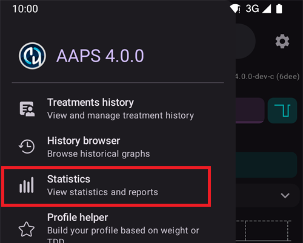

На экране **Статистика** четыре вкладки: **Инсулин**, **Время в диапазоне**, **Гликемия** и **Цикл**. Нажмите на вкладку или проведите пальцем влево или вправо, чтобы переходить между ними.

(reviewing-tdd)=
### Вкладка «Инсулин»: суммарная суточная доза

Карточка **Суммарные суточные дозы** показывает по одной строке на каждый из предыдущих дней (не больше одной недели), за которые у **AAPS** есть данные об инсулине, затем их **Средний** показатель и затем **Сегодня** (на текущий момент). Сразу после установки **AAPS** показывается только строка **Сегодня**. Столбцы:

- **Базал**: только базал.
- **Болюс**: сумма болюсов и SMB.
- **Суммарный суточный инсулин TDD**: суммарная суточная доза инсулина (**TDD**), сумма болюсного и базального инсулина, введенного за день.
- **Углеводы**: введенные углеводы и растянутые углеводы (eCarbs).

Раздел **TDD** рассчитывается, когда вы открываете страницу, и расчет занимает несколько секунд. Нажмите **Пересчитать**, чтобы рассчитать его снова.

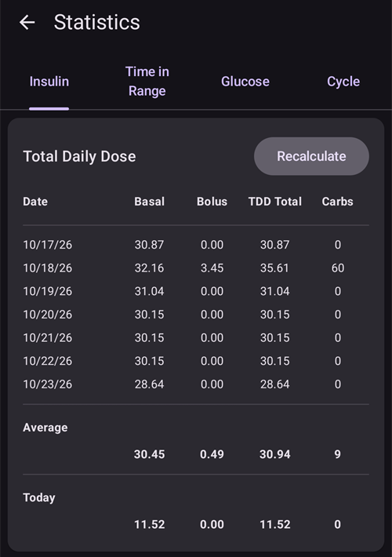

**TDD** — это ваш болюсный плюс базальный инсулин за сутки. Некоторые врачи используют — особенно для тех, кто только начал пользоваться помпой — соотношение базала и болюса 50:50: суммарный базовый базал (**TBB**, сумма ваших базальных скоростей за 24 часа) тогда должен составлять примерно половину TDD. Другие предпочитают TBB от 32% до 37% от TDD.

Как и у большинства эмпирических правил, реальная ценность этого правила ограничена. Ваш диабет может отличаться!

### Вкладка «Время в диапазоне»

Время в целевом диапазоне (**TIR**): 70–180 мг/дл или 3,9–10 ммоль/л.

Данные **TIR** доступны за 7 и 30 дней, в зависимости от того, сколько данных есть в базе данных **AAPS**.

Ниже есть статистика времени в узком диапазоне (TITR) 70–140 мг/дл или 3,9–7,8 ммоль/л (на экране этот диапазон показан как 70–141).

**Обсудите целевые значения с вашим эндокринологом**

Ваш диабет может отличаться. Любые предложенные целевые значения нужно обсудить с вашим эндокринологом или медицинской командой. При правильном использовании статистика AAPS может быть эффективным инструментом, чтобы следить за трендами __ГК__ и отслеживать прогресс.

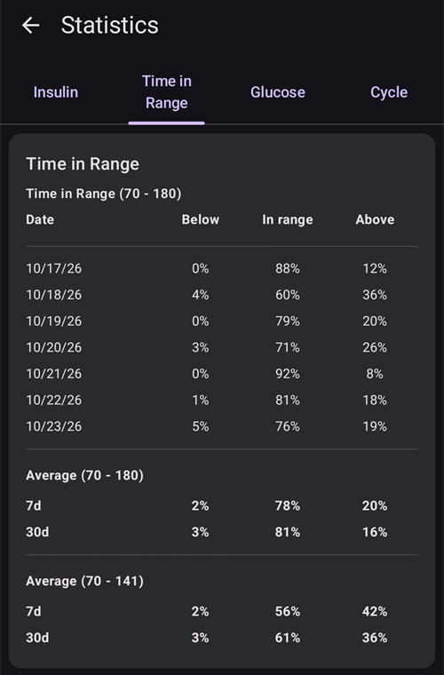

Ниже карточка **Dexcom TIR** показывает подробную статистику **TIR** за 14 дней.

**SD**: стандартное отклонение, [показатель](https://www.ncbi.nlm.nih.gov/pmc/articles/PMC3125941/) вариабельности ГК (чем выше, тем хуже).

HbA1c: оценка гликированного гемоглобина, рассчитанная по среднему значению измерений CGM. Это ориентировочное значение, оно может не совпадать с результатами анализа крови на HbA1c.

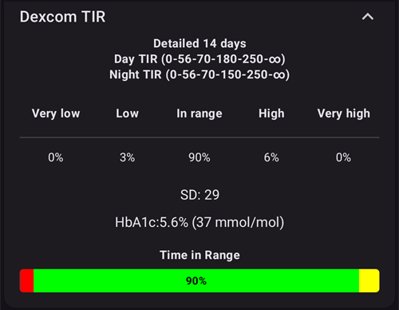

(reviewing-statistics-agp)=
### Вкладка «Гликемия»: амбулаторный профиль глюкозы (AGP)

**Амбулаторный профиль глюкозы** (**AGP**) показывает, как обычно меняется ваша глюкоза в течение дня. Выберите период кнопками вверху: **Сегодня**, **24 ч**, **7 дн**, **30 дн** или **90 дн**.

- **График**: один день от полуночи до полуночи. Линия — это **Медиана** (половина ваших значений в этот час были ниже, половина — выше). Вокруг нее одна полоса содержит среднюю половину ваших значений (**25–75%**), а более широкая полоса — большую их часть (**10–90%**). Узкая полоса означает, что в этот час ваша глюкоза изо дня в день похожа. Пунктирные линии отмечают вашу **отметку НИЗКИЙ**, 140 мг/дл (7,8 ммоль/л) и вашу **отметку ВЫСОКИЙ**.
- **Обзор гликемии**: время в вашем диапазоне, в узком диапазоне (70–140 мг/дл или 3,9–7,8 ммоль/л), выше и ниже вашего диапазона, затем **Среднее** и **Медиана** вашей глюкозы. Ваш диапазон — это **отметка НИЗКИЙ** и **отметка ВЫСОКИЙ**, заданные в разделе [Диапазон для визуализации](#Preferences-range-for-visualization).
- **eA1c** and **GMI**: two estimates of HbA1c calculated from your CGM readings, shown in % with the same value in mmol/mol below it. Как и HbA1c выше, они могут не совпадать с результатами анализа крови на HbA1c.
- **SD** (стандартное отклонение) и **CV** (коэффициент вариации): насколько сильно меняется ваша глюкоза. Чем ниже значение, тем стабильнее глюкоза.
- **Дни**: за сколько дней использованы данные CGM.

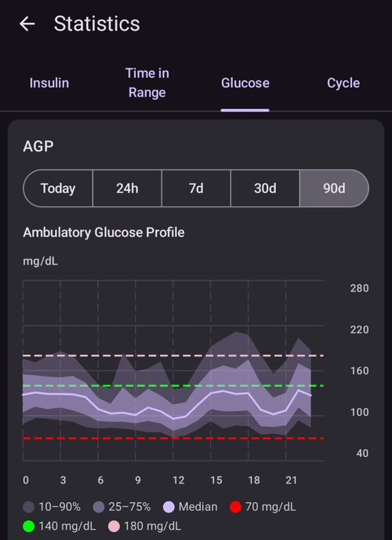 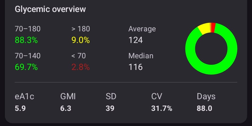

Под AGP карточка **Пятиугольник глюкозы (CGP)** показывает пять показателей вашей глюкозы за последние 14 дней в виде пятиугольника. Чем меньше пятиугольник, тем лучше контроль глюкозы.

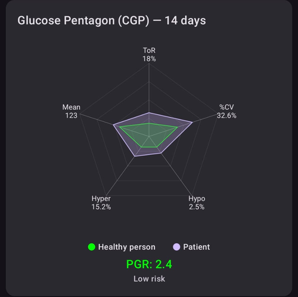

### Вкладка «Цикл»: цикличность TDD

**Цикличность TDD** накладывает ваши суточные дозы инсулина друг на друга по 28-дневным циклам, чтобы помочь вам найти повторяющиеся закономерности. Каждый цикл показан линией (**Индивидуальный цикл**), вместе с их средним значением.

- **Необработанная TDD** / **Обработанная TDD**: выберите суммарную суточную дозу в том виде, как она была введена, или TDD без инсулина на углеводы.
- **Смещение цикла**: сдвигает начало цикла (от 0 до 27 дней).

Нужны данные минимум за 56 дней (2 цикла). Если данных меньше, карточка показывает **Недостаточно данных (требуется не менее 56 дней для 2 циклов)**. Шаблон рассчитывается только тогда, когда вы открываете вкладку **Цикл**, потому что он читает данные за 168 дней.

(aaps-screens-treatments)=
## Treatments history

Откройте **меню** (☰) в левом верхнем углу главного экрана и выберите **История терапии**. Здесь вы можете просматривать и изменять историю следующих видов терапии, каждый на своей вкладке (прокрутите ряд вкладок, чтобы увидеть все):

* Carbs and bolus
* [Пролонгированный болюс](#Extended-Carbs-extended-bolus-and-switch-to-open-loop-dana-and-insight-pump-only)
* Temp basal
* [Временная цель](../DailyLifeWithAaps/TempTargets.md)
* [Смена профиля](../DailyLifeWithAaps/ProfileSwitch-ProfilePercentage.md)
* Портал терапии: примечания и записи портала терапии
* Running mode : history of loop status
* User entry: other notes that are not sent to Nightscout

В конце каждой строки маленькие значки показывают, откуда пришли данные или куда они были отправлены:
* Значок **Nightscout** (логотип Nightscout): данные пришли из Nightscout или были записаны в Nightscout
* Значок **помпы**: данные пришли из истории помпы (помпа их обработала)
* Значок **корзины**: запись удалена (показывается только тогда, когда вы включаете показ удаленных записей значком **глаза** в правом верхнем углу)

(screens-bolus-carbs)=
### Carbs and bolus

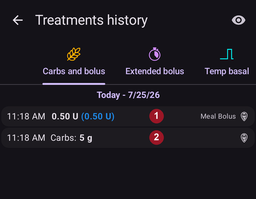

On this tab you can view the bolus and carbs log. У каждого болюса (строка **1**) рядом с количеством инсулина показан оставшийся связанный с ним IOB. The origin of the bolus can be either :
* Прием пищи (введен вручную кнопками «Инсулин», «Мастер быстрых настроек» или «Мастер болюса»)
* SMB, when using the SMB Functionality

Записи углеводов (строка **2**) показаны с количеством в граммах.

Если вы рассчитали дозу инсулина с помощью [Мастера болюса](#aaps-screens-bolus-wizard), нажмите на текст «Кальк» в строке болюса, чтобы увидеть подробности расчета болюса.

В зависимости от помпы инсулин и углеводы могут быть показаны в одной строке или в нескольких строках: одна для подробностей расчета, одна для углеводов и одна для самого болюса.

Историю терапии можно использовать, чтобы исправить неверно введенные углеводы (_т. е._ если вы переоценили или недооценили углеводы). Обратите внимание: изменить существующую запись нельзя, нужно сделать следующее:

1. Проверьте и запомните текущие COB и IOB на главном экране.
2. В зависимости от помпы углеводы могут быть показаны вместе с инсулином в одной строке или отдельной записью (например, с Dana RS).
3. Удалите запись с неверным количеством углеводов: нажмите на значок корзины, выберите строки для удаления, затем снова нажмите на значок корзины, чтобы завершить.
4. Убедитесь, что углеводы удалены, снова проверив COB на главном экране.
5. Сделайте то же самое для IOB, если углеводы и инсулин в одной строке.

   → If carbs are not removed as intended, and you add additional carbs as explained here (6.), COB will be too high and that might lead to too high insulin delivery.

6. Снова введите правильное количество углеводов (**Терапия → Углеводы** на нижней панели навигации или кнопка **Углеводы** на панели [Быстрый запуск](#quicklaunch)) и обязательно укажите правильное время события.
7. Если углеводы и инсулин в одной строке, нужно также добавить количество инсулина. Обязательно укажите правильное время события и проверьте IOB на главном экране после подтверждения новой записи.

### Temp basal

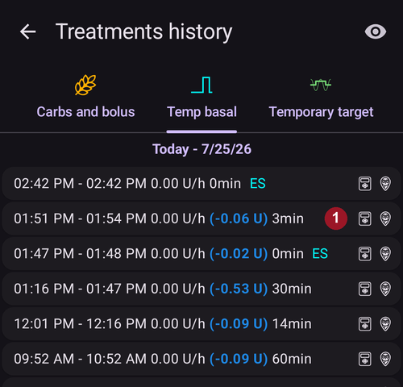

Здесь показаны **временные базалы**, установленные циклом. Если запись еще влияет на IOB, эта информация показана рядом со скоростью (строка **1**). It can be:
* Положительный IOB, если временный базал был выше базала из профиля
* Отрицательный IOB при нулевом временном базале (как в строке **1**) или если временный базал был ниже базала из профиля

Удаление записей влияет только на ваши отчеты в Nightscout и, вероятно, исказит ваш реальный IOB — делать это не рекомендуется.

Красная буква S слева в строке означает «Suspend» (приостановка): это происходит, когда базал сейчас не подается. Это нормальная ситуация, например, во время замены Pod.

### Временная цель

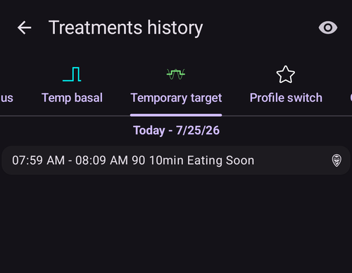

The history of temporary targets can be seen here.

### Смена профиля

The history of profile switches can be seen here. При каждом переключении профиля вы можете увидеть несколько записей: строка **1**, сохраненная и в NS, и в истории помпы, соответствует фактическому переключению. Строка **2**, сохраненная в Nightscout, но не в истории помпы, соответствует запросу пользователя на переключение профиля.

Deleting the entries only affects your reports in Nightscout and will never actually change the current profile.

Кнопкой **Клонировать** в строке **2** можно сделать копию **переключения профиля**. Подробнее см. [Ваш профиль AAPS > Управление профилями](#your-aaps-profile-clone-profile-switch).

### Careportal

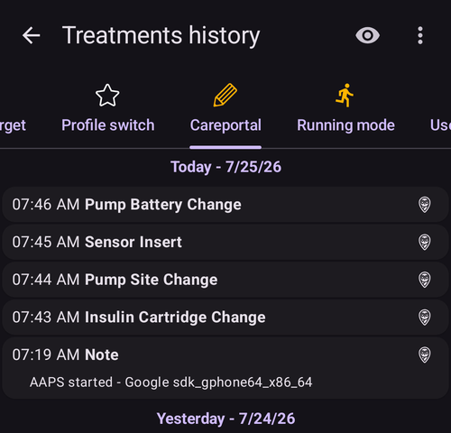

На этой вкладке показаны все примечания и записи портала терапии, сохраненные в Nightscout.

(AapsScreens-running-mode)= (aaps-screens-running-mode)=
### Режим работы

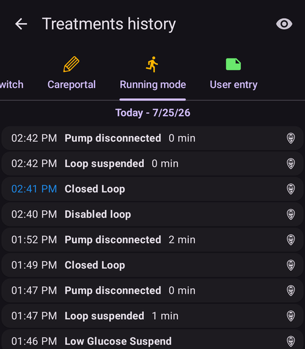

На этой вкладке показана история изменений [состояния цикла](#AapsScreens-loop-status): открытый, замкнутый, LGS, приостановка, отключение.

### User entry

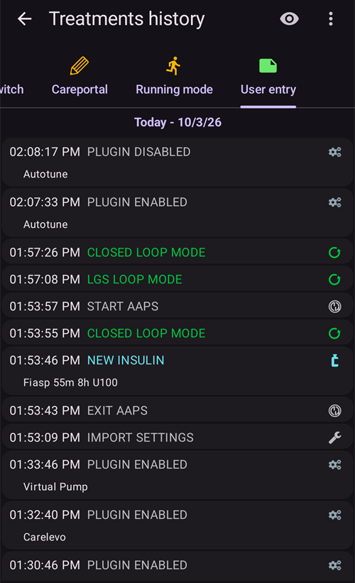

На этой вкладке показаны действия, выполненные в **AAPS** пользователем или **Автоматизацией** (изменения режима цикла, переключения профиля, терапия, экспорт настроек...). Эти записи не отправляются в Nightscout.

------

## В чем разница между Nightscout и Tidepool?

Nightscout помогает пользователю хранить данные **AAPS** и предлагает много [инструментов для отчетов](https://nightscout.github.io/nightscout/reports/).

Tidepool же позволяет пользователю [просматривать свои данные](https://www.tidepool.org/viewing-your-data) и дает [простой доступ к ним для вашей медицинской команды](https://www.tidepool.org/providers/how-it-works#tidepool-data-platform).