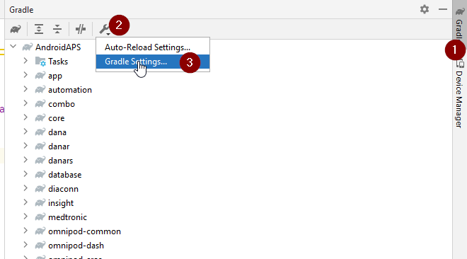
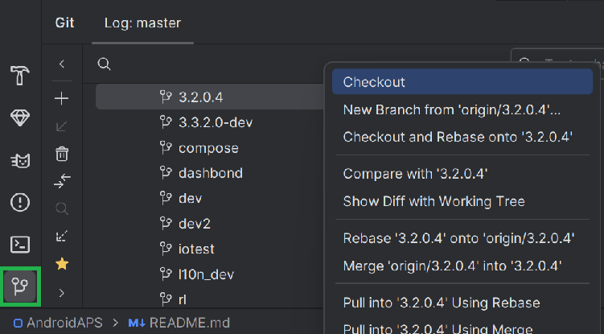
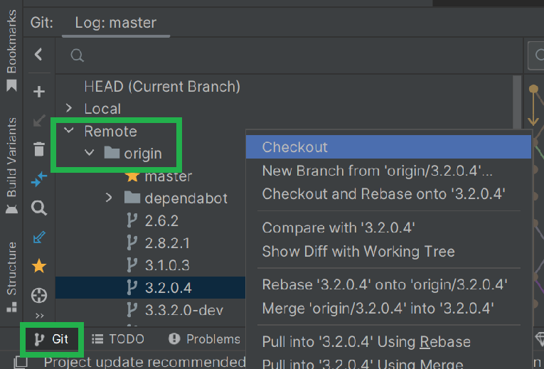
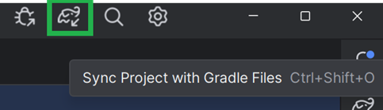
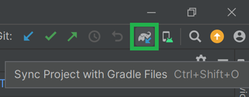

# Обновление до AAPS 3.2.0.4

(update-aaps-3204)=

## Постройте сами вместо скачивания

**Приложение AAPS (файл apk) недоступно для скачивания из-за правил, связанных с медицинскими устройствами. Построить приложение для собственного использования вполне законно, но передавать копию другим не разрешается!**

Подробности смотрите на странице [Часто задаваемые вопросы по работе ИПЖ](../UsefulLinks/FAQ.md).

## Требования к компьютеру и программам для сборки AAPS 3.2.0.4

* Для сборки apk может понадобиться определенная версия **[Android Studio](https://developer.android.com/studio/)**.

| AAPS Version            | Рекомендуемая<br/>версия<br/>Android Studio | Альтернативная<br/>версия<br/>Android Studio | Gradle | JVM |
| ----------------------- | ------------------------------------------------------- | -------------------------------------------------------- | ------ |:--- |
| [3.2.0.4](#version3204) | Hedgehog (2023.1.1)                                     | до Meerkat                                               | 8.2    | 17  |

«Рекомендуемая версия» поставляется с подходящей версией JVM. Рекомендуемая версия – это также минимальная версия, в которой можно собрать **AAPS**. В версии более старой, чем «рекомендуемая», собрать приложение **НЕ** получится. Если вы используете другую версию, могут возникнуть проблемы, связанные с версией JVM. Чтобы решить эти проблемы, см. страницу [Устранение неполадок Android Studio](#incompatible-gradle-jvm). Если вашей текущей версии Android Studio нет в таблице, сначала обновите ее.

Версия Gradle связана с исходным кодом: при скачивании или обновлении исходного кода вы всегда получаете правильную версию Gradle. Она указана здесь только для справки, делать с ней ничего не нужно.

* [32-разрядные системы Windows](#troubleshooting_androidstudio-unable-to-start-daemon-process) не поддерживаются Android Studio. Помните, что **64-разрядный процессор и 64-разрядная ОС – обязательные условия.** Если ваша система НЕ соответствует этому условию, нужно заменить соответствующее оборудование, программы или всю систему.

<table class="tg">
<tbody>
  <tr>
    <th class="tg-baqh">OS (Only 64 bit)</th>
    <td class="tg-baqh">Windows 8 or higher</td>
    <td class="tg-baqh">Mac OS 10.14 or higher</td>
    <td class="tg-baqh">Any Linux supports Gnome, KDE, or Unity DE;&nbsp;&nbsp;GNU C Library 2.31 or later</td>
  </tr>
  <tr>
    <th class="tg-baqh"><p align="center">CPU (Only 64 bit)</th>
    <td class="tg-baqh">Архитектура процессора x86_64; Intel Core второго поколения или новее или процессор AMD с поддержкой <br><a href="https://developer.android.com/studio/run/emulator-acceleration#vm-windows" target="_blank" rel="noopener noreferrer"><span style="text-decoration:var(--devsite-link-text-decoration,none)">Windows Hypervisor</span></a></td>
    <td class="tg-baqh">Чипы на базе ARM или Intel Core второго поколения или новее с поддержкой <br><a href="https://developer.android.com/studio/run/emulator-acceleration#vm-mac" target="_blank" rel="noopener noreferrer"><span style="text-decoration:var(--devsite-link-text-decoration,none)">Hypervisor.Framework</span></a></td>
    <td class="tg-baqh">Архитектура процессора x86_64; Intel Core второго поколения или новее или процессор AMD с поддержкой виртуализации AMD (AMD-V) и SSSE3</td>
  </tr>
  <tr>
    <th class="tg-baqh"><p align="center">RAM</th>
    <td class="tg-baqh" colspan="3"><p align="center">8GB or more</td>
  </tr>
  <tr>
    <th class="tg-baqh"><p align="center">Disk</th>
    <td class="tg-baqh" colspan="3"><p align="center">At least 30GB free space. SSD is recommended.</td>
  </tr>
  <tr>
    <th class="tg-baqh"><p align="center">Resolution</th>
    <td class="tg-baqh" colspan="3"><p align="center">1280 x 800 Minimum <br></td>
  </tr>
  <tr>
    <th class="tg-baqh"><p align="center">Internet</th>
    <td class="tg-baqh" colspan="3"><p align="center">Broadband</td>
  </tr>
</tbody>
</table>

**Настоятельно рекомендуется (но не обязательно) использовать SSD (твердотельный накопитель) вместо HDD (жесткого диска), потому что сборка apk-файла AAPS займет меньше времени.**  Собрать apk-файл **AAPS** можно и на HDD. Процесс сборки приложения при этом может занять много времени, но после начала можно оставить его без присмотра.

## Помощь и поддержка при сборке 3.2.0.4

Если при сборке приложения **AAPS** возникли трудности, сначала прочитайте отдельный раздел [**Устранение неполадок Android Studio**](https://androidaps.readthedocs.io/en/3.2/GettingHelp/TroubleshootingAndroidStudio.html).

Если вы считаете, что в инструкции по сборке что-то неправильно, чего-то не хватает или что-то непонятно, или у вас все еще не получается, обратитесь к группе пользователей **AAPS** в [Facebook](https://www.facebook.com/groups/AndroidAPSUsers) или [Discord](https://discord.gg/4fQUWHZ4Mw). Если вы хотите что-то изменить сами (обновить снимки экрана _и т. п._), отправьте [pull request (PR)](../SupportingAaps/HowToEditTheDocs.md).

```{note}
На этой странице есть примеры изображений как для **New** (нового), так и для старого (**Classic**) интерфейса Android Studio.
```

## Обзор обновления с 3.2.0.x до 3.2.0.4

```{contents} Steps for updating to 3.2.0.4
:depth: 1
:local: true
```

### Экспортируйте текущие настройки

Экспортируйте настройки из текущей версии **AAPS** на телефоне. Возможно, это не потребуется, но лучше обезопасить себя, чем потом жалеть.

Если вы не помните, как это сделать, см. страницу [Создание и восстановление резервных копий](ExportImportSettings.md).

### Обновите локальную копию AAPS

* Open your existing AAPS project with Android Studio. You might need to select your project. (Double) click on the AAPS project.


<br>


* В строке меню Android Studio выберите Git -> Fetch


<br>


* You will see a message in the lower right corner that Fetch was successful.


<br>


* Теперь в строке меню выберите Git -> Pull


<br>


* Оставьте все параметры как есть (origin/master) и выберите Pull


<br>


* Wait while download is in progress, you will see this as info in the bottom bar. По окончании появится сообщение об успехе.

  ```{note}
  Обновленные файлы могут отличаться! Это не признак проблемы.
  ```


<br>


* Запустится Gradle Sync, чтобы скачать некоторые зависимости. Дождитесь завершения процесса.


<br>


### Выберите версию JVM 17

- Откройте панель Gradle, нажав на слона (1) справа в Android Studio, откройте настройки (2) и выберите **Gradle Settings** (3):


<br>



- В поле **Gradle JDK** (1) проверьте, выбрана ли подходящая версия: **jbr-17**. Если нет, нажмите на поле и посмотрите, есть ли она уже в списке. Если ее нет в списке (на снимке экрана ниже показан компьютер, где доступна только **jbr-21**), выберите **Download JDK...** (2).


- В поле Version (1) выберите **17**. В поле Vendor (2) выберите JetBrains Runtime или любого другого поставщика. Location (3): не меняйте.


- Закройте окно **Settings** кнопкой **OK**.

### Выберите ветку AAPS 3.2.0.4

- Внизу слева выберите значок Git, нажмите правой кнопкой мыши на 3.2.0.4 и выберите Checkout.



<br>



### Синхронизируйте проект с Gradle

```{admonition} WARNING!
:class: warning
**Никогда не обновляйте Gradle.** Всегда синхронизируйте его с проектом.
```

В новом интерфейсе нажмите значок слона и выберите Sync Project with Gradle Files (или следуйте [этому](#gradle-resync)).



Или ([это](https://androidaps.readthedocs.io/en/3.2/GettingHelp/TroubleshootingAndroidStudio.html#gradle-resync)) для классического интерфейса.



### Соберите подписанный APK 3.2.0.4

Ваш исходный код теперь соответствует текущей выпущенной версии, и все предварительные условия проверены. Пора собрать подписанный apk, как описано в [разделе о сборке подписанного apk](#Building-APK-generate-signed-apk).

### Перенесите и установите APK 3.2.0.4

Чтобы установить apk, его нужно перенести на телефон.

```{note}
Если вы собрали приложение в Android Studio с тем же хранилищем ключей, удалять существующее приложение на телефоне не нужно. Когда вы устанавливаете apk, следуйте подсказкам для установки обновлений.
Для других сценариев, таких как создание нового хранилища ключей в Android Studio, нужно удалить старое приложение перед установкой apk. **Обязательно экспортируйте свои настройки!**
```

См. инструкции на странице [Перенос и установка AAPS на смартфон](../SettingUpAaps/TransferringAndInstallingAaps.md)

### Проверьте версию AAPS 3.2.0.4 на телефоне

После установки нового приложения, проверьте версию AAPS, нажав на выпадающее меню вверху справа "о приложении". Вы увидите текущую версию.

