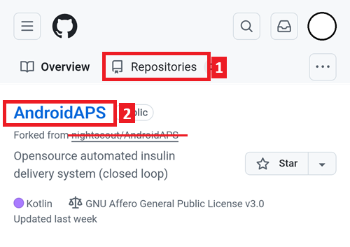
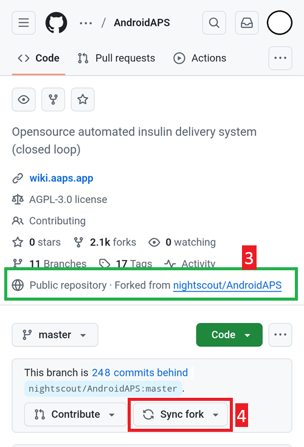
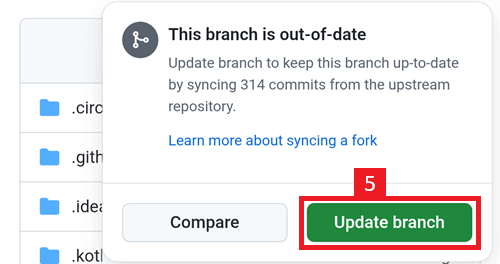
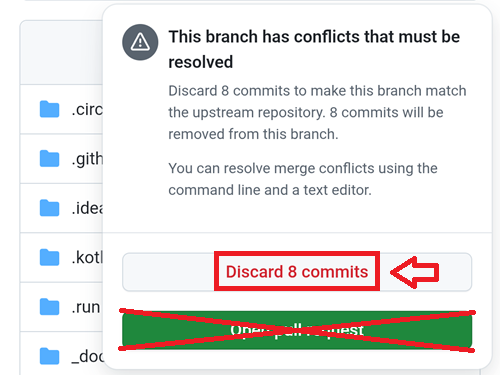
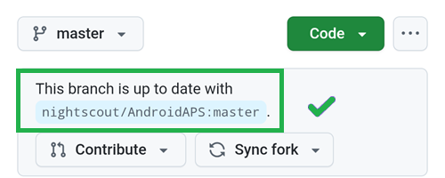
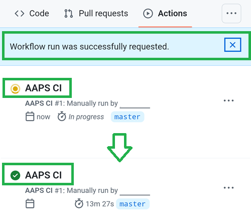

# Обновление через браузер (fork)

```{tip}
Вы собрали AAPS с помощью **AAPS Builder**? Эта страница вам не нужна: см. [Обновление AAPS с AAPS Builder](#aaps-builder-updates).
```

## Постройте сами вместо скачивания

**AAPS** is not available to download, due to regulations concerning medical devices. Построить приложение для собственного использования вполне законно, но передавать копию другим не разрешается! Подробности смотрите на странице [Часто задаваемые вопросы по работе ИПЖ](../UsefulLinks/FAQ.md).

```{note}
Если вы впервые обновляете **AAPS** через браузер: скопируйте резервную копию файла хранилища ключей на свой Google Диск. Затем следуйте инструкции [Сборка **AAPS** через браузер](../SettingUpAaps/BrowserBuild.md) вместо этого руководства. Вместо создания нового хранилища ключей выберите то, которое вы скопировали с компьютера.
Это нужно сделать только в первый раз; при следующих обновлениях вы сможете следовать этому руководству.
```

```{tip}
**Переходите на AAPS Builder?** [AAPS Builder](../SettingUpAaps/BrowserBuildAapsBuilder.md) — более простая сборка через браузер: не нужно синхронизировать fork, а приложение вы скачиваете прямо с GitHub. Переходить не обязательно: это руководство продолжает работать. Если переходите, сначала получите копию хранилища ключей из своего fork, как описано в разделе [Переход с прежней сборки через браузер](#aaps-builder-from-fork). Иначе новая сборка не сможет обновить AAPS на вашем телефоне.
```

## Обзор: обновление AAPS до новой версии через браузер

```{contents} Steps for updating to a new version of AAPS
:depth: 1
:local: true
```

Если возникли проблемы, см. отдельную страницу [Сборка через браузер: устранение неполадок](../GettingHelp/BrowserBuildTroubleshooting.md).

### Export your settings

Экспортируйте настройки из текущей версии **AAPS** на телефоне. Возможно, это не потребуется, но лучше обезопасить себя, чем потом жалеть.

Если вы не помните, как это сделать, см. страницу [Создание и восстановление резервных копий](ExportImportSettings.md).

(Update-to-new-version-update-your-repo)=
### Обновите свой репозиторий GitHub

[Войдите в GitHub](https://github.com/login).

1. Выберите Repositories.
2. Прокрутите вниз и выберите свой репозиторий AndroidAPS.



3. Проверьте, что вы используете свою копию AndroidAPS (Forked from nightscout/AndroidAPS)
4. Нажмите Sync Fork, чтобы обновить ее (число отстающих коммитов может отличаться от картинки)




5. Нажмите Update Branch



Примечание: если вы по ошибке изменили свою копию AndroidAPS, вы увидите этот экран. Отмените все изменения (коммиты) (Discard), чтобы вернуться к выпущенной версии.



Теперь вы синхронизировали (обновили) свою копию с последним выпуском **AAPS**. Отлично.



### Запустите workflow для сборки подписанного APK

1. В своей копии AndroidAPS на GitHub выберите Actions.
2. Разверните All Workflows.
3. Выберите AAPS-CI


4. Прокрутите вниз и нажмите Run Workflow.


5. Оставьте ветку master. В **Select AAPS Version** проверьте, что выбрана **4.0.0** — самая новая версия вверху списка. Если ваш fork не обновлен, заранее выбрана более старая версия: если запустить workflow с формой как есть, вы снова соберете эту старую версию, и приложение не обновится. Выберите [вариант](#browserbuild-variant) (fullRelease), а затем нажмите Run workflow.

   ```{note}
   Список версий — часть workflow в вашем fork. Если **4.0.0** нет в списке, ваш fork еще не синхронизирован: вернитесь к разделу [Обновите свой репозиторий GitHub](#Update-to-new-version-update-your-repo).
   ```


6. Вы увидите сообщение Workflow run was successfully requested. Обновите страницу браузера, и вы сможете следить за ходом сборки. Когда действие завершится, у действия AAPS CI появится зеленая галочка. Вы успешно собрали обновленную версию **AAPS**. Это значит, что APK основного приложения и APK для Wear теперь сохраняются прямо на ваш Google Диск (как описано ниже). APK AAPSClient можно скачать с Github > nightscout > AndroidAPS [здесь](https://github.com/nightscout/AndroidAPS/releases)





### Установите APK AAPS

1. Откройте свой Google Диск
2. Откройте папку AAPS, выберите папку новой версии: в ней будут версии и для телефона, и для Android Wear.


```{note}
С сентября 2026 года [проверка разработчиков Android](#android-developer-verification) от Google может, в зависимости от вашей страны, блокировать установку APK нажатием на файл. Бесплатные обходные пути описаны на той странице.
```

Продолжите [здесь](#Update-to-new-version-check-aaps-version-on-phone)

(update-browser-build-troubleshooting)=

## Устранение неполадок

Если что-то пойдёт не так, не паникуйте.

Выдохните!

Затем проверьте, не описана ли уже ваша проблема: см. [Устранение неполадок AAPS Builder](#aaps-builder-troubleshooting), если вы собираете с **AAPS Builder**, иначе — [Сборка через браузер: устранение неполадок](#aaps-ci-troubleshooting).

Если нужна дополнительная помощь, обратитесь к другим пользователям **AAPS** в [Facebook](https://www.facebook.com/groups/AndroidAPSUsers) или [Discord](https://discord.gg/4fQUWHZ4Mw).
