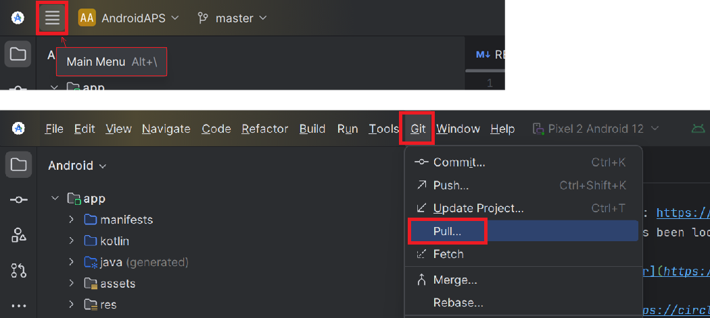
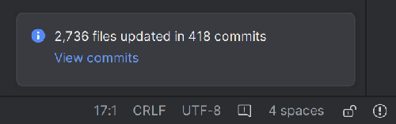
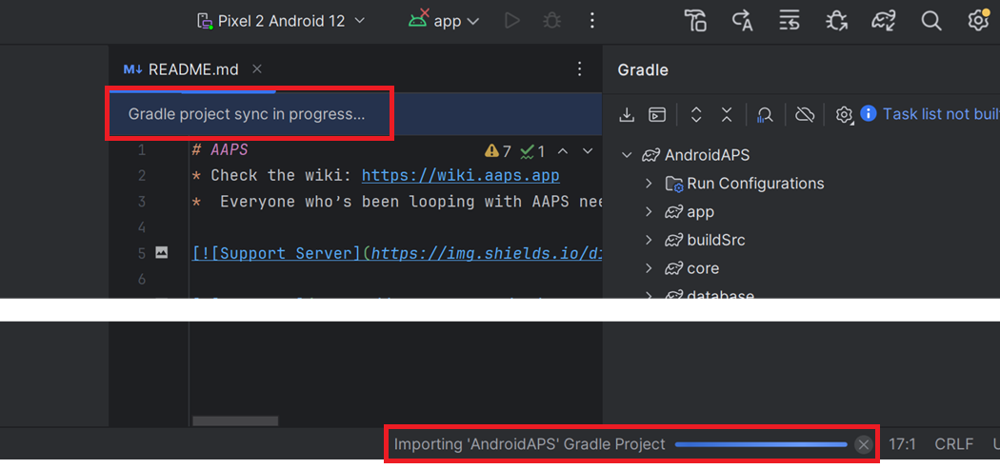

# Обновление через Android Studio

## Постройте сами вместо скачивания

**AAPS** is not available to download, due to regulations concerning medical devices. Построить приложение для собственного использования вполне законно, но передавать копию другим не разрешается! Подробности смотрите на странице [Часто задаваемые вопросы по работе ИПЖ](../UsefulLinks/FAQ.md).

```{note}
Если вы хотите собрать **AAPS** на новом компьютере: скопируйте резервную копию файла хранилища ключей на новый компьютер. Затем выполните [первую сборку **AAPS**](../SettingUpAaps/BuildingAaps.md) вместо этого руководства. Разница только в том, что вместо создания нового хранилища ключей вы можете выбрать то, которое скопировали на новый компьютер.
```

## Обзор обновления AAPS до новой версии с помощью Android Studio

```{contents} Steps for updating to a new version of AAPS
:depth: 1
:local: true
```

Если возникнут проблемы, смотрите отдельную страницу [Устранение неполадок Android Studio](../GettingHelp/TroubleshootingAndroidStudio.md).

### Export your settings

Экспортируйте настройки из текущей версии **AAPS** на телефоне. Возможно, это не потребуется, но лучше обезопасить себя, чем потом жалеть.

Если вы не помните, как это сделать, см. страницу [Создание и восстановление резервных копий](ExportImportSettings.md).

### Проверьте версию Android Studio

Минимальная нужная версия описана в [инструкциях по сборке](#Building-APK-recommended-specification-of-computer-for-building-apk-file). Если ваша версия старее, сначала [обновите Android Studio](#Building-APK-install-android-studio)!

(Update-to-new-version-update-your-local-copy)=
### Update your local copy

* Open your existing AAPS project with Android Studio. You might need to select your project. (Double) click on the AAPS project.

  

* В строке меню Android Studio выберите Git -> Fetch

   

* You will see a message in the lower right corner that Fetch was successful.

   

* Теперь в строке меню выберите Git -> Pull

   

* Оставьте все параметры как есть (origin/master) и выберите Pull

   

* Wait while download is in progress, you will see this as info in the bottom bar. По окончании появится сообщение об успехе.

  ```{note}
  Обновленные файлы могут отличаться! Это не признак проблемы.
  ```

   

* Запустится Gradle Sync, чтобы скачать некоторые зависимости. Дождитесь завершения процесса.

  

### Проверьте версию JVM

Эта проверка особенно нужна, если вы уже собирали предыдущую версию **AAPS** на этом же компьютере.

Посмотрите в [инструкциях по сборке](#Building-APK-recommended-specification-of-computer-for-building-apk-file), какая версия JVM нужна для версии **AAPS**, которую вы сейчас собираете. Затем выполните шаги из раздела [Incompatible Gradle JVM](#incompatible-gradle-jvm), чтобы убедиться, что сейчас используется правильная версия.

(Update-to-new-version-build-the-signed-apk)=
### Сборка подписанного APK

Ваш исходный код теперь соответствует текущей выпущенной версии, и все предварительные условия проверены. Пора собрать подписанный apk, как описано в [разделе о сборке подписанного apk](#Building-APK-generate-signed-apk).

(Update-to-new-version-transfer-and-install)=

### Перенос и установка APK
Чтобы установить apk, его нужно перенести на телефон.

```{note}
Если вы собрали приложение в Android Studio с тем же хранилищем ключей, удалять существующее приложение на телефоне не нужно. Когда вы устанавливаете apk, следуйте подсказкам для установки обновлений.
Для других сценариев, таких как создание нового хранилища ключей в Android Studio, нужно удалить старое приложение перед установкой apk. **Обязательно экспортируйте свои настройки!**
```

Смотрите инструкцию [Перенос и установка AAPS на смартфон](../SettingUpAaps/TransferringAndInstallingAaps.md). Там, где действует [проверка разработчиков Android](#android-developer-verification) от Google (с сентября 2026 г., в зависимости от страны), устанавливайте приложение через [ADB](#android-developer-verification-adb), а не нажатием на файл APK.

Продолжайте [здесь](#Update-to-new-version-check-aaps-version-on-phone).

(update-computer-build-troubleshooting)=

## Устранение неполадок

Если что-то пойдёт не так, не паникуйте.

Выдохните!

Затем проверьте, не описана ли ваша проблема на отдельной странице [Устранение неполадок Android Studio](../GettingHelp/TroubleshootingAndroidStudio.md).

Если нужна дополнительная помощь, обратитесь к другим пользователям **AAPS** в [Facebook](https://www.facebook.com/groups/AndroidAPSUsers) или [Discord](https://discord.gg/4fQUWHZ4Mw).