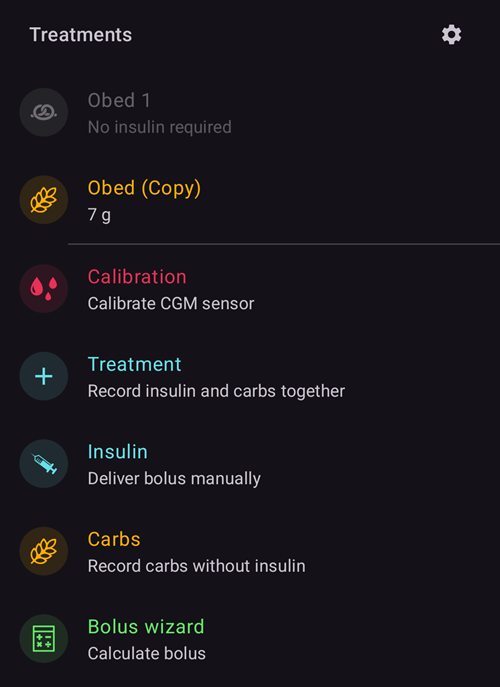
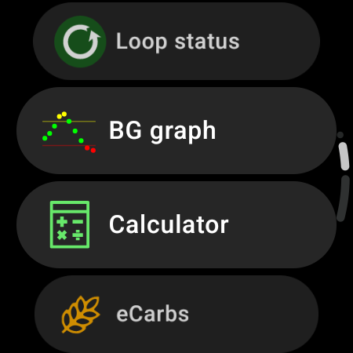
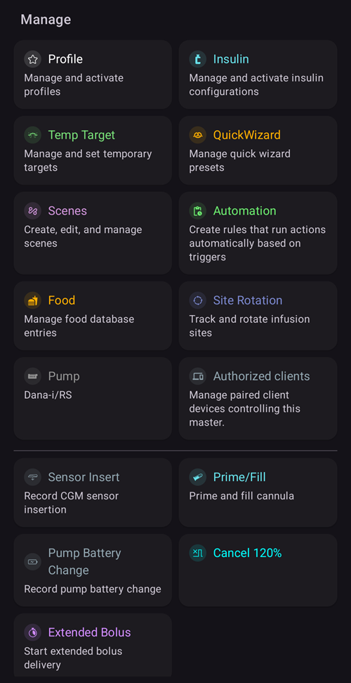
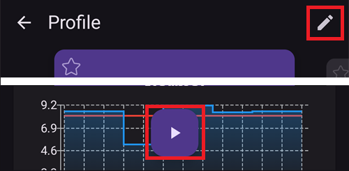

(v4-changes)=
# Что изменилось в AAPS v4

На этой странице собраны важные **изменения в работе** между **AAPS** v3 и v4 — что работает иначе, что перенесено и что удалено, — чтобы пользователи знали, чего ожидать после обновления. См. также [Примечания к изменениям в версиях](ReleaseNotes.md) и [инструкцию по обновлению](UpdateToNewVersion.md).

```{contents} Table of contents
:depth: 2
:local: true
```

---

## NSClient v1 удален

В **AAPS** v3 было **два** модуля синхронизации с Nightscout:

- **NSClient** — старый клиент (старый API Nightscout REST / socket.io, его также называют *«v1»*), и
- **NSClientV3** — клиент для нового **API v3** Nightscout.

В **AAPS** v4 старый модуль **NSClient (v1)** **удален**. Для синхронизации с Nightscout остался только **NSClientV3**.

```{admonition} What you need to do
:class: important
Если вы (или ваш фолловер в **AAPSClient**) еще синхронизировались через старый модуль **NSClient (v1)**, перейдите на **NSClientV3** до или после обновления:

- Откройте **[Конфигурация](../SettingUpAaps/ConfigBuilder.md) → Связь → NSClientV3**.
- Введите **URL Nightscout** и **токен доступа** (NSClientV3 использует токен доступа, *а не* старый API secret — см. [создание токена](https://nightscout.github.io/nightscout/security/#create-a-token)).
- Ваш сайт Nightscout должен поддерживать **API v3** (Nightscout 15 или новее).
- Если вы используете **websockets**, включите или выключите их на **обоих** устройствах — на основном телефоне и у фолловера, — никогда только на одном.
- Websockets **обязательны** для удаленного управления из **AAPSClient**, на обоих телефонах.
```

Это касается только того, как приложение обменивается данными с Nightscout; ваши данные в Nightscout не меняются.

---

## Нижняя панель навигации: Терапия, Сценарии и Управление

В **AAPS** v3 вы переходили по приложению через ряд **вкладок** (главный экран, Действия, Терапия, …), а несколько функций были **модулями**, которые включались в Конфигураторе (**Действия**, **Автоматизация**, **Еда**, …).

В **AAPS** v4 вкладок больше нет, как и флажка с глазом в Конфигураторе, который показывал модуль как вкладку. Основной экран — **главный экран**, а **нижняя панель навигации** открывает три панели. **Действия, Автоматизация и Еда больше не являются модулями** — в [Конфигурации](../SettingUpAaps/ConfigBuilder.md) (так теперь называется Конфигуратор) ничего включать не нужно; их функции теперь находятся в этих панелях.

(v4changes-treatments)=
### Терапия — ввести и подать

Панель **Терапия** служит для записи или подачи терапии: **Мастер болюса**, **Инсулин** (ручной болюс), **Углеводы**, **Терапия** (инсулин и углеводы вместе), **Калибровка**, **CGM** (открывает приложение CGM, если оно настроено) и ваши **[Мастера быстрых настроек](../DailyLifeWithAaps/QuickWizards.md)**.



На **часах Wear OS** та же терапия вводится из **меню AAPS** на часах (Мастер болюса / Калькулятор, eCarbs, Терапия, …):



### Сценарии

Ваши предустановки для разных ситуаций — см. [Сценарии](../DailyLifeWithAaps/Scenes.md).

(v4changes-manage)=
### Управление — настроить и активировать

На панели **Управление** вы настраиваете и активируете все остальное: **[Профиль](../DailyLifeWithAaps/ProfileSwitch-ProfilePercentage.md)**, **Настройки инсулина** (ваши конфигурации инсулина), **[Временная цель](../DailyLifeWithAaps/TempTargets.md)**, предустановки **[Мастера быстрых настроек](../DailyLifeWithAaps/QuickWizards.md)**, **[Сценарии](../DailyLifeWithAaps/Scenes.md)**, **Автоматизация**, **Еда**, **Места установки**, **Помпа**, **[Авторизованные клиенты](../RemoteFeatures/ClientMasterControl.md)** — а также действия с помпой, которые раньше были на вкладке *Действия* (**Пролонгированный болюс**, **Отменить временный базал**, **Прайм/заполнение**, **Установка сенсора**, **Замена батареи помпы**).



Все ваши правила автоматизации и записи о еде сохраняются; изменился только способ, которым вы открываете эти функции.

(screens-action-tab)=
#### Куда делась вкладка «Действия»?

В **AAPS** 3.x была вкладка «Действия». В **AAPS** 4 ее функции находятся в других местах:

* **Переключение профиля** и **Процент профиля**: нажмите на [название профиля](#aaps-screens-profile--target) на главном экране или выберите **Управление → Профиль**. См. [Изменение процента профиля](#ProfileSwitch-change-percentage).
* **Временная цель**: нажмите на [цель](#aaps-screens-profile--target) на главном экране или выберите **Управление → Временная цель**.
* **Прайм/заполнение**, **Установка сенсора**, **Проверка ГК** и другие записи портала терапии: в развернутой [панели состояния](#aaps-screens-careportal), в разделе **Управление** или как кнопки [Быстрого запуска](../DailyLifeWithAaps/QuickLaunch.md).
* **Просмотр журнала**, **Статистика** (TDD): в **меню** (☰).

```{admonition} Profile switch and profile percentage
:class: note
В **AAPS** v3 долгое нажатие на название профиля открывало диалог переключения профиля (процент, длительность, временная цель «Нагрузка»). В **AAPS** v4 **нажмите** на название профиля (или **Управление → Профиль**), затем нажмите круглую кнопку **▶** внизу справа, чтобы открыть те же настройки. См. [Изменение процента профиля](#ProfileSwitch-change-percentage).
```

---

(v4changes-read-only-management)=
## Защита настроек теперь блокирует и экраны управления

В **AAPS** v3 [защита настроек](#Preferences-settings-protection) запрашивала пароль только при открытии настроек. Без него все равно можно было добавлять или редактировать профили на вкладке **Локальный профиль**.

В **AAPS** v4 защита настроек также распространяется на редактирование на экранах управления: **Профиль**, **Настройки инсулина**, **Временная цель** и **Мастер быстрых настроек**. Если ваши настройки заблокированы, эти экраны открываются **только для чтения**:

- Вы можете просматривать записи и нажимать **▶ Активировать** или использовать их.
- Кнопки **Добавить / Редактировать / Клонировать / Удалить** **скрыты**. Только **✏️ карандаш** на верхней панели показывает, что редактирование можно разблокировать.



```{admonition} What you need to do
:class: important
Чтобы добавить, редактировать, клонировать или удалить запись, нажмите **✏️ карандаш** на верхней панели и введите пароль настроек (или используйте биометрию). Появятся кнопки.

Если защищать настройки не нужно, защиту настроек можно выключить в разделе **Настройки → Защита**.
```

---

(v4changes-active-insulin)=
## Используемый инсулин нельзя редактировать

В **AAPS** v3 можно было в любой момент изменить DIA используемого инсулина.

В **AAPS** v4 инсулин с отметкой **АКТИВНЫЙ** в разделе **Управление → Настройки инсулина** отображается серым: его нельзя редактировать или удалить.

При обновлении **AAPS** сохраняет инсулин и DIA, которые уже были записаны в ваших переключениях профиля в v3. Если находятся старые записи, где инсулин известен, а DIA нет, для них используется DIA по умолчанию, и один раз показывается сообщение, например *В старых записях не было длительности действия инсулина, поэтому для Lyumjev использовано 9,0 ч. Проверьте настройки инсулина — уже перенесенные записи потом не обновляются.* Увидев это сообщение, проверьте настройки инсулина.

When you [import settings](../Maintenance/ExportImportSettings.md) exported from **AAPS** 3.x, **AAPS** adds the insulin of that backup to your insulin list and tells you which one, for example *Added to your insulin list from the backup: Free-Peak Oref 38m 6h U100.* This insulin is not in use yet: select the right insulin when you activate your profile, and do this before Nightscout downloads your older treatments.

```{admonition} What you need to do
:class: important
Чтобы изменить DIA или пик, добавьте новый инсулин кнопкой **+**, настройте его, сохраните и нажмите **▶ Активировать**. См. [Смена используемого инсулина](#Config-Builder-insulin-change-active).
```

---

(v4changes-remote-control)=
## Для удаленного управления через AAPSClient нужно сопряжение

В **AAPS** v3 **AAPSClient** управлял **AAPS**, записывая терапию портала терапии в Nightscout, и не мог подать болюс.

В **AAPS** v4 клиент и основной телефон один раз **сопрягаются**, и каждая команда подписывается. Основной телефон проверяет и подтверждает каждую команду, и теперь клиент тоже может подать болюс.

- У каждого клиента есть **[роль](#client-master-control-roles)**, которая ограничивает, что ему разрешено делать.
- Пока управление с клиента включено, основной телефон работает в **[защищенном режиме](#client-master-control-hardened-mode)**: терапия и изменения, введенные напрямую в Nightscout (на сайте, в других приложениях), больше не применяются.
- Каждый клиент получает **[собственный токен Nightscout](#client-master-control-own-token)** только с теми правами, которые ему нужны.

```{admonition} What you need to do
:class: important
Выполните сопряжение каждого **AAPSClient** с основным телефоном: см. [Управление «основной телефон ↔ клиент»](#client-master-control). Если на основном телефоне используется токен администратора, основной телефон показывает QR-код, который настраивает клиент и выполняет сопряжение за одно сканирование. Если раньше вы вводили терапию на сайте Nightscout, теперь вводите ее на сопряженном клиенте.
```

---

## Повторяющиеся данные ГК теперь переключают цикл в режим приостановки на низкой ГК

Когда **AAPS** получает одно и то же значение ГК дважды (красный значок предупреждения на ярлыке источника ГК на нижней панели), он не может надежно рассчитать тренд и поэтому перестает подавать корректирующий инсулин.

В **AAPS** v3 это происходило незаметно в фоне: цикл по-прежнему отображался как **Замкнутый цикл**, хотя корректировать он уже не мог.

В **AAPS** v4 это изменение видно. Замкнутый цикл переключается в режим **Приостановка помпы на низкой ГК**, а диалог цикла сообщает причину: *«Режим LGS из-за повторяющихся значений в источнике ГК»*. **AAPS** по-прежнему может снизить или приостановить базал, чтобы защитить вас от гипогликемии.

```{admonition} What you need to do
:class: important
Найдите и удалите повторяющиеся значения — см. [Предупреждающий знак ГК](#aaps-screens-bg-warning-sign).

Когда их не станет, **AAPS** останется в режиме **Приостановка помпы на низкой ГК**. Сам он не вернется в **Замкнутый цикл**: нажмите и удерживайте значок цикла и снова выберите **Замкнутый цикл**.
```

---

(v4changes-tidepool)=
## Tidepool: данные теперь отображаются под именем устройства AAPS

В **AAPS** v3 данные, загруженные в [Tidepool](../SettingUpAaps/Tidepool.md), отображались в Tidepool под другим именем устройства.

В **AAPS** v4 данные отображаются под именем устройства **AAPS**. После обновления **AAPS** начинает в Tidepool новый набор данных. Ваши старые данные остаются в Tidepool под старым именем устройства.

```{admonition} What you need to do
:class: important
Обычно ничего делать не нужно: новые данные просто появляются под **AAPS**.

**Не** запускайте «**Полная синхронизация**», пока старые данные еще есть в Tidepool: иначе одни и те же данные окажутся там дважды. Если вы хотите видеть все данные под новым именем, сначала нажмите кнопку «**Удалить все данные**» на [экране Tidepool](#tidepool-menu) (она также удаляет старые данные, загруженные **AAPS**), затем запустите «**Полная синхронизация**». Загрузить повторно можно только те данные, которые еще хранятся в **AAPS** на вашем телефоне.
```

---


<!-- =====================================================================
     This page is a growing list of v4 behavioral changes.
     Add new changes as their own "## " section, newest grouping as agreed.
     Maintainers: relocate page + images and fix cross-links as needed.
     ===================================================================== -->
