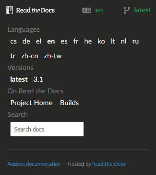

# Смена языка и версии

Документация, которую вы сейчас читаете, доступна на нескольких языках и относится к определенной версии **AAPS**. И язык, и версию можно изменить в меню в правом нижнем углу экрана.

```{note}
Нажмите на полосу в правом нижнем углу экрана, чтобы открыть меню выбора языка и версии.
```



## Изменение языка

В меню выберите язык, на котором вы хотите читать документацию.

Присоединяйтесь к переводчикам и корректорам на [Crowdin](https://crowdin.com/project/androidapsdocs) и помогите перевести документацию на ваш язык.

## Изменение версии

Номер версии отображается в правом нижнем углу экрана. Чтобы перейти на другую версию, нажмите на текущую версию и выберите нужную.

```{warning}
При смене языка и/или версии, вы можете получить 404 - Страница не найдена, если язык или версия не существует. Это часто происходит при смене версии, но не должно происходить при изменении языка: страница будет отображаться на английском языке, если еще не переведена.
```
