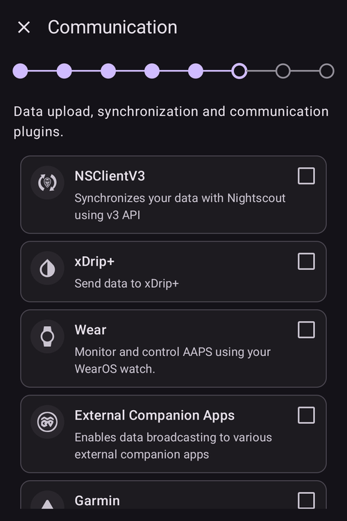
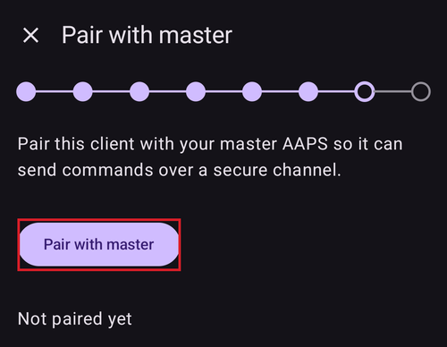
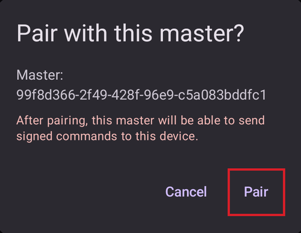
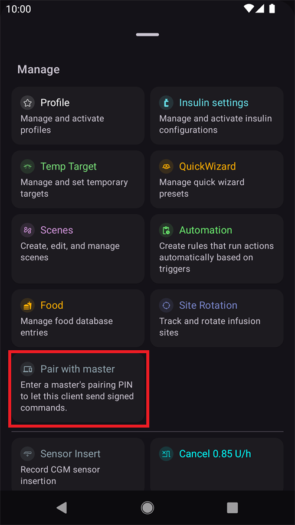
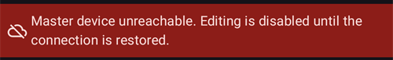

(aapsclient-app)=
# Приложение AAPSClient

**AAPSClient** — это дополнительное приложение к **AAPS**: приложение-компаньон для второго телефона (обычно телефона опекуна), которое **следит** за человеком, использующим **AAPS**. Начиная с версии 4 **AAPS** опекун также может **управлять** циклом удаленно с помощью подписанных команд. Оба телефона обмениваются данными через ваш сайт **Nightscout**; прямое соединение между телефонами не нужно.

```{admonition} Wording used on this page
:class: note
- **Клиент** = телефон, на котором работает **AAPSClient**.
- **Основной телефон** = главный телефон с **AAPS**, к которому подключена помпа и на котором работает цикл.
```

```{admonition} Which devices can run AAPSClient?
:class: note
Начиная с версии 4 **AAPS** **AAPSClient** работает на телефонах и планшетах Android, на часах Wear OS и на компьютерах (Windows, Mac и Linux). Для iPhone нет готового файла для скачивания: приложение нужно собрать самостоятельно. См. [таблицу файлов для скачивания по устройствам](#aapsclient-platforms).
```

```{contents} Table of contents
:depth: 2
:local: true
```

## Что такое AAPSClient (и чем он не является)

**AAPSClient** выглядит и работает как **AAPS**, но у него **нет собственного цикла**:

- В нем **нет алгоритма APS**, нет **Целей** и **нет драйверов помп** — он никогда не вводит инсулин сам.
- Модули, которые использует только основное приложение (**SMS коммуникатор**, **Tidepool**, **Open Humans**), в него тоже не входят.
- Что в нем *есть*: синхронизация **NSClientV3**, модули источников ГК, трансляция данных в **xDrip+** и подключение к **Wear OS** / **Garmin** — все, что нужно, чтобы следить и передавать команды. Часы **Garmin**, подключенные к клиенту, могут показывать данные, но углеводы, которые они отправляют, не вносятся, и они не могут подключить или отключить помпу: клиент показывает сообщение, и вы вносите эти данные в **AAPS**.

Все, что вы запускаете из **AAPSClient**, проверяется, ограничивается, подтверждается и **выполняется основным телефоном** (телефоном с помпой). Как это работает, объясняет отдельная страница [Управление «основной телефон ↔ клиент» (подписанное удаленное управление)](ClientMasterControl.md): как выполнить сопряжение двух телефонов, как основной телефон пишет текст подтверждения, который вы видите, как вводится болюс, запущенный на клиенте, и что происходит, когда основной телефон не в сети.

## Версии: AAPSClient, AAPSClient2 и AAPSClient3

На одном телефоне фолловера можно установить рядом до трех клиентских приложений, каждое из которых следит за **разными** людьми: **AAPSClient** (значок с желтой совой), **AAPSClient2** (синяя сова) и — новое в версии 4 **AAPS** — **AAPSClient3** (зеленая сова). По функциям они одинаковые. Отличаются только название и цвет (значок приложения, фон виджета и блок состояния на главном экране), чтобы их можно было различить. Каждое приложение сопряжено со своим основным телефоном. Подробнее см. [Об AAPSClient, AAPSClient2 и AAPSClient3](#remotecontrol-aapsclient-versions).

(aapsclient-platforms)=
## Как получить приложение

Все готовые файлы находятся в списке *Assets* последнего релиза на [GitHub](https://github.com/nightscout/AndroidAPS/releases/) (нажмите *Assets* внизу релиза, чтобы развернуть список). В таблице *x.y.z* означает номер версии. Выберите файл, который подходит для вашего устройства:

| Device                      | Файл для скачивания                 | Примечания                                                                                                                                                                                            |
| --------------------------- | ----------------------------------- | ----------------------------------------------------------------------------------------------------------------------------------------------------------------------------------------------------- |
| Телефон или планшет Android | `app-aapsclient-release_x.y.z.apk`  | Установите его как основное приложение: см. [Загрузка и установка AAPSClient](#RemoteControl_aapsclient) и [Перенос и установка AAPS на смартфон](../SettingUpAaps/TransferringAndInstallingAaps.md). |
| Часы Wear OS                | `wear-aapsclient-release_x.y.z.apk` | Работает вместе с приложением AAPSClient на телефоне. См. [Настройка AAPS на часах Wear OS](../WearOS/WearOsSmartwatch.md).                                                                           |
| Компьютер с Windows         | `AAPSClient-x.y.z.msi`              | Откройте файл, чтобы установить.                                                                                                                                                                      |
| Mac                         | `AAPSClient-x.y.z.dmg`              | См. примечание о macOS под таблицей.                                                                                                                                                                  |
| Linux (Debian, Ubuntu)      | `aapsclient_x.y.z_amd64.deb`        | Установите его с помощью менеджера пакетов.                                                                                                                                                           |
| iPhone                      | отсутствуют                         | Версии в App Store нет, файла для скачивания тоже нет. Приложение нужно собрать самостоятельно, см. [AAPSClient на iPhone](#aapsclient-iphone).                                                       |

**Следите за двумя людьми?** Каждый файл выше есть также в варианте *aapsclient2* / *AAPSClient2*. Это второе клиентское приложение, которое устанавливается рядом с первым, так что одно устройство может следить за двумя людьми (см. [Об AAPSClient, AAPSClient2 и AAPSClient3](#remotecontrol-aapsclient-versions)). **AAPSClient3** нет среди файлов релиза: соберите его самостоятельно ([варианты сборки](#browserbuild-variant)).

**Файлы, которые не нужны:** файлы *pumpcontrol* (`app-pumpcontrol-release_…`, `wear-pumpcontrol-release_…`) не являются клиентом. Не используйте их.

**Mac: первый запуск.** Приложение не заверено (notarized) Apple, поэтому macOS блокирует его при первом открытии. Нажмите *Готово*, затем откройте *Системные настройки → Конфиденциальность и безопасность*, прокрутите вниз и нажмите *Все равно открыть* (Open Anyway).

**Компьютер: как подключить.** У компьютера нет камеры, поэтому QR-код отсканировать нельзя. Настройте **Nightscout** в клиенте, затем на основном телефоне добавьте клиента с **PIN-кодом** и введите 8-значный PIN-код в клиенте (**Сопряжение с мастером**). См. [Сопряжение с основным телефоном](#aapsclient-pairing-with-the-master).

**Одна и та же версия везде.** На основном телефоне и на всех его клиентах должна работать одна и та же версия **AAPS**. Когда вы обновляете основной телефон, обновите и клиенты.

(aapsclient-iphone)=
### AAPSClient на iPhone

В App Store нет **AAPSClient** и нет готового файла для скачивания, поэтому приложение нужно собрать самостоятельно:

- Вам нужен Mac с **Xcode** и учетная запись разработчика Apple.
- Проект находится в папке `ios` [репозитория AndroidAPS на GitHub](https://github.com/nightscout/AndroidAPS/tree/master/ios).
- Сборка для настоящего iPhone подписывается вашей собственной командой разработчика Apple. Сборке для симулятора iPhone она не нужна.
- Пошаговой инструкции пока нет. Эта страница будет обновлена, когда она появится.

Версия для iPhone выполняет сопряжение с основным телефоном так же, как остальные. В отличие от версий для компьютера, iPhone может отсканировать QR-код основного телефона своей камерой.

## Первый запуск: сокращенный Мастер установки

При первом запуске **AAPSClient** открывает тот же **Мастер установки**, который вы знаете по **AAPS**, но с гораздо меньшим числом шагов — у фолловера нет настройки профиля, инсулина, помпы, APS или целей:

1. **Добро пожаловать**, **лицензионное соглашение**, **разрешения** и **главный пароль** — так же, как в основном приложении, см. [Мастер установки AAPS](../SettingUpAaps/SetupWizard.md).
2. Клиент **не** спрашивает **единицы измерения** и **нижнюю/верхнюю границы**: он берет их с основного телефона, как только подключится к Nightscout. Позже их можно увидеть в **Настройках**, где маленький **значок телефона** показывает, что они [синхронизированы с основным телефоном](#client-master-config-prefs). Их можно изменить только тогда, когда основной телефон доступен.
3. **Настройка с основного телефона** — на основном телефоне откройте **Управление → Авторизованные клиенты**, добавьте этот телефон с **QR-кодом** и нажмите здесь **Сканировать QR-код**. Одно сканирование настраивает Nightscout с собственным токеном этого телефона, а если код предназначен и для сопряжения, также выполняет сопряжение телефона. Телефон также берет в качестве имени экземпляра имя, с которым он был добавлен на основном телефоне (буквы с диакритическими знаками становятся простыми буквами, «Miloš» становится «Milos»). **После сканирования настройка завершена**: мастер закрывается, потому что следующие шаги только показали бы то, что уже сделал код. Если QR-кода нет, пропустите этот шаг. (Не на компьютере: у него нет камеры, см. [Как получить приложение](#aapsclient-platforms).)

   

4. **Связь** — в списке модулей есть только то, что нужно фолловеру (NSClientV3, xDrip+, Wear, Внешние приложения-компаньоны, Garmin). Если вы не сканировали QR-код, включите **NSClientV3** и введите **тот же URL Nightscout**, что и на основном телефоне, и токен доступа, с включенными **websockets** — точно так, как описано в разделе [Синхронизация](#RemoteControl_aapsclient). Websockets **обязательны** для удаленного управления из **AAPSClient** на обоих телефонах.

   

5. **Сопряжение с мастером** — этот шаг есть **только** на клиенте. Он подключает это устройство к основному телефону по защищенному каналу команд с помощью PIN-кода и, как и QR-код, берет имя, с которым телефон был добавлен на основном телефоне. **После сопряжения настройка завершена.** Этот шаг можно также пропустить и выполнить сопряжение в любое время позже через **Управление → Сопряжение с мастером**.

   

6. **Кто пользуется этим телефоном?** — только если вы не выполнили сопряжение в мастере: имя человека, который пользуется этим телефоном. По нему этот экземпляр отличается от других в отчетах и при синхронизации.

(aapsclient-pairing-with-the-master)=

## Сопряжение с основным телефоном

На **основном телефоне** откройте **Управление → Авторизованные клиенты** и добавьте клиента. Есть два способа выполнить сопряжение:

- **С QR-кодом** (быстрее всего, если у телефона есть камера): отсканируйте код на шаге мастера «**Настройка с основного телефона**» или через **Управление → Сопряжение с мастером → Сканировать QR-код** и подтвердите кнопкой «**Использовать**». При этом также настраивается Nightscout.
- **С PIN-кодом**: на **клиенте** откройте шаг мастера, описанный выше (или **Управление → Сопряжение с мастером**), введите одноразовый PIN-код, показанный на основном телефоне, и нажмите «**Выполнить сопряжение**». Затем клиент показывает, кому он собирается доверять, — подтвердите кнопкой «**Выполнить сопряжение**»:



Если сопряжение выполнено из мастера, после успешного сопряжения настройка завершается и открывается главный экран. На основном телефоне клиент появляется как **Активен** в списке [Авторизованные клиенты](#client_master_master_setup). После этого **Управление → Сопряжение с мастером** показывает «*Сопряжение уже выполнено*», роль телефона и включен ли защищенный режим:

 Полная процедура сопряжения, сведения о безопасности и устранение неполадок — на странице [Управление «основной телефон ↔ клиент» (подписанное удаленное управление)](#client_master_client_setup).

После сопряжения клиент получает от основного телефона собственный токен Nightscout (если на основном телефоне есть токен администратора) только с теми правами, которые нужны клиенту, и перестает использовать токен, который вы, возможно, ввели. **AAPSClient** никогда сам не записывает терапию или ГК в Nightscout: все, что он делает, отправляется на основной телефон, который это записывает. См. [Собственный токен Nightscout у клиента](#client-master-control-own-token).

Основной телефон определяет, что может делать этот телефон, с помощью его **[роли](#client-master-control-roles)** (Только чтение, Питание, Опекун или Администратор). **Управление → Сопряжение с мастером** показывает роль телефона.

## Главный экран

Главный экран клиента повторяет цикл, за которым он следит:


- **ГК, графики, IOB/COB и профиль** приходят из Nightscout точно так, как их загрузил основной телефон.
- Показанный **статус цикла** — это статус **основного телефона** (у клиента нет собственного цикла). Пока клиент не получил режим работы основного телефона из Nightscout, чип режима работы показывает **вопросительный знак** (неизвестно).
- **Карточка состояния** показывает резервуар и батарею **помпы, за которой следит клиент**, и батарею загрузчика, взятые из статуса устройства в Nightscout — у клиента нет помпы, поэтому в приложении нигде нет локального статуса помпы и управления помпой.
- На нижней панели есть **Терапия**, **Сценарии** и **Управление**, когда клиент сопряжен (до сопряжения — только **Управление**); вкладок помпы и целей нет.

## Терапия и действия

Все в разделе **Управление** работает так же, как в основном приложении, с одним важным отличием: на клиенте действия, которые меняют терапию (болюс, углеводы, временные цели, сценарии…), **скрыты, пока устройство не сопряжено**, а после сопряжения они **передаются на основной телефон** для подтверждения и выполнения — см. [Использование удаленного управления](#client-master-control).

Исключение — пункт **Профиль**: он показывается даже на **несопряженном** клиенте, но открывается **только для просмотра** — клиент показывает профили, которые получает через Nightscout (они нужны ему для собственных расчетов), без кнопок редактирования и активации. Когда клиент **сопряжен**, список профилей синхронизируется с основным телефоном, и вы можете редактировать и активировать профили с клиента, как любое другое удаленное действие.

На **несопряженном** клиенте в разделе **Управление** есть только **Профиль** и **Сопряжение с мастером**:


Красный баннер «*Основное устройство недоступно. Редактирование отключено до восстановления соединения.*» также появляется на несопряженном клиенте. Это ожидаемо: пока еще нет основного телефона, с которым можно связаться. Баннер исчезает, когда клиент сопряжен и основной телефон в сети.

Когда клиент сопряжен, появляются действия терапии:



**Пункта «Помпа» нет** — у клиента нет помпы.

Если основной телефон недоступен, тот же баннер появляется и на сопряженном клиенте: действия терапии становятся серыми, и все, что вы пытаетесь сделать, блокируется до отправки. Клиент замечает, что основной телефон не в сети, когда вы пытаетесь выполнить действие, и снова включает действия, когда основной телефон снова в сети.



## Настройки, синхронизированные с основным телефоном

Активная **конфигурация** модулей и многие **настройки** синхронизируются между основным телефоном и его сопряженными клиентами; синхронизированные элементы отмечены маленьким **значком телефона** и отключены (с баннером «*Основное устройство недоступно*»), пока основной телефон недоступен. Это описано в разделе [Изменение конфигурации и настроек](#client-master-config-prefs).

## AAPSClient на смарт-часах

Часы Wear OS можно связать с телефоном-**клиентом**; их действия передаются через клиента на основной телефон. См. [Настройка AAPS на часах Wear OS](../WearOS/WearOsSmartwatch.md) и [настройки смарт-часов в разделе «Удаленное управление AAPS»](#RemoteControl_smartwatches).
