# Android Auto

** AAPS ** может отправлять информацию о ваших текущих данных в виде сообщения непосредственно в Android Auto в автомобиле.

## Что потребуется:

**AAPS** использует функцию Android Auto, которая передает сообщения от приложений на телефоне на экран аудиосистемы автомобиля.

Это означает, что:

* Android должен разрешать **AAPS** показывать уведомления и
* Поскольку **AAPS** — неофициальное приложение, разрешите в Android Auto использование «неизвестных источников».

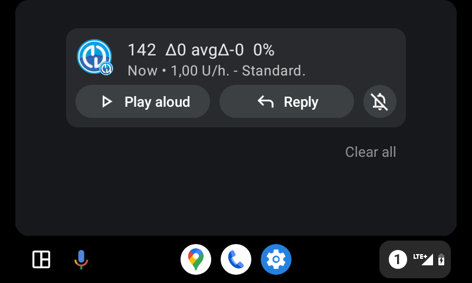

(androidauto-check-that-aaps-can-show-notifications)=

## Проверьте, что AAPS может показывать уведомления

**AAPS** всегда показывает уведомление о состоянии с текущей ГК, IOB и COB. Именно это уведомление Android Auto показывает в автомобиле. В **AAPS** ничего включать не нужно, но Android должен разрешать **AAPS** показывать уведомления.

На телефоне откройте **Настройки** > **Приложения** > **AAPS** > **Уведомления** и проверьте, что переключатель **Все уведомления AAPS** (All AAPS notifications) включен.

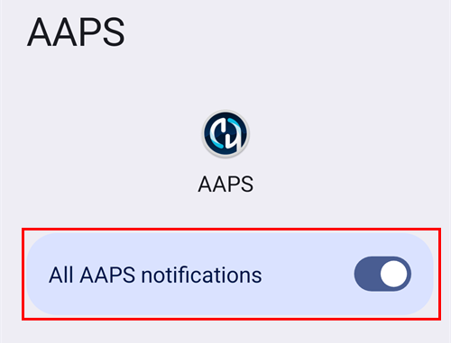

Прокрутите вниз и проверьте, что включен канал **Текущий статус** (Ongoing status): это канал уведомления о состоянии.

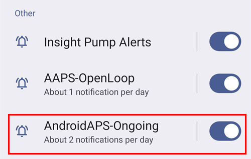

Сейчас, до того как идти к автомобилю, проверьте, что на телефоне видно уведомление о состоянии **AAPS**!

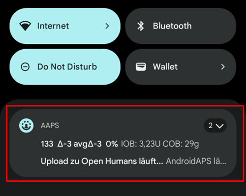

(androidauto-allow-the-use-of-unknown-sources-with-android-auto)=

## В Android Auto разрешите использование «неизвестных источников».

Так как **AAPS** не является официальным приложением Android Auto, в Android Auto нужно включить уведомления из «неизвестных источников». Это делается с помощью режима разработчика, который мы покажем здесь.

Подойдите к автомобилю и подключите телефон к его аудиосистеме.

Должен появиться экран, похожий на этот.

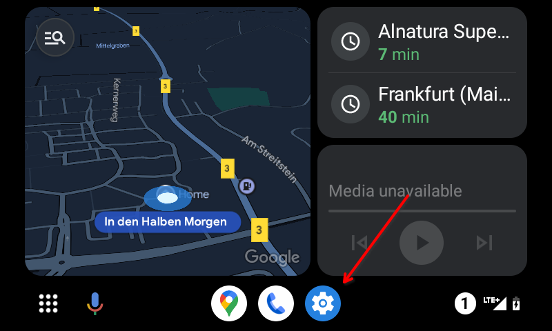

Нажмите на иконку **настроек** чтобы начать конфигурацию.

Прокрутите вниз до конца страницы и выберите **см. больше в телефоне**.

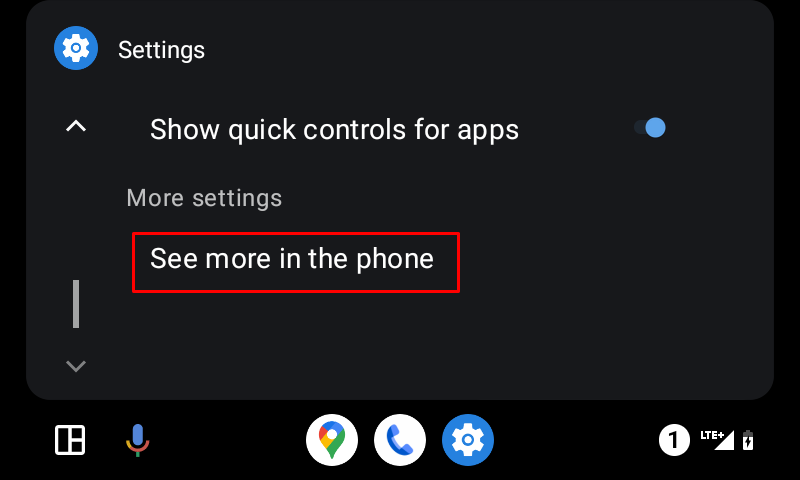

Теперь, на мобильном устройстве, активируем режим разработчика.

Первый экран выглядит так. Прокрутите вниз до конца страницы.

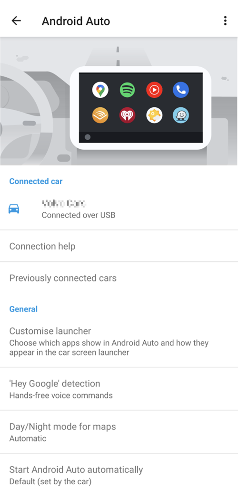

Там в списке вы видите версию Android Auto. Нажмите 10 раз (буквально десять) на версию Android Auto. Этой скрытой комбинацией вы открываете режим разработчика.

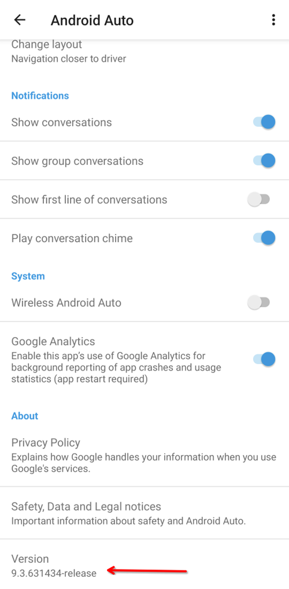

Подтвердите, что вы хотите включить режим разработчика в диалоге "Разрешить настройки разработки?".

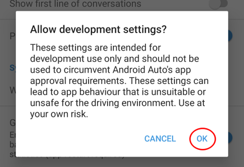

В настройках **разработчика** включите "Неизвестные источники".

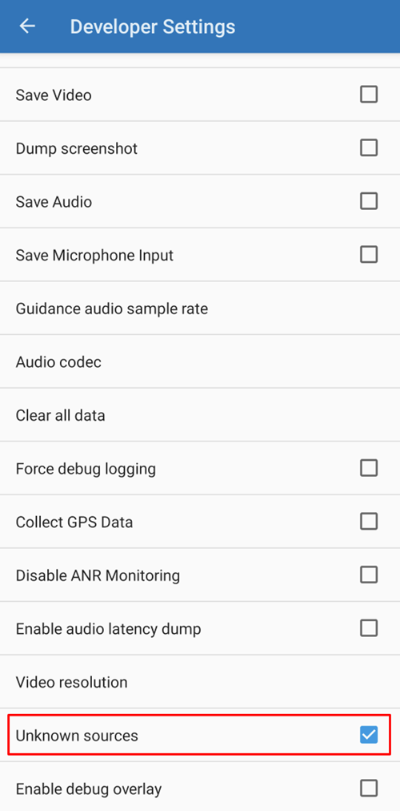

Теперь можно выйти из режима разработчика. Чтобы сделать это, нажмите на три точки меню вверху справа.

## Показывать уведомления в автомобиле

Коснитесь **значка № ** на нижней панели меню Android Авто в автомобиле.

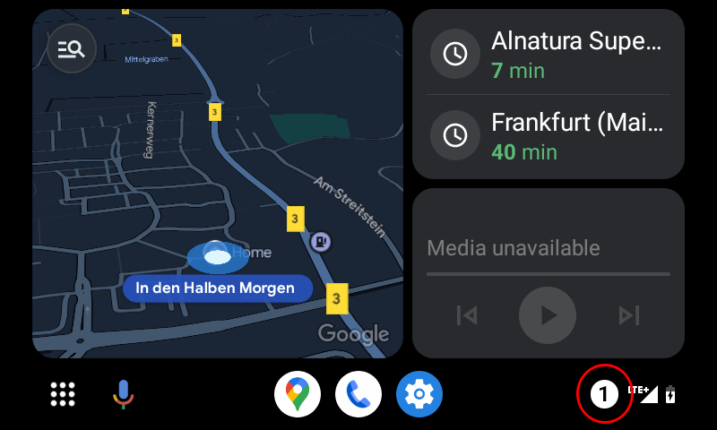

Значения гликемии будут показаны следующим образом:

(android-auto-troubleshooting)=

## Устранение неполадок:

* If you don't see the notification, check if you [allowed AAPS to show notifications](#androidauto-check-that-aaps-can-show-notifications) in Android and if [Android Auto has access rights to notifications](#androidauto-allow-the-use-of-unknown-sources-with-android-auto).