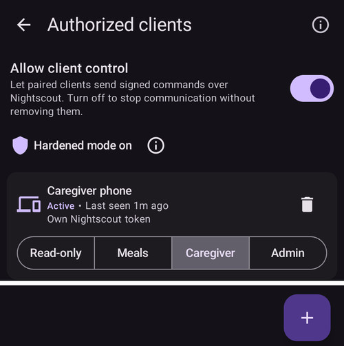
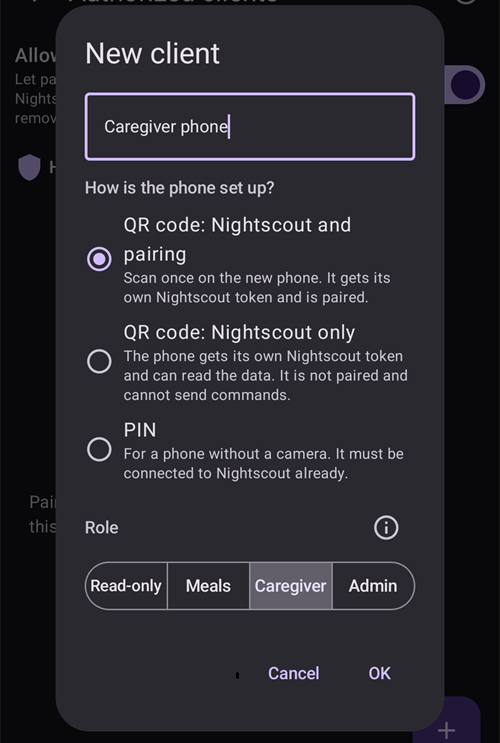
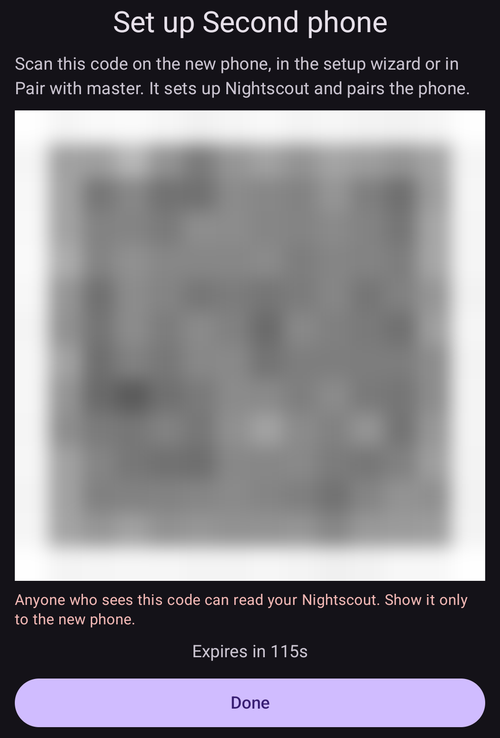
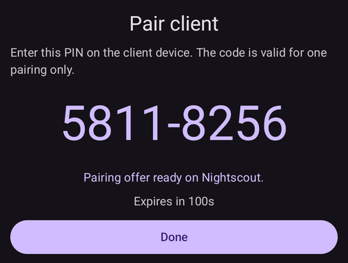
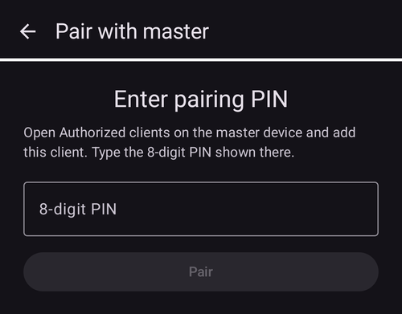
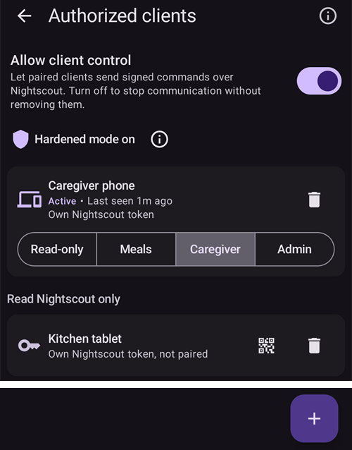
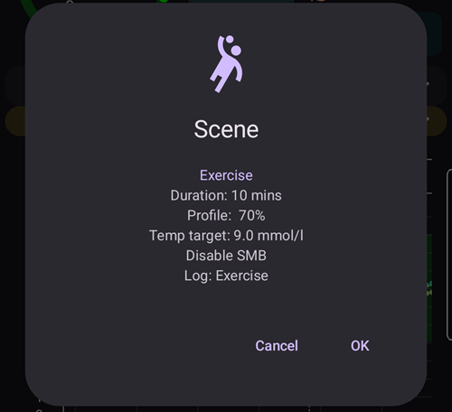
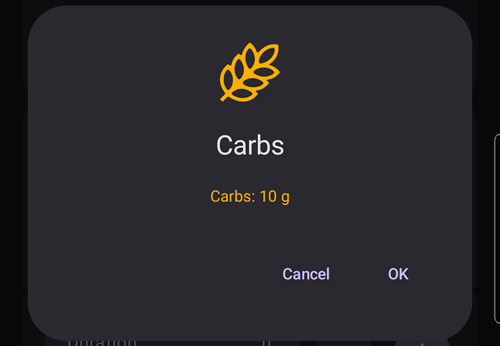
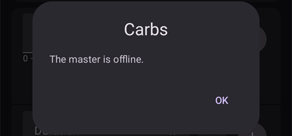
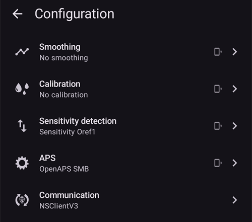

(client-master-control)=
# Управление «основной телефон ↔ клиент» (подписанное удаленное управление)

Начиная с версии 4 **AAPS**, телефон фолловера с приложением **AAPSClient** может делать намного больше, чем просто *сообщать* о терапии через Nightscout. После **сопряжения** с главным телефоном он может отправлять **подписанные команды**, которые главный телефон (**основной телефон**) проверяет, подтверждает и выполняет — включая подачу **болюса инсулина** помпой основного телефона.

На этой странице описано, как это работает, как это настроить и как этим пользоваться.

```{contents} Table of contents
:depth: 2
:local: true
```

```{admonition} Wording used on this page
:class: note
- **Основной телефон** (master, в приложении также «мастер») = главный телефон с **AAPS**, к которому подключена помпа и на котором работает цикл (приложение `full`).
- **Клиент** = телефон с **AAPSClient** без помпы, который следит за основным телефоном и теперь также *управляет* им.
- Оба телефона должны быть подключены к **одному и тому же сайту Nightscout**. Весь обмен данными по-прежнему идет через Nightscout — прямое соединение между телефонами не нужно.
```

---

## How it works

```{admonition} Coming from AAPS v3?
:class: note
В **AAPS** v3 **AAPSClient** мог только записывать в Nightscout неподписанные записи портала терапии и не мог подать болюс. Для удаленного управления теперь нужно один раз выполнить [сопряжение](#client_master_master_setup). См. также [Что изменилось в AAPS v4](#v4changes-remote-control).
```

**AAPS** v4 использует отдельный канал **Client-Control** (управление с клиента). Он по-прежнему работает через ваш сайт Nightscout (в коллекции `settings`), но каждое сообщение **подписано криптографически** секретом, который знают только два телефона. Секрет передается один раз, при **сопряжении**, и сразу после этого заменяется новым, поэтому он никогда не передается открытым текстом.

Главный принцип: **решает основной телефон**:

1. Клиент отправляет *намерение* («болюс 2 ед», «запустить сценарий Нагрузка», «установить эту временную цель»…).
2. **Основной телефон** заново рассчитывает действие и **ограничивает** его по своим **собственным** текущим данным (профиль, IOB, COB, текущая временная цель, помпа) и **составляет точный текст подтверждения**, который увидит пользователь.
3. Клиент (или часы) показывает текст подтверждения **основного телефона** — свой текст он никогда не составляет.
4. После подтверждения основной телефон **выполняет действие один раз** и сообщает результат клиенту.

Что это значит для вас:

- **Подписанные команды**: отправлять команды могут только клиенты, с которыми вы выполнили сопряжение (у каждого клиента свой секрет сопряжения и своя подпись). Старые или повторно отправленные команды отклоняются.
- **Роль для каждого клиента**: вы решаете, что может делать каждый клиент, от *Только чтение* до *Администратор* — см. [Роли клиентов](#client-master-control-roles).
- **Болюс инсулина с клиента**: основной телефон подает его своей помпой, а клиент показывает ход подачи.
- **Решает основной телефон**: он ограничивает каждое действие по своим собственным ограничениям и пишет текст подтверждения, который показывается на клиенте.
- **Терапию меняют только сопряженные клиенты**: пока управление с клиентов включено, основной телефон больше не принимает терапию или изменения, введенные прямо в Nightscout — см. [Защищенный режим](#client-master-control-hardened-mode).
- **Каждый клиент получает свой собственный токен Nightscout** только с теми правами, которые нужны клиенту — см. [Собственный токен Nightscout клиента](#client-master-control-own-token).
- **Основной телефон не в сети**: действия блокируются, и показывается понятное сообщение.
- **Отозвать доступ клиента** можно одним нажатием (для каждого клиента отдельно), или используйте переключатель на основном телефоне, чтобы остановить все клиенты.

Действия, которые можно запустить с клиента: **болюс**, **углеводы / растянутые углеводы (eCarbs)**, **временная цель** (установить и отменить), **переключение профиля**, изменение **цикла / режима работы**, **временный базал** (установить и отменить), **пролонгированный болюс** (установить и отменить), **выбор инсулина** и **[сценарии](../DailyLifeWithAaps/Scenes.md)**. Часть **настроек** также синхронизируется в обе стороны между основным телефоном и клиентами.

---

## Роли и требования

```{admonition} Before you start
:class: important
- На **основном телефоне** работает обычная сборка **AAPS** `full`, и он подключен к вашей помпе.
- **Основной телефон** использует **NSClientV3** с вашим Nightscout и показывает *подключено*. Дайте ему **токен администратора** вашего Nightscout: с ним основной телефон может создать собственный токен для каждого клиента и показать его клиенту в виде QR-кода.
- На **клиенте** работает **[AAPSClient](AapsClient.md)** (или **AAPSClient2** / **AAPSClient3** для других пациентов — см. [Об AAPSClient, AAPSClient2 и AAPSClient3](#remotecontrol-aapsclient-versions)). Он должен использовать **тот же самый** Nightscout. Если вы настраиваете его с помощью QR-кода основного телефона, клиент получает адрес Nightscout и токен от основного телефона; иначе сначала сами настройте на нем **NSClientV3**.
- Websockets **обязательны** для удаленного управления из **AAPSClient**, на обоих телефонах. Команда действует всего несколько секунд: без websockets она не выполняется, а не приходит с опозданием. Пока управление с клиентов включено, **AAPS** держит websockets включенными на основном телефоне и на сопряженных клиентах. Ваш хостинг Nightscout должен поддерживать websockets.
```

Сопряжение и синхронизация — это две разные вещи:

- **Синхронизация** (данные: ГК, терапия, профиль) настраивается как раньше — см. [Синхронизация](#RemoteControl_aapsclient). QR-код основного телефона может сделать это за вас на клиенте.
- **Сопряжение** (управление: описанный здесь канал подписанных команд) — это новый шаг, описанный ниже.

---

## Настройка

(client_master_master_setup)=
### 1. На основном телефоне — включите управление и добавьте клиента

На основном телефоне откройте экран **Управление** и выберите **Авторизованные клиенты**.

Включите **Разрешить управление с клиентов** (по умолчанию это **выключено**). Это главный выключатель: когда он выключен, ни один клиент не может отправлять команды, но сопряженные клиенты сохраняются, и позже вы можете снова включить его. При включении также включается [Защищенный режим](#client-master-control-hardened-mode). Он показывается как «*Защищенный режим включен*» со значком **(i)**, который объясняет его. В [Простом режиме](#preferences-simple-mode) управление с клиентов всегда включено, поэтому переключатель не показывается.



Нажмите кнопку **+** (справа внизу), чтобы добавить клиента. В диалоге **Новый клиент**:

1. Введите **имя устройства**, чтобы узнать его в списке.
2. Выберите, **как настраивается телефон** (см. таблицу ниже).
3. Выберите его **[роль](#client-master-control-roles)**. Ничего не выбирается за вас: правильная роль зависит от того, кто пользуется телефоном.



| Способ                              | Что получает новый телефон                                                         | Когда использовать                                                                                                     |
| ----------------------------------- | ---------------------------------------------------------------------------------- | ---------------------------------------------------------------------------------------------------------------------- |
| **QR-код: Nightscout и сопряжение** | адрес Nightscout, собственный токен Nightscout и сопряжение — за одно сканирование | у нового телефона есть камера: самый быстрый способ, ничего не нужно вводить                                           |
| **QR-код: только Nightscout**       | адрес Nightscout и собственный токен Nightscout, без сопряжения                    | телефон должен только **показывать** данные и никогда не отправлять команды                                            |
| **PIN-код**                         | только сопряжение; телефон сохраняет свои настройки Nightscout                     | у телефона нет камеры (или основной телефон не может создавать токены); телефон уже должен быть подключен к Nightscout |

Для обоих способов с QR-кодом нужен **токен администратора** в настройках **NSClientV3** основного телефона, потому что основной телефон создает токен клиента в Nightscout. Без него варианты с QR-кодом показываются, но их нельзя выбрать, и диалог объясняет почему; **PIN-код** работает всегда.

#### С QR-кодом

Нажмите **OK**: основной телефон создает токен Nightscout для клиента и показывает **QR-код**. Код, который также выполняет сопряжение, действует около **двух минут**; на экране идет обратный отсчет, и экран закрывается сам, когда клиент выполнил сопряжение. Отсканируйте его на новом телефоне, как описано в разделе [На клиенте](#client_master_client_setup).

```{admonition} The QR code is a secret
:class: warning
Любой, кто видит QR-код, может читать ваш Nightscout, а код для сопряжения также содержит данные сопряжения. Показывайте его только новому телефону. **AAPS** блокирует снимки экрана, пока код показан на экране.
```



#### С PIN-кодом

Нажмите **OK**: основной телефон показывает 8-значный **PIN-код сопряжения** в виде двух групп по четыре цифры (например, `1234 5678`). Этот PIN-код **одноразовый** и **перестает действовать примерно через две минуты**. Как и с QR-кодом, основной телефон отклоняет имя клиента, которое уже есть в его списке: каждый клиент получает собственный токен Nightscout под своим именем.



```{admonition} The pairing PIN is a secret
:class: warning
PIN-код защищает секрет сопряжения, который передается через Nightscout. Сообщайте его только устройству, с которым выполняете сопряжение, не публикуйте его и дайте ему истечь, если вы его не используете. Новый PIN-код всегда можно создать, снова нажав **+**.
```

(client_master_client_setup)=
### 2. На клиенте — выполните сопряжение с основным телефоном

#### Сканирование QR-кода

QR-код основного телефона можно отсканировать в двух местах:

- в **Мастере установки** клиента, на шаге «**Настройка с основного телефона**», который идет перед шагом Nightscout. Одно сканирование настраивает Nightscout, а код для сопряжения также выполняет сопряжение, поэтому настройка завершена: мастер закрывается и открывается главный экран;
- в любое время позже через **Управление → Сопряжение с мастером → Сканировать QR-код**.

В первый раз **AAPSClient** запрашивает разрешение на доступ к **камере**. Если вы откажете, на экране будет сказано, что камера нужна. Вы можете разрешить доступ кнопкой **Повторить** или вместо этого выполнить сопряжение с помощью PIN-кода.

Наведите камеру на код. Клиент показывает, что делает код — адрес Nightscout и, для кода с сопряжением, основной телефон, с которым будет выполнено сопряжение — и спрашивает «**Использовать этот код?**». Нажмите **Использовать**: клиент включает **NSClientV3**, заменяет свой адрес Nightscout и токен на те, что в коде, и включает websockets. Код для сопряжения также выполняет сопряжение телефона; телефон отправляет приветствие основному телефону, как только подключится к Nightscout.


```{admonition} Scanning is available on Android
:class: note
Компьютер без камеры: используйте на нем PIN-код.
```

#### Ввод PIN-кода

На клиенте откройте **Управление → Сопряжение с мастером** (или шаг мастера **Сопряжение с мастером** после шага Nightscout), **введите 8-значный PIN-код**, показанный на основном телефоне, и нажмите **Выполнить сопряжение**. Клиент использует PIN-код, чтобы безопасно получить предложение сопряжения через Nightscout, затем спрашивает «**Выполнить сопряжение с этим основным телефоном?**» и показывает идентификатор основного телефона. Нажмите **Выполнить сопряжение**, чтобы подтвердить (снимок экрана см. в разделе [Сопряжение с основным телефоном](#aapsclient-pairing-with-the-master)).



#### После сопряжения

После сопряжения клиент отправляет основному телефону сообщение **Hello** и появляется в списке **Авторизованные клиенты** основного телефона как **Активен**, со временем *«последней активности»*. Клиент узнает свою [роль](#client-master-control-roles) при сопряжении, поэтому сразу показывает нужные кнопки. Сопряжение, выполненное в Мастере установки, завершает работу мастера. На этом же шаге два телефона заменяют секрет сопряжения новым, который никогда не передавался (см. [Замечания о безопасности](#client-master-control-security)), а клиент, настроенный с помощью PIN-кода, получает свой собственный токен Nightscout (см. [Собственный токен Nightscout клиента](#client-master-control-own-token)). Клиент может быть сопряжен только с **одним** основным телефоном одновременно; чтобы выполнить сопряжение с другим основным телефоном, сначала нажмите **Разорвать сопряжение**.


### 3. Управление клиентами

На экране **Авторизованные клиенты** основного телефона вы в любое время можете:

- **Изменить роль** клиента с помощью ряда из четырех кнопок под его именем. Новая роль действует сразу, повторное сопряжение не нужно.
- **Посмотреть, с каким токеном Nightscout** записывает клиент: нужно, чтобы было написано «*Собственный токен Nightscout*». Красная строка «*Использует токен Nightscout …, у которого больше прав, чем нужно клиенту*» означает, что клиент все еще использует токен с большими правами, обычно ваш токен администратора — см. [Собственный токен Nightscout клиента](#client-master-control-own-token).
- **Отозвать доступ** одного клиента — нажмите значок **корзины** рядом с ним. Клиент больше не может отправлять команды, пока с ним снова не выполнят сопряжение. Его собственный токен Nightscout тоже удаляется, поэтому он больше не может и читать ваш Nightscout.
- **Остановить все управление**, не теряя сопряжений — выключите **Разрешить управление с клиентов**.

Телефоны, настроенные с помощью **QR-код: только Nightscout**, показаны под клиентами, в разделе «**Только чтение Nightscout**». Для каждого из них можно снова показать QR-код (чтобы заново настроить тот же телефон) или удалить его токен, что закрывает ему доступ к вашему Nightscout.



---

(client-master-control-roles)=
## Роли клиентов

У каждого сопряженного клиента есть **роль**. Основной телефон проверяет ее для каждой команды, а клиент показывает только то, что разрешает его роль. Новая роль действует сразу, повторное сопряжение не нужно. Роли строятся друг на друге: каждая может все, что может предыдущая.

| Роль              | Клиент может                                                                                                                                                                                                                                                             |
| ----------------- | ------------------------------------------------------------------------------------------------------------------------------------------------------------------------------------------------------------------------------------------------------------------------ |
| **Только чтение** | только показывать данные. Он остается сопряженным, поэтому готов к работе, когда вы дадите ему более высокую роль.                                                                                                                                                       |
| **Питание**       | подавать болюс, пользоваться Мастером болюса и Мастером быстрых настроек, вводить углеводы и останавливать текущий болюс. Углеводы, введенные здесь, могут заставить цикл подать больше инсулина.                                                                        |
| **Опекун**        | делать все, что пользователь делает в **AAPS**: временные цели, переключение профиля и инсулина, режим цикла, временный базал, пролонгированный болюс, сценарии, события портала терапии, калибровки и удаление записей. Он не может менять настройки или предустановки. |
| **Администратор** | делать все, включая настройки и предустановки (Мастер быстрых настроек, предустановки временных целей, сценарии, профили, автоматизация, инсулин).                                                                                                                       |

Значок **(i)** вверху экрана **Авторизованные клиенты** показывает это же объяснение. На клиенте **Управление → Сопряжение с мастером** показывает роль этого телефона.

---

(client-master-control-hardened-mode)=
## Защищенный режим

Когда **Разрешить управление с клиентов** включено, основной телефон находится в **защищенном режиме**: он принимает изменения только от сопряженных клиентов. Он **не** принимает терапию, временные цели, изменения профиля, изменения режима работы или удаления, сделанные прямо в Nightscout, например на сайте Nightscout или в других приложениях.

- Настройки приема данных из Nightscout (**NSClientV3 → Синхронизация**) скрыты, пока включен защищенный режим; **AAPS** работает так, как будто они выключены.
- Основной телефон по-прежнему **загружает** все свои данные в Nightscout, включая ГК, и держит **websockets** включенными.
- Если основной телефон получает **ГК из Nightscout**, он по-прежнему берет ГК оттуда.
- Чтобы загрузить историю на **новый** основной телефон, используйте **Полная синхронизация** в **NSClientV3**: она берет все, что есть в Nightscout, включая профили.
- Это не влияет на [SMS команды](SMSCommands.md).

Сопряженный клиент следует защищенному режиму основного телефона: он держит websockets включенными, и на нем скрыты те же настройки Nightscout. Несопряженный клиент сохраняет свои собственные настройки.

[Простой режим](#preferences-simple-mode) всегда включает защищенный режим. Чтобы выключить его, выйдите из Простого режима и выключите **Разрешить управление с клиентов** на основном телефоне.

```{admonition} Why hardened mode
:class: note
Все, что отправляет сопряженный клиент, подписано, проверено и подтверждено основным телефоном. С терапией, введенной на сайте Nightscout, это не так: ее может добавить любой, у кого есть права записи в ваш Nightscout. В защищенном режиме изменить то, что делает основной телефон, могут только подписанные команды.
```

---

(client-master-control-own-token)=
## Собственный токен Nightscout клиента

Клиенту не нужен токен администратора. Он только читает ваш Nightscout и отправляет через него свои команды основному телефону; сам он ничего не загружает. Поэтому основной телефон дает каждому клиенту собственный токен Nightscout только с такими правами:

- читать все,
- записывать в коллекцию `settings` — канал связи с основным телефоном,
- откладывать сигналы тревоги Nightscout.

Токен относится к роли Nightscout с именем **`aaps-client`**, которую основной телефон создает, когда она нужна ему в первый раз. Роль и токены (с именем из `aaps-` и имени клиента) можно увидеть в **Admin tools** (инструменты администратора) вашего сайта Nightscout. Если роль там изменили, основной телефон возвращает ее назад, когда в следующий раз создает токен или когда вы открываете **Авторизованные клиенты**.

Как клиент получает свой токен:

- **Настройка с помощью QR-кода**: токен содержится в коде.
- **Сопряжение с помощью PIN-кода** (или сопряжение, выполненное до появления этой функции): после сопряжения основной телефон отправляет клиенту его собственный токен по сопряженному каналу в зашифрованном виде. Клиент сначала проверяет, что вход с этим токеном работает, а затем использует его вместо прежнего токена. Для этого на основном телефоне нужен токен администратора; без него клиент сохраняет свой токен, а его карточка на основном телефоне показывает красную строку.

**Клиент сохраняет свой собственный токен.** Как только основной телефон увидел, что клиент записывает со своим собственным токеном, он принимает команды этого клиента только с этим токеном. Команда, записанная с другим токеном (например, с токеном администратора, введенным в клиент позже, или с токеном другого клиента), отклоняется, даже если клиент сопряжен, и клиент сообщает: «*Основной телефон отклонил команду: этот телефон записывает в Nightscout с другим токеном, а не со своим*». Его карточка на основном телефоне сообщает об этом красным цветом. Клиент по-прежнему показывается как находящийся в сети, поэтому вы можете увидеть, в чем проблема. Чтобы исправить это, удалите клиента на основном телефоне и добавьте его снова.

Основной телефон никогда не удаляет и не изменяет токен Nightscout, который он не создавал (токен с другими ролями, чем `aaps-client`): это ваши токены. Собственный токен клиента он удаляет, когда вы удаляете клиента.

---

## Использование удаленного управления

### Запуск действия с клиента

Пользуйтесь клиентом точно так же, как самим основным телефоном: откройте **Углеводы**, **Инсулин**, **Временная цель**, **Профиль**, **Сценарии**, панель **Управление** и т. д. и заполните значения.

Когда вы подтверждаете, клиент ненадолго показывает **«Связь с основным устройством…»**, **основной телефон** рассчитывает и ограничивает действие, а затем клиент показывает **собственное подтверждение основного телефона** — точно те же строки, значения и цвета, которые основной телефон показал бы на своем экране. Проверьте их и нажмите **OK**, чтобы продолжить.



То же самое относится к простому вводу углеводов — количество, показанное для подтверждения, рассчитано основным телефоном:



После вашего подтверждения основной телефон выполняет действие один раз, и результат отображается на клиенте.

### Болюс инсулина с клиента

Это главная новая возможность в v4. Болюс, запущенный на клиенте, **подает основной телефон своей помпой**; основной телефон ограничивает его по своим собственным ограничениям, а клиент показывает **ход подачи в реальном времени**, пока болюс идет (и сигнал тревоги, если помпа сообщает об ошибке).

```{admonition} Boluses are always confirmed and capped on the master
:class: note
Клиент никогда сам не решает, сколько инсулина подать. Основной телефон пересчитывает и ограничивает количество, вы подтверждаете количество, составленное основным телефоном, и только после этого оно подается.
```

(clientmastercontrol-when-the-master-is-offline)=
### Когда основной телефон не в сети

Если основной телефон недоступен (телефон выключен или спит, не подключен к Nightscout или websockets не работают), действия управления на клиенте **блокируются до того, как что-либо будет отправлено**, и вы получаете понятное сообщение. Ничего не применяется наполовину.



Клиент автоматически снова проверяет доступность и снова включает управление, как только основной телефон снова в сети.

(clientmastercontrol-wear-os-on-a-client)=

### Wear OS (часы) на клиенте

Часы, сопряженные с **клиентским** телефоном, передают свои действия через клиента основному телефону (часы → клиент → основной телефон). Часы показывают строки подтверждения **основного телефона** и реальный результат, так же как телефон. Настройка часов не изменилась — см. [Настройка AAPS на часах Wear OS](../WearOS/WearOsSmartwatch.md).


<!-- 📷 SCREENSHOT NEEDED (optional): watch confirmation screen relayed from the master,
     and/or the "Contacting master" state on the watch. Requires a paired Wear OS device. -->

---

(client-master-config-prefs)=
## Изменение конфигурации и настроек

Сопряжение не только передает отдельные действия — оно также поддерживает одинаковыми **конфигурацию** и многие **настройки** на основном телефоне и его клиентах.

### Конфигурация (какие модули активны)

Активные **модули** (алгоритм APS, чувствительность, сглаживание, …) выбираются на **основном телефоне** и **копируются** на каждый сопряженный клиент. На клиенте этот выбор отмечен маленьким **значком телефона** на экране [Конфигурация](#configuration_sync_icon) — меняйте его на основном телефоне, и клиенты автоматически следуют за ним, и наоборот.

На клиенте значок телефона появляется у *Сглаживание*, *Калибровка*, *Модули чувствительности* и *APS* (синхронизируются с основного телефона), но не у *Связь*:



Параметры подключения, которые у каждого устройства свои — прежде всего **URL Nightscout / токен доступа NSClient** — *не* синхронизируются. У каждого телефона они свои; на клиенте они берутся из QR-кода основного телефона, или вы задаете их сами.

### Профили

Ваш **список профилей** также синхронизируется между основным телефоном и сопряженными клиентами. На сопряженном клиенте **Управление → Профиль** показывает те же профили, что и основной телефон; вы можете **редактировать** профиль или **активировать** его, и — как любая другая команда — изменение отправляется на **основной телефон**, применяется там и синхронизируется обратно.

Когда вы в первый раз активируете профиль на только что установленном клиенте, клиент может показать «*Инсулин еще не используется*» и попросить **выбрать инсулин**. Выберите инсулин, который активен на основном телефоне (его показывает **Управление → Настройки инсулина** на основном телефоне).

На клиенте, который **не сопряжен**, экран профиля по-прежнему доступен, но **только для просмотра**: клиент показывает профили, которые получает через Nightscout (они нужны ему для собственных расчетов), но кнопок редактирования и активации нет — нет основного телефона, которому можно отправить изменение.

### Настройки

Часть **настроек** работает **в обе стороны**: их можно менять на **основном телефоне или на сопряженном клиенте**, и изменение синхронизируется на другую сторону. Когда вы меняете такую настройку на клиенте, она отправляется на основной телефон по подписанному каналу, применяется там, и окончательное значение отправляется обратно — поэтому на клиенте вы всегда видите то, что сохранил основной телефон. Если одну и ту же настройку изменили на двух устройствах почти одновременно, **действует последнее изменение**. Для настройки с ползунком новое значение отправляется, когда вы убираете палец.

Внутри настроек тот же маленький **значок телефона** отмечает отдельные настройки, которые синхронизируются. В примере ниже *Отсечка усвоения* синхронизируется (значок телефона), а настройки без значка действуют только на этом устройстве:


```{admonition} The master must be online to change synced settings from a client
:class: note
Так как сохраненное значение определяет основной телефон, для изменения с клиента элемента конфигурации, которым управляет основной телефон, или двусторонней настройки основной телефон должен быть **доступен**. Когда основной телефон не в сети, эти элементы управления на клиенте отключены (см. [Когда основной телефон не в сети](#clientmastercontrol-when-the-master-is-offline)).
```

---

(client-master-control-security)=
## Замечания о безопасности

```{admonition} How the channel is protected
:class: tip
- **Секрет сопряжения**: основной телефон передает его клиенту один раз — защищенным PIN-кодом в документе Nightscout или внутри QR-кода, — и оба телефона хранят его в зашифрованном виде.
- **Новый секрет сразу после сопряжения**: первое сообщение клиента после сопряжения запускает обмен ключами, и с этого момента оба телефона используют секрет, который никогда не передавался. Секрет, который кто-то мог увидеть (сфотографированный QR-код, предложение с PIN-кодом, прочитанное из Nightscout), после этого бесполезен. Телефоны, сопряженные до появления этой функции, делают то же самое один раз после обновления.
- **Каждая команда подписана** (HMAC). Основной телефон отклоняет все, подпись чего не совпадает с сопряженным клиентом.
- **Повторная отправка невозможна** благодаря монотонному счетчику для каждого клиента, и каждая команда **истекает** через короткое время жизни.
- **Минимальные права в Nightscout**: у каждого клиента есть [собственный токен Nightscout](#client-master-control-own-token), который может только читать и записывать в канал управления с клиента. Как только клиент использовал этот токен, основной телефон принимает его команды только с этим токеном. При удалении клиента токен удаляется.
- **Только подписанные изменения**: в [защищенном режиме](#client-master-control-hardened-mode) основной телефон игнорирует изменения терапии, введенные прямо в Nightscout.
- **Основной телефон подписывает то, чем делится**: настройки, список клиентов и признак «основной телефон работает», которые основной телефон помещает в Nightscout для своих клиентов, содержат подпись основного телефона. Клиент принимает их, только если подпись принадлежит основному телефону, поэтому токен другого клиента не может их изменить. Клиент узнает ключ основного телефона при сопряжении или, для телефона, который только читает Nightscout, из QR-кода. Отклоненный документ показывается в журнале NSClient как «*✕ SETTINGS … refused*».
- **Управление остается у вас**: дайте каждому клиенту нужную ему [роль](#client-master-control-roles), отзовите доступ клиента одним нажатием или выключите все с помощью **Разрешить управление с клиентов**.
```

```{admonition} After restoring a backup
:class: warning
Если клиент восстановлен из резервной копии, в которой счетчик команд меньше, основной телефон будет отклонять его следующие команды как повторные. Чтобы исправить это, просто **разорвите сопряжение и выполните его снова**.
```

---

(client-master-control-troubleshooting)=

## Устранение неполадок

При проблемах с Nightscout / синхронизацией сначала см. [Устранение неполадок NSClient](../GettingHelp/TroubleshootingNsClient.md).

### Pairing

**Варианты с QR-кодом нельзя выбрать в диалоге «Новый клиент»**

Диалог объясняет почему:

- *Не токен администратора*: дайте основному телефону токен администратора вашего Nightscout или добавьте клиента с помощью **PIN-кода**.
- *Нет подключения*: подождите, пока основной телефон не покажет *подключено* в **NSClientV3**.

**«В Nightscout есть токен с этим именем и другими правами»**

Один из ваших собственных токенов Nightscout называется `aaps-` и этим именем. Выберите для клиента другое имя.

**«Клиент с этим именем уже есть в списке»**

Выберите другое имя или сначала удалите этого клиента.

**Клиент сообщает «Этот код из другой версии AAPS»**

На основном телефоне и клиенте должна работать **одна и та же** версия **AAPS**. Обновите более старую.

**Клиент сообщает «Срок действия этого кода истек»**

Код для сопряжения действует около двух минут. Чтобы получить новый код, снова добавьте клиента на основном телефоне.

**Клиент сообщает «Этот телефон уже сопряжен»**

Сначала разорвите сопряжение (**Управление → Сопряжение с мастером → Разорвать сопряжение**), затем отсканируйте снова. Код **только Nightscout** работает и на сопряженном телефоне.

**Сопряжение отменяется с сообщением «Не удалось сохранить секрет сопряжения»**

Ничего не изменилось. Начните сопряжение заново. Если ошибка повторяется, перезапустите **AAPSClient** и попробуйте еще раз.

**Клиент сообщает, что он не сопряжен**

Выполните сопряжение снова через **Управление → Сопряжение с мастером**. Проверьте, что клиент показан как **Активен** в списке **Авторизованные клиенты** основного телефона.

**После сопряжения ничего не происходит**

Убедитесь, что на основном телефоне **Разрешить управление с клиентов** ВКЛЮЧЕНО и что основной телефон подключен к Nightscout.

### Команды

**Клиент сообщает, что основной телефон не в сети, или команды не выполняются**

Проверьте, что:

- основной телефон не спит и **AAPS** работает,
- оба телефона подключены в **NSClientV3** к одному и тому же сайту Nightscout,
- **websockets** включены на обоих телефонах.

Websockets **обязательны** для удаленного управления из **AAPSClient**. Если соединение websocket постоянно обрывается, удаленное управление не работает. См. [Устранение неполадок NSClient](../GettingHelp/TroubleshootingNsClient.md).

**Основной телефон отклоняет команду**

Основной телефон снова проверяет каждую команду по своему текущему состоянию: например, выбранного профиля больше нет или тип помпы не совпадает. Проверьте на основном телефоне.

**Терапия, введенная на сайте Nightscout, не применяется**

Это ожидаемо в [защищенном режиме](#client-master-control-hardened-mode). Вместо этого вводите их на сопряженном клиенте.

### Токены и настройки Nightscout

**Клиент сообщает «Основной телефон отклонил команду: этот телефон записывает в Nightscout с другим токеном, а не со своим»**

Раньше клиент использовал свой собственный токен Nightscout, а теперь записывает с другим, например после того, как токен ввели в его настройки Nightscout. Удалите клиента на основном телефоне и добавьте его снова (см. [Собственный токен Nightscout клиента](#client-master-control-own-token)).

**Карточка клиента показывает красным «Использует токен Nightscout …»**

Клиент все еще записывает с токеном, у которого больше прав, чем ему нужно. Основной телефон отправляет клиенту его собственный токен после сопряжения, но только если у основного телефона есть токен администратора. Проверьте токен основного телефона или заново настройте клиента с помощью QR-кода.

**Журнал NSClient на клиенте показывает «✕ SETTINGS … refused», и его настройки больше не следуют за основным телефоном**

Кто-то другой записал документ настроек основного телефона, или у основного телефона новый ключ (например, после очистки его данных). Сопряженный клиент сам принимает новый ключ, когда в следующий раз подключается к Nightscout. Телефону, который только читает Nightscout, нужно снова отсканировать QR-код основного телефона (**Только чтение Nightscout → показать код**).

**Клиент больше не может читать Nightscout**

Его токен был удален, например потому, что клиента удалили на основном телефоне. Добавьте его снова.

---


<!-- =====================================================================
     SCREENSHOTS STILL TO ADD:
       1. (optional) Wear OS confirmation relayed from the master
     Already included:
       - authorized_clients_master.png       (master: Allow client control, hardened mode, client card, + button)
       - authorized_clients_roles.png        (master: client card with roles, Read Nightscout only section)
       - new_client_master.png               (master: New client dialog, three ways and role row)
       - qr_code_master.png                  (master: pairing QR code with countdown, code blurred; console screenshot)
       - aapsclient_wizard_from_master.png   (client: Set up from the master wizard step)
       - pair_with_master_unpaired.png       (client: pairing screen, unpaired PIN entry)
       - pairing_pin_master.png              (master: one-time pairing PIN — expired demo PIN)
       - pair_with_master_client.png         (client: pairing screen, paired state)
       - confirmation_master_authored.png    (client: master-authored scene confirmation)
       - carbs_confirmation_client.png       (client: master-authored carbs confirmation)
       - master_offline_error.png            (client: master-offline message)
     Maintainers: relocate page + images and fix cross-links as needed.
     ===================================================================== -->
