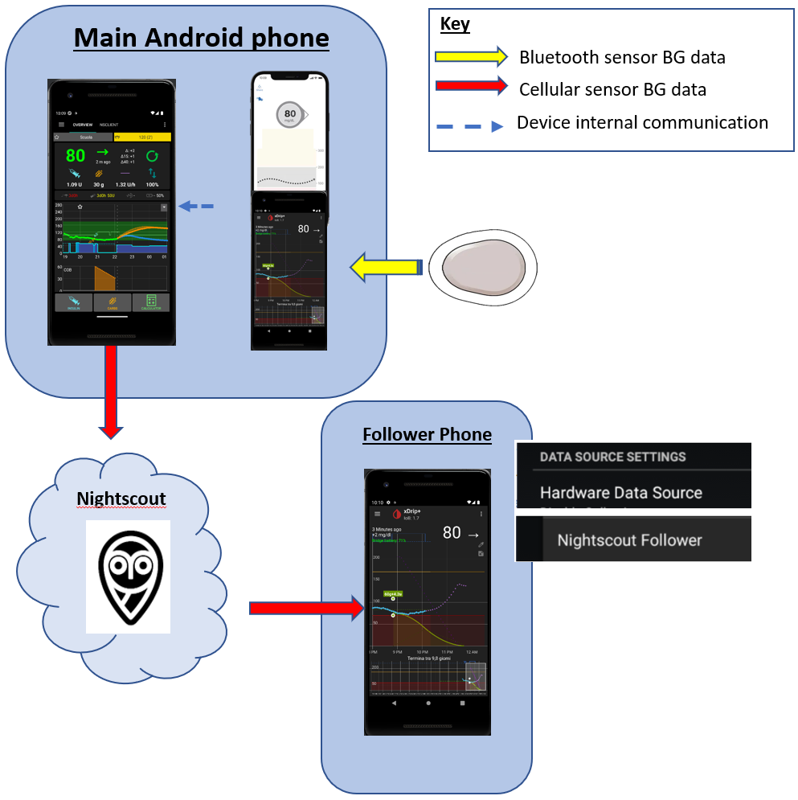
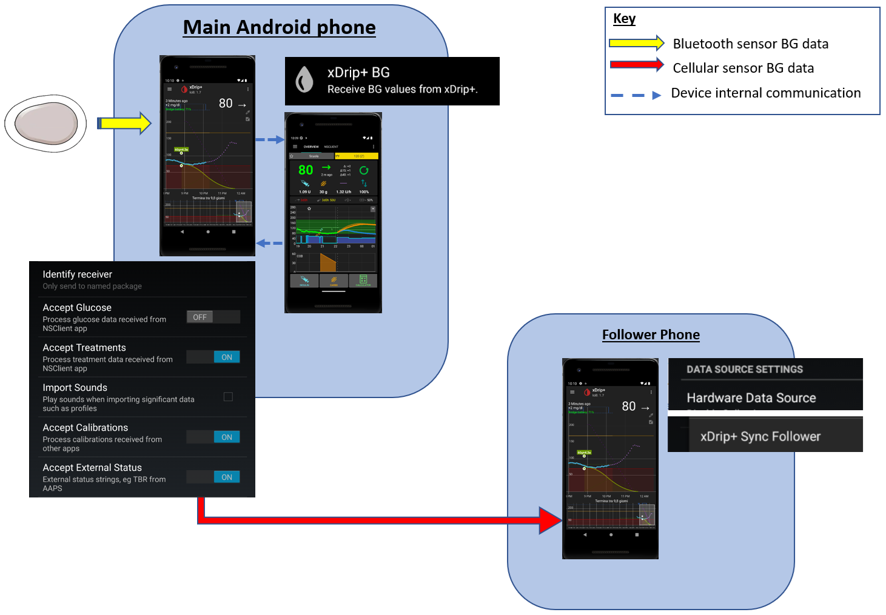
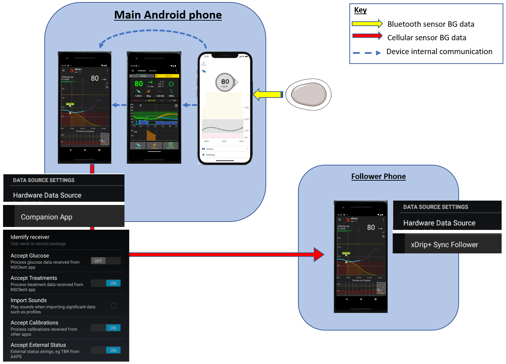
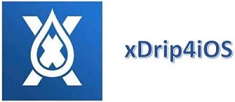
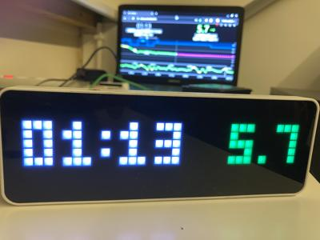

# Слежение за работой AAPS (без взаимодействия с системой)

Кроме многих возможностей удаленного управления _и_ слежения за **AAPS**, описанных в разделе [Удаленное управление AAPS](../RemoteFeatures/RemoteControl.md), сообщество создало несколько дополнительных приложений и устройств, чтобы просто следить за числами (уровнем глюкозы и другой информацией) без взаимодействия с **AAPS**.

Хороший обзор многочисленных вариантов слежения за **AAPS** есть на веб-странице [Nightscout follower](https://nightscout.github.io/nightscout/downloaders/#).

```{contents} Table of contents
:depth: 1
:local: true
```

Наиболее распространенные сценарии сочетания работы **AAPS** с наблюдением приведены ниже.

## Smartphone apps

```{contents} These are some of the main “follower” apps used by **AAPS** users. All of these apps are “free”: 
:depth: 1
:local: true
```

### Dexcom Follow ([Android](https://play.google.com/store/apps/details?id=com.dexcom.follow.region2.mgdl) и [iOS](https://apps.apple.com/fr/app/dexcom-follow-mg-dl-dxcm2/id1032203080))


* Dexcom Follow работает на очень многих телефонах (и Android, и iPhone). Dexcom Follow можно использовать, даже если вы не используете официальное приложение Dexcom для получения данных.

* Многие опекуны знают Dexcom Follow и предпочитают его понятный интерфейс чему-то более сложному.

* Dexcom Follow очень хорошо подходит для учителей, бабушек и дедушек и людей, которые очень мало знают о диабете и уровне сахара. It has customizable alerts (BG level, what sound to play etc.). Оповещения могут быть полностью выключены, что очень полезно, если сенсор еще прирабатывается и передает много заниженных значений.

#### Setting up Dexcom Follow: how-to-guide

Если для получения данных сенсора вы используете неофициальное приложение Dexcom BYODA, возможно, вы сможете отправлять приглашения фолловерам прямо из BYODA.

Из сторонних приложений больше нельзя отправлять фолловерам Dexcom приглашения по электронной почте. In xDrip the invite request will just result in the message “invite not sent”.

Нужно установить официальное приложение Dexcom, отправить приглашение, а затем удалить официальное приложение.

Для этого выполните следующие шаги:

1) Установите официальное приложение «Dexcom» на _любой_ смартфон (Android/iPhone); если так удобнее, это может быть телефон фолловера. 2) Войдите c именем пользователя и паролем Dexcom, это те же данные, что и для Dexcom Clarity, если вы уже клиент Dexcom/Clarity. Если у вас нет учетной записи Dexcom, можно создать новый логин.   
3) Пролистайте вводные меню. 4) В разделе код сенсора (sensor code) введите "no code". 5) В разделе «Transmitter SN» (номер трансмиттера) выберите «enter manually» (ввести вручную) и введите любой допустимый код трансмиттера (если знаете, используйте код одного из ваших старых трансмиттеров с истекшим сроком, чтобы он не мешал работе текущего трансмиттера; коды имеют определенный формат из цифр и букв: «NLNNNL», и допустимы только некоторые комбинации, поэтому проще всего взять код, о котором вы точно знаете, что он действителен). 6) Когда приложение начнет искать трансмиттер и сенсор, вы сможете пригласить фолловеров: нажмите три маленькие точки в левом верхнем углу приложения и добавьте нового фолловера. Это можно сделать и тогда, когда один из ваших фолловеров сменил телефон и ему нужно новое приглашение: здесь вы можете удалить его из списка фолловеров и снова отправить приглашение по электронной почте для нового телефона. 7) На телефоне фолловера установите Dexcom Follow, скачав его из App Store (iPhone) или Google Play (Android). Настройте приложение Dexcom Follow и вам будет предложено открыть электронную почту, найти приглашение и стать подписчиком.    
8) Теперь можно удалить официальное приложение Dexcom G6.

For Dexcom Follow, the sensor data is then exported from the **AAPS** phone either directly from BYODA, or from xDrip, depending on which app you are using.


### [Nightguard](https://apps.apple.com/fr/app/nightguard/id1116430352) (iOS)


Достоинства (как указывают пользователи):

* Доступен в [App Store](https://apps.apple.com/us/app/nightguard/id1116430352), простой и удобный интерфейс.

* Чтобы отложить сигналы тревоги на разные периоды от 5 мин до 24 часов, проведите по кнопке или встряхните телефон

* Настраиваемые сигналы тревоги (оповещения о высокой и низкой ГК, о пропущенных значениях, если данных нет 15–45 минут).

* Быстрый рост или падение за 2–5 значений подряд (выбираете вы). Можно также выбрать значения дельты между двумя данными

* Умное откладывание: нет оповещения, если уровень меняется в нужном направлении

* Есть вкладка «Care», которая, похоже, позволяет задать новую временную цель на определенное время, удалить временную цель или ввести углеводы.

Недостатки (по сообщениям пользователей)

* Доступен только для iOS

* Временная цель показывается как 5 ммоль, какой бы уровень временной цели ни был задан

* Никогда не показывает скорость временного базала, хотя показывает TB

### [Nightwatch](https://play.google.com/store/apps/details?id=se.cornixit.nightwatch) (Android)


* Nightwatch позиционирует себя как клиент Nightscout и показывает уровень глюкозы пользователя из Nightscout на телефоне или планшете Android.

* Приложение можно скачать из [Google Play](https://play.google.com/store/apps/details?id=se.cornixit.nightwatch), оно показывает данные ГК в реальном времени.

* The user can be alerted with customized noisy low and high alarms set.

* Данные ГК можно смотреть в ммоль/л или в мг/дл.

* Нужен Android 5.0 или новее.

* It has a dark UI, large readings and buttons, designed for usage at night.

### xDrip (Android)

You can use xDrip as a follower.

#### С Nightscout

Set xDrip as a Nightscout Follower. Вы будете получать ГК и терапию, но не базал.



#### Without Nightscout - xDrip BG data source

If your **AAPS** data source is xDrip (or if xDrip can also receive BG from another app like BYODA, Juggluco, ...) you can use it from the master phone to share data with xDrip followers, displaying BG, treatments and basal rates.



#### Without Nightscout - xDrip BG companion app

If your **AAPS** data source is not xDrip but you can display BG data from the Companion App data source, you can use it from the master phone to share data with xDrip followers, displaying BG, treatments and basal rates.



### xDrip4iOS (iOS)



xDripSwift was created from porting the original xDrip app to iOS and evolved into "xDrip for iOS", written as **xDrip4iOS**.

```{admonition} Further detail about how to attempt to obtain the original **xDrip4iOS** app
:class: dropdown
[Группа xDrip4iOS в Facebook](https://www.facebook.com/groups/853994615056838/announcements) — основное место поддержки сообщества для xDrip4iOS и Shuggah. **xDrip4iOS** может подключаться ко многим разным системам CGM и трансмиттерам, показывать значения глюкозы крови, графики и статистику, а также подавать сигналы тревоги. Он также может загружать данные в Nightscout или работать как [приложение-фолловер для Nightscout](https://xdrip4ios.readthedocs.io/en/latest/connect/follower/). 

«Как установить **xDrip4iOS** на iPhone?»
Есть два варианта:

1. Если у вас есть Mac и учетная запись Apple Developer (99 EUR/USD в год), вы можете собрать свой xDrip4iOS, [следуя инструкции](https://xdrip4ios.readthedocs.io/en/latest/install/build/).

Если хотите, вы можете затем стать «релизером» и [поделиться личной сборкой xDrip4iOS в Testflight](https://xdrip4ios.readthedocs.io/en/latest/install/personal_testflight/) с другими людьми (до 100 человек), чтобы помочь им.

2. Вступите в [группу xDrip4iOS в Facebook](https://www.facebook.com/groups/853994615056838/announcements) и прочитайте закрепленные сообщения о текущих способах получить приложение. **Не просите приглашение в приложение** (прочитайте правила группы).
```


«Что такое **Shuggah**?» Группа украинских разработчиков скопировала код проекта xDrip4iOS (он открыт на GitHub) и выпустила его в App Store под бизнес-аккаунтом. Разработчики xDrip4iOS никак не управляют выпуском Shuggah.

[Группа xDrip4iOS в Facebook](https://www.facebook.com/groups/853994615056838/announcements) поддерживает xDrip4iOS и соответствующие приложения для Apple Watch.

### [Sugarmate](https://apps.apple.com/fr/app/sugarmate/id1111093108) (iOS)


[Sugarmate](https://sugarmate.io/) можно закачать из App Store. Sugarmate совместим с:
* Apple iPhone (нужна версия ПО 13.0 или новее)
* Apple iPad (нужна версия ПО 13.0 или новее)
* Google Android (сохраните веб-приложение на главный экран)

Пользователи Sugarmate сообщают что приложение совместимо с Apple CarPlay в США для отображения данных гликемии во время вождения. Пока еще не установлено, возможно ли это в странах за пределами США. If you know more about this, please add details in here to the documentation by completing a [pull request](../SupportingAaps/HowToEditTheDocs.md), which is quick and easy to do.


### [Spike](https://spike-app.com/) (iOS)


Spike can be used as a primary receiver or as a follower app, providing BG, alarms and IOB and more.

Сайт и приложение больше не развиваются. Поддержку можно найти в [Facebook](https://www.facebook.com/groups/1973791946274873) и [Gitter](https://gitter.im/SpikeiOS/Lobby).

## Смарт-часы для **мониторинга AAPS** (все данные профиля или только глюкоза), когда **AAPS** работает на телефоне.

See [here](../Getting-Started/Watches.md).


## Devices for following AAPS

```{contents} Devices include:
:depth: 1
:local: true
```

### M5Stack


M5Stack — это небольшая коробка, которую можно запрограммировать для многих задач. Проект Мартина [M5Stack NightscoutMon](https://github.com/mlukasek/M5_NightscoutMon/wiki) показывает значения глюкозы с сенсора и тренды, IOB и COB. Он находится в пластиковой коробке, оснащен цветным дисплеем, слотом для карт Micro SD, 3 кнопками, динамиком и внутренним аккумулятором. Это отличный монитор уровня сахара, и его довольно легко настроить, если у вас есть учетная запись Nightscout. Обычно его используют через домашний Wi-Fi, но некоторые пользователи сообщают, что используют его как дисплей при езде на мотоцикле, подключив его к точке доступа Wi-Fi телефона.

### SugarPixel

SugarPixel — это устройство для системы вторичного оповещения об уровне глюкозы для приложений Dexcom или Nightscout на смартфоне пользователя. Устройство отображает показания уровня сахара в крови в режиме реального времени. This CGM hardware monitor benefits from random tone generation audio alerts (which are incredibly loud), vibration alerts for hearing impaired, customizable display options and native multi-user following.


* SugarPixel has multiple display options in mg/dL and mmol/L to suit the user’s needs with color-coded glucose values.
* Стандартный экран показывает ГК, стрелку тренда и дельту. Дельта - это изменение + или - от последнего показания.
* SugarPixel can be customized for use in low brightness with the BG and Time face to see the user’s BG reading and current time on the user’s nightstand.
* SugarPixel’s color face uses the entire display to show a single color representing the BG value. Это позволяет пользователю видеть значения ГК на расстоянии через окно, находясь в бассейне, во дворе или на веранде.
* Экран Big BG (крупная ГК) удобен для тех, кто смотрит на него с прикроватной тумбочки и носит очки или контактные линзы.

### Nightscout Clock на Ulanzi TC001

**Nightscout Clock** — это программа с открытым исходным кодом, которая работает на устройстве **Ulanzi TC001**. Она подключается к серверам Dexcom или к Nightscout и показывает значения сахара крови в реальном времени.



* Часы поддерживают единицы ммоль/л и мг/дл и имеют звуковые сигналы тревоги.
* Several displays are available, see [Github nightscout-clock](https://github.com/ktomy/nightscout-clock?tab=readme-ov-file#more-information-for-people-who-needs-it) for an overview.
* Установка и настройка устройства — это всего несколько простых шагов. После настройки для работы нужны только питание и Wi-Fi.
* Устройство Ulanzi TC001 стоит значительно дешевле, чем SugarPixel.
* Программу и инструкции по установке можно найти на [Github nightscout-clock](https://github.com/ktomy/nightscout-clock?tab=readme-ov-file).
* Ее разрабатывает и поддерживает Artiom Kenibasov, поддержка — в [группе AAPS Users в Facebook](https://www.facebook.com/groups/cgminthecloud/posts/8776932509094594/).

### ПК (TeamViewer)
Некоторые пользователи считают, что полнофункциональный инструмент удаленного доступа, такой как [TeamViewer](https://www.teamviewer.com/), может оказаться полезным для удаленного устранения неполадок.
