# Дистанционное управление AAPS

```{contents} In this page
:backlinks: entry
:depth: 2
```

Существует 4 наиболее эффективных инструмента для удаленного управления **AAPS**:

1) [SMS commands](#RemoteControl_SMS-Commands) (follower phone can be either Android or iOS), 2) [AAPSClient](#RemoteControl_aapsclient) (follower device is an Android phone or tablet, or a Windows, Mac or Linux computer; on an iPhone you [build the app yourself](#aapsclient-iphone)) 3) [Nightscout](#RemoteControl_nightscout) (Android, iOS or other computer/device), mainly for following: see the note on [client control](#client-master-control) in that section.  
4) [Smartwatches](#RemoteControl_smartwatches) (Android)

Первые три подходят в основном для опекунов/родителей, а смарт-часы очень полезны и для опекунов/родителей, **и** для самих взрослых с диабетом.


(RemoteControl_SMS-Commands)=

## 1) SMS Commands

См. отдельную страницу [SMS команды](../RemoteFeatures/SMSCommands.md).

(RemoteControl_aapsclient)=
## 2) AAPSClient

**AAPSClient** looks very similar in appearance to **AAPS** itself, offering the caregiver the same screens and buttons to send commands remotely to **AAPS**:


(remotecontrol-aapsclient-versions)=
### About AAPSClient, AAPSClient2 and AAPSClient3

There are 3 versions of the client app: **AAPSClient**, **AAPSClient2** and **AAPSClient3**. They work the same way. The only difference is that they can be installed side by side on the same follower phone.

A caregiver who follows one person needs only **AAPSClient**. To follow and remote control a second person (with their own **Nightscout** site and their own **AAPS** phone), install **AAPSClient2** as well, and **AAPSClient3** for a third person. Each app is set up and [paired](#aapsclient-pairing-with-the-master) on its own, with the **Nightscout** site and the **AAPS** phone of the person it follows.

To tell the apps apart, some elements have a different color: yellow for **AAPSClient**, blue for **AAPSClient2** and green for **AAPSClient3**. Those elements are the app icon, the widget background, and the **AAPS** status section on the home screen of the app. <br/> Note: the opacity of the widget background can be set in the widget configuration. At a low opacity the color is hard to see.

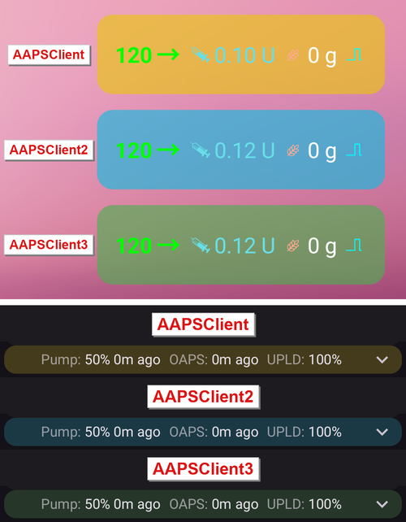

### Скачивание и установка

**AAPSClient** можно установить на один или несколько телефонов фолловеров (например, телефон фолловера родителя 1 и телефон фолловера родителя 2), чтобы оба опекуна получили доступ и могли удаленно управлять телефоном пациента с **AAPS**.

To download **AAPSClient**, navigate to the [GitHub repository](https://github.com/nightscout/AndroidAPS/releases/) and click on the asset **“app-AAPSClient-release_x.x.x.x”** (it may be a newer version to that shown in the screenshot below):


Затем перейдите в _загрузки_ на своем компьютере. On Windows, _downloads_ will show in the right hand ribbon:

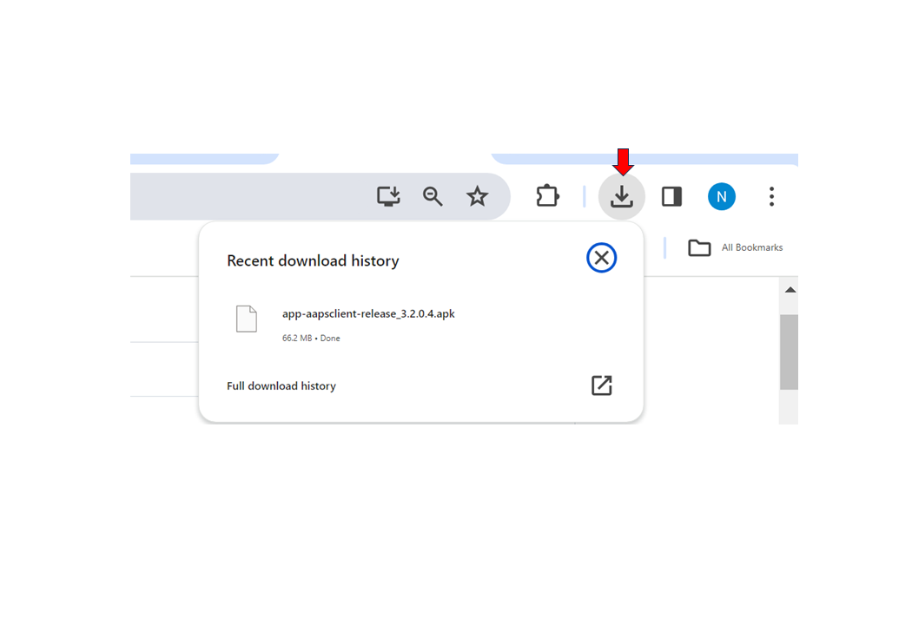

После загрузки нажмите _показать в папке_ для поиска файла.

APK **AAPSClient** теперь можно:

перенести на телефон фолловера с помощью кабеля USB; или перетащить в папку Google Диска, а затем добавить на телефон фолловера, нажав на файл "app-AAPSClient-release".

Should you be needing **AAPS** for yourself, and **AAPSClient** for monitoring someone else, you will need to build **AAPSClient** yourself instead of downloading it from the GitHub repository as described above. Причина в том, что нельзя установить на один телефон **AAPS** и **AAPSClient**, подписанные разными ключами. <br/> Чтобы собрать **AAPSClient** самостоятельно, выполните те же шаги, что и для [обычной сборки AAPS](../SettingUpAaps/BuildingAaps.md). На странице **Generate signed App Bundle or APK** выберите **aapsclientRelease** вместо **fullRelease**.

The same rule applies when you install several client apps (**AAPSClient**, **AAPSClient2**, **AAPSClient3**) on one follower phone: they must all be signed with the **same key**. Otherwise Android refuses to install the second one (error `INSTALL_FAILED_DUPLICATE_PERMISSION`).

### Synchronization: AAPSClient and AAPS set up

Once the __AAPSClient__ apk is installed on the follower phone, make sure **NSClientV3** is set up the same way on both phones for Nightscout 15 (see the [update notes](../Maintenance/UpdateToNewVersion.md)). The example below shows the synchronization set-up with NSClientV3 and Nightscout 15; other data sources are available in __AAPS__ (e.g. xDrip).

In **Configuration** > **Communication**, the user synchronizes their data with Nightscout through __NSClientV3__ (using the v3 API), set up the same way for both __AAPS__ and the follower phone.


The user must ensure that __both__ the AAPS and AAPS Client phones are synched together by setting up NSClientV3 on each. On the follower phone this can be done by scanning a QR code shown by **AAPS** instead, see [Pairing AAPSClient with AAPS](#remotecontrol-pairing) below:

- Enter your **Nightscout URL** in the NSClientV3 **Settings**

- Enter your **Nightscout access token** in the same settings. Please follow the notes [here](https://nightscout.github.io/nightscout/security/#create-a-token). On the **AAPS** phone use an **admin token**: with it **AAPS** makes a token of its own for each follower phone.

- Enable **Use websockets** on **both** phones. Websockets are **mandatory** for remote control from **AAPSClient**, on both phones. Without them, **AAPSClient** can follow **AAPS** but cannot control it. On both phones they also make synchronization faster, at the cost of slightly higher battery use.

  Your Nightscout host must support websockets. If the websocket connection keeps dropping, remote control does not work. See [Troubleshooting NSClient](../GettingHelp/TroubleshootingNsClient.md).


The user should ensure that both __AAPSClient__ and __AAPS__ are showing  ‘connected’ in the **NSClientV3** screen of each phone. At this point **AAPSClient** follows **AAPS** (BG, treatments, profile), but it cannot control it yet: pair the two phones as described below.

(remotecontrol-pairing)=
### Pairing AAPSClient with AAPS (remote control)

From **AAPS** version 4, **AAPSClient** controls **AAPS** through a secure, **paired** connection. Synchronization alone is not enough: until the phones are paired, **AAPSClient** only shows **Manage** with a view-only **Profile** and **Pair with master**.

1. On the **AAPS** phone, open **Manage → Authorized clients** and turn on **Allow client control** (it is off by default, and always on in Simple Mode).
2. Tap **+**, enter a name for the follower phone, choose how it is set up and choose its **role**:
   - **QR code: Nightscout and pairing** — **AAPS** shows a QR code that sets up Nightscout on the follower phone and pairs it, in one scan. This needs an admin token in the **AAPS** phone's NSClientV3 settings.
   - **PIN** — for a follower phone without a camera, already connected to Nightscout: note the one-time **PIN** (valid for about two minutes).
3. On the **AAPSClient** phone, scan the code (in the Setup Wizard, or **Manage → Pair with master → Scan QR code**), or open **Manage → Pair with master** and enter the PIN. Confirm.

The follower phone then appears as **Active** in the **Authorized clients** list, and **AAPSClient** shows **Treatments**, **Scenes** and **Manage**. The follower phone gets a Nightscout token of its own, with only the rights it needs. The full procedure, with screenshots and troubleshooting, is on [Master ↔ Client control](#client_master_master_setup).

Check that the set-up works: enter carbs on **AAPSClient**, confirm the amount shown, and check that the entry appears in **Treatments** on both phones.

(remotecontrol-nightscout-access-token)=

### Troubleshooting 'Nightscout access token' configuration issues

The precise 'Nightscout access token' configuration may differ depending upon whether your Nightscout provider is a paid for hosted site or not.

If you are struggling with **AAPS** to accept the 'Nightscout access token' and using a paid for hosted Nightscout site, you may wish to first liaise with your Nightscout provider on how to resolve the 'Nightscout access token' difficulties. Иначе обратитесь в группу **AAPS**, но сначала еще раз проверьте, что вы правильно выполнили указания [здесь](https://nightscout.github.io/nightscout/security/#create-a-token).

### What AAPSClient offers

Once paired, **AAPSClient** offers the caregiver almost the same screens as **AAPS** itself:

- **Treatments**: insulin bolus, carbs and the bolus wizard.
- **Scenes**: start and stop [scenes](../DailyLifeWithAaps/Scenes.md).
- **Manage**: profiles, insulin settings, temporary targets, QuickWizard, automation, food, site rotation, pairing and the running temp basal.
- **Main menu**: treatments history, history browser, statistics, maintenance, configuration.

There is no pump and no objectives on **AAPSClient**. See [The AAPSClient app](AapsClient.md) for a detailed description.

**AAPSClient** lets the caregiver make most of the adjustments allowed directly in **AAPS**, **including insulin boluses**, remotely over the mobile or internet network. Every command is signed and sent through Nightscout to the **AAPS** phone, which checks it against its own data, caps it, shows you its own confirmation, and only then executes it. **AAPSClient** _can_ be much faster than [SMS Commands](../RemoteFeatures/SMSCommands.md), especially for commands that would need authentication.

Treatments entered in Nightscout by other means (for example the Nightscout website) are not applied while client control is on: **AAPS** is then in [hardened mode](#client-master-control-hardened-mode) and takes changes only from paired clients. With client control off, they are applied only if the matching **Receive** options are enabled in the [Synchronization section of NSClient preferences](#Preferences-nsclient-synchronization).

Remote control through **AAPSClient** is only recommended if your synchronization is working well (_i.e._ you don’t see unwanted data changes like self-modification of TT, TBR etc).

### AAPSClient с функциями для смарт-часов

Смарт-часы - полезный инструмент в управлении **AAPS** у детей. Возможны несколько различных конфигураций. Если **AAPSClient** установлен на телефоне опекуна, приложение [**AAPSClient WearOS**](https://github.com/nightscout/AndroidAPS/releases/) можно скачать и установить на совместимые смарт-часы, подключенные к телефону родителя. This will show current BG and loop status. Once **AAPSClient** is paired with **AAPS**, the watch actions (including boluses, carbs, temp targets and profile changes) are relayed through **AAPSClient** to **AAPS**, which confirms and executes them: see [Wear OS on a client](#clientmastercontrol-wear-os-on-a-client). You can read more about Smartwatches [here](#remotecontrol-smartwatches).

(RemoteControl_nightscout)=
## 3) Nightscout

Кроме того, что Nightscout является сервером в «Облаке», также есть специальное приложение **Nightscout**, которое можно загрузить непосредственно из App Store на iPhone. If you have an Android follower phone, there is not a dedicated Nightscout app and it is better to use [**AAPSClient**](#RemoteControl_aapsclient), or, if you only want to follow, and not send treatments you can download and install the [Nightwatch](https://play.google.com/store/apps/details?id=se.cornixit.nightwatch) app from the Playstore.

После установки приложения **Nightscout** на iPhone, откройте приложение и следуйте инструкциям настройки, введя адрес Nightscout (см. ниже, слева). Форма может быть разной, в зависимости от провайдера хостинга. (_например_ http://youraddresshere.herokuapp.com). Затем введите Nightscout API secret (см. ниже, справа). Если API-пароль не запрошен, то нужно ввести его, нажав на замок в верхней части приложения:

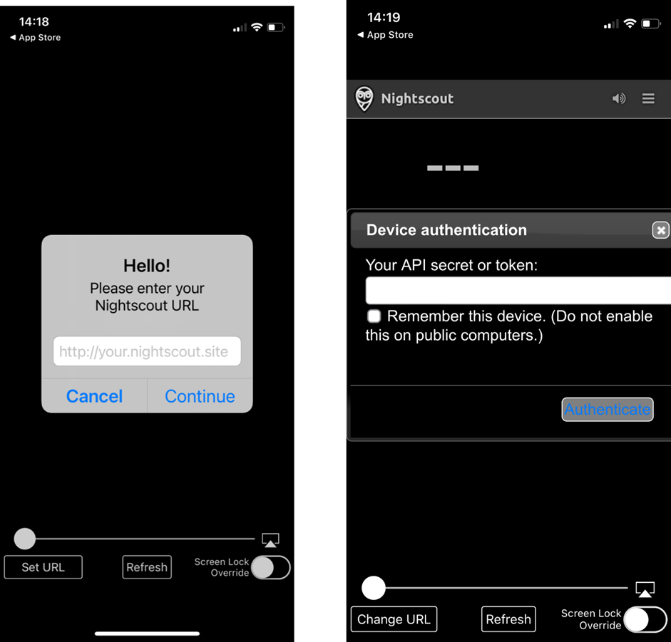

Дополнительная информация об установке доступна непосредственно на ресурсе [Nightscout](https://nightscout.github.io/nightscout/discover/)

При первом входе вы увидите очень простой экран. Настройте параметры отображения: выберите меню «гамбургер» вверху справа и прокрутите вниз:

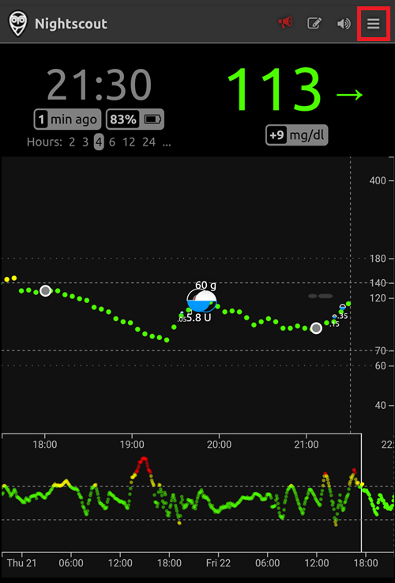

Прокрутите вниз до «Настройки». "Масштаб" можно заменить на "линейный" т. к. по умолчанию он логарифмический, и в строке «отображать базал» выберите «по умолчанию», чтобы появился график базала.

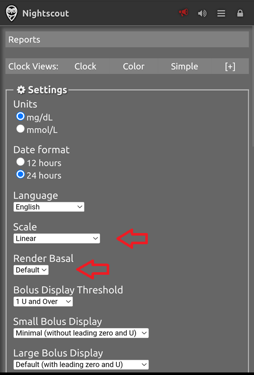

Выберите нужные параметры. Снимите флажок с сигналов тревоги, если вы используете для них другое приложение.

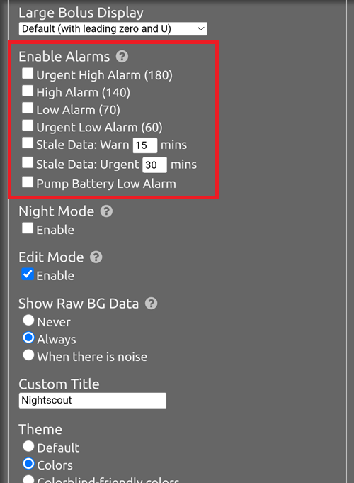

Продолжайте прокручивать вниз до «показать расширения (плагины)».

Убедитесь, что «портал терапии» отмечен галочкой, а также можете выбрать другие показатели (наиболее полезные: активный инсулин IOB, помпа, катетер, отсчет возраста инсулина, базальный профиль и OpenAPS).

Не забудьте, это важно, чтобы эти изменения вступили в силу, нажать кнопку «сохранить» в нижней части.

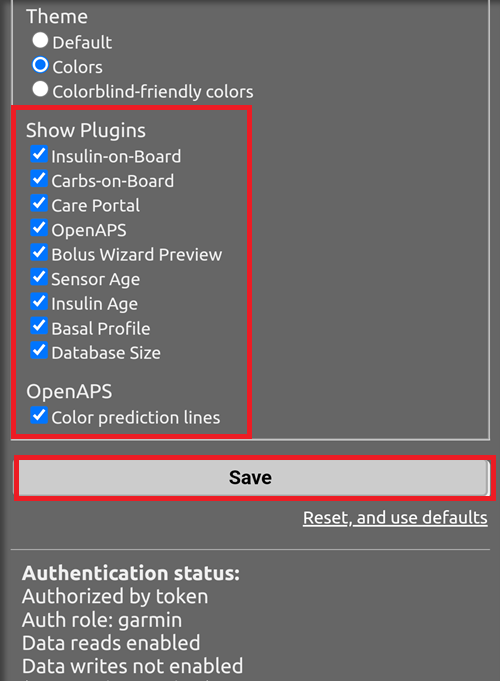

После нажатия «сохранить» приложение вернется на главный экран Nightscout и будет выглядеть примерно так:

1. Текущее значение глюкозы
2. Информация о состоянии системы AAPS — нажмите на отдельные вкладки на экране, чтобы увидеть подробности. Добавляйте или убирайте эти элементы через меню «гамбургер».
3. Недавний график глюкозы с событиями терапии (углеводы, болюсы)
4. Долгосрочный график глюкозы
5. Меню «гамбургер» для настройки отображения, создания отчетов, редактирования профилей и инструментов администратора Nightscout
6. "**+**" menu for entering treatments (see [below](#RemoteControl_nightscout-treatments) for when **AAPS** applies them).
7. Выбор другого периода времени для отображения
8. Профиль базального инсулина
9. Зеленая линия = прошлые значения глюкозы Синие линии = прогноз глюкозы

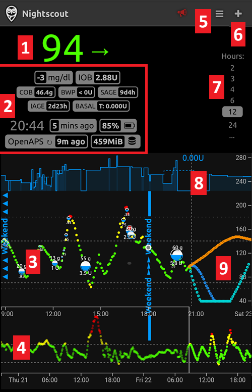

В верхнем левом меню приложения Nightscout вы найдете дополнительную информацию:

1. Ретроспективное редактирование в портале терапии
2. Включение/выключение сигналов тревоги
3. «Гамбургер» — для настройки параметров
4. Careportal - Log treatment (see [below](#RemoteControl_nightscout-treatments) for when **AAPS** applies these)

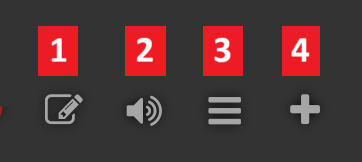

На серых вкладках этого экрана огромное количество информации о состоянии системы **AAPS** (и еще больше информации появится, если нажать на вкладку):

1. Тренд глюкозы за 5 мин
2. Предварительный просмотр мастера болюса (BWP)
3. Нажмите на Basal, чтобы увидеть текущий профиль и информацию о базале
4. Время с последнего значения CGM в AAPS
5. **Помпа**: инсулин, % батареи и когда AAPS последний раз подключался к ней
6. Последнее обновление AAPS — если прошло больше 5 мин, это может означать проблему связи между телефоном с AAPS и помпой/CGM
7. Нажмите на IOB, чтобы увидеть разделение на базальный и болюсный инсулин
8. Возраст инсулина в резервуаре
9. сколько времени прошло с момента установки канюли
10. Состояние батареи телефона с AAPS
11. Размер вашей базы данных. Если она слишком заполнена (только для DIY Nightscout — платные сервисы на это не обращают внимания), могут начаться проблемы со связью. Чтобы уменьшить это число, можно удалить данные в меню Admin tools (через «гамбургер»).

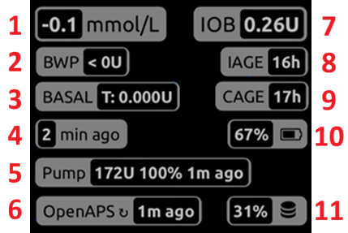

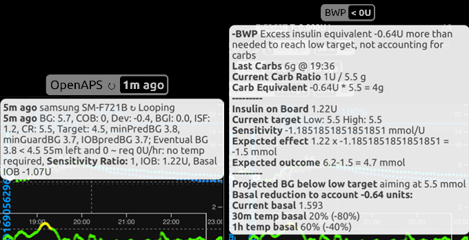

Нажмите «обновить» (refresh) внизу страницы, чтобы закрыть всплывающее окно.

(RemoteControl_nightscout-treatments)=
### Отправка событий терапии через приложение Nightscout в AAPS

In **AAPS** 4 the supported way to control **AAPS** remotely is a **paired AAPSClient**, see [Master ↔ Client control](#client-master-control): each client has a [role](#client-master-control-roles) that limits what it may do, and every command is signed by the client, then checked and confirmed by the **AAPS** phone. While client control is on, the **AAPS** phone is in [hardened mode](#client-master-control-hardened-mode): treatments, temporary targets and profile switches entered on the Nightscout website or in the Nightscout app are **not** applied. The Nightscout app is then a tool for following only.

```{admonition} Only when client control is off
:class: warning
If **Allow client control** is off in **Manage → Authorized clients** (and Simple Mode is off), **AAPS** applies careportal entries from Nightscout only for the data types you turned on under **Receive** in the [Synchronization section of the NSClientV3 settings](#Preferences-nsclient-synchronization): carbs, temporary targets, profile switches and the other careportal entries. Insulin is never delivered this way: a "Correction bolus" entered in Nightscout is only *announced*, and **AAPS** counts it as insulin on board without delivering it. This set-up is not recommended for remote control; use a paired **AAPSClient** instead.
```

Подробнее о возможностях **Nightscout** [здесь](https://nightscout.github.io/)

### Как извлечь максимум пользы из приложения Nightscout

1). Если вы «застряли» на странице и хотите видеть главное окно снова, просто нажмите «обновить» (внизу по центру) и вернетесь на домашнюю страницу **Nightscout** с графиком ГК.

Чтобы увидеть параметры текущего профиля на телефоне, нажмите на различные иконки на экране над графиком. Больше информации (текущий углеводный коэффициент, чувствительность, часовой пояс и т. д.) можно увидеть нажав «basal»; а нажав на «OpenAPS» получим данные о профиле, текущей цели и т. д. Можно также отслеживать % батареи телефона и % батареи помпы. Калькулятор болюса дает информацию о прогнозе алгоритма с учетом активного инсулина IOB и активных углеводов COB.

#### Другие иконки в меню: что означает карандаш (редактирование)?

Карандаш редактирования поможет (технически) переместить или удалить болюс или коррекцию с графика за последние 48 часов.

Подробнее [здесь](https://nightscout.github.io/nightscout/discover/#edit-mode-edit)

Хотя это может пригодиться для удаления внесенных (но не получивших болюса) углеводов, на практике эта функция плохо работает с **AAPS** и мы рекомендуем вносить такие изменения непосредственно через приложение **AAPS**.

(RemoteControl_smartwatches)= (remotecontrol-smartwatches)=

## 4) Смарт-часы

### Вариант 1) Управление AAPS с часов Wear OS

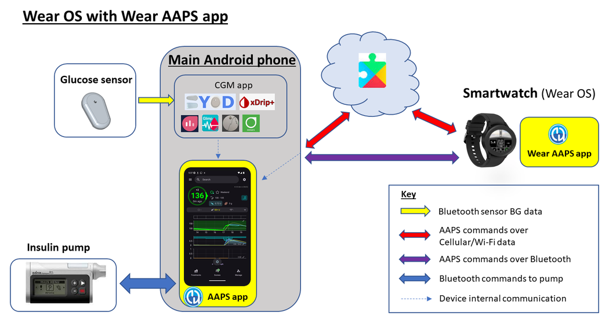

После того как вы [настроили **AAPS** на часах](../WearOS/BuildingAapsWearOS.md), подробное описание циферблатов и их функций смотрите на странице [Настройка AAPS на часах Wear OS](../WearOS/WearOsSmartwatch.md).

Кратко: со смарт-часов можно запустить следующие функции:

* установить временную цель

* use the bolus calculator (calculation variables can be defined in settings on the phone)

* ввести растянутые углеводы (eCarbs)

* administer a bolus (insulin + carbs)

* watch settings

* status

* check pump status

* проверить состояние цикла

* проверить и изменить профиль, CPP (Circadian Percentage Profile = сдвиг по времени + процент)

* показать TDD (суммарная суточная доза = болюс + базал за день)

* Удаленный болюс, когда опекун и ребенок с СД1 находятся в разных местах (это возможно для часов с **AAPS** и телефона с **AAPS**, если оба устройства подключены к сети)

#### Связь опекунов с часами через другие приложения (например, WhatsApp)

На часы можно добавить другие приложения, например WhatsApp, для обмена сообщениями (например) между опекунами и детьми. Важно, чтобы с телефоном был связан только ОДИН аккаунт Google, иначе часы не будут получать эти данные. Для учетной записи Samsung вам должно быть 13 лет или больше, и ее нужно настроить на тот же адрес электронной почты, который используется на телефоне Android.

Видео о настройке WhatsApp для сообщений на часах Galaxy Watch 4 (полная функциональность WhatsApp недоступна) можно посмотреть [здесь](https://gorilla-fitnesswatches.com/how-to-get-whatsapp-on-galaxy-watch-4/)

Настройки в приложении **Galaxy wearable** на телефоне с **AAPS** и на часах позволяют сообщениям WhatsApp приходить с легкой вибрацией и показываться поверх текущего циферблата.

### Вариант 2) **AAPS** на смарт-часах, для дистанционного управления **AAPS** на телефоне

Similarly to using a follower phone with **AAPSClient** or SMS commands (see the sections above), a smartwatch can be used to remotely control **AAPS** and provide full profile data. A key difference to using a follower phone is that the smartwatch to **AAPS** phone link is via Bluetooth and needs neither Nightscout nor an authentication code. As a side-note, if both smartwatch and **AAPS** phone linked by Bluetooth are also on a Wi-Fi/Cellular data network, the watch will also interact with the **AAPS** phone, giving a longer range of communication. This includes remote delivery of a bolus where the caregiver with the **AAPS** watch and T1D child (with **AAPS** phone) are in different locations, which can be useful in circumstances where the T1D child is in school.

Таким образом, смарт-часы дистанционного управления полезны когда:

a)  **AAPSClient** or **SMS** commands cannot work; or

b)  The user wishes to avoid typing an authentication code (as required for SMS commands).

A smartwatch needs **Wear OS 3 or newer** to be able to control **AAPS**. Please check the technical specifications of the watch, and see the [Smartwatches page](../Getting-Started/Watches.md). Search, or ask in the **AAPS** Facebook/Discord groups if unsure.

Specific How-to guides for setting up **AAPS** on the popular Samsung Galaxy Watch 4 (40mm) are given below. Часы [Garmin](https://apps.garmin.com/en-US/apps/a2eebcac-d18a-4227-a143-cd333cf89b55?fbclid=IwAR0k3w3oes-OHgFdPO-cGCuTSIpqFJejHG-klBTm_rmyEJo6gdArw8Nl4Zc#0) также популярны. Если у вас есть опыт настройки других смарт-часов, который, по-вашему, будет полезен другим, добавьте его на эти страницы (см. [Как редактировать документацию](../SupportingAaps/HowToEditTheDocs.md)), чтобы поделиться опытом с широким сообществом **AAPS**.

### Вариант 3) AAPSClient на смарт-часах, для удаленного управления **AAPS** на телефоне

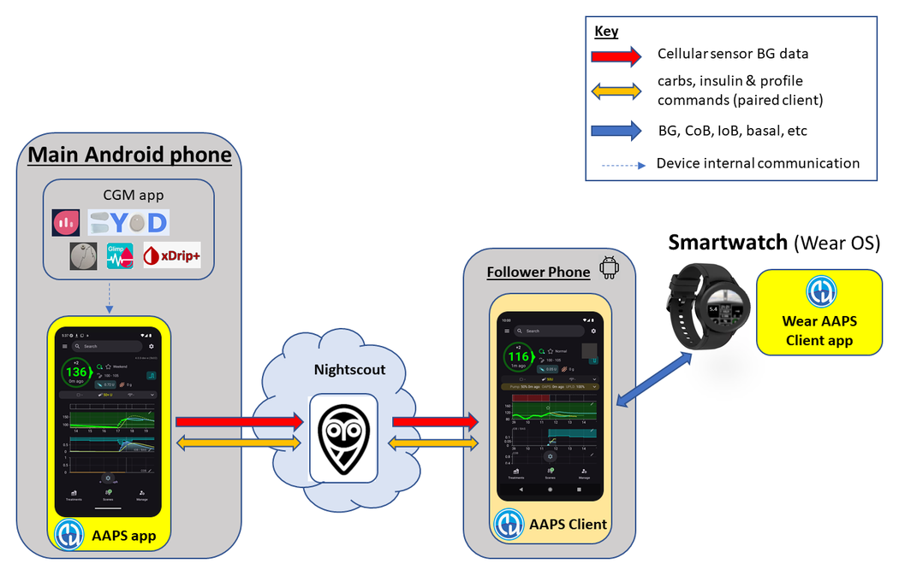

The software for the watch, **AAPSClient** Wear apk, can be downloaded directly from [GitHub](https://github.com/nightscout/AndroidAPS/releases/).

To download the software, click on the watch app that matches the client app on the phone: **wear-aapsclient-release_**_version_ goes with **AAPSClient**, **wear-aapsclient2-release_**_version_ goes with **AAPSClient2** (see [About AAPSClient, AAPSClient2 and AAPSClient3](#remotecontrol-aapsclient-versions)):


Затем «сохранить как» и сохранить файл в удобном месте на компьютере:


APK **AAPSClient** для Wear можно перенести на телефон и установить на часы так же, как приложение **AAPS** Wear, как описано в разделе [Перенос приложения Wear на телефон с AAPS](#remote-control-transferring-the-aaps-wear-app-onto-your-aaps-phone)  


