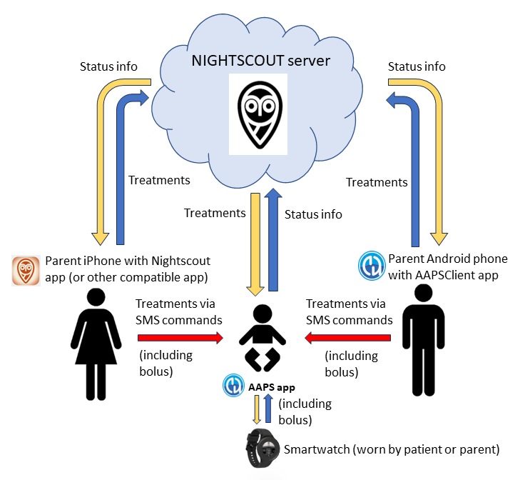
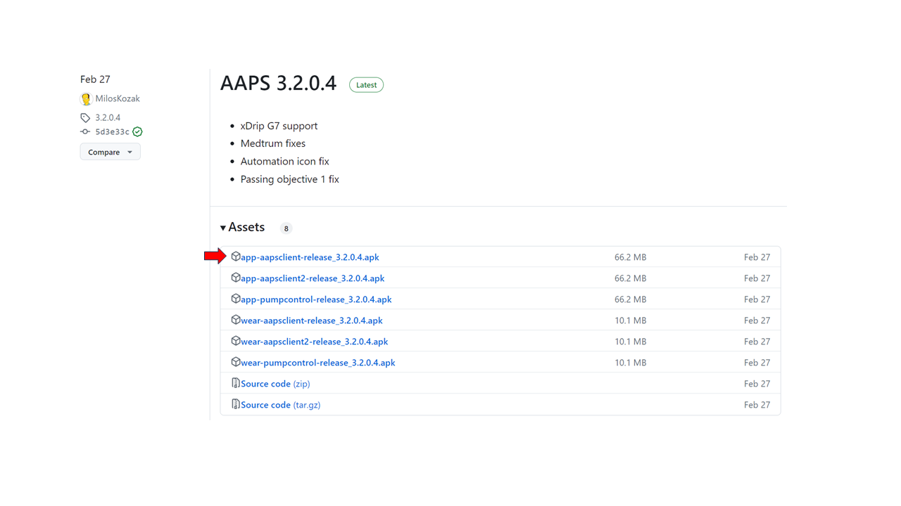

# Дистанционное управление AAPS

```{contents} In this page
:backlinks: entry
:depth: 2
```

Существует 4 наиболее эффективных инструмента для удаленного управления **AAPS**:

1) [SMS команды](#RemoteControl_SMS-Commands) (телефон фолловера может быть на Android или iOS), 2) [AAPSClient](#RemoteControl_aapsclient) (устройство фолловера — телефон или планшет на Android либо компьютер с Windows, Mac или Linux; на iPhone [приложение нужно собрать самостоятельно](#aapsclient-iphone)) 3) [Nightscout](#RemoteControl_nightscout) (Android, iOS или другой компьютер/устройство), в основном для слежения: см. примечание об [управлении с клиентов](#client-master-control) в этом разделе.  
4) [Смарт-часы](#RemoteControl_smartwatches) (Android)

Первые три подходят в основном для опекунов/родителей, а смарт-часы очень полезны и для опекунов/родителей, **и** для самих взрослых с диабетом.



(RemoteControl_SMS-Commands)=

## 1) SMS Commands

См. отдельную страницу [SMS команды](../RemoteFeatures/SMSCommands.md).

(RemoteControl_aapsclient)=
## 2) AAPSClient

**AAPSClient** внешне очень похож на сам **AAPS** и дает опекуну те же экраны и кнопки, чтобы удаленно отправлять команды в **AAPS**:


(remotecontrol-aapsclient-versions)=
### О приложениях AAPSClient, AAPSClient2 и AAPSClient3

Есть 3 версии клиентского приложения: **AAPSClient**, **AAPSClient2** и **AAPSClient3**. Они работают одинаково. Единственное отличие — их можно установить рядом друг с другом на один телефон фолловера.

Опекуну, который следит за одним человеком, нужен только **AAPSClient**. Чтобы следить за вторым человеком (со своим сайтом **Nightscout** и своим телефоном с **AAPS**) и удаленно управлять, установите также **AAPSClient2**, а для третьего человека — **AAPSClient3**. Каждое приложение настраивается и [сопрягается](#aapsclient-pairing-with-the-master) отдельно, с сайтом **Nightscout** и телефоном с **AAPS** человека, за которым оно следит.

Чтобы различать приложения, некоторые элементы имеют разный цвет: желтый для **AAPSClient**, синий для **AAPSClient2** и зеленый для **AAPSClient3**. Это значок приложения, фон виджета и раздел состояния **AAPS** на главном экране приложения. <br/> Примечание: непрозрачность фона виджета можно задать в настройках виджета. При низкой непрозрачности цвет трудно увидеть.


### Скачивание и установка

**AAPSClient** можно установить на один или несколько телефонов фолловеров (например, телефон фолловера родителя 1 и телефон фолловера родителя 2), чтобы оба опекуна получили доступ и могли удаленно управлять телефоном пациента с **AAPS**.

Чтобы скачать **AAPSClient**, перейдите в [репозиторий GitHub](https://github.com/nightscout/AndroidAPS/releases/) и нажмите на файл **“app-AAPSClient-release_x.x.x.x”** (версия может быть новее, чем на снимке экрана ниже):



Затем перейдите в _загрузки_ на своем компьютере. В Windows _загрузки_ появятся на панели справа:


После загрузки нажмите _показать в папке_ для поиска файла.

APK **AAPSClient** теперь можно:

перенести на телефон фолловера с помощью кабеля USB; или перетащить в папку Google Диска, а затем добавить на телефон фолловера, нажав на файл "app-AAPSClient-release".

Если вам нужен **AAPS** для себя и **AAPSClient** для наблюдения за другим человеком, вам нужно собрать **AAPSClient** самостоятельно, а не скачивать его из репозитория GitHub, как описано выше. Причина в том, что нельзя установить на один телефон **AAPS** и **AAPSClient**, подписанные разными ключами. <br/> Чтобы собрать **AAPSClient** самостоятельно, выполните те же шаги, что и для [обычной сборки AAPS](../SettingUpAaps/BuildingAaps.md). На странице **Generate signed App Bundle or APK** выберите **aapsclientRelease** вместо **fullRelease**.

То же правило действует, когда вы устанавливаете несколько клиентских приложений (**AAPSClient**, **AAPSClient2**, **AAPSClient3**) на один телефон фолловера: все они должны быть подписаны **одним и тем же ключом**. Иначе Android откажется устанавливать второе (ошибка `INSTALL_FAILED_DUPLICATE_PERMISSION`).

### Синхронизация: настройка AAPSClient и AAPS

После установки APK __AAPSClient__ на телефон фолловера убедитесь, что **NSClientV3** настроен одинаково на обоих телефонах для Nightscout 15 (см. [примечания к обновлению](../Maintenance/UpdateToNewVersion.md)). В примере ниже показана настройка синхронизации с NSClientV3 и Nightscout 15; в __AAPS__ доступны и другие источники данных (например, xDrip).

В **Конфигурация** > **Связь** пользователь синхронизирует данные с Nightscout через __NSClientV3__ (используя API v3), настроенный одинаково и в __AAPS__, и на телефоне фолловера.


Пользователь должен убедиться, что __оба__ телефона, с AAPS и с AAPSClient, синхронизированы, настроив NSClientV3 на каждом. На телефоне фолловера это можно сделать и сканированием QR-кода, который показывает **AAPS**, см. [Сопряжение AAPSClient с AAPS](#remotecontrol-pairing) ниже:

- Введите **URL-адрес Nightscout** в **настройках** NSClientV3

- Введите **код доступа Nightscout** в тех же настройках. Следуйте указаниям [здесь](https://nightscout.github.io/nightscout/security/#create-a-token). На телефоне с **AAPS** используйте **токен администратора**: с ним **AAPS** создает собственный токен для каждого телефона фолловера.

- Включите **Использовать websockets** на **обоих** телефонах. Websockets **обязательны** для удаленного управления из **AAPSClient** на обоих телефонах. Без них **AAPSClient** может следить за **AAPS**, но не может им управлять. На обоих телефонах они также ускоряют синхронизацию за счет немного большего расхода батареи.

  Ваш хостинг Nightscout должен поддерживать websockets. Если соединение websocket постоянно обрывается, удаленное управление не работает. См. [Устранение неполадок NSClient](../GettingHelp/TroubleshootingNsClient.md).


Пользователь должен убедиться, что и __AAPSClient__, и __AAPS__ показывают «подключено» на экране **NSClientV3** каждого телефона. Теперь **AAPSClient** следит за **AAPS** (ГК, терапия, профиль), но еще не может им управлять: выполните сопряжение двух телефонов, как описано ниже.

(remotecontrol-pairing)=
### Сопряжение AAPSClient с AAPS (удаленное управление)

Начиная с версии 4 **AAPS**, **AAPSClient** управляет **AAPS** через защищенное **сопряженное** соединение. Одной синхронизации недостаточно: пока телефоны не сопряжены, **AAPSClient** показывает только **Управление** с **Профилем** только для просмотра и **Сопряжение с мастером**.

1. На телефоне с **AAPS** откройте **Управление → Авторизованные клиенты** и включите **Разрешить управление с клиентов** (по умолчанию выключено, а в Простом режиме всегда включено).
2. Нажмите **+**, введите имя телефона фолловера, выберите способ настройки и его **роль**:
   - **QR-код: Nightscout и сопряжение** — **AAPS** показывает QR-код, который одним сканированием настраивает Nightscout на телефоне фолловера и выполняет сопряжение. Для этого в настройках NSClientV3 телефона с **AAPS** нужен токен администратора.
   - **PIN-код** — для телефона фолловера без камеры, уже подключенного к Nightscout: запишите одноразовый **PIN-код** (действует около двух минут).
3. На телефоне с **AAPSClient** отсканируйте код (в Мастере установки или **Управление → Сопряжение с мастером → Сканировать QR-код**) или откройте **Управление → Сопряжение с мастером** и введите PIN-код. Подтвердите.

После этого телефон фолловера появится как **Активен** в списке **Авторизованные клиенты**, а **AAPSClient** покажет **Терапия**, **Сценарии** и **Управление**. Телефон фолловера получает собственный токен Nightscout только с нужными ему правами. Полная процедура со снимками экрана и устранением неполадок описана на странице [Управление «основной телефон ↔ клиент»](#client_master_master_setup).

Проверьте, что настройка работает: введите углеводы в **AAPSClient**, подтвердите показанное количество и проверьте, что запись появилась в разделе **Терапия** на обоих телефонах.

(remotecontrol-nightscout-access-token)=

### Устранение проблем с настройкой «Код доступа Nightscout»

Точная настройка «Код доступа Nightscout» может отличаться в зависимости от того, используете ли вы платный хостинг Nightscout.

Если **AAPS** не принимает «Код доступа Nightscout» и вы используете платный хостинг Nightscout, сначала обратитесь к своему провайдеру Nightscout, чтобы решить эту проблему. Иначе обратитесь в группу **AAPS**, но сначала еще раз проверьте, что вы правильно выполнили указания [здесь](https://nightscout.github.io/nightscout/security/#create-a-token).

### Что предлагает AAPSClient

После сопряжения **AAPSClient** дает опекуну почти те же экраны, что и сам **AAPS**:

- **Терапия**: болюс инсулина, углеводы и мастер болюса.
- **Сценарии**: запуск и остановка [сценариев](../DailyLifeWithAaps/Scenes.md).
- **Управление**: профили, настройки инсулина, временные цели, мастер быстрых настроек, автоматизация, продукты, места установки, сопряжение и текущий временный базал.
- **Главное меню**: история терапии, просмотр журнала, статистика, обслуживание, конфигурация.

В **AAPSClient** нет помпы и нет целей. Подробное описание см. на странице [Приложение AAPSClient](AapsClient.md).

**AAPSClient** позволяет опекуну удаленно, через мобильную сеть или интернет, делать большинство настроек, доступных прямо в **AAPS**, **включая болюсы инсулина**. Каждая команда подписывается и отправляется через Nightscout на телефон с **AAPS**, который проверяет ее по своим данным, ограничивает, показывает вам свое подтверждение и только потом выполняет. **AAPSClient** _может_ быть гораздо быстрее, чем [SMS команды](../RemoteFeatures/SMSCommands.md), особенно для команд, которым нужна аутентификация.

События терапии, введенные в Nightscout другим способом (например, на сайте Nightscout), не применяются, пока включено управление с клиентов: тогда **AAPS** находится в [защищенном режиме](#client-master-control-hardened-mode) и принимает изменения только от сопряженных клиентов. Когда управление с клиентов выключено, они применяются, только если включены соответствующие параметры **Получать** в [разделе «Синхронизация» настроек NSClient](#Preferences-nsclient-synchronization).

Удаленное управление через **AAPSClient** рекомендуется, только если синхронизация работает хорошо (_т. е._ вы не видите нежелательных изменений данных, например самопроизвольного изменения ВЦ, временного базала и т. д.).

### AAPSClient с функциями для смарт-часов

Смарт-часы - полезный инструмент в управлении **AAPS** у детей. Возможны несколько различных конфигураций. Если **AAPSClient** установлен на телефоне опекуна, приложение [**AAPSClient WearOS**](https://github.com/nightscout/AndroidAPS/releases/) можно скачать и установить на совместимые смарт-часы, подключенные к телефону родителя. Здесь показываются текущая ГК и состояние цикла. Когда **AAPSClient** сопряжен с **AAPS**, действия с часов (включая болюсы, углеводы, временные цели и смены профиля) передаются через **AAPSClient** в **AAPS**, который подтверждает и выполняет их: см. [Wear OS на клиенте](#clientmastercontrol-wear-os-on-a-client). Подробнее о смарт-часах можно прочитать [здесь](#remotecontrol-smartwatches).

(RemoteControl_nightscout)=
## 3) Nightscout

Кроме того, что Nightscout является сервером в «Облаке», также есть специальное приложение **Nightscout**, которое можно загрузить непосредственно из App Store на iPhone. Если у вас телефон фолловера на Android, отдельного приложения Nightscout для него нет, и лучше использовать [**AAPSClient**](#RemoteControl_aapsclient), а если вы хотите только следить, не отправляя события терапии, можно скачать и установить приложение [Nightwatch](https://play.google.com/store/apps/details?id=se.cornixit.nightwatch) из Play Маркета.

После установки приложения **Nightscout** на iPhone, откройте приложение и следуйте инструкциям настройки, введя адрес Nightscout (см. ниже, слева). Форма может быть разной, в зависимости от провайдера хостинга. (_например_ http://youraddresshere.herokuapp.com). Затем введите Nightscout API secret (см. ниже, справа). Если API-пароль не запрошен, то нужно ввести его, нажав на замок в верхней части приложения:


Дополнительная информация об установке доступна непосредственно на ресурсе [Nightscout](https://nightscout.github.io/nightscout/discover/)

При первом входе вы увидите очень простой экран. Настройте параметры отображения: выберите меню «гамбургер» вверху справа и прокрутите вниз:


Прокрутите вниз до «Настройки». "Масштаб" можно заменить на "линейный" т. к. по умолчанию он логарифмический, и в строке «отображать базал» выберите «по умолчанию», чтобы появился график базала.


Выберите нужные параметры. Снимите флажок с сигналов тревоги, если вы используете для них другое приложение.


Продолжайте прокручивать вниз до «показать расширения (плагины)».

Убедитесь, что «портал терапии» отмечен галочкой, а также можете выбрать другие показатели (наиболее полезные: активный инсулин IOB, помпа, катетер, отсчет возраста инсулина, базальный профиль и OpenAPS).

Не забудьте, это важно, чтобы эти изменения вступили в силу, нажать кнопку «сохранить» в нижней части.


После нажатия «сохранить» приложение вернется на главный экран Nightscout и будет выглядеть примерно так:

1. Текущее значение глюкозы
2. Информация о состоянии системы AAPS — нажмите на отдельные вкладки на экране, чтобы увидеть подробности. Добавляйте или убирайте эти элементы через меню «гамбургер».
3. Недавний график глюкозы с событиями терапии (углеводы, болюсы)
4. Долгосрочный график глюкозы
5. Меню «гамбургер» для настройки отображения, создания отчетов, редактирования профилей и инструментов администратора Nightscout
6. Меню «**+**» для ввода событий терапии (см. [ниже](#RemoteControl_nightscout-treatments), когда **AAPS** их применяет).
7. Выбор другого периода времени для отображения
8. Профиль базального инсулина
9. Зеленая линия = прошлые значения глюкозы Синие линии = прогноз глюкозы


В верхнем левом меню приложения Nightscout вы найдете дополнительную информацию:

1. Ретроспективное редактирование в портале терапии
2. Включение/выключение сигналов тревоги
3. «Гамбургер» — для настройки параметров
4. Портал терапии — записать событие терапии (см. [ниже](#RemoteControl_nightscout-treatments), когда **AAPS** их применяет)


На серых вкладках этого экрана огромное количество информации о состоянии системы **AAPS** (и еще больше информации появится, если нажать на вкладку):

1. Тренд глюкозы за 5 мин
2. Предварительный просмотр мастера болюса (BWP)
3. Нажмите на Basal, чтобы увидеть текущий профиль и информацию о базале
4. Время с последнего значения CGM в AAPS
5. **Помпа**: инсулин, % батареи и когда AAPS последний раз подключался к ней
6. Последнее обновление AAPS — если прошло больше 5 мин, это может означать проблему связи между телефоном с AAPS и помпой/CGM
7. Нажмите на IOB, чтобы увидеть разделение на базальный и болюсный инсулин
8. Возраст инсулина в резервуаре
9. сколько времени прошло с момента установки канюли
10. Состояние батареи телефона с AAPS
11. Размер вашей базы данных. Если она слишком заполнена (только для DIY Nightscout — платные сервисы на это не обращают внимания), могут начаться проблемы со связью. Чтобы уменьшить это число, можно удалить данные в меню Admin tools (через «гамбургер»).


Нажмите «обновить» (refresh) внизу страницы, чтобы закрыть всплывающее окно.

(RemoteControl_nightscout-treatments)=
### Отправка событий терапии через приложение Nightscout в AAPS

В **AAPS** 4 поддерживаемый способ удаленного управления **AAPS** — **сопряженный AAPSClient**, см. [Управление «основной телефон ↔ клиент»](#client-master-control): у каждого клиента есть [роль](#client-master-control-roles), которая ограничивает его возможности, и каждая команда подписывается клиентом, а затем проверяется и подтверждается телефоном с **AAPS**. Пока включено управление с клиентов, телефон с **AAPS** находится в [защищенном режиме](#client-master-control-hardened-mode): события терапии, временные цели и переключения профиля, введенные на сайте Nightscout или в приложении Nightscout, **не** применяются. Тогда приложение Nightscout служит только для слежения.

```{admonition} Only when client control is off
:class: warning
Если **Разрешить управление с клиентов** выключено в **Управление → Авторизованные клиенты** (и Простой режим выключен), **AAPS** применяет записи портала терапии из Nightscout только для тех типов данных, которые вы включили в **Получать** в [разделе «Синхронизация» настроек NSClientV3](#Preferences-nsclient-synchronization): углеводы, временные цели, переключения профиля и другие записи портала терапии. Инсулин так никогда не вводится: «Correction bolus», введенный в Nightscout, только *объявляется*, и **AAPS** учитывает его как активный инсулин, не вводя его. Такая настройка не рекомендуется для удаленного управления; используйте сопряженный **AAPSClient**.
```

Подробнее о возможностях **Nightscout** [здесь](https://nightscout.github.io/)

### Как извлечь максимум пользы из приложения Nightscout

1). Если вы «застряли» на странице и хотите видеть главное окно снова, просто нажмите «обновить» (внизу по центру) и вернетесь на домашнюю страницу **Nightscout** с графиком ГК.

Чтобы увидеть параметры текущего профиля на телефоне, нажмите на различные иконки на экране над графиком. Больше информации (текущий углеводный коэффициент, чувствительность, часовой пояс и т. д.) можно увидеть нажав «basal»; а нажав на «OpenAPS» получим данные о профиле, текущей цели и т. д. Можно также отслеживать % батареи телефона и % батареи помпы. Калькулятор болюса дает информацию о прогнозе алгоритма с учетом активного инсулина IOB и активных углеводов COB.

#### Другие иконки в меню: что означает карандаш (редактирование)?

Карандаш редактирования поможет (технически) переместить или удалить болюс или коррекцию с графика за последние 48 часов.

Подробнее [здесь](https://nightscout.github.io/nightscout/discover/#edit-mode-edit)

Хотя это может пригодиться для удаления внесенных (но не получивших болюса) углеводов, на практике эта функция плохо работает с **AAPS** и мы рекомендуем вносить такие изменения непосредственно через приложение **AAPS**.

(RemoteControl_smartwatches)= (remotecontrol-smartwatches)=

## 4) Смарт-часы

### Вариант 1) Управление AAPS с часов Wear OS


После того как вы [настроили **AAPS** на часах](../WearOS/BuildingAapsWearOS.md), подробное описание циферблатов и их функций смотрите на странице [Настройка AAPS на часах Wear OS](../WearOS/WearOsSmartwatch.md).

Кратко: со смарт-часов можно запустить следующие функции:

* установить временную цель

* use the bolus calculator (calculation variables can be defined in settings on the phone)

* ввести растянутые углеводы (eCarbs)

* administer a bolus (insulin + carbs)

* watch settings

* status

* check pump status

* проверить состояние цикла

* проверить и изменить профиль, CPP (Circadian Percentage Profile = сдвиг по времени + процент)

* показать TDD (суммарная суточная доза = болюс + базал за день)

* Удаленный болюс, когда опекун и ребенок с СД1 находятся в разных местах (это возможно для часов с **AAPS** и телефона с **AAPS**, если оба устройства подключены к сети)

#### Связь опекунов с часами через другие приложения (например, WhatsApp)

На часы можно добавить другие приложения, например WhatsApp, для обмена сообщениями (например) между опекунами и детьми. Важно, чтобы с телефоном был связан только ОДИН аккаунт Google, иначе часы не будут получать эти данные. Для учетной записи Samsung вам должно быть 13 лет или больше, и ее нужно настроить на тот же адрес электронной почты, который используется на телефоне Android.

Видео о настройке WhatsApp для сообщений на часах Galaxy Watch 4 (полная функциональность WhatsApp недоступна) можно посмотреть [здесь](https://gorilla-fitnesswatches.com/how-to-get-whatsapp-on-galaxy-watch-4/)

Настройки в приложении **Galaxy wearable** на телефоне с **AAPS** и на часах позволяют сообщениям WhatsApp приходить с легкой вибрацией и показываться поверх текущего циферблата.

### Вариант 2) **AAPS** на смарт-часах, для дистанционного управления **AAPS** на телефоне

Так же как телефон фолловера с **AAPSClient** или SMS команды (см. разделы выше), смарт-часы можно использовать для удаленного управления **AAPS** и получения полных данных профиля. Главное отличие от телефона фолловера в том, что связь смарт-часов с телефоном с **AAPS** идет через Bluetooth и не требует ни Nightscout, ни кода аутентификации. Кстати, если смарт-часы и телефон с **AAPS**, связанные по Bluetooth, также подключены к сети Wi-Fi/мобильной сети передачи данных, часы будут взаимодействовать с телефоном с **AAPS** и через нее, что дает больший радиус связи. Это включает удаленное введение болюса, когда опекун с часами с **AAPS** и ребенок с СД1 (с телефоном с **AAPS**) находятся в разных местах, что может быть полезно, например, когда ребенок с СД1 в школе.

Таким образом, смарт-часы дистанционного управления полезны когда:

a)  команды **AAPSClient** или **SMS** не могут работать; или

b)  пользователь хочет не вводить код аутентификации (как нужно для SMS команд).

Чтобы управлять **AAPS**, смарт-часам нужна **Wear OS 3 или новее**. Проверьте технические характеристики часов и см. страницу [Смарт-часы и AAPS](../Getting-Started/Watches.md). Если не уверены, поищите или спросите в группах **AAPS** в Facebook/Discord.

Ниже приведены подробные инструкции по настройке **AAPS** на популярных часах Samsung Galaxy Watch 4 (40 мм). Часы [Garmin](https://apps.garmin.com/en-US/apps/a2eebcac-d18a-4227-a143-cd333cf89b55?fbclid=IwAR0k3w3oes-OHgFdPO-cGCuTSIpqFJejHG-klBTm_rmyEJo6gdArw8Nl4Zc#0) также популярны. Если у вас есть опыт настройки других смарт-часов, который, по-вашему, будет полезен другим, добавьте его на эти страницы (см. [Как редактировать документацию](../SupportingAaps/HowToEditTheDocs.md)), чтобы поделиться опытом с широким сообществом **AAPS**.

### Вариант 3) AAPSClient на смарт-часах, для удаленного управления **AAPS** на телефоне


Программу для часов, APK **AAPSClient** Wear, можно скачать прямо с [GitHub](https://github.com/nightscout/AndroidAPS/releases/).

Чтобы скачать программу, нажмите на приложение для часов, которое соответствует клиентскому приложению на телефоне: **wear-aapsclient-release_**_версия_ подходит к **AAPSClient**, **wear-aapsclient2-release_**_версия_ — к **AAPSClient2** (см. [О приложениях AAPSClient, AAPSClient2 и AAPSClient3](#remotecontrol-aapsclient-versions)):


Затем «сохранить как» и сохранить файл в удобном месте на компьютере:


APK **AAPSClient** для Wear можно перенести на телефон и установить на часы так же, как приложение **AAPS** Wear, как описано в разделе [Перенос приложения Wear на телефон с AAPS](#remote-control-transferring-the-aaps-wear-app-onto-your-aaps-phone)  


