# Работа AAPS с помощью смарт-часов на базе Wear OS

(Смарт-часы-аапс-смарт-часы)=

## Циферблаты AAPS

```{warning}
Классические циферблаты **AAPS** работают только на Wear OS 5 и старше, а Wear OS 5 уже ограничивает их. На **Wear OS 6 и новее** приложение для часов вместо них устанавливает один циферблат в формате Google Watch Face Format: ваш пользовательский циферблат в виде картинки или **Циферблат с дополнениями**. Что перестает работать в каждой версии Wear OS, смотрите в разделе [Изменения циферблатов в Wear OS](#wearos-watchface-changes), а о Wear OS 6 - в разделе [Циферблат, который устанавливает AAPS](#wearos-aaps-v4-watchface).
```

На Wear OS 5 и старше в приложение **AAPS** для часов встроено несколько классических циферблатов. Они показывают значение глюкозы с дельтой, IOB, текущую базальную скорость и график показаний. На них работают два касания:

* Дважды нажмите на значение глюкозы, чтобы открыть главное меню **AAPS**
* Дважды нажмите на график, чтобы изменить его временной диапазон

В любой версии Wear OS описанные на этой странице [дополнения](#Watchfaces-complications) и [карточки](#WearOsSmartwatch-wear-os-tiles) работают с любым циферблатом, на котором для них есть место.

## Configuration

Включите **Смарт-часы Wear** в [**Конфигурация** > **Связь**](#Config-Builder-wear).

Чтобы вводить болюс или выполнять другие действия с часов, включите **Управление с часов**. Настройки мастера болюса для часов находятся там же: смотрите [Настройки > Смарт-часы Wear](#preferences-wear). Пока **Управление с часов** выключено, телефон отклоняет любую терапию или смену режима, отправленную с часов, а часы показывают *«Управление с часов выключено в настройках Wear на телефоне.»*

Кнопкой **Открыть модуль** на карточке **Смарт-часы Wear** вы открываете экран Wear:

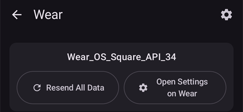

В верхней строке показано имя подключенных часов или **(Часы не подключены)**. На этом экране вы можете

* Resend all data. Это может помочь, если часы какое-то время не были подключены и вы хотите передать информацию на часы.
* Open settings on your watch directly from your phone.
* Выбрать, какой циферблат **AAPS** устанавливает на часы (**Циферблат, установленный на часах**: ваш пользовательский циферблат или циферблат с дополнениями). Эта карточка показана, только пока подключены часы с **Wear OS 6** или новее. Смотрите [Циферблат, который устанавливает AAPS](#wearos-aaps-v4-watchface).
* Управлять разделом **Пользовательский циферблат** (карточка показана, пока часы подключены): **Загрузить циферблат** отправляет пользовательский циферблат на часы, **Циферблат Infos** показывает данные загруженного циферблата и его поля, **Еще циферблаты** открывает в браузере [сайт для обмена циферблатами](../ExchangeSiteCustomWatchfaces/index.md), а **Экспортировать шаблон** сохраняет шаблон, который можно редактировать. Под кнопками показан предварительный просмотр загруженного циферблата. Смотрите [Переход на циферблат AAPS](#WearOS_changing-to-AAPS-watchface).

Убедитесь, что уведомления AAPS не заблокированы на часах. Подтверждение действия (например, болюс, временные цели) происходит через уведомления, которые нужно смахнуть в сторону и нажать на галочку.

## Доступ к главному меню AAPS

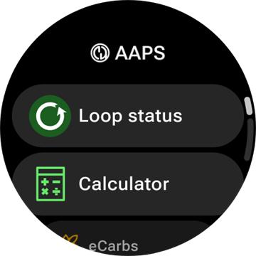

Чтобы открыть главное меню **AAPS**, используйте один из способов:

* откройте **AAPS** из списка приложений на часах
* нажмите на дополнение **AAPS**, которое открывает меню, смотрите [Настройки дополнений](#WearOsSmartwatch-complication-settings)
* нажмите на карточку **График ГК**, у которой **Действие по тапу** установлено на **Главное меню**, смотрите [Настройки карточек](#WearOsSmartwatch-wear-os-tiles)
* на классическом циферблате **AAPS** дважды нажмите на значение глюкозы

(WearOsSmartwatch-loop-status)=

## Экран «Статус цикла»

Экран **Статус цикла** кратко показывает, что делает цикл, и для этого не нужно доставать телефон. Откройте его из главного меню AAPS (**Статус цикла** или **Состояние → Замкнутый цикл**) или нажатием на дополнение **Гликемия**. В меню **Состояние** также есть страница **Помпа** и страница **TDD** с суммарными суточными дозами.

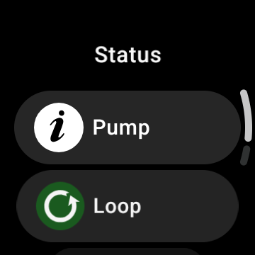

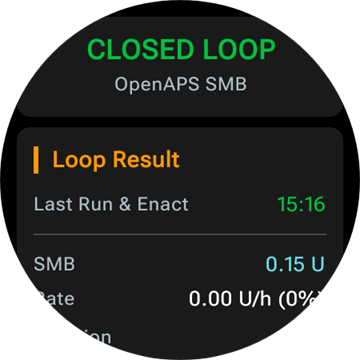

Экран - это список карточек. Прокрутите вниз, чтобы увидеть их все:

* **Режим работы** — текущий режим (замкнутый цикл, открытый цикл, LGS, приостановлен, отключен…) и, для временного режима, сколько он еще будет работать.
* **Результат цикла** — когда цикл работал в последний раз и какой временный базал или SMB он запросил.
* **Сценарий** — только пока активен [сценарий](#scenes-from-watch): его название, оставшееся время (или **До завершения** для сценария без времени окончания) и сценарий **Следующий**, который начнется после его окончания.
* **Цели** — ваша цель и временная цель, если она сейчас работает.
* **Профиль** — название активного профиля, с его значениями **Процент** и **Сдвиг по времени**, если они отличаются от значений по умолчанию. Временное переключение профиля выделено и показывает, сколько оно еще будет работать и к какому профилю (**Возврат к**) вернется после окончания.
* **Чувствительность** — те же строки, что на плашке чувствительности на главном экране телефона: значение Autosens и ISF профиля, переменный и эффективный ISF.

Маленький значок сценария рядом с режимом работы, временной целью или переключением профиля означает, что это **задано активным сценарием**. Такой же значок показан в списке выбора **Режим работы**.

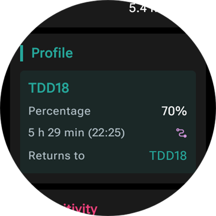

(WearOsSmartwatch-bolus-calculator)=

## Калькулятор болюса на часах

Откройте **Калькулятор** из главного меню **AAPS**, из [карточки «Действия»](#WearOsSmartwatch-wear-os-tiles) или из дополнения, настроенного на открытие калькулятора. Он проходит через несколько страниц, проведите справа налево, чтобы перейти дальше:

| Углеводы                                                                 | Запрос                                                                   | Result                                                                     | Calculation                                                                       | Confirm                                                                       |
| ------------------------------------------------------------------------ | ------------------------------------------------------------------------ | -------------------------------------------------------------------------- | --------------------------------------------------------------------------------- | ----------------------------------------------------------------------------- |
| 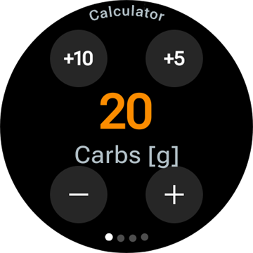 | 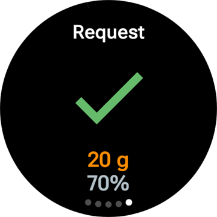 | 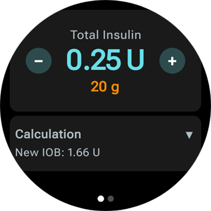 | 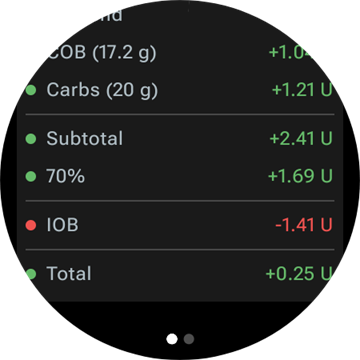 | 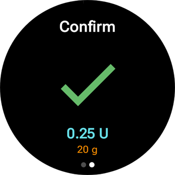 |

1. **Углеводы**: введите углеводы кнопками **+10**, **+5**, **−** и **+**.
2. **Запрос**: последняя страница перед тем, как дальше работает телефон. Она показывает, что вы ввели: углеводы, а также тип еды, время приема углеводов и процент, если вы их используете, смотрите [Дополнительные страницы](#WearOsSmartwatch-calculator-optional-pages). Нажмите на галочку, чтобы отправить данные на телефон, который выполнит расчет.
3. **Результат**: болюс, который предлагает **AAPS**, а под ним углеводы: углеводы сейчас и eCarbs позже, время приема углеводов и колокольчик напоминания о еде. Измените дозу кнопками **−** и **+**, смотрите ниже. Прокрутите вниз до карточки **Расчет**: нажмите на нее, чтобы увидеть каждую строку расчета, так же как на телефоне.
4. **Подтвердить**: проведите на вторую страницу и нажмите на галочку. Телефон вводит болюс и записывает углеводы.

(WearOsSmartwatch-calculator-optional-pages)=

### Дополнительные страницы

Три настройки на часах добавляют каждая по одной странице после страницы **Углеводы**. По умолчанию они выключены. Откройте главное меню **AAPS**, затем **Настройки** > **Интерфейс** и включите нужные; если включено несколько, страницы идут в таком порядке: **Тип еды**, **Время приема углеводов**, **Процент**. Точки внизу калькулятора показывают, сколько в нем страниц.

| Настройки                                                                               | Тип еды                                                                     | Carb time                                                                                  | Процент                                                                      |
| --------------------------------------------------------------------------------------- | --------------------------------------------------------------------------- | ------------------------------------------------------------------------------------------ | ---------------------------------------------------------------------------- |
| 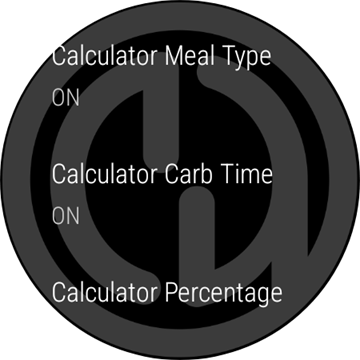 | 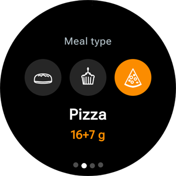 | 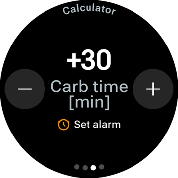 | 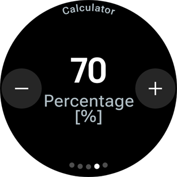 |

* **Тип еды в калькуляторе**: **Хлеб**, **Торт** или **Пицца**; делит углеводы медленной еды на углеводы сейчас и eCarbs позже, смотрите [Выбор типа еды](#WearOsSmartwatch-wizard-meal-type).
* **Время приема углеводов в калькуляторе**: минуты до еды, с колокольчиком **Установить напоминание** для напоминания о еде, смотрите [Время приема углеводов и напоминание о еде](#WearOsSmartwatch-wizard-carb-time).
* **Процент калькулятора**: процент от рассчитанного болюса, например 70%, если вы хотите меньшую дозу. Он начинается со значения **Процент болюса** из [настроек мастера болюса](#Preferences-deliver-this-part-of-bolus-wizard-result) на телефоне, это 100%, если вы его не меняли. Смотрите также примечание в разделе [Изменение болюса на странице результата](#WearOsSmartwatch-wizard-result).

(WearOsSmartwatch-wizard-result)=

### Изменение болюса на странице результата

Страница результата показывает болюс, который предлагает **AAPS**, вместе с кнопками **−** и **+**. С их помощью можно изменить дозу перед подтверждением, не возвращаясь к телефону.

| Предложено                                                                        | Больше                                                                              | Меньше                                                                                |
| --------------------------------------------------------------------------------- | ----------------------------------------------------------------------------------- | ------------------------------------------------------------------------------------- |
| 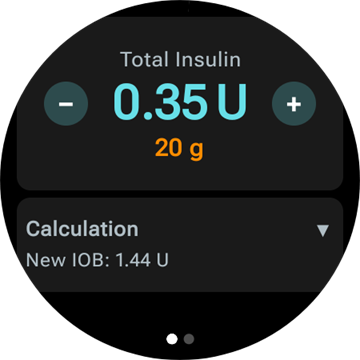 | 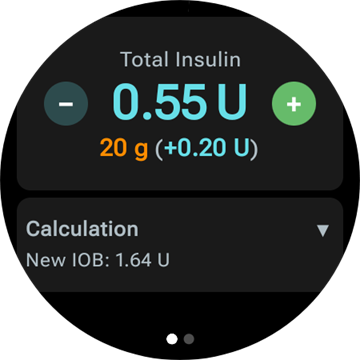 | 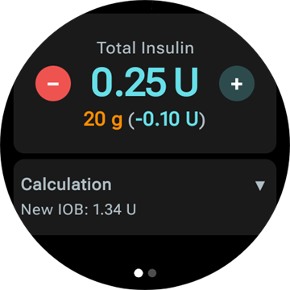 |

* Каждое нажатие меняет болюс на **один шаг вашей помпы**, поэтому предлагаемые количества всегда соответствуют тому, что помпа действительно может ввести.
* **Нажмите и удерживайте** кнопку, чтобы значение менялось дальше. Чем дольше вы держите кнопку, тем быстрее меняется значение.
* Нельзя опуститься ниже **0 ед.** или подняться выше настройки **максимальный болюс**.

Текущая сумма показана на странице результата, поэтому вы всегда видите количество, которое собираетесь подтвердить. Изменение показано после углеводов, например *(+0.20 U)*, а нажатая кнопка становится зеленой при увеличении или красной при уменьшении.

Если **AAPS** пришлось ограничить дозу, например потому что рассчитанный болюс выше настройки **максимальный болюс**, это сообщает желтая строка предупреждения под суммой (например *«Применено ограничение болюса»*). То же относится к ограниченному количеству углеводов.

```{admonition} Это не то же самое, что «Процент калькулятора» :class: note Настройка **Процент калькулятора** позволяет ввести *процент* от рассчитанного болюса **до** того, как появится страница результата. Кнопки **−** и **+** меняют *итоговое количество* **на** странице результата. Можно использовать и то, и другое.

    <br />(WearOsSmartwatch-wizard-meal-type)=
    
    ### Выбор типа еды
    
    Калькулятор на часах может делить углеводы медленной еды на углеводы сейчас и eCarbs позже, как [тип углеводов](#AapsScreens-carbs-type) в мастере болюса на телефоне. Включите **Тип еды в калькуляторе** на часах в **Настройки** > **Интерфейс**. По умолчанию настройка выключена, и тогда страница **Тип еды** пропускается.
    
    * После ввода углеводов страница **Тип еды** показывает три значка: **Хлеб**, **Торт** и **Пицца**. Нажмите на значок: под значками появится его название и количество углеводов, например *65 g* для хлеба или *52+22 g* для пиццы (52 г сейчас и 22 г eCarbs позже). **Хлеб** выбран по умолчанию и оставляет все углеводы на сейчас.
    * Страницы запроса и подтверждения показывают углеводы так же (*52+22 g*). Страница результата также показывает, когда начинаются eCarbs и сколько они длятся.
    * Болюс рассчитывается только для углеводов, которые съедены сейчас. Деление использует те же числа, что и мастер болюса на телефоне.
    
    (WearOsSmartwatch-wizard-carb-time)=
    
    ### Время приема углеводов и напоминание о еде
    
    Если на часах в **Настройки** > **Интерфейс** включено **Время приема углеводов в калькуляторе**, после углеводов идет страница **Время приема углеводов**: минуты до еды, как [время приема углеводов](#aaps-screens-bolus-wizard) в мастере болюса на телефоне. **Сейчас** - значение по умолчанию. **−** и **+** меняют его с шагом 5 минут, до часа раньше или позже текущего времени. Время в прошлом - для углеводов, которые вы уже съели.
    
    При времени в будущем под значением появляется колокольчик **Установить напоминание**. По умолчанию он включен, нажмите на него, чтобы выключить. Страницы запроса и результата показывают время приема углеводов, например *+30 min*, и колокольчик. Телефон записывает углеводы на это время, сдвигает вместе с ними eCarbs типа еды и запускает свое напоминание **Пора есть**.
    
    | Результат | График ГК | Работает | Пора есть |
    | --- | --- | --- | --- |
    | 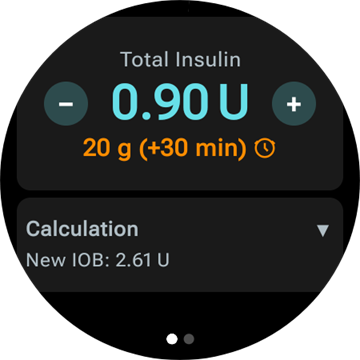 | 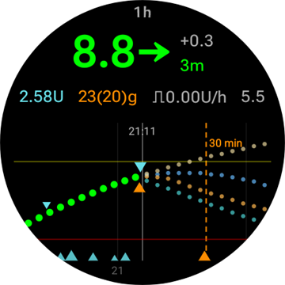 | 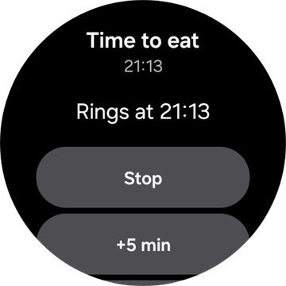 | 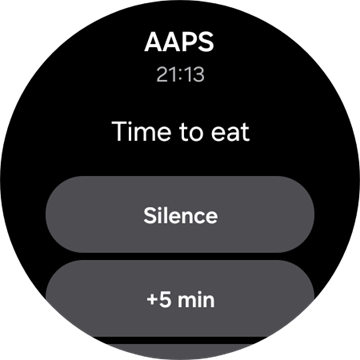 |
    
    Напоминание есть и на часах, поэтому оно звонит, даже когда телефон далеко:
    
    * Экран **График ГК**, карточка **График ГК** и график **Циферблата с дополнениями** рисуют оранжевую пунктирную линию в момент, когда зазвонит напоминание, а рядом - оставшиеся минуты.
    * Пока оно работает, в списке уведомлений находится беззвучное уведомление **Пора есть** с кнопками **Стоп** и **+5 мин**. Если смахнуть его, оно возвращается, пока напоминание не закончится.
    * Когда время пришло, часы вибрируют, и затем каждые полминуты в течение пяти минут, пока вы не ответите. Уведомление предлагает **Заглушить** и **+5 мин**, и если смахнуть его, оно тоже замолкает.
    
    **Стоп**, **Заглушить** и **+5 мин** работают одинаково на часах, на телефоне и в **AAPSClient**, и все они показывают одно и то же напоминание.
    
    (Watchfaces-complications)=
    
    ## Дополнения
    
    _Дополнение_ (complication) - термин из классического часового дела. Так называют добавление к основному циферблату - еще одно маленькое окно или малый циферблат (с датой, днем недели, фазой луны и т. д.). Wear OS 2.0 переносит эту идею на часы: дополнительные данные, например погоду, уведомления, счетчики фитнеса и многое другое, можно добавить в любые циферблаты, которые поддерживают дополнения.
    
    Приложение AAPS для Wear OS поддерживает дополнения начиная со сборки `2.6` и позволяет настроить любой сторонний циферблат, который поддерживает дополнения, для показа данных AAPS (ГК с трендом, IOB, COB и т. д.).
    
    Дополнения также служат **ярлыками** для функций AAPS. Нажав на них, вы можете открывать меню и диалоговые окна AAPS (в зависимости от типа дополнения и настройки).
    
    
    
    ### Типы дополнений
    
    Приложение AAPS для Wear OS дает только исходные данные в заранее заданных форматах. Где и как показывать дополнения, включая их расположение, рамку, цвет и шрифт, решает сторонний циферблат. Из многих типов дополнений Wear OS AAPS использует:
    
    * `SHORT TEXT` - две строки текста по 7 символов, иногда их называют значением и подписью. Обычно отображается внутри круга или небольшой «таблетки» - один под другим или рядом друг с другом. Это дополнение с очень малым местом. AAPS пытается удалить ненужные символы чтобы уместить информацию: округляет значения, удаляет начальные и хвостовые нули из значений и т. д.
    * `LONG TEXT` - две строки текста примерно по 20 символов. Обычно отображается внутри прямоугольника или длинной «таблетки» - один под другим. Он используется для более детальной информации в виде текста.
    * `RANGED VALUE` - для значений из заданного диапазона, например процентов. Он содержит иконку, ярлык и обычно отображается в виде круга с достигнутыми значениями.
    * `LARGE IMAGE` - собственное фоновое изображение, которое можно использовать как фон (если циферблат это поддерживает).
    * `SMALL IMAGE` / `MONOCHROMATIC IMAGE` - маленький значок. В месте `SMALL IMAGE` AAPS рисует его своим цветом; в месте `MONOCHROMATIC IMAGE` его окрашивает циферблат.
    
    ### Настройка дополнений
    
    Чтобы добавить дополнение на циферблат, настройте его долгим нажатием и нажатием на значок шестеренки внизу. В зависимости от того, как это настроено в конкретном циферблате, нажмите на место для дополнения или откройте меню настройки дополнений циферблата. Дополнения AAPS собраны в пункте меню AAPS.
    
    При настройке дополнений на циферблате Wear OS показывает список только тех дополнений, которые подходят для выбранного места на циферблате. Если нужного дополнения нет в списке, то, вероятно, его тип нельзя использовать для этого места.
    
    ### Дополнения AAPS
    
    AAPS предоставляет дополнения, перечисленные ниже. «Открывает» - это то, что делает нажатие, когда **Действия при нажатии кнопки расширений** оставлено на **По умолчанию**, смотрите [Настройки дополнений](#WearOsSmartwatch-complication-settings).
    
    **Глюкоза**
    
    * **Гликемия** (`SHORT TEXT`, открывает _Статус цикла_): значение глюкозы со стрелкой тренда в первой строке, возраст показания и дельта во второй.
    * **Глюкоза крови (больш.)** (`SHORT TEXT`, открывает _График ГК_): только значение глюкозы в первой строке, чтобы циферблат мог показать его крупно. Возраст и стрелка тренда - во второй строке.
    * **График ГК** (`SMALL IMAGE` / `LARGE IMAGE`, открывает _График ГК_): график ГК в виде картинки, для циферблатов с местом для изображения. Это график на **Циферблате с дополнениями**.
    * **Полная информация о статусе** (`LONG TEXT`, открывает _Меню_): большая часть данных в одной строке: значение глюкозы со стрелкой тренда, дельта и возраст показания, затем активные углеводы, активный инсулин и базальная скорость.
    * **Полный статус (в обратном виде)** (`LONG TEXT`, открывает _Меню_): то же самое, но строки поменяны местами, для циферблатов, которые показывают только одну из двух строк места `LONG TEXT`.
    
    **Инсулин и углеводы**
    
    * **Иконка актИнс** (`SHORT TEXT`, открывает _Болюс_): активный инсулин со значком шприца.
    * **АктИнс подробно** (`SHORT TEXT`, открывает _Болюс_): весь активный инсулин в первой строке, болюсная и базальная части во второй.
    * **Иконка актУг** (`SHORT TEXT`, открывает _Калькулятор_): активные углеводы со значком углеводов.
    * **АктУг подробно** (`SHORT TEXT`, открывает _Калькулятор_): активные углеводы сейчас в первой строке, углеводы, которые еще будут (eCarbs), во второй.
    * **АктУг & актИнс** (`SHORT TEXT`, открывает _Калькулятор_): активный инсулин в первой строке, активные углеводы во второй.
    
    **Базал и цель**
    
    * **Базальная скорость** (`SHORT TEXT`, открывает _Меню_): текущая базальная скорость.
    * **BR & IoB** (`SHORT TEXT`, открывает _Меню_): активный инсулин в первой строке, базальная скорость во второй.
    * **БС & Цель** (`SHORT TEXT`, открывает _Временную цель_): цель в первой строке, с оставшимся временем, если работает временная цель, и базальная скорость во второй.
    * **Цель** (`SHORT TEXT`, открывает _Временную цель_): цель в первой строке и, пока работает временная цель, ее оставшееся время во второй.
    * **База, актУг & актИнс** (`SHORT TEXT`, открывает _Меню_): базальная скорость в первой строке, активные углеводы и активный инсулин во второй.
    
    **Цикл и телефон**
    
    * **Режим работы** (`SMALL IMAGE` / `ICON`, открывает _Выбор режима работы_): текущий режим цикла в виде значка: замкнутый цикл, открытый цикл, приостановка на низкой ГК, приостановлен, отключен или деактивирован. Нажатие открывает список смен режима, которые разрешены сейчас, например **Приостановить цикл**, **Отключить помпу**, **Возобновить цикл** или **Возобновить соединение с помпой**. Такой же список есть в главном меню **AAPS** в пункте **Режим работы**.
    * **Батарея загрузчика/телефона** (`RANGED VALUE` / `SHORT TEXT` / `ICON`, открывает _Состояние_): заряд батареи телефона с **AAPS** в виде шкалы со значком батареи, в виде числа или только значком. Оно обновляется вместе с другими данными **AAPS**, обычно каждые 5 минут с новым показанием.
    
    Список выбора **Режим работы**, открытый из дополнения, из главного меню или из карточки «Режим работы»:
    
    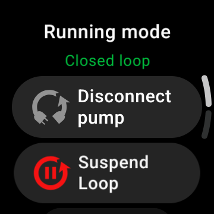
    
    (WearOsSmartwatch-complication-settings)=
    
    ### Настройки дополнений
    
    В главном меню **AAPS** на часах откройте **Настройки** > **Дополнения**:
    
    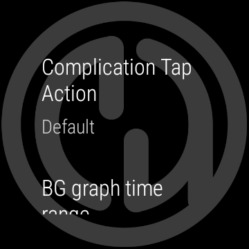
    
    * **Действия при нажатии кнопки расширений** (по умолчанию `По умолчанию`): что открывает нажатие на дополнение **AAPS**, сразу для всех дополнений:
      * _По умолчанию_: то, что открывает само дополнение, смотрите список выше
      * _Меню_: главное меню **AAPS**
      * _Калькулятор_: калькулятор болюса
      * _Терапия_: диалог терапии, инсулин и углеводы
      * _Растянутые углеводы eCarbs_: диалог eCarbs
      * _Состояние_: меню состояния
      * _Режим работы_: выбор режима работы. Нужно, чтобы **Управление с часов** было включено в настройках Wear на телефоне, иначе вместо этого откроется главное меню.
      * _Не показывать_: нажатие ничего не делает
    * **Временной диапазон графика ГК** (по умолчанию `3 часа`): сколько часов показывает дополнение **График ГК**: 1, 3 или 6. У карточки «График ГК» своя настройка.
    * **Юникод в дополнениях** (по умолчанию `Вкл`): дополнения используют символы Юникода, например `Δ` для дельты, `⁞` как разделитель и `⎍` для базальной скорости. Как они выглядят, зависит от шрифта циферблата. Установите `Выкл`, если циферблат рисует их как квадратики или пустые места.
    
    (WearOsSmartwatch-wear-os-tiles)=
    
    ## Карточки Wear OS
    
    Карточки - это страницы, которые открываются, если провести пальцем от циферблата. **AAPS** добавляет семь карточек, в каждой до четырех кнопок. Нажатие на кнопку открывает нужный диалог на часах или просит подтвердить, а затем работу выполняет телефон. Карточка - это ярлык, а не экран статуса: она не хранит состояние приложения на телефоне.
    
    Перед использованием карточек включите **Управление с часов** в [Настройки > Смарт-часы Wear](#preferences-wear).
    
    ### Добавление карточки
    
    Есть два способа, в зависимости от ваших часов и телефона:
    
    1. На часах: проведите от циферблата мимо последней карточки до **Добавить карточку** и выберите карточку **AAPS**. На большинстве часов долгое нажатие на карточку тоже открывает экран добавления и удаления.
    2. На телефоне, в приложении-компаньоне для ваших часов (**Galaxy Wearable** для Samsung, **Wear OS** для других марок): откройте **Карточки**, нажмите **Добавить** и выберите нужные карточки **AAPS**. Порядок карточек можно менять перетаскиванием.
    
    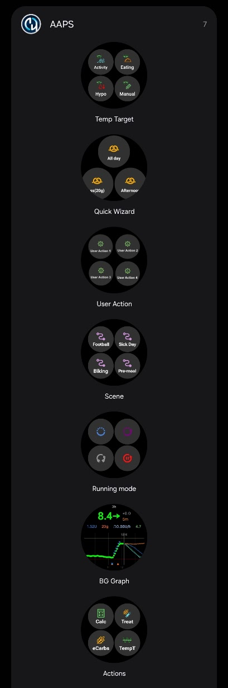
    
    ### Настройки карточек
    
    У карточек **Действия**, **Временная цель**, **График ГК** и **Сценарий** есть настройки на часах. Откройте главное меню **AAPS**, затем **Настройки** > **Карточки** и выберите карточку. Долгое нажатие на карточку тоже открывает ее настройки, кроме часов Pixel. Остальные три карточки заполняются с телефона, и на часах для них настраивать нечего.
    
    | Главное меню | Настройки | Карточки |
    | --- | --- | --- |
    | 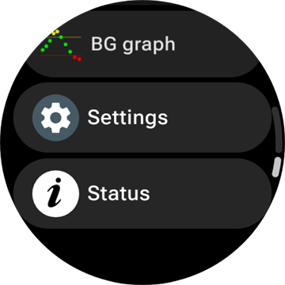 | 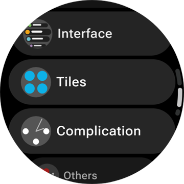 | 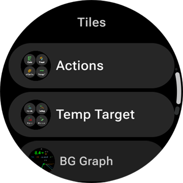 |
    
    Настройки карточки - это список ее четырех мест. Нажмите на место, чтобы выбрать, что оно показывает, или **Отсутствует**, чтобы оставить его пустым.
    
    | Долгое нажатие на карточку | Настройки карточки «Временная цель» |
    | --- | --- |
    | 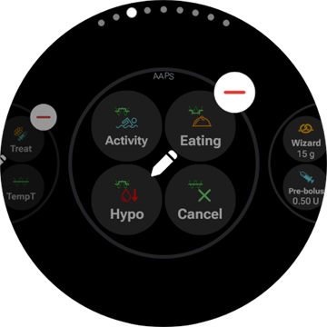 | 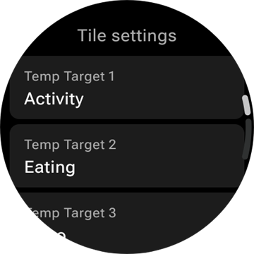 |
    
    У каждой карточки четыре места. Карточка, у которой пунктов больше, показывает первые четыре.
    
    ### Карточка «Действия»
    
    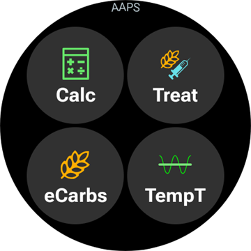
    
    Ярлыки к диалогам приложения **AAPS** на часах. Выберите до четырех из них в настройках карточки:
    
    * **Кальк**: калькулятор болюса, с вводом углеводов, необязательным процентом [1] и необязательным типом еды [2]
    * **Терап**: инсулин и углеводы за один раз
    * **Инсулин**: болюс, вводится в единицах
    * **Углеводы**: углеводы, также растянутые углеводы. Принимается **отрицательное** количество, вплоть до текущего COB, чтобы исправить углеводы, введенные раньше. Удаление углеводов показано на графике ГК на часах.
    * **Растянутые углеводы eCarbs**: растянутые углеводы
    * **ВЦ**: временная цель с собственным значением цели и длительностью
    * **Смена профиля**: переключение профиля с процентом, сдвигом по времени и длительностью
    
    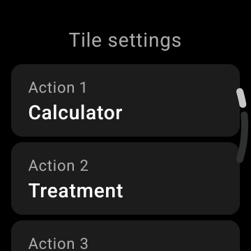
    
    Диалоги, которые открывают кнопки. Проведите справа налево, чтобы перейти к следующей странице диалога, и нажмите на галочку на последней странице, чтобы отправить запрос на телефон:
    
    | Терап | Инсулин | Углеводы | eCarbs | ВЦ | Смена профиля |
    | --- | --- | --- | --- | --- | --- |
    | 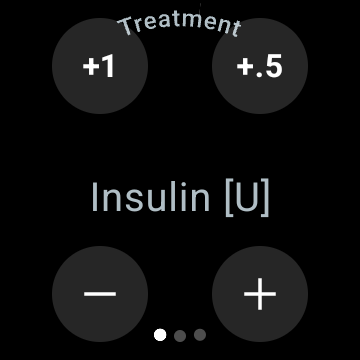 | 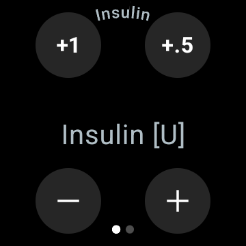 |  | 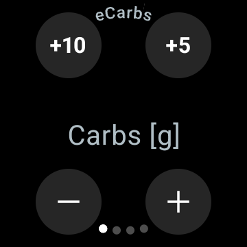 | 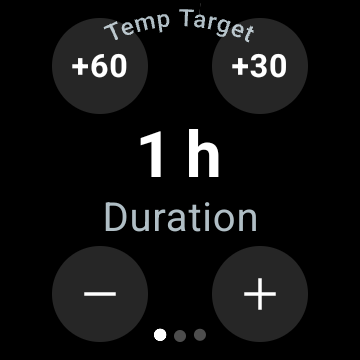 | 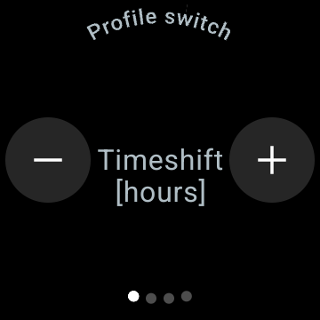 |
    
    [1] На часах в **Настройки** > **Интерфейс** включите **Процент калькулятора**, чтобы в калькуляторе болюса появился ввод процента. Процент по умолчанию берется из настройки телефона [«Процент болюса»](#Preferences-deliver-this-part-of-bolus-wizard-result). Остальные настройки калькулятора - это настройки телефона в **Настройки** > **Настройки мастера болюса**.
    
    [2] На часах в **Настройки** > **Интерфейс** включите **Тип еды в калькуляторе**, чтобы появилась страница **Тип еды**, где вы выбираете **Хлеб**, **Торт** или **Пицца**, чтобы разделить углеводы медленной еды на углеводы сейчас и eCarbs позже. Смотрите [Выбор типа еды](#WearOsSmartwatch-wizard-meal-type).
    
    ### Карточка «Временная цель»
    
    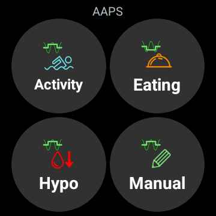
    
    Временные цели из предустановок телефона. Длительность и цель каждой предустановки задаются на телефоне в **Настройки** > [Временные цели по умолчанию](#Preferences-default-temp-targets). Выберите до четырех из них в настройках карточки:
    
    * **Нагрузка**: для спорта
    * **Прием пищи**: ожидаемый прием пищи, более низкая цель, чтобы к еде было больше активного инсулина
    * **Гипо**: более высокая цель во время лечения гипо
    * **Вручную**: собственная цель и длительность
    * **Отмена**: останавливает работающую временную цель. Эта кнопка показана, только пока работает временная цель.
    
    ### Карточка «Мастер быстрых настроек»
    
    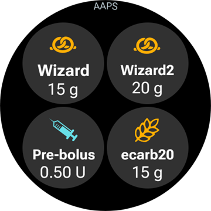
    
    Записи [Мастера быстрых настроек](#quickwizards) на телефоне, у которых включено **Показать на часах**, в пределах их времени действия. Запись с углеводами показывает углеводы в г, запись с инсулином - свою фиксированную дозу в ед. Нажатие выполняет запись после подтверждения на часах. На часах настраивать нечего: редактируйте записи на телефоне и включите **Показать на часах** в разделе **Выбор устройства** для каждой записи, которую вы хотите видеть на карточке. Вне времени действия всех ваших записей карточка показывает **Нет доступной конфигурации**.
    
    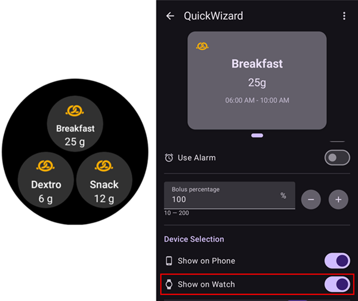
    
    ### Карточка «Сценарий»
    
    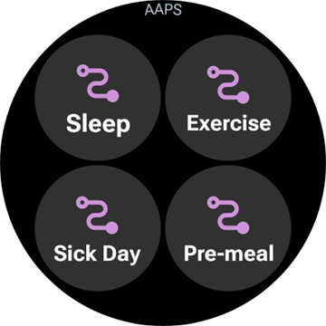
    
    [Сценарии](#scenes-from-watch) телефона. Каждое из четырех мест в настройках карточки можно установить на **Автоматически**, **Отсутствует** или на один сценарий. Место **Автоматически** берет следующий сценарий из списка телефона, который не занят другим местом. Место, установленное на сценарий, которого больше нет на телефоне, показывает **Недоступно**.
    
    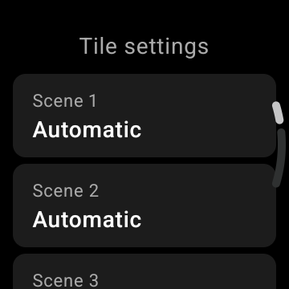
    
    ### Карточка «Режим работы»
    
    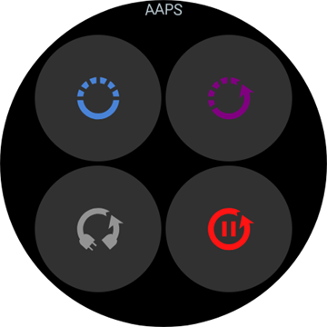
    
    [Режимы работы](#aaps-screens-running-mode), на которые можно переключиться из текущего, с теми же значками, что и на телефоне: замкнутый цикл, приостановка на низкой ГК, открытый цикл, деактивировать цикл, приостановить цикл и отключить помпу, или возобновить и снова подключить, пока работает один из них. **Приостановить цикл** и **Отключить помпу** сначала спрашивают длительность. Телефон решает, какие режимы предложить, часы показывают первые четыре и не показывают **Деактивировать цикл**, если в списке есть **Приостановить цикл**.
    
    ### Карточка «Действия пользователя»
    
    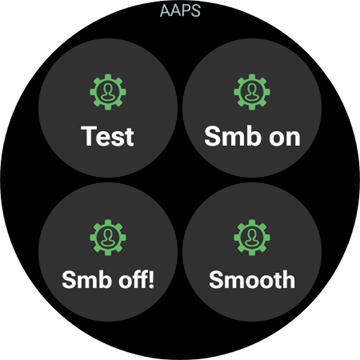
    
    По одной кнопке на каждую [автоматизацию](#automations-automation-triggers) на телефоне, у которой триггер **Действия пользователя**. Нажатие просит подтвердить, затем телефон выполняет действия автоматизации. Кнопки называются так же, как автоматизации, поэтому давайте им короткие названия. На часах настраивать нечего.
    
    ### Карточка «График ГК»
    
    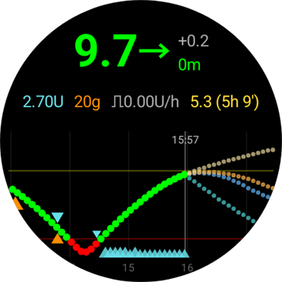
    
    Значение глюкозы со стрелкой, дельтой и возрастом, под ним IOB, COB, базальная скорость и цель, а также график ГК с прогнозами, болюсами, углеводами и SMB. Две настройки на часах: **Временной диапазон** (1, 3 или 6 часов) и **Действие по тапу**, которое открывает полный **График ГК**, **Главное меню** или экран **Статус цикла**.
    
    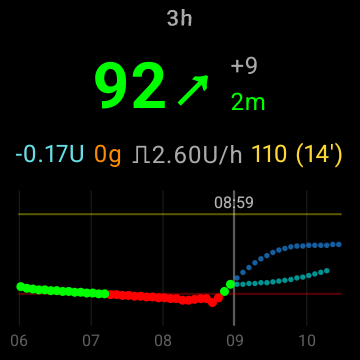
    
    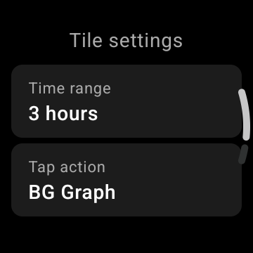
    
    ## Всегда включен
    
    Этот и следующий разделы относятся к классическим циферблатам **AAPS** на Wear OS 5 и старше. На Wear OS 6 у **Циферблата с дополнениями** есть свой режим постоянно включенного экрана, смотрите [Циферблат, который устанавливает AAPS](#wearos-aaps-v4-watchface).
    
    Долгая работа батареи смарт-часов на Android Wear OS - это непростая задача. Некоторые смарт-часы работают до 30 часов без подзарядки. Дисплей должен быть выключен для оптимального энергосбережения, если он не используется. Большинство часов поддерживают дисплей «Всегда включен».
    
    Начиная с версии 3 AAPS мы можем использовать «Упростить интерфейс» в режиме постоянно включенного экрана. Этот интерфейс содержит только глюкозу крови, направление и время. Этот интерфейс экономит энергию: он реже обновляется, показывает меньше информации и включает меньше пикселей, чтобы экономить заряд на OLED-дисплеях.
    
    Упрощенный интерфейс доступен для циферблатов Digital Style и пользовательских циферблатов. Упрощенный интерфейс необязателен и настраивается в настройках циферблата (долгое нажатие на циферблат и нажатие «изменить» или значка шестеренки). Выберите настройку «Упростить интерфейс» и установите для нее «Режим: всегда вкл» или «Режим: всегда вкл при зарядке».
    
    ### Ночной режим
    
    Во время зарядки было бы удобно, если бы экран мог оставаться «всегда включенным» и показывать вашу глюкозу крови ночью. Однако стандартные циферблаты слишком яркие и показывают слишком много информации, а детали трудно прочитать заспанными глазами. Поэтому мы добавили опцию настройки для упрощения интерфейса только во время зарядки.
    
    Упрощенный интерфейс доступен для циферблатов Digital Style и пользовательских циферблатов. Упрощенный интерфейс необязателен и настраивается в настройках циферблата (долгое нажатие на циферблат и нажатие «изменить» или значка шестеренки). Выберите настройку «Упростить интерфейс» и установите для нее «Во время зарядки» или «Режим: всегда вкл при зарядке».
    
    Опции разработчика Android позволяют вашим часам не засыпать во время зарядки. Как открыть параметры для разработчиков, смотрите в [официальной документации](https://developer.android.com/training/wearables/get-started/debugging). Включите «Не выключать экран» (Stay awake when charging) в параметрах для разработчиков.
    
    Обратите внимание: не все дисплеи работают хорошо с опцией "не отключаться". Это может вызвать перегорание экрана, особенно на старых OLED дисплеях. Часы, как правило, затемняют дисплей, чтобы предотвратить его перегорание; пожалуйста, проверьте руководство пользователя, рекомендации изготовителя или поищите информацию в интернете.
    
    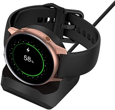
    
    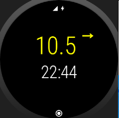
    
    (WearOsSmartwatch-phone-alarms)=
    
    ## Сигналы тревоги телефона на часах
    
    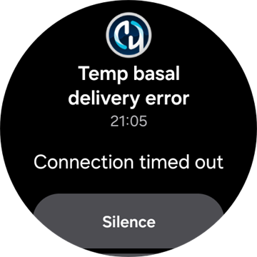
    
    Часы показывают сигналы тревоги телефона, поэтому вы видите, почему телефон издает звук, и можете ответить с запястья. Часы вибрируют, и затем каждые полминуты в течение пяти минут, пока вы не ответите. Уведомление показывает заголовок и текст сигнала тревоги, с теми же ответами, что и у напоминания [Пора есть](#WearOsSmartwatch-wizard-carb-time):
    
    * **Заглушить** или смахивание: сигнал останавливается, и экран сигнала на телефоне закрывается.
    * **Без звука 5 мин**: сигнал останавливается и звучит снова через пять минут, на телефоне и на часах.
    
    На часы приходят два вида сигналов тревоги:
    
    * Экран сигнала тревоги на телефоне (ошибки помпы, сигналы автоматизации, сигналы ГК): **Заглушить** и **Без звука 5 мин**.
    * Срочные уведомления со звуком, например *Помпа недоступна* или сигнал Nightscout: только **Заглушить**. На телефоне для них есть только **Закрыть**, и они возвращаются сами, пока остается их причина.
    
    Напоминание *Пора есть* так не отправляется: его часы подают сами.
    
    ## Ярлык «Отложить оповещения AAPS»
    
    Часы сами [показывают сигнал тревоги](#WearOsSmartwatch-phone-alarms); ярлык - это второй способ заглушить его одним нажатием. Можно создать ярлык, чтобы отложить оповещения от AAPS. Отключение звука через часы - удобный и быстрый способ без необходимости обращения к телефону. Примечание: вам все равно нужно проверить сообщение о сигнале тревоги на телефоне и отреагировать на него, но это можно сделать позже. Если у ваших часов две кнопки, вы можете назначить кнопку программе `AAPS Snooze Alert` («Отложить оповещения AAPS»).
    
    Чтобы назначить кнопку на Samsung Watch 4, перейдите в `Settings > Advanced Features > Customize Buttons > Double press > AAPS Snooze Alert`
    
    На циферблате с дополнениями дополнение **Ярлык приложения** (App shortcut), установленное на **Отложить оповещения AAPS**, делает то же самое нажатием. [Альтернативная настройка Циферблата с дополнениями](#wearos-complications-watchface-setup) использует для этого свое верхнее правое место.
    
    ### Отложить сигналы xDrip
    
    Если вы используете xDrip и xDrip установлен на часах, ярлык «Отложить оповещения AAPS» также отложит любой сигнал тревоги xDrip. 
    
    
    ## Советы по производительности и работе батареи
    
    Часы Wear OS - устройства с очень ограниченным запасом энергии. Размер корпуса часов ограничивает емкость встроенной батареи. Даже с последними достижениями в аппаратном и программном обеспечении часов Wear OS по-прежнему требуется ежедневная подзарядка.
    
    Если батарея работает меньше суток (от рассвета до заката), вот несколько советов для поиска причины.
    
    Больше всего батарею расходуют:
    
    * Активный дисплей с включенной подсветкой (для LED) или в режиме полной яркости (для OLED)
    * Отрисовка на экране
    * Радиосвязь по Bluetooth
    
    Так как мы не можем экономить на связи (нужны свежие данные) и хотим, чтобы показывались самые новые данные, большую часть оптимизации можно сделать в области _времени работы экрана_:
    
    * Стандартные циферблаты обычно оптимизированы лучше, чем пользовательские, скачанные из магазина.
    * Лучше использовать циферблаты, которые показывают меньше данных в неактивном / затемненном режиме.
    * Будьте внимательны, если добавляете другие дополнения, например сторонние виджеты погоды или другие, которые берут данные из внешних источников.
    * Начните с более простых циферблатов. Добавляйте по одному дополнению и наблюдайте, как они влияют на работу батареи.
    * Используйте темную тему на циферблате. На OLED-дисплеях меньше светящихся пикселей - это меньше расход энергии и меньше выгорание.
    * Проверьте, что работает лучше на ваших часах: стандартные циферблаты AAPS или другие циферблаты с дополнениями AAPS.
    * Наблюдайте в течение нескольких дней, при разной активности. Большинство часов активируют дисплей при просмотре, движении или других активаторах, связанных с использованием.
    * Проверьте общие системные настройки, которые влияют на производительность: уведомления, время до отключения подсветки/активного дисплея, когда включается GPS.
    * Смотрите [список проверенных телефонов и часов](#Phones-list-of-tested-phones) и [спросите сообщество](../GettingHelp/WhereCanIGetHelp.md) об опыте других пользователей и о том, сколько у них работает батарея.
    * **Мы не можем гарантировать, что данные на циферблате или в дополнении актуальны**. В конечном итоге, когда обновлять циферблат или дополнение, решает Wear OS. Даже если приложение AAPS запрашивает обновление, система может решить отложить или игнорировать обновления для экономии батареи. При сомнениях и низком заряде батареи на часах - всегда сверяйтесь с основным приложением AAPS на телефоне.
    
    (Watchfaces-troubleshooting-the-wear-app)=
    
    ## Устранение неполадок приложения на часах
    
    Если часы не показывают данные или показывают старые данные, сначала проверьте связь между часами и телефоном, смотрите [Устранение неполадок связи между часами AAPS и телефоном AAPS](#wear-os-watch-phone-communication). Для часов с Wear OS 5 смотрите также [общие рекомендации по устранению неполадок для Wear OS 5](#wear-os-5-troubleshooting). У дополнения, которое не обновляется, те же причины, что у карточки или циферблата, которые не обновляются, поэтому сначала проверьте их.
    
    ## Доступны также другие пользовательские циферблаты AAPS
    
    [Здесь](../ExchangeSiteCustomWatchfaces/index.md) можно скачать Zip-файлы с пользовательскими циферблатами, которые сделали другие пользователи.
    
    ## Создание своего циферблата
    
    Если вы хотите создать свой циферблат, следуйте [этому руководству](../ExchangeSiteCustomWatchfaces/CustomWatchfaceReference.md).
    
    Когда вы создали пользовательский циферблат, вы можете поделиться своим пользовательским циферблатом **AAPS** с другими: zip-файл можно загрузить в папку "ExchangeSiteCustomWatchfaces" через Pull Request на GitHub. При слиянии запроса на изменение (pull request) команда документации извлечет файл CustomWatchface.png и добавит к его имени в начале имя Zip-файла.
    
    (WearOsSmartwatch-complications-watchface-download)=
    
    ## Своя версия Циферблата с дополнениями
    
    **Циферблат с дополнениями**, который **AAPS** устанавливает на Wear OS 6 (смотрите [Циферблат, который устанавливает AAPS](#wearos-aaps-v4-watchface)), сделан в **Watch Face Studio** от Samsung. Файл его проекта можно бесплатно скачать, поэтому вы можете изменить его на свой вкус или использовать на часах с Wear OS 5 и старше, где **AAPS** его не устанавливает:
    
    [Циферблат с дополнениями (AAPS V4), zip](https://github.com/openaps/AndroidAPSdocs/raw/refs/heads/master/docs/_static/wearos/Complications_watchface_AAPS_V4.zip)
    
    В zip-архиве четыре файла:
    
    * `AAPS V4_0_2.wfs`: проект. Откройте его в [Watch Face Studio](https://developer.samsung.com/watch-face-studio/download.html), измените что хотите и установите на часы оттуда.
    * `com.watchfacestudio.aapsv4.apk`: циферблат как есть, готовый к установке через [adb](https://developer.android.com/tools/releases/platform-tools): `adb install com.watchfacestudio.aapsv4.apk`, когда часы подключены через отладку ADB.
    * `README.txt`: две рекомендуемые настройки дополнений, такие же, как на [странице Wear OS](#wearos-complications-watchface-setup).
    * `AAPS V4.png`: предварительный просмотр.
    
    ```{admonition} Это не пользовательский циферблат
    :class: note
    Этот zip-архив - не пользовательский циферблат для **Загрузить циферблат** в модуле **Смарт-часы Wear**, и телефон не может его установить. Его нужно распаковать и установить на часы с помощью Watch Face Studio или adb, как описано выше.