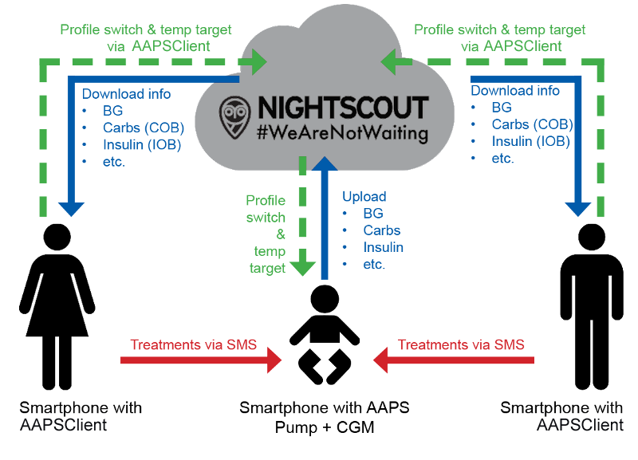

# Удаленный мониторинг

__AAPS__ предлагает несколько функций для удаленного мониторинга детей с диабетом 1 типа, а также поддерживает удаленные команды, которые отправляют указания в __AAPS__ на расстоянии. Точно так же __AAPSClient__ можно использовать для удаленного мониторинга, чтобы следить за __AAPS__ партнера или друга.

## Функции

- Помпой ребенка управляет телефон ребенка с __AAPS__.
- Опекуны могут удаленно следить за всеми важными данными, такими как уровень глюкозы, активные углеводы, активный инсулин и т. д., с помощью **AAPSClient apk** на своем телефоне Android (версия **AAPSClient** для iPhone в разработке, см. [Приложение AAPSClient](AapsClient.md)). Настройки, измененные в __AAPS__, синхронизируются с __AAPSClient__, и наоборот.
- Опекуны могут получать сигналы тревоги через **xDrip в режиме фолловера** на своем телефоне Android, если настроен режим xDrip companion.
- Удаленное управление __AAPS__ через [SMS команды](../RemoteFeatures/SMSCommands.md) защищено двухфакторной аутентификацией.
- Удаленное управление через __AAPSClient__ использует подписанный канал команд, появившийся в **AAPS** 4: сначала нужно выполнить **сопряжение** клиента с основным телефоном (по QR-коду или PIN-коду), и каждую команду подтверждает и выполняет основной телефон. Каждый телефон опекуна может получить свою [роль](#client-master-control-roles), от только чтения до полного управления — см. [Управление «основной телефон ↔ клиент» (подписанное удаленное управление)](#client-master-control).

## Инструменты и приложения для удаленного мониторинга

- [Nightscout](https://nightscout.github.io/) в веб-браузере (в основном показ данных).
- [__AAPSClient__](AapsClient.md) — это упрощенная версия __AAPS__, которая может следить за основным __AAPS__ и, после **сопряжения**, отправлять удаленные команды: углеводы, __временные цели__, __переключения профиля__ и даже болюсы (см. [Управление «основной телефон ↔ клиент» (подписанное удаленное управление)](#client-master-control)). Есть 3 приложения: [AAPSClient, AAPSClient2 и AAPSClient3 для скачивания](https://github.com/nightscout/AndroidAPS/releases/), поэтому опекун может следить за тремя разными людьми с одного телефона (например, за двумя детьми с диабетом 1 типа, у каждого из которых своя учетная запись Nightscout и свой основной __AAPS__).
- Dexcom follow if you are using original Dexcom app (BG values only).
- [xDrip](../CompatibleCgms/xDrip.md) в режиме фолловера (в основном значения ГК и **сигналы тревоги**).
- [Sugarmate](https://sugarmate.io/) или [Spike](https://spike-app.com/) на iOS (в основном значения ГК и **сигналы тревоги**).
- Некоторые пользователи считают, что полнофункциональный инструмент удаленного доступа, такой как [TeamViewer](https://www.teamviewer.com/), может оказаться полезным для удаленного устранения неполадок.

## Опции для смарт-часов

Смарт-часы могут очень помочь в управлении __AAPS__ у детей с СД1. Есть несколько вариантов:

- Вариант 1 – Если __AAPSClient__ установлен на телефоне опекуна, на совместимые смарт-часы, подключенные к телефону опекуна, можно установить [приложение AAPSClient для WearOS](https://github.com/nightscout/AndroidAPS/releases/). Они показывают текущую __ГК__, состояние цикла и историю болюсов, а также позволяют вводить углеводы, __временные цели__ и менять __профиль__. Если клиент **сопряжен** с основным телефоном, с часов можно также запустить **болюс**: команда передается через клиента на основной телефон, который подтверждает и вводит его (см. [Управление «основной телефон ↔ клиент» (подписанное удаленное управление)](#client-master-control)).
- Вариант 2 – [Приложение AAPS для WearOS](../WearOS/WearOsSmartwatch.md) можно также собрать и установить на совместимые смарт-часы, которые подключены к телефону ребенка, но их носит опекун. Здесь есть все функции, перечисленные выше, а также возможность вводить болюс инсулина напрямую, не забирая телефон у ребенка.
- Вариант 3 – Только показ: часы, которые **AAPS** не поддерживает напрямую (Xiaomi, Amazfit или часы Wear OS с дополнением), могут показывать глюкозу, IOB, COB и состояние цикла через приложение-компаньон, например WatchDrip+ или GlucoDataHandler. Данные им передает модуль **Внешние приложения-компаньоны** на телефоне с **AAPS** или **AAPSClient**, к которому подключены часы. См. [Внешние приложения-компаньоны](#watches-external-companion-apps).

## Важные факторы

- Учитывайте задержку между основным телефоном и фолловером из-за времени выгрузки и загрузки, а также то, что основной телефон с __AAPS__ загружает данные только после выполнения цикла.
- Какой у вас план на случай, если удаленное управление не работает (_например_, проблемы с сетью или потеря связи Bluetooth)? Always consider what will happen with **AAPS** if you suddenly can’t send a new command. **AAPS** заменяет базал, ISF и IC в помпе значениями из текущего профиля. Если вы переключаетесь на более сильный профиль инсулина, делайте только временные переключения профиля (_т. е._ с заданной длительностью) на случай, если удаленная связь прервется. Then the pump will revert to the original profile when the time expires.
