# SMS команды

```{contents} Table of contents
:depth: 2
```

Большинство удаленных изменений (временные цели, углеводы, переключения профиля, а после сопряжения клиента и болюсы) можно делать в [приложении **AAPSClient**](../RemoteFeatures/RemoteMonitoring.md) на телефоне Android с подключением к интернету, см. [Управление «основной телефон ↔ клиент»](#client-master-control) (версия **AAPSClient** для iPhone в разработке, см. [AAPSClient](AapsClient.md)). SMS-команды остаются альтернативой, которая работает без интернета. Это единственный способ удаленного управления, если вы используете iPhone как фолловер и у вас еще нет **AAPSClient**.

**SMS commands are really useful:**
1. For routine remote control

2. Если вы хотите удаленно вводить болюс инсулина без сопряженного **AAPSClient**

3. In a region of poor internet reception, where text messages are able to get through, but data/internet phone reception is limited. This is very useful when going to remote areas (e.g. camping, skiing).

4. Если ваш другой способ удаленного управления (**AAPSClient**) временно не работает

## Безопасность прежде всего

If you enable **SMS Communicator** in **AAPS**, consider that the phone which is set up to give remote commands could be stolen, and/or used by someone else. Always lock your phone handset with at least a PIN. Очень рекомендуется надежный пароль и/или биометрическая блокировка. Этот пароль должен отличаться от главного пароля APK (пароля, который нужен для экспорта настроек **AAPS**).

Кроме того, рекомендуется разрешить SMS-команды со [второго номера телефона](#SMSCommands-authorized-phone-numbers). Так вы сможете со второго номера [отключить](#SMSCommands-other) SMS коммуникатор, если ваш основной телефон для удаленного управления будет скомпрометирован.

Минимальная задержка между командами болюса по умолчанию – 15 минут, считая с момента, когда помпа приняла болюс. For safety reasons, you have to add at least two authorised phone numbers to change this to a shorter time delay. Если вы попытаетесь снова ввести удаленный болюс в течение 15 минут после предыдущего болюса, вы получите ответ «Удаленный болюс недоступен, повторите попытку позже.»

AAPS также сообщит вам текстовым сообщением, выполнены ли ваши удаленные команды, такие как болюс или изменение профиля. Рекомендуется сделать такую настройку, чтобы подтверждающие тексты направлялись по меньшей мере на два разных телефона на тот случай, если один из них украден.

**Если вы вводите болюс через SMS-команды, углеводы нужно вводить отдельно (второе SMS, AAPSClient...)!** Если этого не сделать, IOB будет верным, но COB слишком низким. Тогда корректирующий болюс может быть не подан, потому что **AAPS** посчитает, что у вас слишком много активного инсулина.

Для важных команд, чтобы повысить безопасность, нужно использовать приложение-аутентификатор с одноразовым паролем, ограниченным по времени.

Если вы хотите отнять у телефона опекуна возможность отправлять SMS-команды, используйте аварийную кнопку «[Сбросить аутентификаторы](#sms-commands-authenticator-setup)» в **AAPS** или отправьте SMS-команду «[SMS stop](#SMSCommands-other)». By resetting authenticators you make ALL the caregivers' phones invalid. You will need to set them up again.

## Настройка SMS-команд

```{contents} The overall process is as follows
:depth: 1
:local: true
```

(sms-commands-authenticator-setup)=
### Настройка аутентификации

Для повышения безопасности используется двухфакторная аутентификация.

На телефон опекуна скачайте (из App Store или Google Play) и установите приложение-аутентификатор. Популярные бесплатные приложения:
  - [Приложение Authy](https://authy.com/download/)
  - Google Authenticator - [Android ](https://play.google.com/store/apps/details?id=com.google.android.apps.authenticator2)/[iOS](https://apps.apple.com/de/app/google-authenticator/id388497605)
  - [LastPass Authenticator](https://lastpass.com/auth/)
  - [FreeOTP Authenticator](https://freeotp.github.io/)

Эти приложения создают одноразовый 6-значный пароль, ограниченный по времени, как в мобильном банке или при покупках в интернете. You can use an alternative Authenticator app, as long as it supports RFC 6238 TOTP tokens. The Microsoft Authenticator does not work.

### Проверьте настройки телефона

На телефоне откройте **Приложения > AAPS > Разрешения**. Убедитесь, что **SMS** и **Телефон** разрешены.

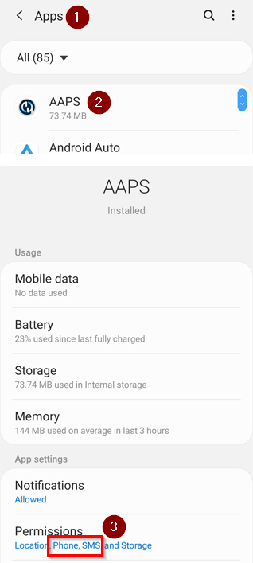

```{admonition} "App was denied access to SMS"
:class: tip
Android может блокировать разрешение **SMS** для приложений, установленных не из магазина приложений, например для **AAPS**. Если вы видите это сообщение, когда даете разрешение **SMS**, откройте на телефоне **Настройки > Приложения > AAPS**, нажмите меню **⋮** (вверху справа) и выберите **Разрешить доступ к настройкам** (Allow restricted settings). Затем снова дайте разрешение **SMS**.
```

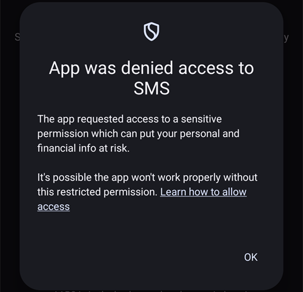

### Синхронизация даты и времени

Время на обоих телефонах должно быть синхронизировано. Оптимальный вариант - установить на автоматическую настройку из сети. Различия во времени могут привести к проблемам аутентификации.

И на телефоне с **AAPS**, и на телефоне опекуна проверьте, что дата и время синхронизированы. Как именно это сделать, зависит от вашего устройства; возможно, придется попробовать разные настройки.

Пример (для Samsung S23): **Настройки > Общие настройки > Дата и время**: убедитесь, что включено **Автоматические дата и время**.

Some options may be greyed out, due to needing admin via a family account if the phone has been set up as a child account. This date and time setting is called “set automatically” on a caregiver/parent iPhone. Если вы не уверены, синхронизированы ли телефоны, не волнуйтесь: можно настроить SMS-команды и потом искать причину, если, похоже, проблемы возникают из-за этого (при необходимости попросите помощи).

### Настройки AAPS

Теперь, когда настройки телефона проверены, в самом приложении **AAPS** откройте [**Конфигурация** → **Связь**](../SettingUpAaps/ConfigBuilder.md) и включите модуль **SMS коммуникатор**.

Откройте настройки **SMS коммуникатор**.

Включите **Разрешить команды через смс**. Параметры **Дополнительный обязательный пин-код в конце маркера** и **Настройка аутентификации** появляются только после этого:

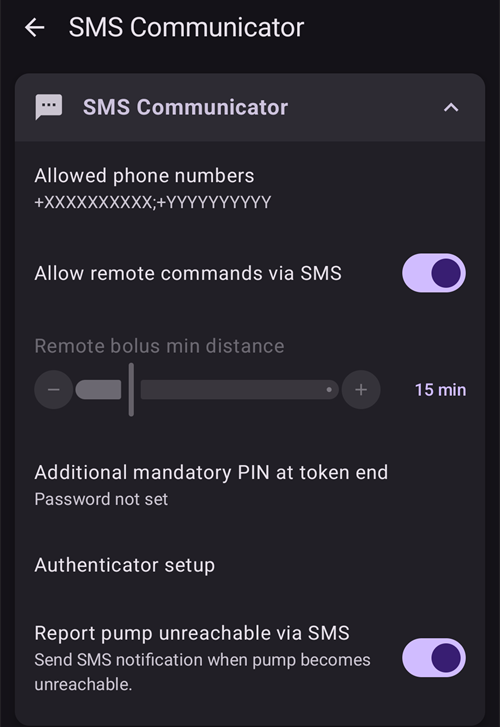

(SMSCommands-authorized-phone-numbers)=
#### Allowed phone numbers

Введите номер(а) телефона опекуна. Include the country code and exclude the first “0” of the phone number, as shown in these examples:
* Номер телефона в Великобритании: +447976304596
* Номер телефона в США: +11234567890
* Номер телефона во Франции: +33612344567
* _etc._

Note that the “+” in front of the number may or may not be required based on your location. Чтобы это узнать, отправьте пробное сообщение. Полученный формат будет показан на экране модуля **SMS коммуникатор** (**Конфигурация** → **Связь** → **SMS коммуникатор** → **Открыть модуль**).

Если нужно добавить несколько номеров телефона, разделяйте их точкой с запятой **БЕЗ пробела между номерами** (это очень важно!). Выберите **OK**:

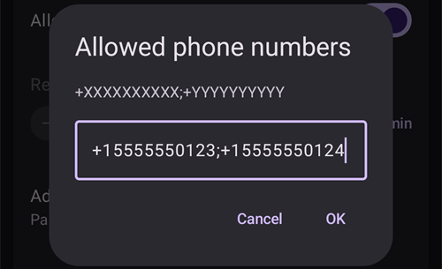

#### Минимальный интервал между удаленными болюсами

- Можно задать минимальную задержку (в минутах) между двумя болюсами, отправленными по SMS.
- Из соображений безопасности следует добавить хотя бы два авторизованных номера телефона для изменения этого значения.

#### Additional mandatory PIN at token end

Из соображений безопасности после кода ответа нужно ввести PIN-код. Выберите PIN-код, который вы (и другие опекуны) будете вводить после кода аутентификатора при отправке SMS-команды.

PIN requirements are:

* не менее 6 цифр
* только цифры

Для более надежного PIN-кода не используйте одну и ту же цифру много раз (_например,_ 111111) или последовательность (_например,_ 123456).

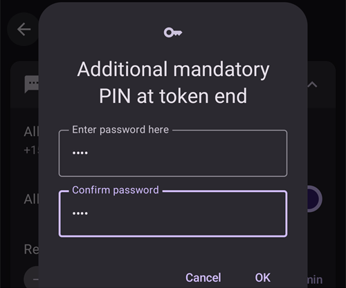

#### Настройка аутентификации

* Нажмите **Настройка аутентификации** и следуйте пошаговым инструкциям на экране.
* Откройте установленное приложение-аутентификатор на _телефоне опекуна_, создайте новое подключение и
* Телефоном опекуна отсканируйте QR-код, показанный в разделе **Сканируйте код для настройки OTP кодов AAPS**.

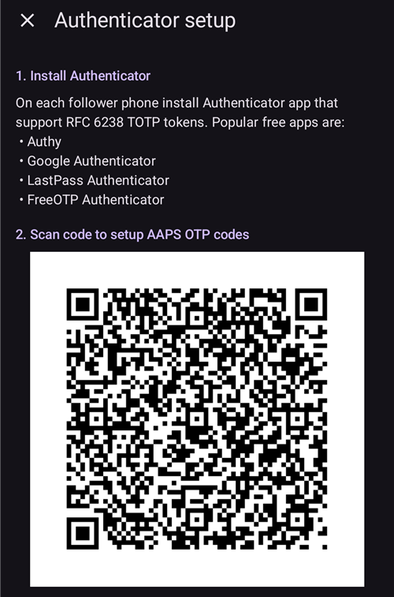

* В разделе **Проверьте одноразовый пароль** введите в поле **Код для проверки** одноразовый код из приложения-аутентификатора на телефоне опекуна, а сразу после него ваш PIN-код:

Example:
* Токен из приложения-аутентификатора: 457051
* Your mandatory PIN is 2401
* Code to check: 4570512401

Если ввод правильный, красный текст «НЕВЕРНЫЙ PIN-КОД» автоматически сменится на зеленый «OK». **Здесь нет кнопки, которую нужно нажать!** Процесс завершен, после ввода кода не нужно нажимать кнопку «OK»:

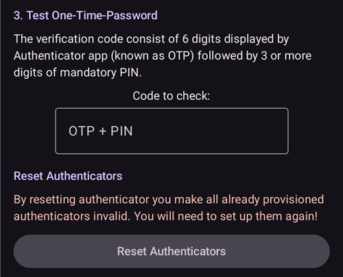

You should now be set up with SMS commands.

Используйте кнопку **Сбросить аутентификаторы** внизу экрана **Настройка аутентификации**, если хотите удалить настроенные аутентификаторы. (By resetting authenticator you make ALL already provisioned authenticators invalid. You will need to set them up again.)

## Использование SMS-команд

### First steps using SMS commands

1)  Чтобы проверить, что все настроено правильно, проверьте связь: отправьте с телефона опекуна на телефон с **AAPS** SMS с текстом «bg». You should get a response similar to that shown here:

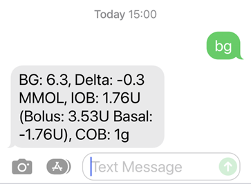

Если вы не получили ответа, см. раздел [Устранение неполадок](#SMSCommands-troubleshooting) ниже.

2)  Теперь попробуйте SMS-команду, которая требует аутентификатора, _например,_ «target hypo». Телефон опекуна получит ответное сообщение с просьбой ввести **шестизначный пароль** из приложения-аутентификатора, а за ним дополнительный секретный **PIN-код**, который знают только опекуны/фолловеры (всего 12 цифр, если ваш PIN-код из 6 цифр).

Когда вы впервые отправляете SMS-команду, делайте это рядом с телефоном с **AAPS**, чтобы увидеть, как это работает:

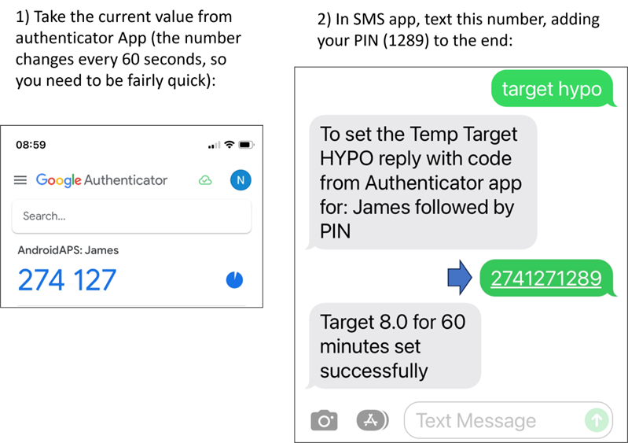

Телефон опекуна получит ответное SMS от **AAPS**, которое подтвердит, успешно ли выполнена удаленная SMS-команда.

If your command is successful, you will receive a reply to confirm this. If there is a problem you will receive an error message. Частые ошибки см. в разделе [Устранение неполадок](#SMSCommands-troubleshooting) ниже.

**Подсказка**: Если отправляется много SMS, полезно иметь тарифный план с неограниченным количеством SMS (для каждого используемого телефона).

### Болюсы на еду с помощью SMS-команд

Удаленный болюс инсулина можно ввести через **SMS-команды** или через сопряженный **AAPSClient** (см. [Управление «основной телефон ↔ клиент»](#client-master-control)); через сайт Nightscout этого сделать нельзя. Углеводы тоже можно внести через SMS или **AAPSClient**. По SMS нельзя отправить команды на углеводы и на инсулин в одном сообщении. These commands must be sent separately as follows:

1)  Отправка болюса инсулина через SMS-команды (_например,_ «bolus 2» дает команду на болюс 2 ед) равнозначна **Терапия** → **Инсулин** в **AAPS**. 2)  Send the carbs (_e.g._ “carbs 20” will announce 20g of carbs). Это равнозначно **Терапия** → **Углеводы** в **AAPS**.

Чтобы избежать гипо, лучше начинать осторожно и вводить болюс с **меньшим количеством инсулина**, чем нужно по вашему углеводному коэффициенту, потому что вы не учитываете текущий уровень глюкозы и его тренд.

**Порядок отправки этих команд важен**. If you announce a large amount of carbs by any route, and have SMBs enabled, **AAPS** may immediately respond by giving a partial bolus of insulin. So, if you then try to send an insulin bolus _after_ announcing the carbs, you may have a frustrating delay and a “bolus in progress” message, and you then need to check what has been given as an SMB. Or, if you do not realise an SMB is being delivered, and your own subsequent bolus is also successful, too much insulin may be delivered for the meal overall. Therefore, if bolusing for meals remotely, always send the insulin bolus _before_ the carb announcement. Если хотите, можно сочетать **AAPSClient** с SMS-командами: углеводы, введенные в сопряженном **AAPSClient**, не требуют кода аутентификации, поэтому это быстрее, чем SMS-команды. Углеводы и другие записи терапии, введенные на сайте Nightscout, **не** применяются, пока включено управление клиентом; тогда **AAPS** работает в [защищенном режиме](#client-master-control-hardened-mode).

(SMSCommands-commands)=
## Команды

```{contents} List of command groups
:depth: 1
:local: true
```

Команды нужно отправлять на английском. Ответ будет на вашем языке, если строка ответа уже [переведена](#translations-translate-strings-for-AAPS-app). Регистр в командах не важен: можно писать строчными или заглавными буквами.

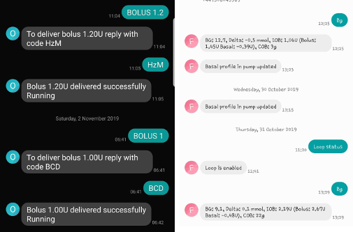

В **таблицах SMS-команд** ниже показаны все возможные SMS-команды. Для облегчения понимания приводятся _примеры значений_. Для команд допустимы те же диапазоны значений (цели, процент профиля и т. д.), что и в самом приложении **AAPS**.

(authentication-or-not)=
### Authentication or not?

На некоторые SMS-команды ответ приходит сразу, а некоторые требуют надежной **аутентификации** через приложение-аутентификатор. Простой запрос, например «**BG**» (запрос текущей глюкозы), быстро набирается, не требует аутентификации и возвращает информацию о состоянии **AAPS**, как показано ниже:


Commands which need more security require a code to be entered, for example:

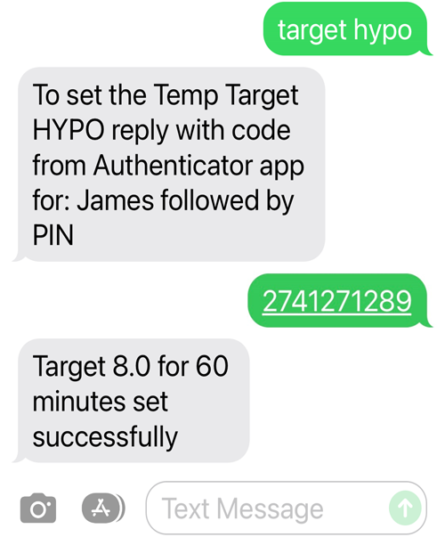

Столбец *Аутент.* в таблицах ниже показывает, нужна ли такая надежная аутентификация для каждой команды.

### Данные мониторинга

| Команда    | Аутент. | Функция и *ответ*                                                                                                                                                                                                                             |
| ---------- | ------- | --------------------------------------------------------------------------------------------------------------------------------------------------------------------------------------------------------------------------------------------- |
| BG         | No      | Возвращает: последнюю ГК, изменение (дельту), IOB (болюс и базал), COB<br/>*Последняя ГК: 5.6 4мин. назад, Дельта: -0,2 ммоль, IOB: 0.20ед (Болюс: 0.10ед Базал: 0.10ед)*                                                               |
| CAL 5.6/90 | Yes     | Калибрует CGM значением 5.6/90<br/>(используйте значение в ваших единицах глюкозы)<br/>Работает, только если правильно настроено в **AAPS**.<br/>*Калибровка отправлена. В xDrip+ должна быть включена возможность приема.* |

### Pump

| Команда              | Аутент. | Функция и *ответ*                                                                                          |
| -------------------- | ------- | ---------------------------------------------------------------------------------------------------------- |
| PUMP                 | No      | Пред соед: 1 мин. наз<br/>ВремБаз 0.00ед/ч @11:38 5/30мин<br/>IOB: 0.5ед Резерв: 34ед Бат: 100 |
| PUMP DISCONNECT *30* | Yes     | Отключить помпу на *30* минут                                                                              |
| PUMP CONNECT         | Yes     | Pump reconnected                                                                                           |

### Базал

| Команда           | Аутент. | Функция и *ответ*                  |
| ----------------- | ------- | ---------------------------------- |
| BASAL 0.3         | Yes     | Запустить базал 0,3 ед/ч на 30 мин |
| BASAL 0.3 20      | Yes     | Запустить базал 0,3 ед/ч на 20 мин |
| BASAL 30%         | Yes     | Запустить базал 30% на 30 мин      |
| BASAL 30% 50      | Yes     | Запустить базал 30% на 50 мин      |
| BASAL STOP/CANCEL | Yes     | Остановить временный базал         |

Некоторые помпы принимают временный базал только в процентах, другие только в ед/ч. Если вы используете другую форму, **AAPS** отвечает *«This pump takes a temp basal only in percent, not in U/h.»* (или наоборот) и ничего не устанавливает. Длительность должна быть кратной шагу длительности временного базала вашей помпы.


### Замкнутый цикл

| Команда           | Аутент. | Функция и *ответ*                                                                                                                                                                                                                                                                          |
| ----------------- | ------- | ------------------------------------------------------------------------------------------------------------------------------------------------------------------------------------------------------------------------------------------------------------------------------------------ |
| LOOP STATUS       | No      | Ответ зависит от текущего состояния:<br/> - *Цикл не работает*, если цикл выключен<br/> - *Зцикл работает*, если цикл замкнутый, открытый или LGS<br/> - *Связь с помпой отключена*, если помпа отключена<br/> - *Остановлен (на 10 мин)*, если цикл приостановлен |
| LOOP STOP/DISABLE | Yes     | Помпа вернется к запрограммированной базальной скорости.<br/>*Зцикл остановлен*                                                                                                                                                                                                      |
| LOOP SUSPEND 20   | Yes     | *Loop suspended*                                                                                                                                                                                                                                                                           |
| LOOP RESUME       | Yes     | *Loop resumed*                                                                                                                                                                                                                                                                             |
| LOOP CLOSED       | Yes     | *Текущий режим работы: Замкнутый цикл*                                                                                                                                                                                                                                                     |
| LOOP LGS          | Yes     | *Текущий режим работы: Приостановка помпы на низкой ГК*                                                                                                                                                                                                                                    |

### Болюс

Remote bolus is not allowed within 15 min (this value is editable only if 2 phone numbers added) after last bolus command or remote commands! В этом случае ответ будет *Удаленный болюс недоступен, повторите попытку позже.* Этот ответ также приходит, когда помпа в данный момент подает болюс.

| Команда              | Аутент. | Функция и *ответ*                                                                                                                                                             |
| -------------------- | ------- | ----------------------------------------------------------------------------------------------------------------------------------------------------------------------------- |
| BOLUS 1.2            | Yes     |                                                                                                                                                                               |
| BOLUS 0.60 MEAL      | Yes     | Подает указанный болюс 0,60 ед<br/>**и** устанавливает [временную цель «Ожидаемый прием пищи»](#TempTargets-eating-soon-temp-target)                                    |
| CARBS 5              | Yes     | Ввести 5 г без болюса                                                                                                                                                         |
| CARBS 5 17:35/5:35PM | Yes     | Ввести 5 г в 17:35.<br/>Допустимый формат времени зависит<br/> от настройки времени (12 ч/24 ч) на телефоне.                                                      |
| EXTENDED 2 120       | Yes     | Запустить пролонгированный болюс 2 ед на 120 мин.<br/>Только для [совместимых помп](#Extended-Carbs-extended-bolus-and-switch-to-open-loop-dana-and-insight-pump-only). |
| EXTENDED STOP/CANCEL | Yes     | Остановить пролонгированный болюс                                                                                                                                             |

### Профиль

| Команда        | Аутент. | Функция и *ответ*                                                                                                                                                             |
| -------------- | ------- | ----------------------------------------------------------------------------------------------------------------------------------------------------------------------------- |
| PROFILE STATUS | No      | Текущий профиль и процент                                                                                                                                                     |
| PROFILE LIST   | No      | Текущий список профилей в **AAPS**, например:<br/>1. Profile1<br/> 2. Profile2                                                                                    |
| PROFILE 1      | Yes     | Переключить профиль на профиль 1 из списка.<br/>Используйте номера, которые возвращает **PROFILE LIST**,<br/>а не названия профилей, под которыми вы их сохранили |
| PROFILE 2 30   | Yes     | Переключить профиль на Profile2 30%                                                                                                                                           |

Процент должен быть от 30 до 250%, как в приложении. Значение вне этого диапазона отклоняется еще до того, как у вас запросят код аутентификации.

### Временные цели

| Команда                   | Аутент. | Функция и *ответ*                                                       |
| ------------------------- | ------- | ----------------------------------------------------------------------- |
| TARGET MEAL/ACTIVITY/HYPO | Yes     | Установить временную цель MEAL/ACTIVITY/HYPO (прием пищи/нагрузка/гипо) |
| TARGET STOP/CANCEL        | Yes     | Отменить временную цель                                                 |


(SMSCommands-other)=
### Другое

| Команда          | Аутент. | Функция и *ответ*                                                                                                                                                                                                                                        |
| ---------------- | ------- | -------------------------------------------------------------------------------------------------------------------------------------------------------------------------------------------------------------------------------------------------------- |
| RESTART          | Yes     | Перезапускает AAPS. Полезно, если возникли проблемы, которые обычно решаются перезапуском.                                                                                                                                                               |
| SMS DISABLE/STOP | Yes     | Чтобы отключить удаленную службу SMS, ответьте кодом.<br/>Помните, что снова включить ее можно будет только<br/>непосредственно на основном смартфоне с **AAPS**.                                                                            |
| HELP             | No      | Возвращает все доступные функции:<br/>BG, LOOP, PUMP, BASAL, BOLUS, EXTENDED, CAL, PROFILE, TARGET, SMS, CARBS, HELP, RESTART<br/>Отправьте команду ***HELP ***ФУНКЦИЯ******, чтобы получить список<br/>всех вариантов в этом разделе. |
| HELP BOLUS       |         | *BOLUS 1.2<br/>BOLUS 1.2 MEAL*                                                                                                                                                                                                                     |

(SMSCommands-troubleshooting)=
## Устранение неполадок и частые вопросы

```{contents} List of questions and issues
:depth: 1
:local: true
```

### Что _нельзя_ сделать с помощью SMS-команд?

1)  **Нельзя установить _временное_ переключение профиля** (например, включить «профиль нагрузка» на 60 минут), хотя можно переключиться на «профиль нагрузка» насовсем. Временные переключения профиля можно сделать через **AAPSClient**.

2)  **Нельзя отменить автоматизации** или **установить свои значения цели**, но есть приблизительные решения: Например, допустим, обычная цель профиля 5,5. Вы настроили в AAPS автоматизацию, которая всегда устанавливает высокую цель 7,0 с 14:30 до 15:30 из-за урока физкультуры в школе, и условие автоматизации – «нет временной цели». На этой неделе вам неожиданно сообщили, что урок физкультуры отменен и вместо него будет пицца, но ваш ребенок уже в школе с телефоном с **AAPS**. Если автоматизация запустила высокую временную цель 7,0, а вы ее отмените (на телефоне с **AAPS** или удаленно), условия автоматизации все еще выполняются, и **AAPS** просто снова установит высокую цель через минуту.

**Если бы у вас был доступ к телефону с AAPS**, вы могли бы отключить или изменить автоматизацию. Или, если вы не хотите этого делать, можно просто установить новую временную цель 5,6 на 60 мин, нажав на цель на главном экране или через **Управление** → **Временная цель**. Это не даст автоматизации установить высокую цель 7,0.

**Если у вас нет доступа к телефону с AAPS**, SMS-команды помогут приблизительно решить задачу: например, командой «target meal» можно установить цель 5,0 на 45 мин (другие цели по умолчанию – 8,0 для нагрузки или гипо, см. таблицу). Но SMS-командами нельзя задать _конкретное_ значение цели (например, 5,6 на 60 минут); для этого нужен **AAPSClient**.

### Что делать, если я передумал после отправки команды?

**AAPS** will only deliver on the most recent command. So, if you type “bolus 1.5”, and then, without authenticating, you send a new command “bolus 1”, it will ignore the earlier 1.5 command. Перед тем как вас попросят ввести код аутентификации, **AAPS** всегда отправляет на телефон опекуна ответ, подтверждающий, какая это SMS-команда, а после выполнения – еще один ответ.

### Почему я не получил ответ на SMS-команду?

Это может быть по одной из следующих причин:

1)  The message has not got through to the phone (network issues). 2)  **AAPS** все еще обрабатывает запрос (_например,_ болюс, подача которого может занять некоторое время в зависимости от скорости подачи болюса). 3)  У телефона с **AAPS** плохая связь Bluetooth с помпой в момент получения команды, и команда не выполнена (обычно на телефоне с **AAPS** при этом появляется сигнал тревоги).

### Совсем нет ответа на SMS-команды

На телефоне опекуна и/или телефоне с **AAPS** попробуйте отключить следующие параметры:
* **Отправлять как сообщение чата** 
* Если вы используете приложение Android Messages или Google Сообщения, отключите обмен сообщениями RCS:
  - откройте конкретный SMS-диалог в приложении Messages
  - Нажмите на значок меню (три точки) в правом верхнем углу
  - выберите "Подробности"
  - Включите «Отправлять только SMS и MMS» 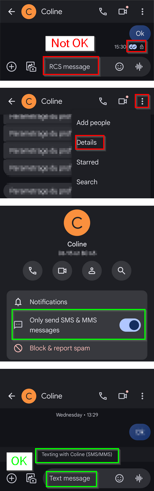

### Ошибки при выполнении команд

There are several possible reasons the command may not be successful:

* Настройка SMS-команд не завершена или выполнена неправильно
* Вы отправили команду в неправильном формате (например, «disconnect pump 45» вместо «pump disconnect 45»)
* Вы ввели неверный или просроченный код аутентификатора (обычно лучше подождать несколько секунд нового кода, если срок текущего скоро закончится)
* Код и PIN-код были верны, но SMS отправилось или пришло с задержкой, и **AAPS** посчитал, что срок кода аутентификатора истек
* Телефон с **AAPS** вне зоны связи с помпой
* Система уже занята подачей болюса

Common errors are shown in the examples below:

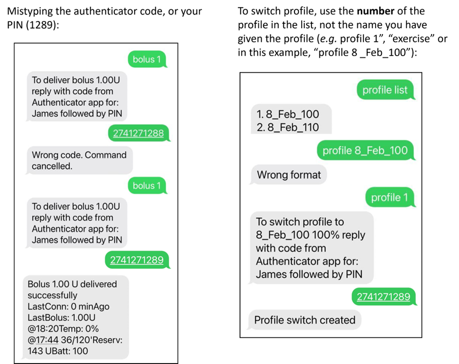

### Как остановить команду после аутентификации?

Никак. Но болюс, отправленный по SMS, можно отменить на самом телефоне с **AAPS**: просто отмените его во всплывающем окне болюса, если успеете. Многие SMS-команды (кроме болюса и ввода углеводов) легко отменить, или при ошибке можно принять меры, чтобы уменьшить нежелательные последствия.

For errors in bolusing and carb announcements, you can still take action. For example, if you have announced 20g carbs but your child only eats 10g and you (or an onhand caregiver) is unable to delete the treatment in the **AAPS** phone directly, you could set a high temporary target, or set a reduced profile, to encourage **AAPS** to be less aggressive.

### Несколько SMS

Если вы снова и снова получаете одно и то же сообщение (_например,_ о переключении профиля), возможно, вы случайно создали зацикливание с другими приложениями. Например, это может быть xDrip. В таком случае убедитесь, что xDrip (или другое приложение) не загружает записи терапии в Nightscout.

Если другое приложение установлено на нескольких телефонах, отключите загрузку на всех.

(sms-commands-too-many-messages)=
### Я получаю слишком много текстовых сообщений от SMS-команд. Can I reduce the frequency, or make them stop?

При использовании SMS-команд телефон с **AAPS** может отправлять на телефон опекуна много автоматических сообщений. Также могут приходить сообщения, например «базальный профиль помпы обновлен», если в **AAPS** настроены автоматизации. Если будет отправляться много SMS, полезно иметь безлимитные SMS в тарифе телефона с **AAPS** (и каждого телефона опекуна), а также отключить звуки уведомлений, сигналы и вибрацию для SMS на всех телефонах. It is not possible to use SMS commands and not receive these updates. Because of this, you may want an alternative way to communicate directly with your child (if they are old enough), instead of SMS. Популярные альтернативные приложения для общения у опекунов **AAPS**: WhatsApp, LINE, Telegram и Facebook Messenger.

SMS «Базальный профиль помпы обновлен» можно отключить, если изменение профиля пришло из Nightscout. Для этого создайте файл с именем **точно** `do_not_send_sms_on_profile_change` в папке `extra` вашего каталога AAPS.
