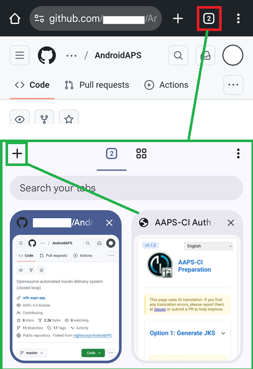

(browser-build)=

# Сборка через браузер

Сборка AAPS с использованием инструментов GitHub.

**Минимальная поддерживаемая версия AAPS - 3.3.2.1.**

## Постройте сами вместо скачивания

**Приложение AAPS (файл apk) недоступно для скачивания из-за правил, связанных с медицинскими устройствами. Построить приложение для собственного использования вполне законно, но передавать копию другим не разрешается!**

Подробности смотрите на странице [Часто задаваемые вопросы по работе ИПЖ](../UsefulLinks/FAQ.md).

(Building-APK-without-a-computer)=

## Выберите способ сборки

Выберите способ, который подходит устройству, с которого вы собираете:

### На телефоне Android: AAPS Builder (рекомендуется)

Страница настройки проведет вас по шагам создания вашего собственного приватного репозитория сборки на GitHub. Ничего не нужно устанавливать, не нужен файл подготовки, и каждую сборку вы запускаете сами. Приложение вы скачиваете прямо с GitHub. Google Диск не обязателен.

Это работает и в браузере на компьютере.

**→ [Сборка через браузер с AAPS Builder](BrowserBuildAapsBuilder.md)**

### На компьютере или iPhone / iPad: fork и файл подготовки

Вы делаете копию (fork) исходного кода AAPS на GitHub, создаете хранилище ключей с помощью файла подготовки, а собранное приложение сохраняется на ваш Google Диск. Выполните четыре шага ниже.

```{note}
**Вы уже собираете через fork?** Продолжайте обновлять его, как описано в разделе [Обновление через браузер (fork)](../Maintenance/UpdateBrowserBuild.md), или перейдите на AAPS Builder. Чтобы перейти, сначала получите копию своего хранилища ключей из fork: смотрите [Переход с прежней сборки через браузер](#aaps-builder-from-fork).
```

Вам будет необходимо использовать несколько вкладок браузера и переключаться между ними. Например, в Chrome:



```{note}
Вам придется переходить между вкладками: перед началом сборки закройте все открытые вкладки, чтобы не потеряться в процессе.
```

#### Что вам понадобится

- **Учетная запись Google**, чтобы собранное приложение можно было сохранить на ваш Google Диск.
- **Учетная запись GitHub** (бесплатно) – вы создадите ее на шаге 1.
- **Веб-браузер**, в котором можно держать открытыми несколько вкладок сразу (ниже предполагается Chrome).
- Небольшая **программа-помощник для запуска файла подготовки**. Какая именно – зависит от устройства, с которого вы собираете. Сейчас ничего устанавливать не нужно, на шаге 2 вы получите указания для вашего устройства:
  - **Компьютер (Windows / Mac / Linux):** Simple Web Server.
  - **iPhone / iPad:** дополнительное приложение не нужно – вы используете встроенное приложение «Файлы» и браузер.

#### Шаги

Сборка через браузер – это ряд решений. Выполните эти шаги по порядку:

1. **[Создайте свой fork на GitHub](BrowserBuildFork.md)** – сделайте личную копию исходного кода AAPS.
2. **[Создайте хранилище ключей для подписи](BrowserBuildKeystore.md)** – главное решение: создать новое хранилище ключей (вариант 1) или загрузить уже существующее (вариант 2), затем следуйте странице для вашего устройства.
3. **[Дайте доступ к Google Диску](BrowserBuildGoogleDrive.md)** – разрешите GitHub сохранять собранное приложение на ваш Google Диск.
4. **[Соберите APK](BrowserBuildAPK.md)** – запустите workflow GitHub Actions и выберите версию и вариант.

Если возникнут проблемы, смотрите **[Сборка через браузер: устранение неполадок](../GettingHelp/BrowserBuildTroubleshooting.md)**. Дополнительные операции с fork описаны в разделах [экспорт хранилища ключей](#ci-keystore-export) и [cherry-pick коммита](#github-cherry-pick).

----

**Начните с [Шаг 1 – Создайте свой fork на GitHub](BrowserBuildFork.md) →**

```{toctree}
:hidden:

AAPS Builder <BrowserBuildAapsBuilder.md>
Шаг 1: Создайте свой fork на GitHub <BrowserBuildFork.md>
Шаг 2: Создайте хранилище ключей для подписи <BrowserBuildKeystore.md>
Шаг 3: Дайте доступ к Google Диску <BrowserBuildGoogleDrive.md>
Шаг 4: Соберите APK <BrowserBuildAPK.md>
```
