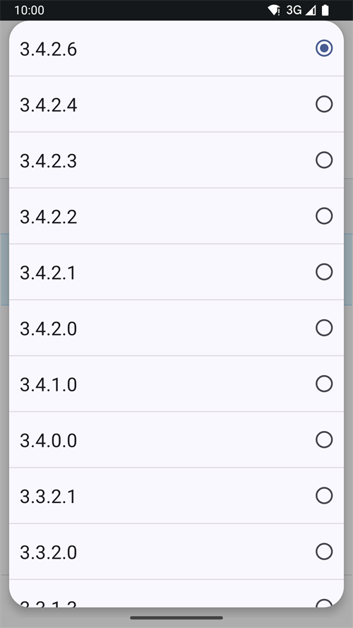
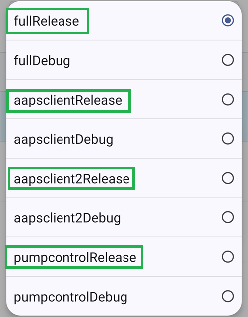

(github-build-apk)=

# Сборка через браузер – Шаг 4: Соберите APK

```{note}
Это **шаг 4** раздела [Сборка через браузер](BrowserBuild.md). Сначала выполните [Шаг 3 – Дайте доступ к Google Диску](BrowserBuildGoogleDrive.md).
```

## GitHub Actions AAPS-CI для сборки APK AAPS
 - Подходит для обычных пользователей.

```{tab-set}

:::{tab-item} Вики
### Запустите workflow, чтобы собрать подписанный APK

1. В своей копии AndroidAPS на GitHub выберите Actions.
2. Разверните All Workflows.
3. Выберите AAPS-CI


4. Прокрутите вниз и нажмите Run Workflow.


5. Оставьте в **Use workflow from** ветку master. В **Select AAPS Version** выберите версию **AAPS**, которую хотите собрать (обычно самую новую). Выберите [вариант](#browserbuild-variant) (fullRelease) и нажмите Run workflow.


6. Вы увидите сообщение Workflow run was successfully requested. Обновите страницу браузера, и вы сможете следить за ходом сборки. Когда действие завершится, у действия AAPS CI появится зеленая галочка. Вы успешно собрали обновленную версию Android APS.


### Установите APK AAPS

1. Откройте ваш Google Диск
2. Откройте папку AAPS, выберите папку новой версии: в ней будут версии и для телефона, и для Android Wear.


:::

:::{tab-item} Видео
<div align="center" style="max-width: 360px; margin: auto; margin-bottom: 2em;">
  <div style="position: relative; width: 100%; aspect-ratio: 9/16;">
    <iframe
      src="https://geo.dailymotion.com/player/x9rdwms.html?video=x9rdwms&loop=true&mute=true"
      loading="lazy"
      style="position: absolute; top: 0; left: 0; width: 100%; height: 100%;"
      frameborder="0"
      allowfullscreen>
    </iframe>
  </div>
</div>
:::  

```

## Выбор версии для сборки

**Способом через браузер можно собрать только версии AAPS 3.3.2.1 и выше.**

Нажмите **Select AAPS Version** и выберите версию для сборки. Самая новая версия находится вверху списка.



(browserbuild-variant)=

## Выбор варианта сборки

*Примечание: приложения для Android и для Android Wear будут собраны автоматически.*

  - Выберите нужный вариант:
    - fullRelease: для обычного использования помпы со всеми функциями.
    - [aapsclientRelease, aapsclient2Release, aapsclient3Release](#RemoteControl_aapsclient): для опекунов (нужен [Nightscout](../SettingUpAaps/Nightscout.md)). `aapsclient3Release` собирает **AAPSClient3**, доступный начиная с версии **AAPS** 4.0 (см. [Об AAPSClient, AAPSClient2 и AAPSClient3](#remotecontrol-aapsclient-versions)).
    - pumpcontrolRelease: чтобы заменить приложение/пульт вашей помпы



Варианты, которые заканчиваются на «Debug», означают, что APK будет собран в режиме отладки. Это полезно разработчикам для поиска неполадок.

<!-- If you want to test the items in a pull request has been moved to dev page /AdvancedOptions/DevBranch.md -->

----

Когда сборка пройдет успешно, файл apk сохранится на ваш Google Диск. Продолжите с раздела [Перенос и установка AAPS на смартфон](TransferringAndInstallingAaps.md).

```{note}
С сентября 2026 года [проверка разработчиков Android](#android-developer-verification) от Google может, в зависимости от вашей страны, блокировать установку APK нажатием на файл. Бесплатные обходные пути описаны на той странице.
```

Если сборка не удалась, сначала [выясните по журналу сборки, что пошло не так](#aaps-ci-read-the-logs), затем смотрите [Сборка через браузер: устранение неполадок](../GettingHelp/BrowserBuildTroubleshooting.md). Чтобы включить в сборку определенный коммит, смотрите [cherry-pick коммита](#github-cherry-pick).
