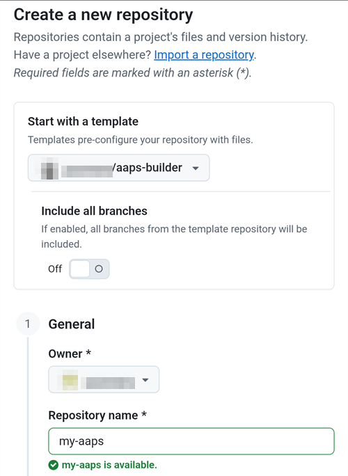
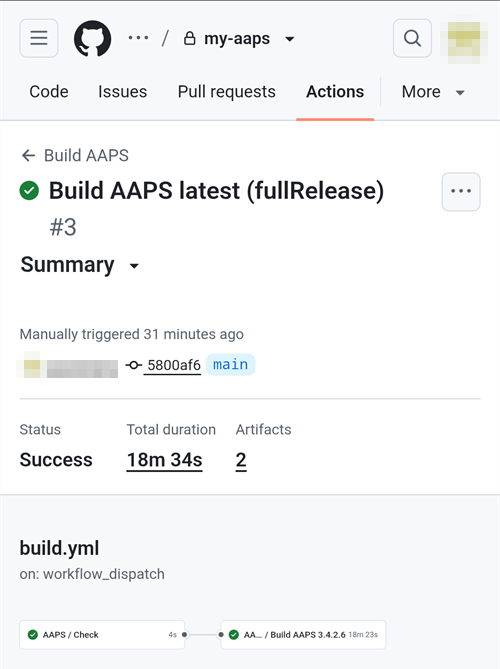

(aaps-builder)=

# Сборка через браузер с AAPS Builder

```{note}
Это рекомендуемый способ собрать AAPS с **телефона Android**. Он также работает в браузере на любом компьютере. О других способах сборки на компьютере или iPhone см. обзор [Сборка через браузер](BrowserBuild.md).
```

```{contents} In this page
:backlinks: entry
:depth: 2
```

**AAPS Builder** собирает приложение AAPS за вас на GitHub — бесплатном сайте для хранения кода. На телефон ничего устанавливать не нужно, и файл подготовки открывать тоже не нужно.

A setup page walks you through it. В первый раз это занимает около 10 минут:

1. Create your own **private copy** of AAPS Builder in your GitHub account: the setup page opens GitHub with everything filled in, you only confirm. The build workflow, the file that tells GitHub how to build AAPS, is already in it.
2. Create or upload your **signing key** (the keystore).
3. Give the key to your repository as a GitHub **secret**.
4. **Build** the app. One build takes 15 to 30 minutes.
5. **Download and install** the app on your phone.

Делать fork AndroidAPS **не** нужно: исходный код AAPS скачивается из официального репозитория AndroidAPS при каждой сборке. Google Диск тоже **не** нужен: приложение скачивается прямо с GitHub.

```{admonition} Where the code comes from
:class: note

The build workflow is maintained by the AAPS developers in the [nightscout/aaps-builder](https://github.com/nightscout/aaps-builder) repository, and your repository is a copy of it. The [workflow](https://github.com/nightscout/aaps-builder/blob/main/.github/workflows/build.yml) in your copy is short: it runs the [build steps](https://github.com/nightscout/aaps-builder/blob/main/.github/workflows/aaps-builder.yml) kept in that repository, so improvements reach you without any change to your repository. You can read both files. Во время сборки workflow скачивает только официальный исходный код AAPS и собственные инструменты сборки GitHub. Ваше хранилище ключей никогда не покидает ваш браузер и ваш приватный репозиторий.
```

(aaps-builder-before-you-start)=

## Перед началом

Вам понадобится:

- **Учетная запись GitHub** (бесплатная). Если ее нет, сначала создайте ее на [github.com](https://github.com/signup).
- **Веб-браузер**: Chrome на телефоне или любой браузер на компьютере. Перед началом войдите на github.com в этом браузере.
- **GitHub app on your phone?** You can keep it. Some buttons of the setup page then open the app instead of Chrome. Building works in the app, but the app **cannot download** the finished AAPS: [step 5](#aaps-builder-step5) shows how to switch to Chrome for the download.
- Ваше **существующее хранилище ключей** (файл `.jks`), его пароль и его псевдоним (alias), если вы уже собирали AAPS и хотите обновить его без переустановки.

```{warning}
**Ваш репозиторий сборки должен оставаться приватным.** Все, что создает сборка, видно любому, кто может видеть репозиторий. Страница настройки создает для вас приватный репозиторий. Never change it to public, and don't **fork** AAPS Builder instead: a fork is always public.

Приватный репозиторий получает 2000 бесплатных минут GitHub Actions в месяц, этого хватает на несколько сборок.
```

```{warning}
**Новый ключ или существующий ключ: от этого зависит, сможете ли вы обновить AAPS.**

- **AAPS уже есть на вашем телефоне, и он собран с хранилищем ключей, которое у вас сохранилось**: выберите на странице настройки **У меня уже есть хранилище ключей** и загрузите его. Следующая сборка обновит AAPS поверх установленного. Built AAPS with the previous browser build (your own fork)? Your keystore is in your fork: [get a copy of it first](#aaps-builder-from-fork).
- **Вы собираете AAPS впервые или потеряли хранилище ключей или его пароль**: выберите **Создать новый ключ**. Приложение, подписанное новым ключом, **не может обновить** AAPS, подписанный другим ключом. You must export your settings, copy the file off your phone, uninstall the old AAPS, install the new one, then import your settings: see [Reinstalling AAPS with a new keystore](#reinstall-aaps).

В дальнейшем всегда используйте один и тот же ключ. When you create a new key, download the backup the page offers and store it with its password and its alias (`key0`) somewhere safe, off your phone.
```

(aaps-builder-from-fork)=

## Coming from the previous browser build (fork)

Skip this section if you never built AAPS with the previous browser build method (your own copy, or fork, of AndroidAPS in GitHub, with the preparation file and Google Drive).

Your keystore is stored as secrets in your fork. GitHub never shows a secret again, so you can't copy it to your new repository. Get a copy of your keystore first, then use it in [step 2](#aaps-builder-step2) with **I already have a keystore**.

```{warning}
Don't choose **Create a new key**. AAPS built with a new key cannot update the AAPS on your phone.
```

Which case is yours?

- **You used Option 2** (you uploaded your own keystore from Android Studio), and you still have the `.jks` file, its passwords and its alias: nothing to do here. Use that file in step 2.
- **You used Option 1** (the preparation file created your key), or you no longer have your keystore file: export it from your fork as below.

To export your keystore from your fork:

1. In your fork, open **Settings** → **Secrets and variables** → **Actions** and add a secret named `ZIP_PASSWORD`. Choose a password with only English letters and numbers. It protects the file you are about to create.
2. Open the **Actions** tab of your fork, tap **CI Keystore Export**, then **Run workflow**. More details: [Export your keystore](#ci-keystore-export).
3. When the run has a green check, open your Google Drive: the file `keystore.zip` is in the folder **AAPS** → **KeyStore**. If the run fails at the Google Drive step, your fork's Google Drive access has expired: see [Google refresh token expired](#aaps-ci-google-token-expired).
4. Download `keystore.zip` and open it with your `ZIP_PASSWORD`: on a computer, or on your phone with a file manager app that can open password-protected ZIP files. It contains:
   - `keystore.jks`: your keystore,
   - `keyStoreInfo.txt`: your `KEYSTORE_PASSWORD`, `KEY_PASSWORD` and `ALIAS` (usually `key0`).
5. Copy `keystore.jks` to your phone (or to Google Drive, so you can pick it from there).

In [step 2](#aaps-builder-step2) of the setup page:

1. Нажмите **У меня уже есть хранилище ключей**.
2. In **Keystore file**, choose `keystore.jks`.
3. In **Keystore password**, type the `KEYSTORE_PASSWORD` from `keyStoreInfo.txt`.
4. In **Key alias**, pick or type the `ALIAS` from `keyStoreInfo.txt`.
5. If `KEY_PASSWORD` is different from `KEYSTORE_PASSWORD`, untick **Key password is the same as the keystore password** and type the `KEY_PASSWORD`.

Keep `keystore.zip` and its `ZIP_PASSWORD` somewhere safe, off your phone: it is the backup of your key.

To also save the builds of AAPS Builder in Google Drive, do [step 6](#aaps-builder-google-drive): the setup page gets a new `GDRIVE_OAUTH2` for you. You can keep your fork until AAPS built with AAPS Builder is installed on your phone.

## Откройте страницу настройки

**→ [Open the AAPS Builder setup page](#aaps-builder-setup)**

The setup page is part of this documentation, in your language. Keep this page open in another tab as well: the sections below explain each step of the setup page in more detail, with screenshots.

The setup page opens each GitHub page in a new Chrome tab. To come back to the setup page, tap the tab button next to Chrome's address bar (the square with a number) and choose the AAPS Builder setup page.


Страница настройки работает полностью в вашем браузере: ваш ключ и пароли никуда не отправляются, кроме секрета GitHub, в который вы сами их вставляете. Only your GitHub username is sent to GitHub, to check that it exists. Она запоминает ваше имя пользователя GitHub и название репозитория, поэтому вы можете вернуться к ней в любое время, чтобы снова открыть страницу секретов или свои сборки.


(aaps-builder-step1)=

## Шаг 1 – Создайте свой приватный репозиторий сборки

This step creates your own private copy of AAPS Builder in your GitHub account, with the build workflow already in it. Только вы видите его и приложения, которые он собирает.

1. Убедитесь, что вы вошли на github.com в этом браузере.

2. In **Your GitHub username**, type your GitHub username, not your e-mail. The page checks it with GitHub: **✓ GitHub user found** means it is right.

3. In **Name of your repository**, keep the suggestion `my-aaps`. If you already created your repository with another name, type that exact name.

   ```{note}
   **Already have an AAPS Builder repository** (made with an earlier version of the setup page)? Don't create a new one: type its exact name, skip **Create my private repository**, and update its workflow once as explained in [Updating AAPS](#aaps-builder-updates). Your secrets stay as they are. If you want a new repository anyway, choose a name you don't have yet, for example `my-aaps-2`, and use the same keystore in step 2.

   Don't type the name of your fork of AndroidAPS: a fork is public, and it already builds with its own **AAPS CI** workflow.
   ```

   

4. Проверьте строку **Ваш репозиторий:** она показывает `github.com/<your username>/my-aaps`. The setup page remembers the name from your last visit: check it every time before you use its buttons.

5. Нажмите **Создать мой приватный репозиторий**.

   

6. GitHub opens **Create a new repository** in a new tab. Everything is already filled in: under **Start with a template**, the template `nightscout/aaps-builder` with **Include all branches** off, and under **General**, your account as **Owner** and the name you chose.

   

   Don't change anything.

7. Scroll down: under **Configuration**, **Choose visibility** is already **Private**. Tap the green **Create repository** button.

   

   GitHub shows your new repository: it contains a folder `.github` (with the build workflow) and a file `README.md`. **Go back to the setup page tab** for step 2: tap the tab button next to Chrome's address bar and choose the setup page.

   

```{warning}
**Your new repository is empty**, with no files? It was not created from the template, and it cannot build. Delete it (**Settings** → bottom of the page → **Delete this repository**), then tap **Create my private repository** on the setup page again.
```

```{tip}
GitHub says **my-aaps already exists in this account**? You already have your repository: close the GitHub tab and go on with the setup page. If your key is already in it, continue with [step 4](#aaps-builder-step4). See [troubleshooting](#aaps-builder-ts-repo-exists).
```

(aaps-builder-step2)=

## Step 2 – Your signing key

Приложение должно быть подписано вашим собственным ключом. Выберите одну из двух вкладок. Сначала прочитайте [предупреждение о новом или существующем ключе](#aaps-builder-before-you-start).


### У меня уже есть хранилище ключей

1. Нажмите **У меня уже есть хранилище ключей**.
2. В поле **Файл хранилища ключей** выберите ваш файл `.jks` (или `.keystore`, `.p12`, `.pfx`). На телефоне сначала скопируйте файл на телефон или в Google Диск.
3. В поле **Пароль хранилища ключей** введите пароль хранилища ключей.
4. In **Key alias**, pick your alias from the list, or type it if there is no list. Для хранилищ ключей, созданных в Android Studio, это обычно `key0`.
5. Если пароль ключа отличается от пароля хранилища ключей, снимите флажок **Пароль ключа совпадает с паролем хранилища ключей** и введите пароль ключа.
6. Нажмите **Проверить и продолжить**.

Страница проверяет пароль и псевдоним на вашем устройстве. **Хранилище ключей в порядке! Continue with step 3.** means everything is right. Если там написано, что пароль будет проверен при сборке, все равно продолжайте: сборка сообщит, если что-то не так.

### Создать новый ключ

1. Нажмите **Создать новый ключ**.

2. Придумайте пароль и введите его дважды. Правила: не менее 8 символов, только буквы a–z и A–Z, цифры 0–9 и символы, например `! ? #`. Без пробелов, без букв с диакритикой и без символа `|`.

3. Нажмите **Создать ключ**. Через несколько секунд появится **Ключ создан**.

   

4. Tap **Download backup (aaps-keystore.jks)**. If Chrome asks **Download file again?**, an older backup with the same name is already on your phone: tap **Download again**. Chrome then saves the new key as `aaps-keystore (1).jks`: that is the file that goes with this key, keep it and don't mix it up with the older one.

   Keep these three together, somewhere safe off your phone (for example your own cloud storage):

   - the file `aaps-keystore.jks`,
   - your password,
   - the alias of the key: **`key0`**.

   You need all three if you ever build AAPS another way, for example with Android Studio. Keys created with an earlier version of the setup page have the alias `aaps`.

   

(aaps-builder-step3)=

## Step 3 – Give the key to your repository

Step 3 unlocks when step 2 is done. Ваш ключ, его пароли и его псевдоним упаковываются в одно значение — секрет `KEYSTORE_SET`.

1. Нажмите **Открыть страницу секретов**.


2. GitHub открывает страницу **New secret** вашего репозитория. На телефоне она находится под меню настроек: прокрутите вниз.


3. Switch to the setup page tab and tap **Copy name**. Switch back to the GitHub tab and paste it into the small **Name** field. The name is `KEYSTORE_SET`.

4. Switch to the setup page tab and tap **Copy secret**. Switch back to the GitHub tab and paste it into the big **Secret** box (long press on a phone). The secret is a very long code, thousands of characters: the setup page shows its first characters next to the button. Don't paste the word `KEYSTORE_SET` there.

5. Нажмите **Add secret**. `KEYSTORE_SET` теперь отображается в разделе **Repository secrets**.


Это нужно сделать только один раз.

```{tip}
GitHub показывает **Page not found** (404)? First check that you are logged in to github.com in this browser: GitHub shows 404 for private repositories when you are not logged in. Otherwise the username or repository name in step 1 doesn't match your repository. Проверьте имя на github.com, исправьте его в шаге 1 и снова нажмите кнопку.
```

(aaps-builder-step4)=

## Step 4 – Build the app

1. На странице настройки нажмите **Открыть страницу сборки**. GitHub открывает страницу **Build AAPS** вашего репозитория.

   

   If the **GitHub app** opens instead: tap **RUN WORKFLOW**, check the version and the variant, and tap **RUN WORKFLOW** again. The app may still show **Nothing to see here**: pull the list down to refresh it and see your build. Then continue with step 4 below.

2. If GitHub asks, tap the green button to enable workflows.

   The list of workflows shows two entries: use **Build AAPS**. Ignore **AAPS Builder**: it holds the build steps and has no **Run workflow** button.

3. Нажмите **Run workflow**. Откроется небольшая форма:
   - **Version**: keep `latest` to build the newest AAPS release, or type a release number such as `4.0.0`.
   - **Variant**: оставьте `fullRelease` для обычного использования с помпой. Другие варианты описаны в разделе [варианты сборки](#browserbuild-variant). `aapsclient3Release` builds **AAPSClient3**, available from **AAPS** version 4.0 (see [About AAPSClient, AAPSClient2 and AAPSClient3](#remotecontrol-aapsclient-versions)).
   - Нажмите зеленую кнопку **Run workflow**.

   

4. Сборка начинается и показывает **In progress**, в ней две части: **AAPS / Check**, затем **AAPS / Build AAPS**.

   

5. Подождите от 15 до 30 минут. Зеленая галочка означает, что сборка завершена. Красный крестик означает, что сборка не удалась: откройте сборку, чтобы прочитать сообщение, затем см. [устранение неполадок](#aaps-builder-troubleshooting).

   

   ```{tip}
   **E-mail when a build is done:** GitHub only e-mails you when a build fails. To also get an e-mail when it succeeds: on github.com, open your profile picture → **Settings** → **Notifications** → **System** → **Actions**, and untick **Only notify for failed workflows**.
   ```

Если кнопки **Build AAPS** или **Run workflow** нет:

- Open your repository and check that it has a folder `.github` with the file `workflows/build.yml`. If the repository is empty, it was not created from the template: delete it (**Settings** → bottom of the page → **Delete this repository**) and do [step 1](#aaps-builder-step1) again with the button.
- The file is there, but GitHub shows **This workflow does not exist**: see [troubleshooting](#aaps-builder-ts-workflow-not-found).
- Откройте вкладку **Actions**. Если там написано, что workflows отключены, нажмите зеленую кнопку, чтобы включить их, затем нажмите **Build AAPS** в списке.

(aaps-builder-step5)=

## Step 5 – Install the app on your phone

```{warning}
**Перед каждым обновлением** [экспортируйте настройки](#ExportImportSettings-Automating-Settings-Export) в AAPS и скопируйте файл **с телефона в другое место** (Google Диск, Dropbox…). Храните там также несколько старых экспортов и файлы APK, чтобы всегда можно было вернуться назад.
```

1. On your phone, open the setup page in **Chrome**. Если потребуется, войдите на github.com.
2. Нажмите **Открыть мои сборки**, затем самую новую сборку с зеленой галочкой.

   ```{admonition} The GitHub app opened instead of Chrome?
   :class: note

   The GitHub app cannot download builds. In the app, open the newest build, then tap **Artifacts ↗**, or tap the share icon at the top and choose **Chrome** (or **Copy link**, then paste the link in Chrome's address bar). The build opens in Chrome: continue with the next step there.

   To stop GitHub links opening in the app: Android **Settings** → **Apps** → **GitHub** → **Open by default** → turn off **Open supported links**.
   ```

   

3. Прокрутите вниз до сводки сборки и нажмите ссылку **Download AAPS**.

   

   ```{tip}
   Прокручивайте пальцем по тексту, а не по схеме шагов сборки: иначе вместо страницы сдвигается схема.
   ```

   Можно также прокрутить ниже до раздела **Artifacts** и нажать значок скачивания рядом с `aaps-….apk`.

   

4. Когда скачивание завершится, откройте меню Chrome **⋮** → **Downloads**, нажмите `aaps-….apk` и выберите **Установить**. Если потребуется, разрешите установку приложений из этого источника.

   

`aaps-wear-….apk` — это приложение для смарт-часов. Если вы ими не пользуетесь, пропустите его.

Приложение хранится на странице сборки **14 дней**. Оно не отображается в разделе **Code** вашего репозитория. Скопируйте его в надежное место вне телефона вместе с экспортами настроек.

Другие способы установки приложения см. на странице [Перенос и установка AAPS на смартфон](TransferringAndInstallingAaps.md).

```{note}
С сентября 2026 года [проверка разработчиков Android](#android-developer-verification) от Google может, в зависимости от вашей страны, блокировать установку APK нажатием на файл. Бесплатные обходные пути описаны на той странице.
```

(aaps-builder-google-drive)=

## Step 6 (optional) – Also save the app in Google Drive

Можно также сохранять каждую сборку в ваш Google Диск, в папку `AAPS/<version>`. Это необязательно: приложение всегда доступно на странице сборки.

Для этого нужен еще один секрет — `GDRIVE_OAUTH2`. Step 6 of the setup page gets it from Google for you, on a phone or a computer. **AAPS** can then only see and change the files it creates in your Google Drive, nothing else.

1. On the setup page, tap **Connect Google Drive**. Google opens in a new tab.

2. Choose your Google account and allow access. If Google says the app is not verified, tap **Advanced**, then **Go to …**.

   

   

3. The new tab then shows an error such as **This site can't be reached** or **127.0.0.1 refused to connect**. **This is expected:** Google's answer is in the address of that tab. Tap the address bar, then the copy icon next to the address (on a computer: select the whole address and copy it). It starts with `http://127.0.0.1:47913/`.

   

   

4. Go back to the setup page tab within a few minutes: Google's answer is only valid for a short time, and only once. Paste the address into **Paste the copied address here** and tap **Get GDRIVE_OAUTH2**. The page shows **GDRIVE_OAUTH2 is ready**.

   

   

5. Нажмите **Открыть страницу секретов**. Tap **Copy name**, then paste it into the small **Name** field (the name is `GDRIVE_OAUTH2`). Tap **Copy secret**, paste it into the big **Secret** box and tap **Add secret**.

   

Начиная со следующей сборки, файлы APK также сохраняются в Google Диск.

Already have a `GDRIVE_OAUTH2` value from the preparation file of the other browser build methods? It works too: add it as the `GDRIVE_OAUTH2` secret.

Google прекращает доступ, если вы не собираете приложение 6 месяцев или если вы меняете пароль Google. Тогда сборка сообщит об этом: повторите эти шаги. См. [Истек срок действия токена обновления Google](#aaps-ci-google-token-expired).

(aaps-builder-updates)=

## Updating AAPS

Ваш репозиторий никогда ничего не собирает сам: вы решаете, когда собирать, какую версию и какой вариант. Когда выходит новая версия AAPS:

1. [Back up your settings](#aaps-builder-step5) as explained in step 5.
2. Build the new version as in [step 4](#aaps-builder-step4). Оставьте `latest` или введите номер версии.
3. Download and install it as in [step 5](#aaps-builder-step5).

**Updates of the build steps** reach you by themselves: at every build, your repository runs the build steps released by the AAPS developers in nightscout/aaps-builder. Nothing changes in your repository, and there is no automatic build.

**Updates of your workflow file** are rare: only when the **Run workflow** form changes, for example for a new build variant, or once if your repository was made with an earlier version of the setup page (an empty repository with a short workflow file) or from the old template. The [Docs updates & changes](../Maintenance/DocumentationUpdate.md) page says so. Your `KEYSTORE_SET` secret stays as it is. On the setup page, open **Updating your copy** at the end of step 1:

1. Tap **Open the newest workflow**. On a computer, click the **copy icon** ("Copy raw file") at the top right of the file. On a phone, open the **plain-text version** instead, press and hold the text, then **Select all** and **Copy**.
2. Tap **Open my workflow file**, then the **⋯** menu at the top right of the file and **Edit file… In place** (on a computer, click the pencil).
3. Replace the whole text with the copied workflow (long press on a phone: **Select all**, then **Paste**).
4. Tap **Commit changes…**, then **Commit changes**.

The first line of the file shows its version.

## Устранение неполадок

Something went wrong? See [AAPS Builder troubleshooting](#aaps-builder-troubleshooting).

```{toctree}
:hidden:

AAPS Builder setup page <BrowserBuildAapsBuilderSetup.md>
```
