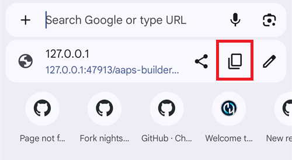

(aaps-builder)=

# Сборка через браузер с AAPS Builder

```{note}
Это рекомендуемый способ собрать AAPS с **телефона Android**. Он также работает в браузере на любом компьютере. О других способах сборки на компьютере или iPhone см. обзор [Сборка через браузер](BrowserBuild.md).
```

```{contents} In this page
:backlinks: entry
:depth: 2
```

**AAPS Builder** собирает приложение AAPS за вас на GitHub — бесплатном сайте для хранения кода. На телефон ничего устанавливать не нужно, и файл подготовки открывать тоже не нужно.

Страница настройки проведет вас через все шаги. В первый раз это занимает около 10 минут:

1. Создайте свою **приватную копию** AAPS Builder в своей учетной записи GitHub: страница настройки открывает GitHub, где все уже заполнено, вам остается только подтвердить. Workflow сборки — файл, который говорит GitHub, как собирать AAPS, — уже в ней есть.
2. Создайте или загрузите свой **ключ подписи** (хранилище ключей).
3. Передайте ключ своему репозиторию как **секрет** GitHub.
4. **Соберите** приложение. Одна сборка занимает от 15 до 30 минут.
5. **Скачайте и установите** приложение на телефон.

Делать fork AndroidAPS **не** нужно: исходный код AAPS скачивается из официального репозитория AndroidAPS при каждой сборке. Google Диск тоже **не** нужен: приложение скачивается прямо с GitHub.

```{admonition} Where the code comes from
:class: note

Workflow сборки поддерживают разработчики AAPS в репозитории [nightscout/aaps-builder](https://github.com/nightscout/aaps-builder), а ваш репозиторий — его копия. [Workflow](https://github.com/nightscout/aaps-builder/blob/main/.github/workflows/build.yml) в вашей копии короткий: он запускает [шаги сборки](https://github.com/nightscout/aaps-builder/blob/main/.github/workflows/aaps-builder.yml), которые хранятся в том репозитории, поэтому улучшения доходят до вас без изменений в вашем репозитории. Оба файла можно прочитать. Во время сборки workflow скачивает только официальный исходный код AAPS и собственные инструменты сборки GitHub. Ваше хранилище ключей никогда не покидает ваш браузер и ваш приватный репозиторий.
```

(aaps-builder-before-you-start)=

## Перед началом

Вам понадобится:

- **Учетная запись GitHub** (бесплатная). Если ее нет, сначала создайте ее на [github.com](https://github.com/signup).
- **Веб-браузер**: Chrome на телефоне или любой браузер на компьютере. Перед началом войдите на github.com в этом браузере.
- **Приложение GitHub на телефоне?** Его можно оставить. Тогда некоторые кнопки страницы настройки открывают это приложение вместо Chrome. Сборка работает и в приложении, но приложение **не может скачать** готовый AAPS: в [шаге 5](#aaps-builder-step5) показано, как перейти в Chrome для скачивания.
- Ваше **существующее хранилище ключей** (файл `.jks`), его пароль и его псевдоним (alias), если вы уже собирали AAPS и хотите обновить его без переустановки.

```{warning}
**Ваш репозиторий сборки должен оставаться приватным.** Все, что создает сборка, видно любому, кто может видеть репозиторий. Страница настройки создает для вас приватный репозиторий. Никогда не делайте его публичным и не делайте **fork** AAPS Builder вместо этого: fork всегда публичный.

Приватный репозиторий получает 2000 бесплатных минут GitHub Actions в месяц, этого хватает на несколько сборок.
```

```{warning}
**Новый ключ или существующий ключ: от этого зависит, сможете ли вы обновить AAPS.**

- **AAPS уже есть на вашем телефоне, и он собран с хранилищем ключей, которое у вас сохранилось**: выберите на странице настройки **У меня уже есть хранилище ключей** и загрузите его. Следующая сборка обновит AAPS поверх установленного. Собирали AAPS прежним способом сборки через браузер (свой fork)? Ваше хранилище ключей находится в вашем fork: [сначала получите его копию](#aaps-builder-from-fork).
- **Вы собираете AAPS впервые или потеряли хранилище ключей или его пароль**: выберите **Создать новый ключ**. Приложение, подписанное новым ключом, **не может обновить** AAPS, подписанный другим ключом. Нужно экспортировать настройки, скопировать файл с телефона в другое место, удалить старый AAPS, установить новый, а затем импортировать настройки: см. [Переустановка AAPS с новым хранилищем ключей](#reinstall-aaps).

В дальнейшем всегда используйте один и тот же ключ. Когда вы создаете новый ключ, скачайте резервную копию, которую предлагает страница, и храните ее вместе с паролем и псевдонимом (`key0`) в надежном месте вне телефона.
```

(aaps-builder-from-fork)=

## Переход с прежней сборки через браузер (fork)

Пропустите этот раздел, если вы никогда не собирали AAPS прежним способом сборки через браузер (своя копия, или fork, AndroidAPS на GitHub, с файлом подготовки и Google Диском).

Ваше хранилище ключей хранится в виде секретов в вашем fork. GitHub больше никогда не показывает секрет, поэтому скопировать его в новый репозиторий нельзя. Сначала получите копию своего хранилища ключей, затем используйте ее в [шаге 2](#aaps-builder-step2) с вариантом **У меня уже есть хранилище ключей**.

```{warning}
Не выбирайте **Создать новый ключ**. AAPS, собранный с новым ключом, не может обновить AAPS на вашем телефоне.
```

Какой у вас случай?

- **Вы использовали Вариант 2** (загрузили собственное хранилище ключей из Android Studio), и у вас все еще есть файл `.jks`, его пароли и псевдоним: здесь ничего делать не нужно. Используйте этот файл в шаге 2.
- **Вы использовали Вариант 1** (ключ создал файл подготовки) или у вас больше нет файла хранилища ключей: экспортируйте его из своего fork, как описано ниже.

Чтобы экспортировать хранилище ключей из fork:

1. В своем fork откройте **Settings** → **Secrets and variables** → **Actions** и добавьте секрет с именем `ZIP_PASSWORD`. Выберите пароль только из английских букв и цифр. Он защищает файл, который вы сейчас создадите.
2. Откройте вкладку **Actions** своего fork, нажмите **CI Keystore Export**, затем **Run workflow**. Подробнее: [Экспорт хранилища ключей](#ci-keystore-export).
3. Когда у запуска появится зеленая галочка, откройте Google Диск: файл `keystore.zip` находится в папке **AAPS** → **KeyStore**. Если запуск завершается ошибкой на шаге Google Диска, срок доступа вашего fork к Google Диску истек: см. [Истек срок действия токена обновления Google](#aaps-ci-google-token-expired).
4. Скачайте `keystore.zip` и откройте его с помощью `ZIP_PASSWORD`: на компьютере или на телефоне в файловом менеджере, который умеет открывать ZIP-файлы с паролем. Он содержит:
   - `keystore.jks`: ваше хранилище ключей,
   - `keyStoreInfo.txt`: ваши `KEYSTORE_PASSWORD`, `KEY_PASSWORD` и `ALIAS` (обычно `key0`).
5. Скопируйте `keystore.jks` на телефон (или в Google Диск, чтобы выбрать его оттуда).

В [шаге 2](#aaps-builder-step2) страницы настройки:

1. Нажмите **У меня уже есть хранилище ключей**.
2. В поле **Файл хранилища ключей** выберите `keystore.jks`.
3. В поле **Пароль хранилища ключей** введите `KEYSTORE_PASSWORD` из `keyStoreInfo.txt`.
4. В поле **Псевдоним ключа** выберите или введите `ALIAS` из `keyStoreInfo.txt`.
5. Если `KEY_PASSWORD` отличается от `KEYSTORE_PASSWORD`, снимите флажок **Пароль ключа совпадает с паролем хранилища ключей** и введите `KEY_PASSWORD`.

Храните `keystore.zip` и его `ZIP_PASSWORD` в надежном месте вне телефона: это резервная копия вашего ключа.

Чтобы сборки AAPS Builder тоже сохранялись в Google Диск, выполните [шаг 6](#aaps-builder-google-drive): страница настройки получит для вас новый `GDRIVE_OAUTH2`. Вы можете оставить свой fork, пока на телефоне не будет установлен AAPS, собранный с помощью AAPS Builder.

## Откройте страницу настройки

**→ [Открыть страницу настройки AAPS Builder](#aaps-builder-setup)**

Страница настройки — часть этой документации, на вашем языке. Держите эту страницу открытой и в другой вкладке: в разделах ниже каждый шаг страницы настройки описан подробнее, со снимками экрана.

Страница настройки открывает каждую страницу GitHub в новой вкладке Chrome. Чтобы вернуться на страницу настройки, нажмите кнопку вкладок рядом с адресной строкой Chrome (квадрат с числом) и выберите страницу настройки AAPS Builder.


Страница настройки работает полностью в вашем браузере: ваш ключ и пароли никуда не отправляются, кроме секрета GitHub, в который вы сами их вставляете. В GitHub отправляется только ваше имя пользователя GitHub, чтобы проверить, что оно существует. Она запоминает ваше имя пользователя GitHub и название репозитория, поэтому вы можете вернуться к ней в любое время, чтобы снова открыть страницу секретов или свои сборки.


(aaps-builder-step1)=

## Шаг 1 – Создайте свой приватный репозиторий сборки

На этом шаге создается ваша собственная приватная копия AAPS Builder в вашей учетной записи GitHub, в которой уже есть workflow сборки. Только вы видите его и приложения, которые он собирает.

1. Убедитесь, что вы вошли на github.com в этом браузере.

2. В поле **Ваше имя пользователя GitHub** введите свое имя пользователя GitHub, а не адрес электронной почты. Страница проверяет его на GitHub: **✓ Пользователь GitHub найден** означает, что оно правильное.

3. В поле **Название вашего репозитория** оставьте предложенное `my-aaps`. Если вы уже создали репозиторий с другим названием, введите именно это название.

   ```{note}
   **У вас уже есть репозиторий AAPS Builder** (созданный более ранней версией страницы настройки)? Не создавайте новый: введите его точное название, пропустите **Создать мой приватный репозиторий** и один раз обновите его workflow, как описано в разделе [Обновление AAPS](#aaps-builder-updates). Ваши секреты остаются как есть. Если вы все же хотите новый репозиторий, выберите название, которого у вас еще нет, например `my-aaps-2`, и используйте то же хранилище ключей в шаге 2.

   Не вводите название своего fork AndroidAPS: fork публичный, и он уже собирает приложение своим workflow **AAPS CI**.
   ```

   

4. Проверьте строку **Ваш репозиторий:** она показывает `github.com/<your username>/my-aaps`. Страница настройки запоминает название с вашего прошлого посещения: проверяйте его каждый раз, прежде чем нажимать ее кнопки.

5. Нажмите **Создать мой приватный репозиторий**.

   

6. GitHub открывает **Create a new repository** в новой вкладке. Все уже заполнено: в разделе **Start with a template** — шаблон `nightscout/aaps-builder` с выключенным **Include all branches**, а в разделе **General** — ваша учетная запись как **Owner** и выбранное вами название.

   

   Ничего не меняйте.

7. Прокрутите вниз: в разделе **Configuration** для **Choose visibility** уже выбрано **Private**. Нажмите зеленую кнопку **Create repository**.

   

   GitHub показывает ваш новый репозиторий: в нем есть папка `.github` (с workflow сборки) и файл `README.md`. **Вернитесь на вкладку страницы настройки** для шага 2: нажмите кнопку вкладок рядом с адресной строкой Chrome и выберите страницу настройки.

   

```{warning}
**Ваш новый репозиторий пустой**, без файлов? Он создан не из шаблона и не может собирать. Удалите его (**Settings** → внизу страницы → **Delete this repository**), затем снова нажмите **Создать мой приватный репозиторий** на странице настройки.
```

```{tip}
GitHub пишет **my-aaps already exists in this account**? Ваш репозиторий уже есть: закройте вкладку GitHub и продолжайте на странице настройки. Если ваш ключ уже в нем, переходите к [шагу 4](#aaps-builder-step4). См. [устранение неполадок](#aaps-builder-ts-repo-exists).
```

(aaps-builder-step2)=

## Шаг 2 – Ваш ключ подписи

Приложение должно быть подписано вашим собственным ключом. Выберите одну из двух вкладок. Сначала прочитайте [предупреждение о новом или существующем ключе](#aaps-builder-before-you-start).


### У меня уже есть хранилище ключей

1. Нажмите **У меня уже есть хранилище ключей**.
2. В поле **Файл хранилища ключей** выберите ваш файл `.jks` (или `.keystore`, `.p12`, `.pfx`). На телефоне сначала скопируйте файл на телефон или в Google Диск.
3. В поле **Пароль хранилища ключей** введите пароль хранилища ключей.
4. В поле **Псевдоним ключа** выберите псевдоним из списка или введите его, если списка нет. Для хранилищ ключей, созданных в Android Studio, это обычно `key0`.
5. Если пароль ключа отличается от пароля хранилища ключей, снимите флажок **Пароль ключа совпадает с паролем хранилища ключей** и введите пароль ключа.
6. Нажмите **Проверить и продолжить**.

Страница проверяет пароль и псевдоним на вашем устройстве. **Хранилище ключей в порядке! Перейдите к шагу 3.** означает, что все правильно. Если там написано, что пароль будет проверен при сборке, все равно продолжайте: сборка сообщит, если что-то не так.

### Создать новый ключ

1. Нажмите **Создать новый ключ**.

2. Придумайте пароль и введите его дважды. Правила: не менее 8 символов, только буквы a–z и A–Z, цифры 0–9 и символы, например `! ? #`. Без пробелов, без букв с диакритикой и без символа `|`.

3. Нажмите **Создать ключ**. Через несколько секунд появится **Ключ создан**.

   

4. Нажмите **Скачать резервную копию (aaps-keystore.jks)**. Если Chrome спрашивает **Download file again?**, на телефоне уже есть более старая резервная копия с тем же именем: нажмите **Download again**. Тогда Chrome сохранит новый ключ как `aaps-keystore (1).jks`: это файл, который относится к этому ключу, сохраните его и не перепутайте со старым.

   Храните эти три вещи вместе, в надежном месте вне телефона (например, в своем облачном хранилище):

   - файл `aaps-keystore.jks`,
   - ваш пароль,
   - псевдоним ключа: **`key0`**.

   Все три понадобятся, если вы когда-нибудь будете собирать AAPS другим способом, например в Android Studio. У ключей, созданных в более ранней версии страницы настройки, псевдоним `aaps`.

   

(aaps-builder-step3)=

## Шаг 3 – Передайте ключ в репозиторий

Шаг 3 становится доступен, когда шаг 2 выполнен. Ваш ключ, его пароли и его псевдоним упаковываются в одно значение — секрет `KEYSTORE_SET`.

1. Нажмите **Открыть страницу секретов**.


2. GitHub открывает страницу **New secret** вашего репозитория. На телефоне она находится под меню настроек: прокрутите вниз.


3. Перейдите на вкладку страницы настройки и нажмите **Копировать имя**. Вернитесь на вкладку GitHub и вставьте его в маленькое поле **Name**. Имя — `KEYSTORE_SET`.

4. Перейдите на вкладку страницы настройки и нажмите **Копировать секрет**. Вернитесь на вкладку GitHub и вставьте его в большое поле **Secret** (на телефоне — долгим нажатием). Секрет — это очень длинный код из тысяч символов: страница настройки показывает его первые символы рядом с кнопкой. Не вставляйте туда слово `KEYSTORE_SET`.

5. Нажмите **Add secret**. `KEYSTORE_SET` теперь отображается в разделе **Repository secrets**.


Это нужно сделать только один раз.

```{tip}
GitHub показывает **Page not found** (404)? Сначала проверьте, что вы вошли на github.com в этом браузере: если вы не вошли, GitHub показывает 404 для приватных репозиториев. Иначе имя пользователя или название репозитория в шаге 1 не совпадает с вашим репозиторием. Проверьте имя на github.com, исправьте его в шаге 1 и снова нажмите кнопку.
```

(aaps-builder-step4)=

## Шаг 4 – Соберите приложение

1. На странице настройки нажмите **Открыть страницу сборки**. GitHub открывает страницу **Build AAPS** вашего репозитория.

   

   Если вместо этого открывается **приложение GitHub**: нажмите **RUN WORKFLOW**, проверьте версию и вариант и снова нажмите **RUN WORKFLOW**. Приложение может еще показывать **Nothing to see here**: потяните список вниз, чтобы обновить его и увидеть свою сборку. Затем переходите к шагу 4 ниже.

2. Если GitHub попросит, нажмите зеленую кнопку, чтобы включить workflows.

   В списке workflows две записи: используйте **Build AAPS**. Не обращайте внимания на **AAPS Builder**: в нем хранятся шаги сборки, и у него нет кнопки **Run workflow**.

3. Нажмите **Run workflow**. Откроется небольшая форма:
   - **Version**: оставьте `latest`, чтобы собрать самый новый выпуск AAPS, или введите номер версии, например `4.0.0`.
   - **Variant**: оставьте `fullRelease` для обычного использования с помпой. Другие варианты описаны в разделе [варианты сборки](#browserbuild-variant). `aapsclient3Release` собирает **AAPSClient3**, доступный начиная с версии **AAPS** 4.0 (см. [Об AAPSClient, AAPSClient2 и AAPSClient3](#remotecontrol-aapsclient-versions)).
   - Нажмите зеленую кнопку **Run workflow**.

   

4. Сборка начинается и показывает **In progress**, в ней две части: **AAPS / Check**, затем **AAPS / Build AAPS**.

   

5. Подождите от 15 до 30 минут. Зеленая галочка означает, что сборка завершена. Красный крестик означает, что сборка не удалась: откройте сборку, чтобы прочитать сообщение, затем см. [устранение неполадок](#aaps-builder-troubleshooting).

   

   ```{tip}
   **Письмо, когда сборка готова:** GitHub присылает письмо только тогда, когда сборка не удалась. Чтобы получать письмо и при успешной сборке: на github.com откройте свое фото профиля → **Settings** → **Notifications** → **System** → **Actions** и снимите флажок **Only notify for failed workflows**.
   ```

Если кнопки **Build AAPS** или **Run workflow** нет:

- Откройте свой репозиторий и проверьте, что в нем есть папка `.github` с файлом `workflows/build.yml`. Если репозиторий пустой, он создан не из шаблона: удалите его (**Settings** → внизу страницы → **Delete this repository**) и снова выполните [шаг 1](#aaps-builder-step1) с помощью кнопки.
- Файл есть, но GitHub показывает **This workflow does not exist**: см. [устранение неполадок](#aaps-builder-ts-workflow-not-found).
- Откройте вкладку **Actions**. Если там написано, что workflows отключены, нажмите зеленую кнопку, чтобы включить их, затем нажмите **Build AAPS** в списке.

(aaps-builder-step5)=

## Шаг 5 – Установите приложение на телефон

```{warning}
**Перед каждым обновлением** [экспортируйте настройки](#ExportImportSettings-Automating-Settings-Export) в AAPS и скопируйте файл **с телефона в другое место** (Google Диск, Dropbox…). Храните там также несколько старых экспортов и файлы APK, чтобы всегда можно было вернуться назад.
```

1. На телефоне откройте страницу настройки в **Chrome**. Если потребуется, войдите на github.com.
2. Нажмите **Открыть мои сборки**, затем самую новую сборку с зеленой галочкой.

   ```{admonition} The GitHub app opened instead of Chrome?
   :class: note

   Приложение GitHub не может скачивать сборки. В приложении откройте самую новую сборку, затем нажмите **Artifacts ↗** или нажмите значок «Поделиться» вверху и выберите **Chrome** (или **Copy link**, затем вставьте ссылку в адресную строку Chrome). Сборка откроется в Chrome: продолжайте там со следующего шага.

   Чтобы ссылки GitHub не открывались в приложении: Android **Настройки** → **Приложения** → **GitHub** → **Открывать по умолчанию** → выключите **Открывать поддерживаемые ссылки**.
   ```

   

3. Прокрутите вниз до сводки сборки и нажмите ссылку **Download AAPS**.

   

   ```{tip}
   Прокручивайте пальцем по тексту, а не по схеме шагов сборки: иначе вместо страницы сдвигается схема.
   ```

   Можно также прокрутить ниже до раздела **Artifacts** и нажать значок скачивания рядом с `aaps-….apk`.

   

4. Когда скачивание завершится, откройте меню Chrome **⋮** → **Downloads**, нажмите `aaps-….apk` и выберите **Установить**. Если потребуется, разрешите установку приложений из этого источника.

   

`aaps-wear-….apk` — это приложение для смарт-часов. Если вы ими не пользуетесь, пропустите его.

Приложение хранится на странице сборки **14 дней**. Оно не отображается в разделе **Code** вашего репозитория. Скопируйте его в надежное место вне телефона вместе с экспортами настроек.

Другие способы установки приложения см. на странице [Перенос и установка AAPS на смартфон](TransferringAndInstallingAaps.md).

```{note}
С сентября 2026 года [проверка разработчиков Android](#android-developer-verification) от Google может, в зависимости от вашей страны, блокировать установку APK нажатием на файл. Бесплатные обходные пути описаны на той странице.
```

(aaps-builder-google-drive)=

## Шаг 6 (необязательно) – Сохраняйте приложение и в Google Диск

Можно также сохранять каждую сборку в ваш Google Диск, в папку `AAPS/<version>`. Это необязательно: приложение всегда доступно на странице сборки.

Для этого нужен еще один секрет — `GDRIVE_OAUTH2`. Шаг 6 страницы настройки получает его у Google за вас, на телефоне или на компьютере. После этого **AAPS** может видеть и менять в вашем Google Диске только созданные им файлы, больше ничего.

1. На странице настройки нажмите **Подключить Google Диск**. Google откроется в новой вкладке.

2. Выберите свою учетную запись Google и разрешите доступ. Если Google сообщает, что приложение не проверено, нажмите **Advanced**, затем **Go to …**.

   

   

3. Затем новая вкладка показывает ошибку, например **This site can't be reached** или **127.0.0.1 refused to connect**. **Так и должно быть:** ответ Google находится в адресе этой вкладки. Нажмите на адресную строку, затем на значок копирования рядом с адресом (на компьютере: выделите весь адрес и скопируйте его). Он начинается с `http://127.0.0.1:47913/`.

   

   

4. Вернитесь на вкладку страницы настройки в течение нескольких минут: ответ Google действителен только короткое время и только один раз. Вставьте адрес в поле **Вставьте сюда скопированный адрес** и нажмите **Получить GDRIVE_OAUTH2**. Страница покажет **GDRIVE_OAUTH2 готов**.

   

   

5. Нажмите **Открыть страницу секретов**. Нажмите **Копировать имя**, затем вставьте его в маленькое поле **Name** (имя — `GDRIVE_OAUTH2`). Нажмите **Копировать секрет**, вставьте его в большое поле **Secret** и нажмите **Add secret**.

   

Начиная со следующей сборки, файлы APK также сохраняются в Google Диск.

У вас уже есть значение `GDRIVE_OAUTH2` из файла подготовки других способов сборки через браузер? Оно тоже подойдет: добавьте его как секрет `GDRIVE_OAUTH2`.

Google прекращает доступ, если вы не собираете приложение 6 месяцев или если вы меняете пароль Google. Тогда сборка сообщит об этом: повторите эти шаги. См. [Истек срок действия токена обновления Google](#aaps-ci-google-token-expired).

(aaps-builder-updates)=

## Updating AAPS

Ваш репозиторий никогда ничего не собирает сам: вы решаете, когда собирать, какую версию и какой вариант. Когда выходит новая версия AAPS:

1. [Сделайте резервную копию настроек](#aaps-builder-step5), как описано в шаге 5.
2. Соберите новую версию, как в [шаге 4](#aaps-builder-step4). Оставьте `latest` или введите номер версии.
3. Скачайте и установите ее, как в [шаге 5](#aaps-builder-step5).

**Обновления шагов сборки** приходят к вам сами: при каждой сборке ваш репозиторий запускает шаги сборки, выпущенные разработчиками AAPS в nightscout/aaps-builder. В вашем репозитории ничего не меняется, и автоматической сборки нет.

**Обновления вашего файла workflow** нужны редко: только когда меняется форма **Run workflow**, например для нового варианта сборки, или один раз, если ваш репозиторий был создан более ранней версией страницы настройки (пустой репозиторий с коротким файлом workflow) или из старого шаблона. Об этом сообщает страница [Обновления и изменения в документации](../Maintenance/DocumentationUpdate.md). Ваш секрет `KEYSTORE_SET` остается без изменений. На странице настройки откройте **Обновление вашей копии** в конце шага 1:

1. Нажмите **Открыть последний workflow**. На компьютере нажмите **значок копирования** («Copy raw file») в правом верхнем углу файла. На телефоне вместо этого откройте **текстовую версию**, нажмите и удерживайте текст, затем выберите **Выбрать все** и **Копировать**.
2. Нажмите **Открыть мой файл workflow**, затем меню **⋯** в правом верхнем углу файла и **Edit file… In place** (на компьютере нажмите на карандаш).
3. Замените весь текст скопированным workflow (на телефоне долгое нажатие: **Выбрать все**, затем **Вставить**).
4. Нажмите **Commit changes…**, затем **Commit changes**.

Первая строка файла показывает его версию.

## Устранение неполадок

Что-то пошло не так? См. [Устранение неполадок AAPS Builder](#aaps-builder-troubleshooting).

```{toctree}
:hidden:

Страница настройки AAPS Builder <BrowserBuildAapsBuilderSetup.md>
```
