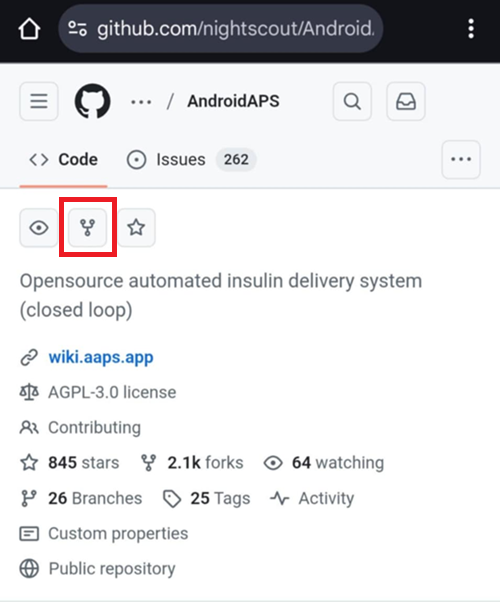
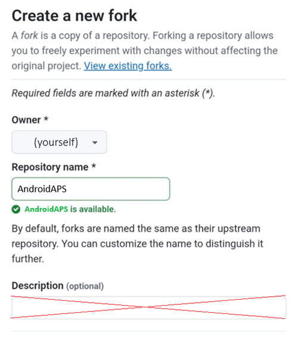
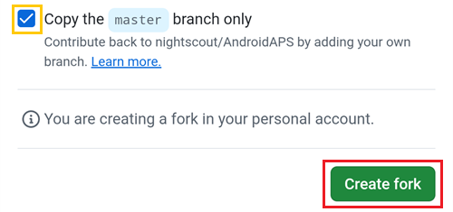
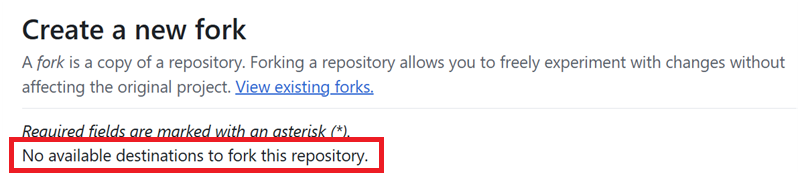
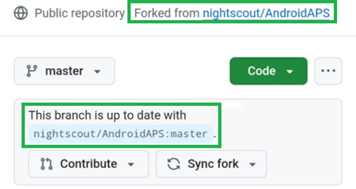

(github-fork)=

# Сборка через браузер – Шаг 1: Создайте свой fork на GitHub

```{note}
Это **Шаг 1** раздела [Сборка через браузер](BrowserBuild.md).
```

Вам нужно будет сохранить в GitHub ваш личный ключ Android Java и данные Google Диска как секреты (как это сделать, мы объясним позже).

Это нельзя сделать в публичном репозитории AndroidAPS, поэтому вам нужно создать свою личную копию исходного кода (она называется fork).

## GitHub account

Если у вас еще нет учетной записи GitHub, [создайте ее](https://github.com/signup).  
Зарегистрироваться можно с помощью электронной почты или с помощью Google. Follow the registration and verification process.

When you have an account, [sign in to GitHub](https://github.com/login).

## Fork AndroidAPS

Open the official AndroidAPS repository following [this link](https://github.com/nightscout/AndroidAPS).

Нажмите на значок fork. This will create a copy inside your own account.



Прокрутите следующий экран вниз и нажмите **Create Fork**.



*Примечание: **снимите** флажок «Copy the master branch only», если вы хотите собирать версии для разработчиков или собственные изменения.*



```{note}
Не получается создать fork и вы видите это?<br/><br/>
**`No available destinations to fork this repository.`**<br/><br/>
<br/><br/>
Это значит, что у вас уже есть fork AndroidAPS.<br/>
Убедитесь, что он обновлен, и переходите к подготовительным шагам.
```

```{warning}
**Никогда не удаляйте свой fork, не сделав резервную копию ваших секретов!**
```

GitHub now displays your personal copy of AndroidAPS. Не закрывайте эту вкладку браузера.



----

**Далее: [Шаг 2 – Создайте хранилище ключей для подписи](BrowserBuildKeystore.md) →**
