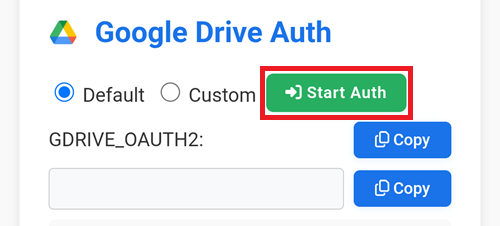
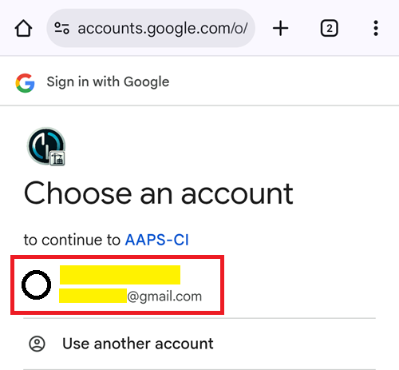
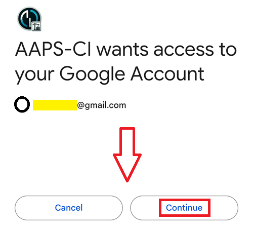
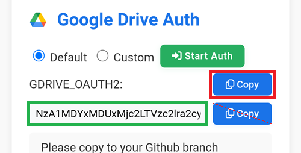
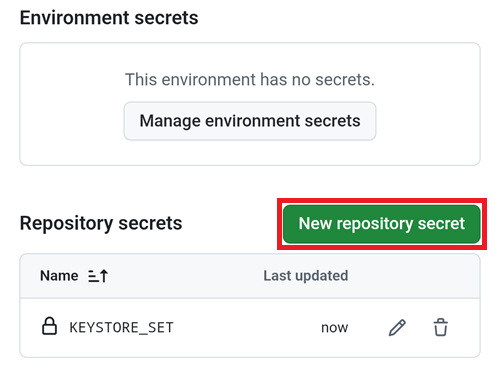
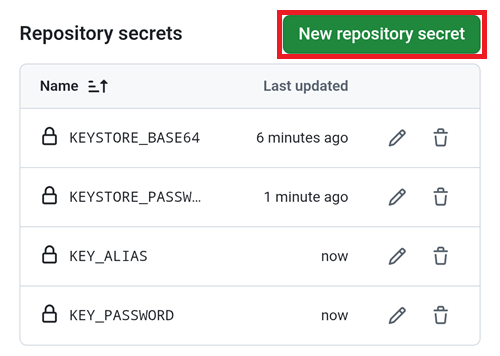
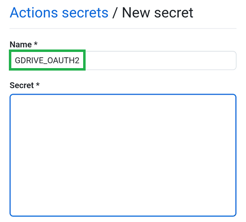
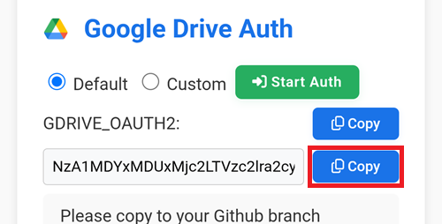
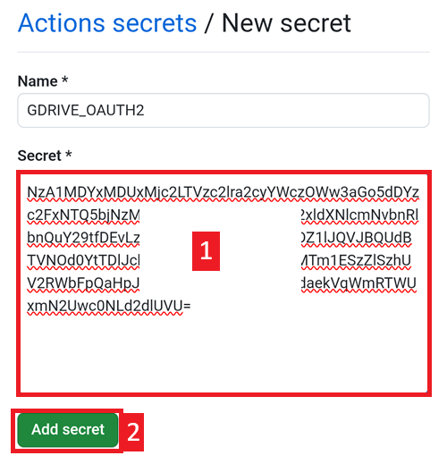
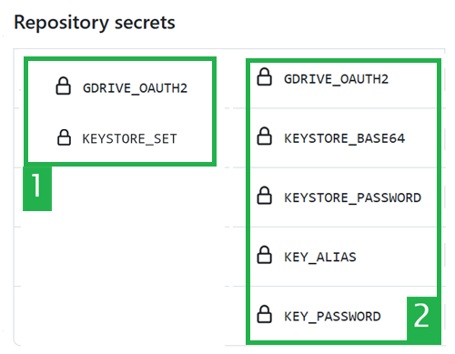

(aaps-ci-google-drive-auth)=

# Сборка через браузер – Шаг 3: Дайте доступ к Google Диску

```{note}
Это **Шаг 3** раздела [Сборка через браузер](BrowserBuild.md). Сначала выполните [Шаг 2 – Создайте хранилище ключей для подписи](BrowserBuildKeystore.md).
```

```{warning}
Независимо от того, какой из предыдущих инструкций вы следовали (Вариант 1 или Вариант 2), вы ОБЯЗАТЕЛЬНО должны добавить авторизацию Google Диска, чтобы сборка через браузер работала.
```

Примечание: если вы уже выполнили эту часть по видео, можете сразу перейти к [Шагу 4 – Соберите APK](BrowserBuildAPK.md).

```{warning}
Если авторизация Google не начинается или страница подготовки выдает ошибку, закройте страницу подготовки, снова откройте `aaps-ci-preparation.html` так же, как в шаге 2, и начните этот шаг заново. См. [устранение неполадок](#aaps-ci-preparation-web).
```

Вернитесь на вкладку со страницей подготовки.

Прокрутите вниз до раздела «Google Drive Auth» и нажмите «Start Auth».



Выберите свою учетную запись Google.



Прокрутите вниз и разрешите доступ. Он нужен веб-странице, чтобы получить ключ авторизации Google Диска.

Нажмите «Continue».



Поле `GDRIVE_OAUTH2` заполнится, нажмите верхнюю кнопку «Copy».



Вернитесь на вкладку GitHub.

Прокрутите вниз до «Repository secrets» и нажмите «New repository secret».

Если вы выполняли Вариант 1, вы увидите вот это:



Если вы выполняли Вариант 2, ключей будет больше:



В поле «Name» вставьте только что скопированный текст. Чтобы появилось меню «Вставить», нажмите на текстовое поле и удерживайте палец.



Перейдите на вкладку со страницей подготовки.

Нажмите вторую кнопку «Copy».



Вернитесь на вкладку GitHub.

1. В поле «Secret» вставьте только что скопированный текст. Чтобы появилось меню «Вставить», нажмите на текстовое поле и удерживайте палец.

2. Нажмите «Add secret».



Теперь у вас должно быть два (Вариант 1) или пять (Вариант 2) секретов.



Теперь GitHub сможет сохранять APK-файл AAPS на ваш Google Диск после сборки.

----

**Далее: [Шаг 4 – Соберите APK](BrowserBuildAPK.md) →**
