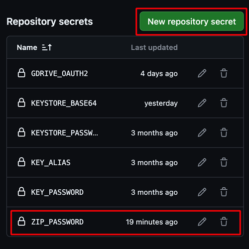
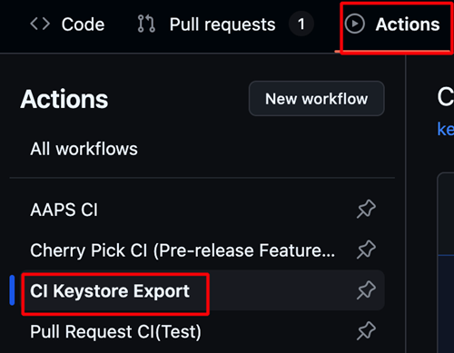
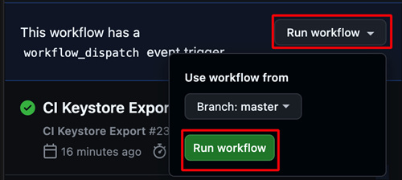

(aaps-ci-preparation)=

# Сборка через браузер – Шаг 2: Создайте хранилище ключей для подписи

```{note}
Это **Шаг 2** раздела [Сборка через браузер](BrowserBuild.md). Сначала выполните [Сборка через браузер – Шаг 1: Создайте свой fork на GitHub](BrowserBuildFork.md).
```

AAPS нужно подписать закрытыми ключами, которые хранятся в **Java KeyStore (JKS)** (хранилище ключей Java). Это самое важное решение во всем процессе, потому что от него зависит, сможете ли вы позже **обновлять** AAPS без переустановки.

```{note}
На следующих шагах вы сохраните личную информацию (ваше хранилище ключей, а позже доступ к Google Диску) в GitHub как **секреты** (secrets). Секрет — это просто зашифрованное значение, которое может прочитать только ваша собственная сборка. Никто другой его не видит, даже люди, которые смотрят ваш fork. Так ваша сборка остается только вашей.
```

## Выберите способ работы с хранилищем ключей

Прочитайте оба варианта и выберите тот, который подходит к вашей ситуации.

### Вариант 1 – Создать новое хранилище ключей (новые пользователи)

Выберите этот вариант, если верно **хотя бы одно** из следующего:

- Вы собираете AAPS **впервые**.
- У вас нет хранилища ключей от прежней сборки в Android Studio (на компьютере).
- Вы забыли пароль или псевдоним (alias) хранилища ключей.

```{warning}
Сборка AAPS по **варианту 1** создает совершенно новое хранилище ключей, поэтому **вы не сможете обновить уже установленный AAPS** поверх старой версии. Чтобы перейти на эту новую сборку, нужно экспортировать настройки, удалить старый AAPS, установить новый и снова импортировать настройки. Выполните шаги из раздела [Переустановка AAPS с новым хранилищем ключей](#reinstall-aaps).
```

**→ [Продолжить с вариантом 1 – Создать новое хранилище ключей](BrowserBuildO1.md)**

### Вариант 2 – Загрузить существующее хранилище ключей (нынешние и прежние пользователи)

Выберите этот вариант, если у вас **уже есть** хранилище ключей `.jks`, которое вы использовали для прежней сборки AAPS на компьютере в Android Studio, **и** вы знаете его пароль и псевдоним (alias, обычно `key0`).

Так ваш установленный AAPS можно будет обновлять: будущие обновления будут использовать то же хранилище ключей.

**→ [Продолжить с вариантом 2 – Загрузить существующее хранилище ключей](BrowserBuildO2.md)**

----

```{note}
На следующей странице вы выберете свое устройство (компьютер или iPhone). Затем страница для каждого устройства шаг за шагом покажет, как правильно скачать и открыть файл подготовки на этом устройстве и создать хранилище ключей. Собранное приложение AAPS будет сохранено на вашем Google Диске.
```

**Далее: выберите [вариант 1](BrowserBuildO1.md) или [вариант 2](BrowserBuildO2.md) выше, затем следуйте странице для вашего устройства.**

----

(ci-keystore-export)=

## Экспорт хранилища ключей (необязательно)

Если вы хотите экспортировать сохраненное хранилище ключей, используйте этот способ.

Этот скрипт экспортирует ранее настроенные данные хранилища ключей (из варианта 1 или варианта 2) в виде ZIP-файла, защищенного паролем, в папку `/AAPS/KeyStore` на вашем Google Диске.

```{warning}
Перед этим способом экспорта убедитесь, что настройка хранилища ключей и Google Диска завершена.
```

### Steps:

1. **Добавьте секрет с паролем для ZIP:**
   - Откройте в вашем репозитории **Settings** → **Secrets and variables** → **Actions**
   - Нажмите **New repository secret**
   - В поле **Name** введите: `ZIP_PASSWORD`
   - В поле **Secret** введите свой пароль для шифрования ZIP
   - Используйте в пароле только английские буквы и цифры (без специальных символов)
   - Нажмите **Add secret**

   

2. **Запустите workflow экспорта:**
   - Откройте вкладку **Actions** в вашем репозитории
   - Выберите **CI Keystore Export**
   - Нажмите **Run workflow**
   - ZIP-файл с экспортированным хранилищем ключей будет сохранен на вашем Google Диске

   

   

```{toctree}
:hidden:

Вариант 1 – Создать новое хранилище ключей <BrowserBuildO1.md>
Вариант 2 – Загрузить существующее хранилище ключей <BrowserBuildO2.md>
```
