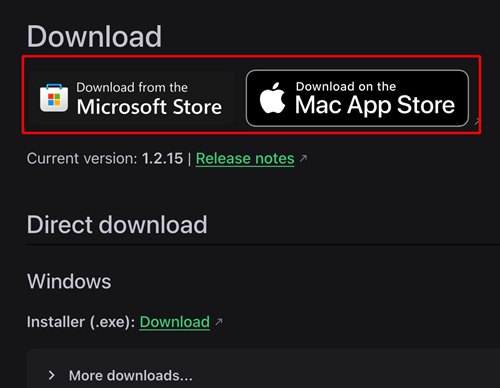
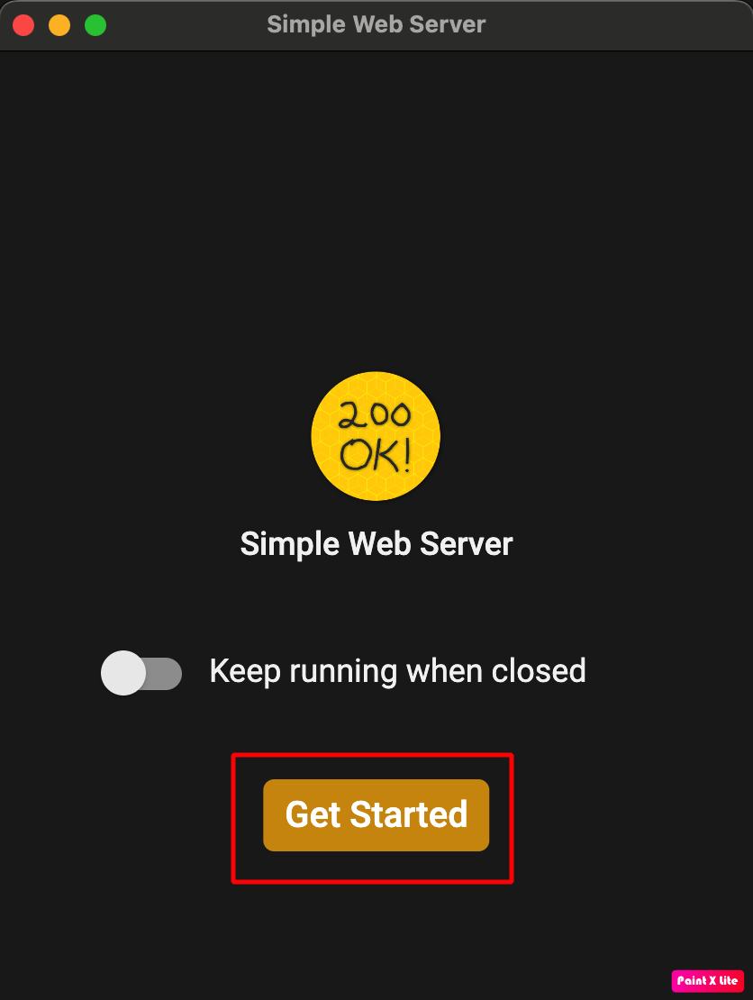
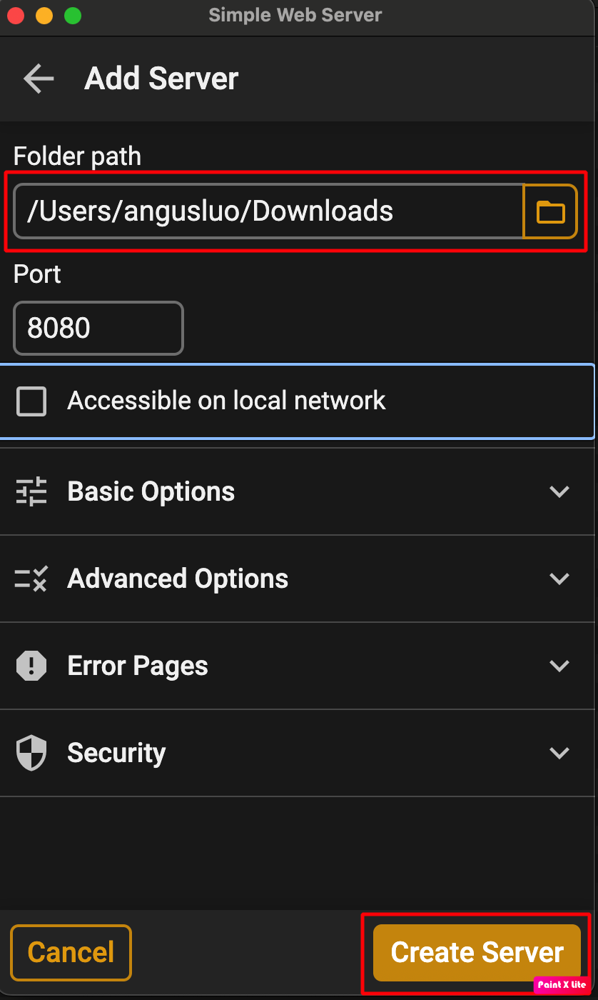

(aaps-ci-option1-computer)=

# Вариант 1 · Компьютер – Создать новое хранилище ключей

```{note}
[Вариант 1](BrowserBuildO1.md) (создать новое хранилище ключей) на **компьютере** (Windows / Mac / Linux).
```

## 1. Скачайте файл подготовки

:::{include} BrowserBuildDownloadPrep.md
:::

## 2. Запустите локальный сервер и создайте хранилище ключей

Используйте компьютер (Windows/Mac/Linux)

Откройте страницу [https://simplewebserver.org/download.html](https://simplewebserver.org/download.html)

Установите Simple Web Server<br/> Если вы пользуетесь Windows или Mac, его можно установить из Microsoft Store или Mac App Store.<br/> Если браузер спросит, открыть ли приложение магазина, разрешите это.<br/><br/> <br/>

Пример на Mac:

- get → install → open<br/><br/> <br/><br/>

- Нажмите Get Started<br/><br/> <br/><br/>

- Нажмите New Server<br/><br/> <br/><br/>

- В поле Folder Path выберите папку, в которой лежит файл aaps-ci-preparation.html, затем нажмите Create Server.<br/><br/> <br/><br/>

- Если вы видите этот экран, сервер запущен.<br/><br/> <br/><br/>

- Не закрывайте Simple Web Server. Перейдите в браузер и откройте<br/> [http://127.0.0.1:8080/aaps-ci-preparation.html](http://127.0.0.1:8080/aaps-ci-preparation.html)<br/><br/>

- Дальнейшие шаги смотрите в видео ниже, начиная с 1 минуты 37 секунд.

  <!--crowdin: exclude-->
  <div align="center" style="max-width: 360px; margin: auto; margin-bottom: 2em;">
    <div style="position: relative; width: 100%; aspect-ratio: 9/16;">
      <iframe
        src="https://geo.dailymotion.com/player/x9rdrpy.html?video=x9rdrpy&startTime=97&loop=true&mute=true"
        loading="lazy"
        style="position: absolute; top: 0; left: 0; width: 100%; height: 100%;"
        frameborder="0"
        allowfullscreen>
      </iframe>
    </div>
  </div>

----

**Далее: [Сборка через браузер – Шаг 3: Дайте доступ к Google Диску](BrowserBuildGoogleDrive.md) →**
