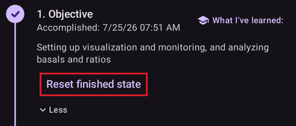

# Прохождение целей

В **AAPS** есть ряд **Целей**, которые нужно пройти. Они помогают пользователю постепенно перейти от простого открытого цикла к гибридному замкнутому циклу и всем функциям **AAPS**. Прохождение **Целей** нужно, чтобы вы:

* Правильно настроили все в **AAPS**;
* Узнали об основных функциях **AAPS**; и
* Получили базовое понимание того, что может ваша система, чтобы увереннее пользоваться **AAPS**.

Когда **AAPS** установлен впервые, каждую цель нужно пройти, прежде чем переходить к следующей. По мере прохождения каждой **Цели** постепенно открываются новые функции.

**Цели 1–8** проведут вас от настройки **AAPS** на смартфоне до «базового» гибридного замкнутого цикла. На это уйдет около 6 недель. До **Цели 5** можно дойти с виртуальной помпой (а инсулин пока вводить другим способом). **Objectives 9 and 10** are designed to test more advanced **AAPS** features with the aim of better control of your diabetes, and will take up to 3 months to complete, possibly longer. Подробнее о примерном распределении времени: [Сколько времени это займет?](#preparing-how-long-will-it-take)

As well as progressing through the **Objectives**, if required, you can also remove your progress and [go back to an earlier objective](#CompletingTheObjectives-go-back-in-objectives).

## Сделайте резервную копию настроек

```{admonition} Note
:class: note

После прохождения каждой **Цели** рекомендуется экспортировать настройки **AAPS**!
```

Настоятельно рекомендуется [экспортировать настройки](../Maintenance/ExportImportSettings.md) после прохождения каждой цели, чтобы не потерять прогресс в **AAPS**. При экспорте создается **файл настроек** (.json). Сохраните его копию в одном или нескольких надежных местах (например, на Google Диске, жестком диске, во вложении к письму _и т. д._). Так весь прогресс в **AAPS** будет сохранен. Если вы потеряли телефон или случайно удалили прогресс, json-файл можно снова загрузить в **AAPS**, импортировав последний файл настроек. Резервная копия **файла настроек** нужна и тогда, когда по какой-либо причине нужен новый смартфон для **AAPS** (замена на новый, потерянный или сломанный телефон _и т. д._)

В файле **настроек** сохраняется не только ваш прогресс по **Целям**, но и все настройки **AAPS**, например **максимальный болюс** _и т. д._

Если у вас нет резервной копии настроек и с вашим смартфоном с **AAPS** что-то случится, **Цели** придется проходить с самого начала. Прохождение **Целей** занимает время, и проходить их заново, например из-за потерянного смартфона, – ситуация, которой лучше избежать.

(objectives-objective1)=
## Цель 1: Настройка визуализации и мониторинга, анализ базала и коэффициентов

В **Цели 1** пользователь выполняет базовую техническую настройку **AAPS**. Пока этот шаг не выполнен, дальше продвинуться нельзя.

- Select the correct CGM/FGM in [Configuration → BG Source](#Config-Builder-bg-source). Подробнее см. [Совместимые CGM](../Getting-Started/CompatiblesCgms.md).
- Select the correct Pump in [Configuration → Pump](#Config-Builder-pump) to ensure your pump can communicate with **AAPS**. Выберите **виртуальную помпу**, если у вашей модели помпы нет драйвера **AAPS** для работы в цикле или если вы хотите пройти первые **Цели**, пока инсулин подает другая система. Подробнее см. [Совместимые помпы](../Getting-Started/CompatiblePumps.md).
- Если вы используете Nightscout:
  - Следуйте инструкциям на странице [Nightscout](../SettingUpAaps/Nightscout.md), чтобы **Nightscout** мог получать и показывать данные **AAPS**.
  - Note that the URL in **NSClientV3** must be **_without_ "/api/v1/"** at the end - see [Settings → NSClientV3](#Preferences-nsclient).
- Если вы используете Tidepool:
  - Следуйте инструкциям на странице [Tidepool](../SettingUpAaps/Tidepool.md), чтобы **Tidepool** мог получать и показывать данные **AAPS**.

Note: *You may need to wait for the next sensor glucose reading to arrive before **AAPS** will recognize it.*

(objectives-objective2)=
## Цель 2: Научитесь контролировать AAPS

**Objective 2** requires several ‘tasks’ to be actioned as shown in the screenshot below. Each task shows its status (**1**): the orange "**Not completed yet**" turns into "**Completed, well done!**" as soon as **AAPS** has registered the action. Tap **Hint** (**2**) underneath a task to open the related documentation, in case you are not familiar with a specific action yet.


Задачи для прохождения **Цели 2**:
- Установите **Профиль** на 90% на 10 мин.
  - _Hint_: Tap your Profile name on the main screen to open the **Profile** screen, then use the **Activate** (▶) button and set percentage and duration. Подробнее см. [Переключение профиля и процент профиля](../DailyLifeWithAaps/ProfileSwitch-ProfilePercentage.md).
  - _Примечание_: **AAPS** не принимает базальную скорость ниже 0,05 ед/ч. If your **Profile** includes rates 0.05U/hr or lower you will need to create a temporary **Profile** with higher basal rates before completing this task. После выполнения этой задачи вернитесь к своему обычному **Профилю**.
- Simulate "taking a shower" by [disconnecting your pump](#AapsScreens-loop-status) in **AAPS** for a duration of 1h.
  - _Hint_: press the loop icon on the main screen to open the Loop dialog, then choose a duration under **Disconnect pump**.
- Завершите «прием душа», снова подключив помпу.
  - _Hint_: press the "disconnected"-icon to open the loop dialog again and choose **Reconnect Pump**.
- Установите свою [**Временную цель**](../DailyLifeWithAaps/TempTargets.md) продолжительностью 10 мин.
  - _Hint_: press the target range on the main screen to bring up the temporary target screen.
- Откройте содержимое модуля **Замкнутый цикл**.
  - _Hint_: open **Configuration → Loop** and tap "**Open plugin**".
- Use scroll or zoom on the BG chart to look at larger or smaller time frames.


(objectives-objective3)=
## Цель 3: Подтвердите ваши знания

В **Цели 3** нужно пройти тест с выбором ответов, который проверяет ваши знания об **AAPS**.

Некоторые пользователи считают **Цель 3** самой трудной. Читайте документацию **AAPS** вместе с вопросами. Если вы действительно не можете ответить даже после поиска в документации **AAPS**, поищите «Objective 3» или «Цель 3» в группе [Facebook](https://www.facebook.com/groups/AndroidAPSUsers) или [Discord](https://discord.gg/4fQUWHZ4Mw) (скорее всего, ваш вопрос уже задавали – и группа на него ответила). В этих группах вам дадут дружеские подсказки или укажут нужный раздел документации **AAPS**.

Тем временем:
- To reduce the number of notifications / decisions you are asked to make (temporary basal rates) while in Open Loop, set a wide target range in your **Profile** _e.g._ 90 - 150 mg/dL or 5.0 - 8.5 mmol/L.
- Вы можете увеличить верхнюю границу диапазона на ночь или вовсе отключить цикл на это время.

To proceed with **Objective 3**, tap a question row to open it. Прочтите внимательно все вопросы и выберите ответ(ы).

Для каждого вопроса правильным может быть больше одного ответа! Если выбран неверный ответ, вопрос блокируется на 1 час. Только потом можно вернуться и ответить на него снова. Имейте в виду, что при следующей попытке порядок ответов может измениться. Так вы будете внимательно их читать и действительно понимать, верен каждый ответ или нет.

```{admonition} __What happens if new question(s) are added to an Objective when I update to a newer version of AAPS?__
:class: note
From time to time, new features are added to **AAPS** which may require a new question to be added to the **Objectives**, particularly **Objective 3**. As a result, any new question added to **Objective 3** will be marked as “incomplete” because **AAPS** will require you to action this. Не волнуйтесь: каждая **Цель** независима, поэтому вы **не потеряете уже доступные функции AAPS**, если другие **Цели** остаются пройденными.
```

## Цель 4: Начните с открытого цикла

The purpose of **Objective 4** is to recognize how often **AAPS** will evaluate the user's basal rate against glucose levels, and recommend temporary basal rate adjustments. В этой **Цели** вы впервые включите открытый цикл, примете 20 предложенных изменений временного базала и при необходимости вручную введете их в помпу. Вы также увидите, как действуют [**Временные цели**](../DailyLifeWithAaps/TempTargets.md). If you are not familiar with setting a temporary basal rate change in **AAPS** yet, see the pump actions in the **Manage** sheet ([Where did the Actions tab go?](#screens-action-tab)).

Минимальное время прохождения этой цели: **7 дней**. Это обязательное время ожидания. Перейти к следующей **Цели** нельзя, даже если все изменения базальной скорости уже выполнены.

- Select Open Loop by pressing the [Loop icon](#AapsScreens-loop-status) on the main screen and choosing **Open Loop** as running mode.
- Вручную выполните не менее 20 предложений временного базала за 7 дней: введите их в свою (физическую) помпу и подтвердите в AAPS, что вы их приняли. Убедитесь, что эти изменения базальной скорости видны в **AAPS** и в **Nightscout**.
- При необходимости используйте [**Временные цели**](../DailyLifeWithAaps/TempTargets.md). После купирования гипо используйте заранее заданную временную цель «Гипо», чтобы система не скорректировала слишком сильно, когда ГК снова пойдет вверх.
- Если на этом этапе у вас все еще включен [Простой режим](#preferences-simple-mode), сейчас, вероятно, самое время его выключить.

To reduce the number of proposed basal rate changes while in Open Loop, you can still use the tips described in [**Objective 3**](#objectives-objective3). Additionally, you can change the minimum percentage for recommended basal rate changes with the "**Open mode minimum change**" setting in **Settings → Loop**. Чем выше значение, тем меньше уведомлений об изменениях вы будете получать.


```{admonition} Note
:class: note

You don't need to action each and every system recommendation!
```
(objectives-objective5)=
## Цель 5: Глубже понимаем работу открытого цикла, включая рекомендации по временным базалам

В **Цели 5** вы начнете понимать, как получаются рекомендации временного базала. This includes the [determination of basal logic](#aaps-screens-how-predictions-become-a-dosing-decision), analyzing the impact by observing [prediction lines in **AAPS Overview**](#aaps-screens-prediction-lines) (or Nightscout) and looking at the detailed calculations shown on the **OpenAPS SMB** plugin screen (**Configuration → APS → Open plugin**).

Примерное время прохождения этой цели: **7 дней**.

This **Objective** requires you to determine and set your “Maximum basal rate” (max-basal) value as described in [OpenAPS-features](#Open-APS-features-max-u-h-a-temp-basal-can-be-set-to). This value can be set in [Settings → OpenAPS SMB](#Preferences-openaps-smb-settings). In [simple mode](#preferences-simple-mode), **AAPS** sets this value automatically and you don't need to change it. Если вы все еще используете виртуальную помпу, убедитесь, что эта настройка безопасности задана и в **AAPS**, и на вашей инсулиновой помпе.

Пока вы не привыкнете к расчетам и настройкам **AAPS**, можно установить [целевое значение ГК в **Профиле**](#profile-glucose-targets) выше обычного. You may wish to experiment with adjusting your **BG target** in your **Profile** being in a tighter range (say, 1 or less mmol/L [20 mg/dL or less] wide) and observe the resulting behavior.


```{admonition} If you have been using a virtual pump, change to a real insulin pump now!
:class: note

Если вы используете открытый цикл с виртуальной помпой, **остановитесь здесь**. Only tap **Verify** at the end of this **Objective** once you have changed to using a "real" pump which delivers insulin.

```


(objectives-objective6)=
## Цель 6: Начинаем замыкать цикл с приостановкой помпы на низкой ГК (Low Glucose Suspend)


```{admonition} Closed loop will not correct high **BG** values in **Objective 6** as it is limited to **Low Glucose Suspend** only!
:class: note
You will still need to correct high BG values by yourself (manually with corrections by pump or pen)!
```

В **Цели 6** вы замкнете цикл и включите режим **Приостановка помпы на низкой ГК** (LGS), пока [max IOB](#Open-APS-features-maximum-total-iob-openaps-cant-go-over) равен нулю. Чтобы пройти эту **цель**, нужно оставаться в режиме LGS 5 дней. Используйте это время, чтобы проверить, точны ли настройки вашего **Профиля** и не срабатывает ли LGS слишком часто.

Минимальное время прохождения этой цели: **5 дней**. Это обязательное время ожидания. Перейти к следующей **Цели** до истечения этого времени нельзя.

Очень важно, чтобы ваш текущий **Профиль** (базал, ISF, IC) был хорошо проверен, прежде чем вы замкнете цикл в режиме **LGS**. Неверные настройки **Профиля** могут привести к гипогликемиям, которые придется купировать вручную. Точный **Профиль** поможет реже купировать низкую ГК в течение этих 5 дней.

**If you still observe frequent or severe low glucose episodes consider refining your [insulin type's DIA](#Config-Builder-insulin-dia), basal, ISF and carb ratios.** Please refer to the [Facebook](https://www.facebook.com/groups/AndroidAPSUsers) or [Discord](https://discord.gg/4fQUWHZ4Mw) group which has much discussion on this.


Во время **Цели 6** **AAPS** принудительно устанавливает значение maxIOB равным нулю. **Это ограничение снимается при переходе к Цели 7.**

Это значит, что на **Цели 6**, если ГК по сенсору снижается, **AAPS** сам уменьшит подачу базального инсулина. But, if sensor glucose levels are rising, **AAPS** will increase the basal rate above your **Profile** value only if **basal IOB** is negative as a result of a previous **LGS**. Иначе **AAPS** не повысит базал выше текущего значения профиля, даже если ГК растет. Эта осторожность нужна, чтобы избежать гипогликемий, пока вы учитесь пользоваться **AAPS**.

**As a consequence, you have to handle high glucose values with manual insulin bolus corrections.**

- Если ваш IOB отрицательный (см. снимок экрана ниже), в **Цели 6** может включиться временный базал (ВБС) > 100%.


- Для надежности и запаса безопасности установите целевой диапазон немного выше, чем обычно.
- Enable 'Low Glucose Suspend' mode by pressing the Loop icon on the main screen and choosing **Low Glucose Suspend** as running mode.
- Следите за активными временными базалами: они показаны бирюзовым текстом базала на главном экране и бирюзовой линией базала на графике главного экрана.
- После купирования гипогликемии возможны временные скачки ГК, так как при отскоке базал нельзя увеличить.

(objectives-objective7)=
## Цель 7: Настройка замкнутого цикла с поднятием величины maxIOB выше 0 и постепенным понижением целевой ГК

Чтобы пройти **Цель 7**, нужно замкнуть цикл и повысить [maxIOB](#Open-APS-features-maximum-total-iob-openaps-cant-go-over). В **Цели 6** значение **maxIOB** автоматически было равно нулю из-за режима приостановки помпы на низкой ГК. Теперь это уже не так. **AAPS** начнет использовать заданное вами значение maxIOB, чтобы корректировать высокую ГК. In [simple mode](#preferences-simple-mode), **AAPS** sets maxIOB automatically and you don't need to change it.

Минимальное время прохождения этой цели: **1 день**. Это обязательное время ожидания. Перейти к следующей **Цели** до истечения этого времени нельзя.

- Select **Closed Loop** by pressing the [Loop icon](#AapsScreens-loop-status) on the main screen and choosing **Closed Loop** as running mode. Оставайтесь в режиме **Замкнутый цикл** в течение 1 дня.

- Slowly raise your 'Max IOB for SMB' (in OpenAPS called 'max-iob') above 0, until you find the settings that work best for you.

Рекомендация по умолчанию для этой настройки: «**средний болюс на еду + 3 × максимальный суточный базал**», где «максимальный суточный базал» – наибольшее часовое значение в любом отрезке суток.


Эта рекомендация должна рассматриваться как отправная точка. Если вы пользуетесь этим правилом, но видите, что AAPS подает слишком много инсулина при росте ГК, возможно, нужно:
* lower the "Max IOB for SMB" value;
* проверить настройки **Профиля**, меняя только одно значение за раз.

Если же у вас сильная инсулинорезистентность, очень осторожно повышайте значение **maxIOB**.

Когда вы будете уверены, какое значение **maxIOB** подходит вашей работе в цикле, снизьте **целевые значения ГК** до нужного уровня.

(objectives-objective8)=
## Цель 8: Корректировка базала и коэффициентов при необходимости, затем включение Autosens

В этой **цели** вы еще раз проверите, как работает ваш **Профиль**, и будете использовать функцию [Autosens](#Open-APS-features-autosens) как показатель неверных настроек.

Минимальное время прохождения этой цели: **7 дней**. Это обязательное время ожидания. Перейти к следующей **Цели** до истечения этого времени нельзя.

Enable [Autosens](../DailyLifeWithAaps/KeyAapsFeatures.md) over a period of 7 days (in [simple mode](#preferences-simple-mode) it is enabled by default) and watch [**Overview**'s graph white line](#AapsScreens-section-g-additional-graphs) showing your insulin sensitivity rising or falling due to exercise or hormones etc. Keep an eye on the **OpenAPS SMB** plugin screen (**Configuration → APS → Open plugin**) which shows **AAPS** adjusting the sensitivity, basals and targets accordingly.

Сейчас хорошее время, чтобы проверить настройки [Модули чувствительности](#Config-Builder-sensitivity-detection). You can view your sensitivity on the main screen in an [additional graph](#AapsScreens-section-g-additional-graphs).

Additionally, you can use [Autotune](#autotune-how-autotune-calculates-adjustments) as a one off to check your basals remain accurate or do a traditional basal test.

(objectives-objective9)=
## Цель 9: Включение дополнительных функций oref1 для дневного времени, таких как супер микроболюс (SMB)

В **Цели 9** вы освоите и начнете использовать **«Супер микроболюс (SMB)»** как одну из основных функций. Изучив обязательные материалы, вы будете хорошо понимать, что такое SMB, как они работают и почему после подачи SMB базал временно ставится на ноль (zero-temping).

Минимальное время прохождения этой цели: **28 дней**. Это обязательное время ожидания. Перейти к следующей Цели до истечения этого времени нельзя.

- [Раздел о SMB в этой документации](#Open-APS-features-super-micro-bolus-smb) и [описание oref1 в документации openAPS](https://openaps.readthedocs.io/en/latest/docs/Customize-Iterate/oref1.html) обязательно нужно прочитать, чтобы понять **SMB** и принцип **zero-temping** (временный базал на ноль).
- После этого можно [повысить maxIOB](#Open-APS-features-maximum-total-iob-openaps-cant-go-over), чтобы **SMB** работали эффективнее. Теперь maxIOB включает весь **IOB**, а не только накопленный базал. Этот порог приостанавливает **SMB**, пока IOB не упадет ниже этого значения (_например_, **maxIOB** равен 7 ед, и на еду подан болюс 8 ед: SMB будут приостановлены и не будут подаваться, пока **IOB** не упадет ниже 7 ед). Хорошее начальное значение: **maxIOB** = **средний болюс на еду + 3 × максимальный суточный базал**, где «максимальный суточный базал» – наибольшее часовое значение в любом отрезке суток. See [objective 7](#objectives-objective7) as reference.
- Evaluate your carb absorption rate and consider changing the “min_5m_carbimpact”-parameter in [Settings → Absorption settings → min_5m_carbimpact](#Preferences-min_5m_carbimpact) if you find it too slow or too fast.

(objectives-objective10)=
## Цель 10: Автоматизация

**Автоматизация** становится доступной, когда начинается **Цель 10**.

Минимальное время прохождения этой цели: **28 дней**. Это обязательное время ожидания. Перейти к следующей Цели до истечения этого времени нельзя.

Сначала прочитайте страницу документации [Автоматизация](../DailyLifeWithAaps/Automations.md).

Set up the most basic automation rule; for example trigger an Android notification in a few minutes:
- Open **Manage → Automation** and tap the **+** button (**Add rule**).
- Enter a **Task name**, for example "My first automation notification".
- Under **Condition**, tap "**EDIT**".
  - Tap "**Add trigger**" and select "**Time**". **AAPS** creates an entry for today at the current time.
  - Change the time so that it triggers in a few minutes.
  - Tap the **Save** icon (top right) to go back to the rule.
- Under **Action**, tap "**ADD**" and select "**Notification**".
  - Enter a message in the action card, for example "My first automation".
- Tap the **Save** icon (top right) and make sure the rule is **Enabled**.
- Дождитесь, когда в заданное время появится уведомление (имейте в виду, что на некоторых телефонах оно может прийти на несколько минут позже)

Затем можно попробовать настроить более полезную **Автоматизацию**. На странице документации есть несколько примеров, а в группе [Facebook](https://www.facebook.com/groups/AndroidAPSUsers) можно поискать снимки экрана по слову «Automation». В сообществе [Discord](https://discord.gg/4fQUWHZ4Mw) также есть отдельный канал.

Например, если каждое утро перед школой или работой вы в одно и то же время едите один и тот же завтрак, можно создать **Автоматизацию**, например «цель-перед-завтраком», которая за 30 минут до завтрака устанавливает немного более низкую **Временную цель**. В этом случае условие, скорее всего, будет «Время повторения»: в нем выбираются определенные дни недели (понедельник, вторник, среда, четверг, пятница) и определенное время (06:30). Действием будет «Начать врем цель» с целевым значением ниже обычного и продолжительностью 30 минут.

## When all objectives are completed

Once you have accomplished all the **Objectives**, the list shows each of them with a tick and the date it was accomplished. The **Objectives** item disappears from the bottom navigation; you can still open the list with **Configuration → Constraints → Objectives → Open plugin**.


Press "**More**" under an objective to see its tasks again:


(CompletingTheObjectives-go-back-in-objectives)=
## Возможность возврата к предыдущим целям

If you wish to go back in the **Objectives** for whatever reason, open the finished **Objective** with "**More**" and tap "**Reset finished state**":



In the same way, the **Objective** you are currently working on can be restarted with "**Reset started state**".
