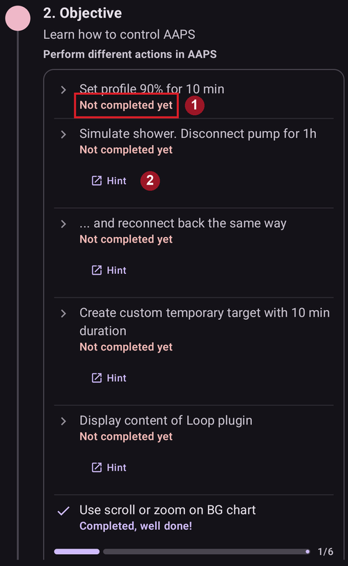
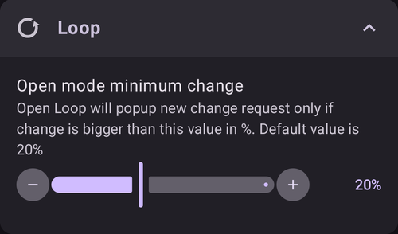
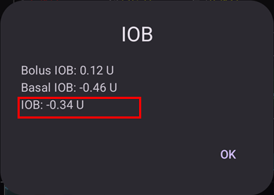
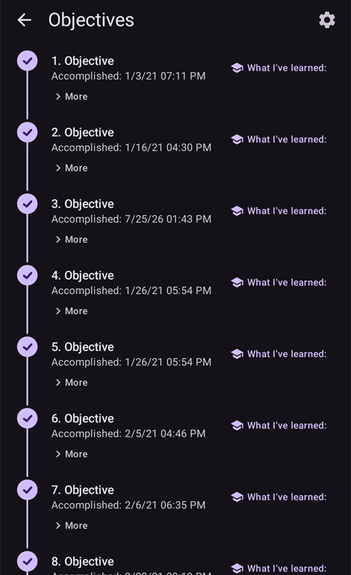
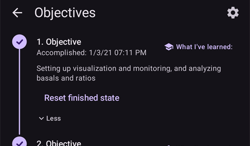

# Прохождение целей

В **AAPS** есть ряд **Целей**, которые нужно пройти. Они помогают пользователю постепенно перейти от простого открытого цикла к гибридному замкнутому циклу и всем функциям **AAPS**. Прохождение **Целей** нужно, чтобы вы:

* Правильно настроили все в **AAPS**;
* Узнали об основных функциях **AAPS**; и
* Получили базовое понимание того, что может ваша система, чтобы увереннее пользоваться **AAPS**.

Когда **AAPS** установлен впервые, каждую цель нужно пройти, прежде чем переходить к следующей. По мере прохождения каждой **Цели** постепенно открываются новые функции.

**Цели 1–8** проведут вас от настройки **AAPS** на смартфоне до «базового» гибридного замкнутого цикла. На это уйдет около 6 недель. До **Цели 5** можно дойти с виртуальной помпой (а инсулин пока вводить другим способом). **Цели 9 и 10** проверяют более сложные функции **AAPS**, чтобы лучше управлять диабетом. На их прохождение уйдет до 3 месяцев, возможно, больше. Подробнее о примерном распределении времени: [Сколько времени это займет?](#preparing-how-long-will-it-take)

Кроме прохождения **Целей**, при необходимости можно также удалить свой прогресс и [вернуться к более ранней цели](#CompletingTheObjectives-go-back-in-objectives).

## Сделайте резервную копию настроек

```{admonition} Note
:class: note

После прохождения каждой **Цели** рекомендуется экспортировать настройки **AAPS**!
```

Настоятельно рекомендуется [экспортировать настройки](../Maintenance/ExportImportSettings.md) после прохождения каждой цели, чтобы не потерять прогресс в **AAPS**. При экспорте создается **файл настроек** (.json). Сохраните его копию в одном или нескольких надежных местах (например, на Google Диске, жестком диске, во вложении к письму _и т. д._). Так весь прогресс в **AAPS** будет сохранен. Если вы потеряли телефон или случайно удалили прогресс, json-файл можно снова загрузить в **AAPS**, импортировав последний файл настроек. Резервная копия **файла настроек** нужна и тогда, когда по какой-либо причине нужен новый смартфон для **AAPS** (замена на новый, потерянный или сломанный телефон _и т. д._)

В файле **настроек** сохраняется не только ваш прогресс по **Целям**, но и все настройки **AAPS**, например **максимальный болюс** _и т. д._

Если у вас нет резервной копии настроек и с вашим смартфоном с **AAPS** что-то случится, **Цели** придется проходить с самого начала. Прохождение **Целей** занимает время, и проходить их заново, например из-за потерянного смартфона, – ситуация, которой лучше избежать.

(objectives-objective1)=
## Цель 1: Настройка визуализации и мониторинга, анализ базала и коэффициентов

В **Цели 1** пользователь выполняет базовую техническую настройку **AAPS**. Пока этот шаг не выполнен, дальше продвинуться нельзя.

- Выберите нужный CGM/FGM в [Конфигурация → Источник ГК](#Config-Builder-bg-source). Подробнее см. [Совместимые CGM](../Getting-Started/CompatiblesCgms.md).
- Выберите нужную помпу в [Конфигурация → Помпа](#Config-Builder-pump), чтобы ваша помпа могла связываться с **AAPS**. Выберите **виртуальную помпу**, если у вашей модели помпы нет драйвера **AAPS** для работы в цикле или если вы хотите пройти первые **Цели**, пока инсулин подает другая система. Подробнее см. [Совместимые помпы](../Getting-Started/CompatiblePumps.md).
- Если вы используете Nightscout:
  - Следуйте инструкциям на странице [Nightscout](../SettingUpAaps/Nightscout.md), чтобы **Nightscout** мог получать и показывать данные **AAPS**.
  - Обратите внимание: URL в **NSClientV3** должен быть **_без_ "/api/v1/"** в конце – см. [Настройки → NSClientV3](#Preferences-nsclient).
- Если вы используете Tidepool:
  - Следуйте инструкциям на странице [Tidepool](../SettingUpAaps/Tidepool.md), чтобы **Tidepool** мог получать и показывать данные **AAPS**.

Примечание: *Возможно, придется дождаться следующего значения ГК от сенсора, прежде чем **AAPS** его распознает.*

(objectives-objective2)=
## Цель 2: Научитесь контролировать AAPS

В **Цели 2** нужно выполнить несколько «задач», как показано на снимке экрана ниже. У каждой задачи показан ее статус (**1**): оранжевое «**Не завершено**» меняется на «**Завершено, отлично!**», как только **AAPS** зарегистрирует действие. Если вы еще не знаете, как выполнить какое-то действие, нажмите **Подсказка** (**2**) под задачей, чтобы открыть нужную документацию.



Задачи для прохождения **Цели 2**:
- Установите **Профиль** на 90% на 10 мин.
  - _Подсказка_: нажмите на название профиля на главном экране, чтобы открыть экран **Профиль**, затем нажмите кнопку **Активировать** (▶) и задайте процент и продолжительность. Подробнее см. [Переключение профиля и процент профиля](../DailyLifeWithAaps/ProfileSwitch-ProfilePercentage.md).
  - _Примечание_: **AAPS** не принимает базальную скорость ниже 0,05 ед/ч. Если в вашем **Профиле** есть скорости 0,05 ед/ч или ниже, перед выполнением этой задачи нужно создать временный **Профиль** с более высокой базальной скоростью. После выполнения этой задачи вернитесь к своему обычному **Профилю**.
- Сымитируйте «прием душа»: [отключите помпу](#AapsScreens-loop-status) в **AAPS** на 1 ч.
  - _Подсказка_: нажмите на значок цикла на главном экране, чтобы открыть окно цикла, затем выберите продолжительность в разделе **Отключить помпу**.
- Завершите «прием душа», снова подключив помпу.
  - _Подсказка_: нажмите на значок «отключено», чтобы снова открыть окно цикла, и выберите **Возобновить соединение с помпой**.
- Установите свою [**Временную цель**](../DailyLifeWithAaps/TempTargets.md) продолжительностью 10 мин.
  - _Подсказка_: нажмите на целевой диапазон на главном экране, чтобы открыть экран временной цели.
- Откройте содержимое модуля **Замкнутый цикл**.
  - _Подсказка_: откройте **Конфигурация → Замкнутый цикл** и нажмите «**Открыть модуль**».
- Прокручивайте или масштабируйте график ГК, чтобы смотреть более длинные или короткие отрезки времени.


(objectives-objective3)=
## Цель 3: Подтвердите ваши знания

В **Цели 3** нужно пройти тест с выбором ответов, который проверяет ваши знания об **AAPS**.

Некоторые пользователи считают **Цель 3** самой трудной. Читайте документацию **AAPS** вместе с вопросами. Если вы действительно не можете ответить даже после поиска в документации **AAPS**, поищите «Objective 3» или «Цель 3» в группе [Facebook](https://www.facebook.com/groups/AndroidAPSUsers) или [Discord](https://discord.gg/4fQUWHZ4Mw) (скорее всего, ваш вопрос уже задавали – и группа на него ответила). В этих группах вам дадут дружеские подсказки или укажут нужный раздел документации **AAPS**.

Тем временем:
- Чтобы в открытом цикле получать меньше уведомлений и решений (временных базалов), установите в **Профиле** широкий целевой диапазон, _например_ 90–150 мг/дл или 5,0–8,5 ммоль/л.
- Вы можете увеличить верхнюю границу диапазона на ночь или вовсе отключить цикл на это время.

Чтобы пройти **Цель 3**, нажмите на строку вопроса, чтобы открыть его. Прочтите внимательно все вопросы и выберите ответ(ы).

Для каждого вопроса правильным может быть больше одного ответа! Если выбран неверный ответ, вопрос блокируется на 1 час. Только потом можно вернуться и ответить на него снова. Имейте в виду, что при следующей попытке порядок ответов может измениться. Так вы будете внимательно их читать и действительно понимать, верен каждый ответ или нет.

```{admonition} __What happens if new question(s) are added to an Objective when I update to a newer version of AAPS?__
:class: note
Время от времени в **AAPS** добавляются новые функции, и для них в **Цели**, особенно в **Цель 3**, может добавиться новый вопрос. As a result, any new question added to **Objective 3** will be marked as “incomplete” because **AAPS** will require you to action this. Не волнуйтесь: каждая **Цель** независима, поэтому вы **не потеряете уже доступные функции AAPS**, если другие **Цели** остаются пройденными.
```

## Цель 4: Начните с открытого цикла

Цель **Цели 4** – понять, как часто **AAPS** сравнивает базальную скорость пользователя с уровнем ГК и рекомендует изменения временного базала. В этой **Цели** вы впервые включите открытый цикл, примете 20 предложенных изменений временного базала и при необходимости вручную введете их в помпу. Вы также увидите, как действуют [**Временные цели**](../DailyLifeWithAaps/TempTargets.md). Если вы еще не знаете, как задать временный базал в **AAPS**, посмотрите действия с помпой на панели **Управление** ([Куда делась вкладка «Действия»?](#screens-action-tab)).

Минимальное время прохождения этой цели: **7 дней**. Это обязательное время ожидания. Перейти к следующей **Цели** нельзя, даже если все изменения базальной скорости уже выполнены.

- Включите открытый цикл: нажмите [значок цикла](#AapsScreens-loop-status) на главном экране и выберите режим работы **Открытый цикл**.
- Вручную выполните не менее 20 предложений временного базала за 7 дней: введите их в свою (физическую) помпу и подтвердите в AAPS, что вы их приняли. Убедитесь, что эти изменения базальной скорости видны в **AAPS** и в **Nightscout**.
- При необходимости используйте [**Временные цели**](../DailyLifeWithAaps/TempTargets.md). После купирования гипо используйте заранее заданную временную цель «Гипо», чтобы система не скорректировала слишком сильно, когда ГК снова пойдет вверх.
- Если на этом этапе у вас все еще включен [Простой режим](#preferences-simple-mode), сейчас, вероятно, самое время его выключить.

Чтобы в открытом цикле получать меньше предложений изменить базальную скорость, можно по-прежнему использовать советы из [**Цели 3**](#objectives-objective3). Кроме того, минимальный процент для рекомендуемых изменений базальной скорости можно изменить в настройке «**Минимальное изменение в открытом цикле**» в **Настройки → Замкнутый цикл**. Чем выше значение, тем меньше уведомлений об изменениях вы будете получать.



```{admonition} Note
:class: note

Не обязательно выполнять каждую рекомендацию системы!
```
(objectives-objective5)=
## Цель 5: Глубже понимаем работу открытого цикла, включая рекомендации по временным базалам

В **Цели 5** вы начнете понимать, как получаются рекомендации временного базала. Это включает [логику определения базала](#aaps-screens-how-predictions-become-a-dosing-decision), анализ результата по [линиям прогнозирования на **главном экране AAPS**](#aaps-screens-prediction-lines) (или в Nightscout) и изучение подробных расчетов на экране модуля **OpenAPS SMB** (**Конфигурация → APS → Открыть модуль**).

Примерное время прохождения этой цели: **7 дней**.

В этой **Цели** нужно определить и задать значение «Максимальная базальная скорость» (max-basal), как описано в [OpenAPS-features](#Open-APS-features-max-u-h-a-temp-basal-can-be-set-to). Это значение можно задать в [Настройки → OpenAPS SMB](#Preferences-openaps-smb-settings). В [простом режиме](#preferences-simple-mode) **AAPS** задает это значение автоматически, и менять его не нужно. Если вы все еще используете виртуальную помпу, убедитесь, что эта настройка безопасности задана и в **AAPS**, и на вашей инсулиновой помпе.

Пока вы не привыкнете к расчетам и настройкам **AAPS**, можно установить [целевое значение ГК в **Профиле**](#profile-glucose-targets) выше обычного. Можно попробовать сузить диапазон **целевой ГК** в **Профиле** (например, до ширины 1 ммоль/л [20 мг/дл] или меньше) и посмотреть, как изменится поведение системы.


```{admonition} If you have been using a virtual pump, change to a real insulin pump now!
:class: note

Если вы используете открытый цикл с виртуальной помпой, **остановитесь здесь**. Нажимайте **Проверить** в конце этой **Цели** только после того, как перешли на «настоящую» помпу, которая подает инсулин.

```


(objectives-objective6)=
## Цель 6: Начинаем замыкать цикл с приостановкой помпы на низкой ГК (Low Glucose Suspend)


```{admonition} Closed loop will not correct high **BG** values in **Objective 6** as it is limited to **Low Glucose Suspend** only!
:class: note
Высокую ГК вам все еще нужно корректировать самостоятельно (вручную, с помощью помпы или шприц-ручки)!
```

В **Цели 6** вы замкнете цикл и включите режим **Приостановка помпы на низкой ГК** (LGS), пока [max IOB](#Open-APS-features-maximum-total-iob-openaps-cant-go-over) равен нулю. Чтобы пройти эту **цель**, нужно оставаться в режиме LGS 5 дней. Используйте это время, чтобы проверить, точны ли настройки вашего **Профиля** и не срабатывает ли LGS слишком часто.

Минимальное время прохождения этой цели: **5 дней**. Это обязательное время ожидания. Перейти к следующей **Цели** до истечения этого времени нельзя.

Очень важно, чтобы ваш текущий **Профиль** (базал, ISF, IC) был хорошо проверен, прежде чем вы замкнете цикл в режиме **LGS**. Неверные настройки **Профиля** могут привести к гипогликемиям, которые придется купировать вручную. Точный **Профиль** поможет реже купировать низкую ГК в течение этих 5 дней.

**Если у вас все еще часто бывают низкие значения ГК или тяжелые гипогликемии, уточните [DIA вашего типа инсулина](#Config-Builder-insulin-dia), базал, ISF и углеводные коэффициенты.** Обратитесь в группу [Facebook](https://www.facebook.com/groups/AndroidAPSUsers) или [Discord](https://discord.gg/4fQUWHZ4Mw), где это много обсуждают.


Во время **Цели 6** **AAPS** принудительно устанавливает значение maxIOB равным нулю. **Это ограничение снимается при переходе к Цели 7.**

Это значит, что на **Цели 6**, если ГК по сенсору снижается, **AAPS** сам уменьшит подачу базального инсулина. Но если ГК по сенсору растет, **AAPS** повысит базальную скорость выше значения **Профиля**, только если **базальный IOB** отрицательный из-за предыдущей **LGS**. Иначе **AAPS** не повысит базал выше текущего значения профиля, даже если ГК растет. Эта осторожность нужна, чтобы избежать гипогликемий, пока вы учитесь пользоваться **AAPS**.

**As a consequence, you have to handle high glucose values with manual insulin bolus corrections.**

- Если ваш IOB отрицательный (см. снимок экрана ниже), в **Цели 6** может включиться временный базал (ВБС) > 100%.



- Для надежности и запаса безопасности установите целевой диапазон немного выше, чем обычно.
- Включите режим приостановки помпы на низкой ГК: нажмите значок цикла на главном экране и выберите режим работы **Приостановка помпы на низкой ГК**.
- Следите за активными временными базалами: они показаны бирюзовым текстом базала на главном экране и бирюзовой линией базала на графике главного экрана.
- После купирования гипогликемии возможны временные скачки ГК, так как при отскоке базал нельзя увеличить.

(objectives-objective7)=
## Цель 7: Настройка замкнутого цикла с поднятием величины maxIOB выше 0 и постепенным понижением целевой ГК

Чтобы пройти **Цель 7**, нужно замкнуть цикл и повысить [maxIOB](#Open-APS-features-maximum-total-iob-openaps-cant-go-over). В **Цели 6** значение **maxIOB** автоматически было равно нулю из-за режима приостановки помпы на низкой ГК. Теперь это уже не так. **AAPS** начнет использовать заданное вами значение maxIOB, чтобы корректировать высокую ГК. В [простом режиме](#preferences-simple-mode) **AAPS** задает maxIOB автоматически, и менять его не нужно.

Минимальное время прохождения этой цели: **1 день**. Это обязательное время ожидания. Перейти к следующей **Цели** до истечения этого времени нельзя.

- Включите **Замкнутый цикл**: нажмите [значок цикла](#AapsScreens-loop-status) на главном экране и выберите режим работы **Замкнутый цикл**. Оставайтесь в режиме **Замкнутый цикл** в течение 1 дня.

- Медленно повышайте «Макс. IOB для SMB» (в OpenAPS это называется 'max-iob') выше 0, пока не найдете настройки, которые лучше всего подходят вам.

Рекомендация по умолчанию для этой настройки: «**средний болюс на еду + 3 × максимальный суточный базал**», где «максимальный суточный базал» – наибольшее часовое значение в любом отрезке суток.


Эта рекомендация должна рассматриваться как отправная точка. Если вы пользуетесь этим правилом, но видите, что AAPS подает слишком много инсулина при росте ГК, возможно, нужно:
* снизить значение «Макс. IOB для SMB»;
* проверить настройки **Профиля**, меняя только одно значение за раз.

Если же у вас сильная инсулинорезистентность, очень осторожно повышайте значение **maxIOB**.

Когда вы будете уверены, какое значение **maxIOB** подходит вашей работе в цикле, снизьте **целевые значения ГК** до нужного уровня.

(objectives-objective8)=
## Цель 8: Корректировка базала и коэффициентов при необходимости, затем включение Autosens

В этой **цели** вы еще раз проверите, как работает ваш **Профиль**, и будете использовать функцию [Autosens](#Open-APS-features-autosens) как показатель неверных настроек.

Минимальное время прохождения этой цели: **7 дней**. Это обязательное время ожидания. Перейти к следующей **Цели** до истечения этого времени нельзя.

Включите [Autosens](../DailyLifeWithAaps/KeyAapsFeatures.md) на 7 дней (в [простом режиме](#preferences-simple-mode) он включен по умолчанию) и следите за [белой линией на графике **главного экрана**](#AapsScreens-section-g-additional-graphs): она показывает, как ваша чувствительность к инсулину растет или падает из-за нагрузки, гормонов и т. д. Следите за экраном модуля **OpenAPS SMB** (**Конфигурация → APS → Открыть модуль**): там видно, как **AAPS** соответственно корректирует чувствительность, базал и цели.

Сейчас хорошее время, чтобы проверить настройки [Модули чувствительности](#Config-Builder-sensitivity-detection). Свою чувствительность можно посмотреть на главном экране на [дополнительном графике](#AapsScreens-section-g-additional-graphs).

Кроме того, можно один раз запустить [Autotune](#autotune-how-autotune-calculates-adjustments), чтобы проверить, что базал все еще точен, или провести обычный тест базала.

(objectives-objective9)=
## Цель 9: Включение дополнительных функций oref1 для дневного времени, таких как супер микроболюс (SMB)

В **Цели 9** вы освоите и начнете использовать **«Супер микроболюс (SMB)»** как одну из основных функций. Изучив обязательные материалы, вы будете хорошо понимать, что такое SMB, как они работают и почему после подачи SMB базал временно ставится на ноль (zero-temping).

Минимальное время прохождения этой цели: **28 дней**. Это обязательное время ожидания. Перейти к следующей Цели до истечения этого времени нельзя.

- [Раздел о SMB в этой документации](#Open-APS-features-super-micro-bolus-smb) и [описание oref1 в документации openAPS](https://openaps.readthedocs.io/en/latest/docs/Customize-Iterate/oref1.html) обязательно нужно прочитать, чтобы понять **SMB** и принцип **zero-temping** (временный базал на ноль).
- После этого можно [повысить maxIOB](#Open-APS-features-maximum-total-iob-openaps-cant-go-over), чтобы **SMB** работали эффективнее. Теперь maxIOB включает весь **IOB**, а не только накопленный базал. Этот порог приостанавливает **SMB**, пока IOB не упадет ниже этого значения (_например_, **maxIOB** равен 7 ед, и на еду подан болюс 8 ед: SMB будут приостановлены и не будут подаваться, пока **IOB** не упадет ниже 7 ед). Хорошее начальное значение: **maxIOB** = **средний болюс на еду + 3 × максимальный суточный базал**, где «максимальный суточный базал» – наибольшее часовое значение в любом отрезке суток. Для справки см. [цель 7](#objectives-objective7).
- Оцените скорость усвоения углеводов и, если она кажется слишком медленной или слишком быстрой, подумайте об изменении параметра «min_5m_carbimpact» в [Настройки → Настройки усваиваемости → min_5m_carbimpact](#Preferences-min_5m_carbimpact).

(objectives-objective10)=
## Цель 10: Автоматизация

**Автоматизация** становится доступной, когда начинается **Цель 10**.

Минимальное время прохождения этой цели: **28 дней**. Это обязательное время ожидания. Перейти к следующей Цели до истечения этого времени нельзя.

Сначала прочитайте страницу документации [Автоматизация](../DailyLifeWithAaps/Automations.md).

Настройте самое простое правило автоматизации, например вывод уведомления Android через несколько минут:
- Откройте **Управление → Автоматизация** и нажмите кнопку **+** (**Добавить правило**).
- Введите **Название задачи**, например «Мое первое уведомление автоматизации».
- В разделе **Условие** нажмите «**РЕДАКТ**».
  - Нажмите «**Добавить триггер**» и выберите «**Время**». **AAPS** создает запись на сегодня с текущим временем.
  - Измените время так, чтобы правило сработало через несколько минут.
  - Нажмите значок **Сохранить** (вверху справа), чтобы вернуться к правилу.
- В разделе **Действие** нажмите «**ДОБАВИТЬ**» и выберите «**Уведомление**».
  - Введите сообщение в карточке действия, например «Моя первая автоматизация».
- Нажмите значок **Сохранить** (вверху справа) и убедитесь, что правило **Включено**.
- Дождитесь, когда в заданное время появится уведомление (имейте в виду, что на некоторых телефонах оно может прийти на несколько минут позже)

Затем можно попробовать настроить более полезную **Автоматизацию**. На странице документации есть несколько примеров, а в группе [Facebook](https://www.facebook.com/groups/AndroidAPSUsers) можно поискать снимки экрана по слову «Automation». В сообществе [Discord](https://discord.gg/4fQUWHZ4Mw) также есть отдельный канал.

Например, если каждое утро перед школой или работой вы в одно и то же время едите один и тот же завтрак, можно создать **Автоматизацию**, например «цель-перед-завтраком», которая за 30 минут до завтрака устанавливает немного более низкую **Временную цель**. В этом случае условие, скорее всего, будет «Время повторения»: в нем выбираются определенные дни недели (понедельник, вторник, среда, четверг, пятница) и определенное время (06:30). Действием будет «Начать врем цель» с целевым значением ниже обычного и продолжительностью 30 минут.

## Когда все цели пройдены

Когда вы пройдете все **Цели**, в списке каждая из них будет отмечена галочкой и датой прохождения. Пункт **Цели** исчезает из нижней панели навигации; список все равно можно открыть через **Конфигурация → Ограничения → Цели → Открыть модуль**.



Нажмите «**Развернуть**» под целью, чтобы снова увидеть ее задачи:



(CompletingTheObjectives-go-back-in-objectives)=
## Возможность возврата к предыдущим целям

Если по какой-либо причине вы хотите вернуться назад в **Целях**, откройте пройденную **Цель** кнопкой «**Развернуть**» и нажмите «**Сбросить пройденные**»:


Так же **Цель**, над которой вы сейчас работаете, можно начать заново кнопкой «**Сбросить начатые**».
