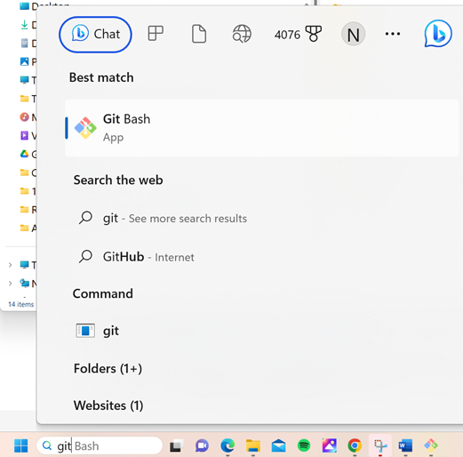
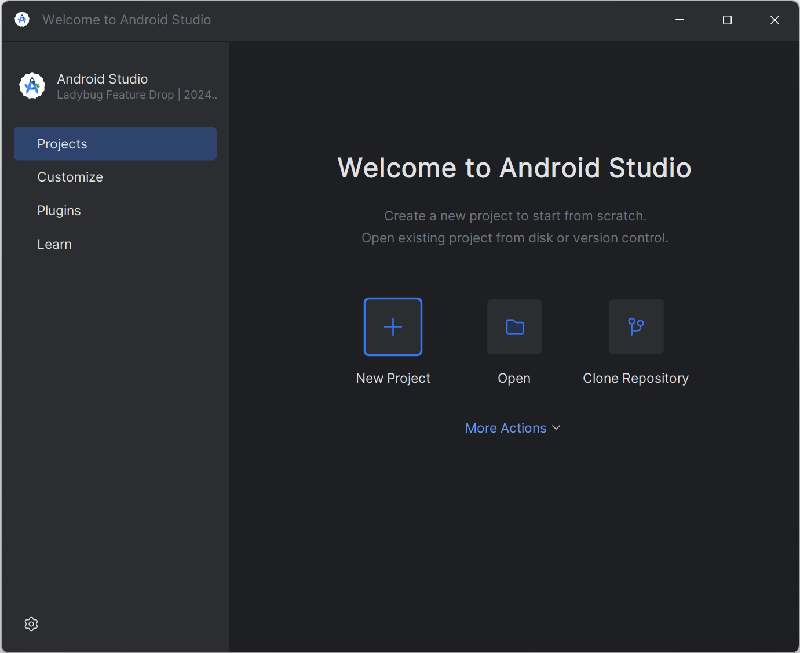
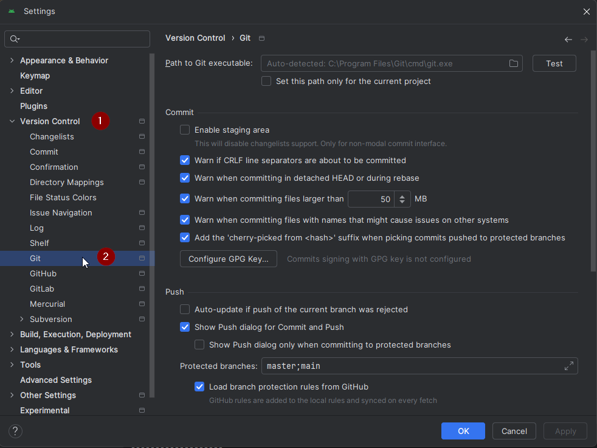
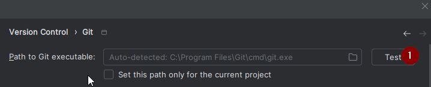
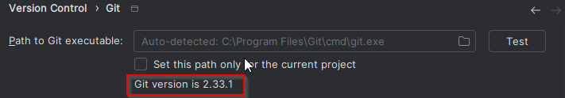

<!-- Android Studio Build, FKA Computer Build. Preserve filenames to avoid breaking URLs. -->

# Сборка в Android Studio

Это традиционный способ собрать приложение AAPS.

Приложение можно собрать и без компьютера – способом [Сборка через браузер](./BrowserBuild.md).

## Постройте сами вместо скачивания

**Приложение AAPS (файл apk) недоступно для скачивания из-за правил, связанных с медицинскими устройствами. Построить приложение для собственного использования вполне законно, но передавать копию другим не разрешается!**

Подробности смотрите на странице [Часто задаваемые вопросы по работе ИПЖ](../UsefulLinks/FAQ.md).

---

(Рекомендуемые спецификации компьютеров для сборки файла apk)=
## Требования к компьютеру и программам для сборки AAPS

* Для сборки apk может понадобиться определенная версия **[Android Studio](https://developer.android.com/studio/)**. См. таблицу ниже:

| AAPS Version            | Рекомендуемая<br/>версия<br/>Android Studio | Альтернативная<br/>версия<br/>Android Studio | Gradle | JVM |
| ----------------------- | ------------------------------------------------------- | -------------------------------------------------------- | ------ |:--- |
| 2.6.2                   | 3.6.1                                                   |                                                          | 5.6.4  | 11  |
| 2.8.2.1                 | 4.1.1                                                   |                                                          | 6.1.1  | 13  |
| [3.1.0.3](#version3100) | 2020.3.1                                                | проверено до Quail 4                                     | 7.3.3  | 17  |
| [3.2.0.4](#version3204) | Hedgehog (2023.1.1)                                     | проверено до Quail 4                                     | 8.2    | 17  |
| [3.3.1.3](#version3300) | Ladybug Feature Drop (2024.2.2)                         | проверено до Quail 4                                     | 8.10   | 21  |
| [3.3.2](#version3300)   | Meerkat (2024.3.1)                                      | проверено до Quail 4                                     | 8.11.1 | 21  |
| [3.3.2.1](#version3321) | Narwhal (2025.1.2)                                      | проверено до Quail 4                                     | 8.13   | 21  |
| [3.4.2.6](#version3426) | Panda 2 (2025.3.2)                                      | проверено до Quail 4                                     | 9      | 21  |
| [4.0.0](#version400)    | Rabbit 2 (2026.2.2)                                     | Последняя                                                | 9.8    | 21  |

«Рекомендуемая версия» поставляется с подходящей версией JVM. Рекомендуемая версия – это также минимальная версия, в которой можно собрать **AAPS**. В версии более старой, чем «рекомендуемая», собрать приложение **НЕ** получится. Если вы используете другую версию, могут возникнуть проблемы, связанные с версией JVM. Чтобы решить эти проблемы, см. страницу [Устранение неполадок Android Studio](#troubleshooting_androidstudio-uncommitted-changes). Если вашей текущей версии Android Studio нет в таблице, сначала обновите ее.

Версия Gradle связана с исходным кодом: при скачивании или обновлении исходного кода вы всегда получаете правильную версию Gradle. Она указана здесь только для справки, делать с ней ничего не нужно.

* [32-разрядные системы Windows](#troubleshooting_androidstudio-unable-to-start-daemon-process) не поддерживаются Android Studio. Помните, что **64-разрядный процессор и 64-разрядная ОС – обязательные условия.** Если ваша система НЕ соответствует этому условию, нужно заменить соответствующее оборудование, программы или всю систему.

<table class="tg">
<tbody>
  <tr>
    <th class="tg-baqh">OS (Only 64 bit)</th>
    <td class="tg-baqh">Windows 10 или новее</td>
    <td class="tg-baqh">macOS 12 или новее</td>
    <td class="tg-baqh">Любой дистрибутив Linux с поддержкой Gnome, KDE или Unity DE;&nbsp;&nbsp;GNU C Library (glibc) 2.31 или новее</td>
  </tr>
  <tr>
    <th class="tg-baqh"><p align="center">CPU (Only 64 bit)</th>
    <td class="tg-baqh">Процессор x86_64 2017 года или новее (Intel Core i5 8-го поколения, AMD Ryzen или новее) с включенной в BIOS <a href="https://developer.android.com/studio/install" target="_blank" rel="noopener noreferrer">поддержкой виртуализации</a> (Intel VT-x или AMD-V)</td>
    <td class="tg-baqh">Apple Silicon (M1 или новее) или Intel Core 6-го поколения или новее (поддержка компьютеров Mac с Intel постепенно прекращается)</td>
    <td class="tg-baqh">Процессор x86_64 2017 года или новее (Intel Core i5 8-го поколения, AMD Ryzen или новее) с включенной в BIOS поддержкой виртуализации (Intel VT-x или AMD-V)</td>
  </tr>
  <tr>
    <th class="tg-baqh"><p align="center">RAM</th>
    <td class="tg-baqh" colspan="3"><p align="center">16 ГБ или больше (8 ГБ – абсолютный минимум только для Android Studio, рекомендуется 32 ГБ)</td>
  </tr>
  <tr>
    <th class="tg-baqh"><p align="center">Disk</th>
    <td class="tg-baqh" colspan="3"><p align="center">Не менее 32 ГБ свободного места. SSD is recommended.</td>
  </tr>
  <tr>
    <th class="tg-baqh"><p align="center">Resolution</th>
    <td class="tg-baqh" colspan="3"><p align="center">Минимум 1280 x 800 (рекомендуется 1920 x 1080)<br></td>
  </tr>
  <tr>
    <th class="tg-baqh"><p align="center">Internet</th>
    <td class="tg-baqh" colspan="3"><p align="center">Broadband</td>
  </tr>
</tbody>
</table>

**Настоятельно рекомендуется (но не обязательно) использовать SSD (твердотельный накопитель) вместо HDD (жесткого диска), потому что сборка apk-файла AAPS займет меньше времени.**  Собрать apk-файл **AAPS** можно и на HDD. Процесс сборки приложения при этом может занять много времени, но после начала можно оставить его без присмотра.

## Помощь и поддержка в процессе сборки

Если в процессе сборки приложения **AAPS** возникнут трудности, есть отдельный раздел [**Устранение неполадок Android Studio**](../GettingHelp/TroubleshootingAndroidStudio.md). Сначала загляните туда.

Если вы считаете, что в инструкции по сборке что-то неправильно, чего-то не хватает или что-то непонятно, или у вас все еще не получается, обратитесь к группе пользователей **AAPS** в [Facebook](https://www.facebook.com/groups/AndroidAPSUsers) или [Discord](https://discord.gg/4fQUWHZ4Mw). Если вы хотите что-то изменить сами (обновить снимки экрана _и т. п._), отправьте [pull request (PR)](../SupportingAaps/HowToEditTheDocs.md).

## Пошаговое руководство по созданию приложения AAPS

```{admonition} WARNING
:class: warning
Если вы уже собирали AAPS раньше, вам не нужно снова выполнять все следующие шаги.
Перейдите сразу к [руководству по обновлению](../Maintenance/UpdateToNewVersion.md)!
```

```{contents} The overall steps for building the **AAPS** apk file
:depth: 1
:local: true
```

В этом руководстве вы найдете _примеры_ снимков экрана при сборке apk-файла **AAPS**. **Android Studio** – программа, с помощью которой мы собираем apk **AAPS**, – регулярно обновляется. Поэтому снимки экрана могут немного отличаться от вашей установки, но по ним все равно можно будет пройти все шаги.

Так как **Android Studio** работает на Windows, Mac OS X и Linux, шаги на разных платформах могут немного отличаться.

(install-git-if-you-dont-have-it)=
### Установите Git

```{admonition} Why Git? 
:class: dropdown

Git – это так называемая «_система управления версиями_» (VCS).\
Git – это программа, которая позволяет отслеживать изменения в коде и работать над ним вместе с другими. С помощью Git вы скопируете исходный код **AAPS** с сайта GitHub на свой компьютер. Затем вы с помощью Android Studio на компьютере соберете приложение **AAPS** (apk). 
```

(BuildingAaps-steps-for-installing-git)=
#### Шаги по установке Git

1.  Проверьте, не установлен ли у вас уже **Git**. Для этого введите «git» в строке поиска Windows. Если вы видите **«Git bash»** или другой вариант Git, он уже установлен, и можно сразу перейти к [установке Android Studio](#Building-APK-install-android-studio):




2. Если Git не установлен, скачайте и установите последнюю версию для вашей системы в разделе «Download» [**здесь**](https://git-scm.com/downloads). Любая новая версия Git должна работать, выбирайте версию в соответствии с вашей системой - Mac, Windows или Linux.

**Примечание для пользователей Mac:** сайт Git также предложит вам установить дополнительную программу «homebrew», которая помогает при установке. Если вы устанавливаете Git через homebrew, то нет необходимости изменять настройки.

(Запомните_путь_к_Git)=

* Во время установки, когда вас попросят выбрать папку установки («select destination location»), запишите, _куда_ устанавливается Git («**путь установки**»). Он понадобится вам на следующем шаге. Это будет что-то вроде "C:\Program Files\Git\cmd\git.exe"

*  По мере прохождения нескольких шагов установки Git, принимайте все параметры по умолчанию.

*  Если после установки вы забыли записать, куда установлен Git, его можно найти так: введите «git» в строке поиска Windows, щелкните правой кнопкой мыши по «Git bash», выберите «Открыть расположение файла» и наведите указатель мыши на значок «Git bash» – тогда будет видно, где он установлен.

* Перезагрузите компьютер перед следующим шагом.

(Сборка-APK-установка-android-studio)=
### Установите Android Studio

- **Во время следующих шагов компьютер все время должен быть подключен к интернету, так как Android Studio скачивает несколько обновлений.**

```{admonition} What is Android Studio?
:class: dropdown
Android Studio – это программа, которая работает на вашем компьютере. It allows you to download source code from the internet (using Git) and build smartphone (and smartwatch) apps. You cannot "break" a current, looping version of **AAPS** which you might have running on a smartphone by building a new or updated app on your PC with Android Studio, these are totally separate processes. 
```

При установке Android Studio самое важное – **наберитесь терпения!** Во время установки и настройки Android Studio скачивает много файлов, и это занимает время.

```{admonition} Different UI
:class: warning
Важно: в последних версиях Android Studio изменился интерфейс. В этом руководстве шаги показаны в *новом интерфейсе*. Снимки экрана сделаны в версии «Ladybug», поэтому в более новых версиях все может выглядеть немного иначе. Если вы все еще пользуетесь старым интерфейсом, возможно, сначала стоит переключить Android Studio на новый интерфейс по [этой инструкции](#computerbuild-NewUI).
```

Версия Android Studio очень важна. Чтобы выбрать подходящую версию Android Studio, см. [инструкции выше](#Building-APK-recommended-specification-of-computer-for-building-apk-file).

Скачайте [текущую версию Android Studio](https://developer.android.com/studio) или более старую версию из [**архива**](https://developer.android.com/studio/archive) и примите условия загрузки.


Когда загрузка завершится, запустите скачанную программу, чтобы установить ее на компьютер. Возможно, вам придется принять или подтвердить предупреждения Windows о скачанных приложениях!

Установите Android Studio, нажимая «Next», как показано на следующих снимках экрана. Вам **не** нужно менять никакие настройки!


Если хотите сэкономить место на диске, можно снять галочку Android Virtual Device: для сборки **AAPS** он не нужен.


Теперь нажмите «Install»:


Когда установка завершится, нажмите «Next».


На последнем шаге нажмите «Finish», чтобы впервые запустить Android Studio.


Вас спросят, хотите ли вы помочь улучшить Android Studio. Выберите любой вариант, на следующие шаги это не повлияет.


Откроется экран приветствия установки Android Studio. Нажмите «Next».


Выберите тип установки «Standard».


Проверьте настройки и снова нажмите «Next».


Теперь нужно принять лицензионные соглашения. Слева есть два раздела (1 и 3). Выберите их по очереди и для каждого нажмите «Accept» (2 и 4) справа.

После этого можно нажать кнопку «Finish» (5).


Теперь будут скачаны и установлены некоторые пакеты Android. Наберитесь терпения и подождите.

Когда все закончится, вы увидите следующий экран, где снова можно нажать «Finish».


Теперь вы увидите экран приветствия Android Studio.




(Сборка-APK-загрузка-AAPS-кода)=
### Загрузите код AAPS

```{admonition} Why can it take a long time to download the AAPS code?
:class: dropdown

Когда **AAPS** скачивается в первый раз, Android Studio подключается через интернет к сайту GitHub и скачивает исходный код **AAPS**. This should take about 1 minute. 

Затем Android Studio с помощью **Gradle** (инструмента разработки приложений Android) определит, какие еще компоненты нужны, чтобы собрать приложение на вашем компьютере. 
```

На экране приветствия Android Studio проверьте, что слева выделен пункт «**Projects**» (1).

Затем нажмите «**Clone Repository**» (2) справа:


Теперь мы скажем программе Android Studio, откуда получить код:


* Слева должен быть выбран (по умолчанию) пункт «Repository URL» (1).
* В качестве системы управления версиями должен быть выбран "Git" (по умолчанию) (2).
* Теперь скопируйте URL-адрес:
    ```
    https://github.com/nightscout/AndroidAPS.git
 
Context | Edit Context
    ```
    и вставьте его в текстовое поле URL (3).

* Проверьте, что папки (по умолчанию) для сохранения клонированного кода на вашем компьютере еще нет (4). Можно выбрать другую папку, но обязательно запомните, где вы сохранили код!
* Теперь нажмите кнопку «Clone» (5).

```{admonition} INFORMATION
:class: note
Запишите эту папку. It is where your sourcecode is stored!
```

Теперь вы увидите экран, сообщающий, что репозиторий клонируется:


В какой-то момент Android Studio закроется и запустится снова. Вас могут спросить, доверяете ли вы этому проекту. Нажмите «Trust Project»:

  


Только для пользователей Windows: Если ваш брандмауэр запрашивает разрешение, предоставьте доступ:

 

После успешного клонирования репозитория, Android Studio откроет клонированный проект.

(computerbuild-NewUI)=
```{admonition} New UI
:class: note
Недавно в Android Studio изменился интерфейс. В новых установках Android Studio новый интерфейс включен по умолчанию!

Только если Android Studio у вас выглядит иначе, вам, возможно, нужно переключиться на новый интерфейс:
Нажмите на меню-гамбургер (☰) слева вверху и выберите **Settings** (или **Preferences** на компьютерах Apple).
В разделе **Appearance & Behavior** перейдите в **New UI** и поставьте галочку **Enable new UI**. Затем перезапустите Android Studio, чтобы начать работать в новом интерфейсе.

Если вы не нашли пункт **New UI**, не волнуйтесь: вы уже пользуетесь новым интерфейсом!
```


Когда Android Studio откроется, терпеливо подождите (это может занять несколько минут) и, главное, **не** обновляйте проект, как предлагается во всплывающем окне.

Android Studio автоматически запустит синхронизацию Gradle («Gradle project sync»), которая займет несколько минут. Видно, что она (еще) выполняется:


```{admonition} NEVER UPDATE GRADLE!
:class: warning

Android Studio может предложить обновить систему gradle. **Никогда не обновляйте gradle!** Это приведет к проблемам.
```

Только на компьютерах с Windows: может появиться уведомление о работе Защитника Windows (Windows Defender). Нажмите **Automatically** и подтвердите – так сборка пойдет быстрее!


Можно оставить синхронизацию gradle работать и уже выполнять следующие шаги.

(Сборка-APK-задать-путь-к-git-в-настройках) =
### Укажите путь к Git в настройках Android Studio

Теперь укажем Android Studio, где найти Git, который вы установили [ранее](#install-git-if-you-dont-have-it).

* Только для пользователей Windows: убедитесь, что вы перезагрузили компьютер после [установки Git](#install-git-if-you-dont-have-it). Если нет, перезагрузите его сейчас и снова откройте Android Studio.

В левом верхнем углу **Android Studio** откройте меню-гамбургер и перейдите в **File** > **Settings** (в Windows) или **Android Studio** > **Preferences** (на Mac). Откроется следующее окно. Нажмите, чтобы раскрыть список **Version Control** (1), и выберите **Git** (2)



Проверьте, может ли **Android Studio** сама найти правильный путь к Git (**Path to Git executable**), нажав кнопку «Test» (1):




Если автоматическая настройка прошла успешно, рядом с путем будет показана ваша текущая версия **Git**.

   


Если **git.exe** не находится автоматически или нажатие «Test» выдает ошибку, вы можете либо
* вручную введите путь, который вы записали [ранее](#BuildingAaps-steps-for-installing-git), или
* нажмите на значок папки (1) и вручную перейдите в папку, куда [ранее](#BuildingAaps-steps-for-installing-git) был установлен **git.exe**
* Проверьте настройки кнопкой **Test**!

  

(Сборка-APK-генерировать-подписанный-apk)=
### Соберите «подписанный» APK AAPS

```{admonition} Why does the AAPS app need to be "signed"?
:class: dropdown

Android требует, чтобы каждое приложение было _подписано_. Так приложение позже можно будет обновить только из того же надежного источника, который выпустил исходное приложение. For more information on this topic, follow [this link](https://developer.android.com/studio/publish/app-signing.html#generate-key). 

For our purposes, this just means that we generate a signing or "keystore" file and use it when we build the **AAPS** app.
```


**Важно: прежде чем продолжить, убедитесь, что синхронизация gradle успешно завершилась!**


Нажмите на меню-гамбургер слева вверху, чтобы открыть строку меню. Выберите **Build** (1), затем **Generate Signed App Bundle / APK** (2)


Выберите «APK» (1) вместо «Android App Bundle» и нажмите «Next» (2):


На следующем экране проверьте, что для «Module» выбрано «AndroidAPS.app» (1). Часть перед «.app» – это название папки, в которую вы клонировали код.

(Building-APK-wearapk)=
```{admonition} INFORMATION!
:class: note
Если вы хотите собрать apk для часов, сейчас нужно выбрать AndroidAPS.wear!
```


Нажмите «Create new...» (2) для создания хранилища ключей.

```{admonition} INFORMATION!
:class: note
Хранилище ключей нужно создать только один раз.
Если вы уже собирали AAPS раньше, НЕ создавайте новое хранилище ключей, а выберите существующее и введите его пароли!
```

**_Примечание:_** хранилище ключей – это файл, в котором хранятся данные для подписи приложения. Он зашифрован и информация защищена паролями.


* Нажмите на значок папки (1), чтобы выбрать место на компьютере для хранилища ключей.

  **Не** используйте папку, где хранится исходный код. Выберите папку, которую вы также перенесете на новый компьютер.

```{admonition} WARNING!
:class: warning
Обязательно запишите, где хранится ваше хранилище ключей. Он понадобится вам при сборке следующего обновления AAPS!
```

* Теперь придумайте простой пароль (и запишите его), введите его в поле пароля (2) и подтвердите (2).

  Пароли для хранилища ключей и для ключа не обязательно должны быть сложными. Если в будущем вы потеряете пароль, см. [Переустановка AAPS с новым хранилищем ключей](#reinstall-aaps).

```{warning}
**Не используйте специальные символы в паролях.** Для паролей хранилища ключей и ключа используйте только буквы и цифры. В частности, не используйте `$`, обратный апостроф (backtick), `"` или `\`. Если позже вы перейдете на [сборку через браузер](#aaps-ci-option2) и снова используете это хранилище ключей, эти символы могут сорвать шаг подписи, см. [Сборка через браузер: устранение неполадок](#aaps-ci-password-special-characters).
```

* По умолчанию псевдоним (3) для вашего ключа это "key0", оставьте его без изменений.

* Теперь вам нужен пароль для ключа. Для простоты можете использовать тот же пароль, что и для хранилища ключей выше. Введите пароль (4) и подтвердите его.

```{admonition} WARNING!
:class: warning
Запишите эти пароли! Они понадобятся вам при сборке следующего обновления AAPS!
```

* По умолчанию срок действия (Validity) – 25 лет, оставьте его как есть.

* Введите свои имя и фамилию (5). Больше ничего вводить не нужно, но при желании можно (6–7).

* Нажмите "OK" (8), чтобы продолжить:


На странице **Generate signed App Bundle or APK** теперь будет показан путь к вашему хранилищу ключей. Теперь снова введите пароль хранилища ключей «Key Store password» (1) и пароль ключа «Key password» (2) и поставьте галочку (3), чтобы пароли запомнились. Тогда в следующий раз при сборке apk (например, при обновлении до новой версии AAPS) их не нужно будет вводить снова. Нажмите «Next» (4):


На следующем экране выберите вариант сборки «fullRelease» (1) и нажмите «Create» (3). Запомните папку назначения, показанную в (2): позже вы найдете там собранный apk-файл!

   

Теперь Android Studio соберет apk **AAPS**. Справа внизу будет показано «Gradle Build running» (2). Процесс занимает некоторое время, в зависимости от вашего компьютера и подключения к интернету, поэтому **наберитесь терпения!** Если хотите следить за ходом сборки, нажмите на маленький молоток «build» (1) внизу Android Studio:


Теперь вы можете наблюдать за ходом построения приложения:


После завершения сборки Android Studio покажет сообщение «BUILD SUCCESSFUL». Вы увидите всплывающее уведомление, на которое можете нажать, чтобы найти файл ("locate"). Если вы это пропустили, нажмите на значок уведомлений (1), чтобы открыть уведомления, а затем на **locate** (2):


**_Если сборка не удалась, см. раздел [Устранение неполадок Android Studio](../GettingHelp/TroubleshootingAndroidStudio.md)._**

В окне Уведомления нажмите на синюю ссылку "locate":

 Откроется файловый менеджер и покажет только что собранный apk-файл.

   

Поздравляем! Теперь у вас есть apk-файл **AAPS**. В следующем разделе документации вы перенесете этот файл на смартфон.

```{tip}
Если вы, возможно, захотите в будущем пользоваться смарт-часами Android Wear, сейчас лучшее время собрать apk AAPS для Wear, чтобы он точно совпадал с вашим apk AAPS.
```

Перейдите к следующему этапу: [Перенос и установка **AAPS** на смартфон](../SettingUpAaps/TransferringAndInstallingAaps.md).


