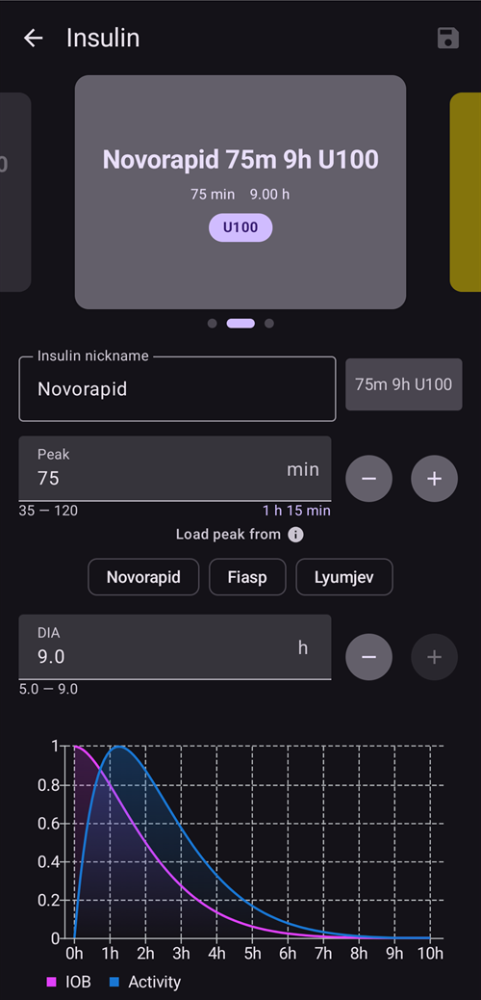
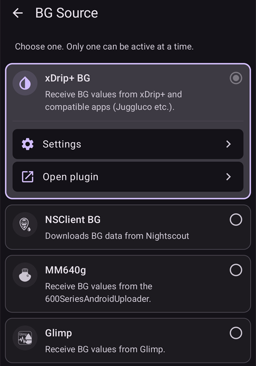
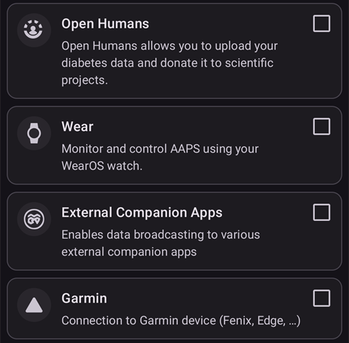
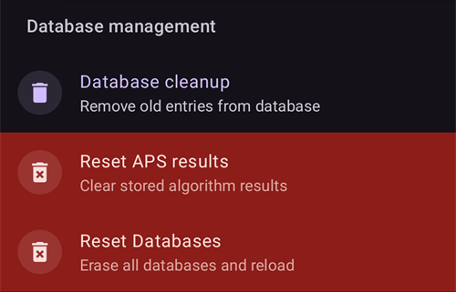

# Конфигурация (Конфигуратор)

```{admonition} Coming from AAPS v3?
:class: note
**Конфигуратор** теперь называется **Конфигурация** и находится в **меню** (☰). См. [Что изменилось в AAPS v4](#v4-changes).
```

В **Конфигурации** вы выбираете, какие модули активны (CGM, помпа, алгоритм APS, чувствительность, синхронизация, …) и открываете каждый модуль и его настройки. [Пошаговое описание](#configuration-v4) находится ниже; остальная часть страницы подробно описывает каждый раздел.

(configuration-v4)=
## Конфигурация в AAPS v4

В **AAPS** v4 нажмите **меню** (☰) в **левом верхнем** углу главного экрана и выберите **Конфигурация** (_«Настройте конфигурацию (CGM, помпа, …) и включите функции»_).


Модули разделены на **категории** — например, _Сглаживание_, _Калибровка_, _Модули чувствительности_, _APS_, _Связь_ и _Общее_. В каждой строке показаны название категории и **активный сейчас** модуль (например, _APS → OpenAPS SMB_). Нажмите на строку, чтобы открыть категорию.


Внутри категории вы видите модули, доступные для нее. В категориях с одним выбором вы выбираете активный модуль; в некоторых категориях можно выбрать несколько (_«Выберите все подходящие»_). У каждого модуля есть два действия:

- **Открыть модуль** — открывает собственный экран модуля.
- **Настройки** — открывает настройки модуля (настройки могут быть собраны в раскрывающиеся разделы).


(configuration_sync_icon)=
### Значок телефона — «синхронизировано с основного телефона»

Маленький **значок телефона** рядом с категорией или настройкой означает, что этот пункт **синхронизируется с основного телефона** — его значение или выбор передается на это устройство по каналу NSClientV3 (Nightscout).

На **клиенте** (**AAPSClient**) эти пункты **синхронизируются с основным телефоном**. Значок виден только на клиенте, поэтому его нет на снимке экрана выше: он сделан в основном приложении **AAPS**. На клиенте он обычно виден у категорий _Сглаживание_, _Калибровка_, _Модули чувствительности_ и _APS_. Как именно основной телефон и клиенты остаются согласованными — и какие настройки можно менять с каждой стороны — описано в разделе [Управление «основной телефон ↔ клиент»](#client-master-config-prefs).

Тот же значок есть и **внутри настроек**, рядом с отдельными параметрами, которые синхронизируются. В примере ниже значок стоит у _Отсечка усвоения_; настройки без значка задаются на каждом устройстве отдельно:


Пункты **без** значка настраиваются **на каждом устройстве отдельно**. Самый важный пример — само подключение **NSClientV3 (Связь)**: **адрес Nightscout**, **токен доступа** и **websockets** задаются на каждом телефоне отдельно, поэтому у них **нет** значка телефона.

---

(Config-Builder-tab-or-hamburger-menu)=
## Как открыть экран модуля

Экран каждого модуля открывается одним из этих способов (вкладок и флажка с глазом из **AAPS** v3 больше нет, см. [Что изменилось в AAPS v4](#v4-changes)):

- **Конфигурация** → категория модуля → **Открыть модуль**,
- панель **Управление** в нижней навигации, для экранов, которые вы используете чаще всего (Профиль, Настройки инсулина, Помпа, Автоматизация, Еда...),
- кнопка [Быстрый запуск](../DailyLifeWithAaps/QuickLaunch.md), которую вы добавляете сами,
- **строка поиска** на главном экране.

```{contents}
:backlinks: entry
:depth: 2
```

(ConfigBuilder_Profile)=

## Профиль

Этот модуль нельзя отключить, так как он является основной частью **AAPS**.

См. [Ваш профиль AAPS](../SettingUpAaps/YourAapsProfile.md), чтобы понять основы того, что входит в ваш **Профиль**.

(insulin)=
(Config-Builder-insulin)=
## Инсулин



В **AAPS** 4 инсулин больше не является модулем, который выбирают в **Конфигурации**. Откройте **Управление → Настройки инсулина**, чтобы настроить инсулин, который вы используете.

В редакторе инсулина можно:

- дайте инсулину **краткое имя**, чтобы его было легко узнать,
- задайте **Пик** (время до максимальной активности инсулина, в минутах) и **DIA** (время действия инсулина, в часах): введите значение или используйте кнопки **–** / **+**,
- нажмите кнопку предустановки **Загрузить пик из** — **Novorapid** (75 мин), **Fiasp** (55 мин) или **Lyumjev** (45 мин), — чтобы за один шаг ввести стандартное время пика для этого инсулина.

Допустимые диапазоны одинаковы для любого инсулина:

- **DIA**: от 5 до 9 часов (от 5 до 10 часов, если тип пациента — **Беременность**). См. [Время действия инсулина (DIA) и пик](#Config-Builder-insulin-dia), чтобы выбрать значение.
- **Пик**: от 35 до 120 минут.

Кривые **IOB** (активный инсулин) и **активности** внизу редактора меняются вместе со значениями, поэтому вы сразу видите, как ваши настройки влияют на действие инсулина.

Больше информации о профиле инсулина, как он показан в **AAPS**, [здесь](#AapsScreens-insulin-profile).

(Config-Builder-insulin-change-active)=
### Смена используемого инсулина (DIA или пик)

Инсулин с отметкой **АКТИВНЫЙ** — это тот, который использует ваш текущий профиль. Его поля серые: изменить или удалить его нельзя. Так название инсулина в вашем текущем профиле всегда совпадает с настройками, которые действительно используются.

Чтобы изменить DIA или пик, которые вы используете:

1. Откройте **Управление → Настройки инсулина**. Если экран открывается только для чтения (**✏️ карандаш** в верхней панели), нажмите на карандаш и разблокируйте настройки.
2. Нажмите **+** (_Добавить новый инсулин_). **AAPS** создает копию инсулина, показанного на экране.
3. Задайте новые **Пик** и/или **DIA**, затем нажмите значок сохранения (справа вверху).
4. Нажмите **▶** (_Активировать инсулин_) и подтвердите. Новый инсулин становится **АКТИВНЫМ**.

```{admonition} The name includes peak and DIA
:class: note
**AAPS** автоматически добавляет пик, DIA и концентрацию к названию инсулина (например, _Fiasp 55m 8h U100_), так что вы сразу отличите свои конфигурации друг от друга.
```

Старый инсулин можно удалить, когда он больше не активен.

### Предустановки «Загрузить пик из»

В **AAPS** 4 нет списка типов инсулина для выбора. Все инсулины используют одну и ту же экспоненциальную кривую активности; различаются только **Пик** и **DIA**. Предустановки **Загрузить пик из** в редакторе инсулина одним нажатием подставляют рекомендуемый пик для самых распространенных инсулинов (маленький значок ⓘ рядом с **Загрузить пик из** показывает их список со значениями пика). Потом **Пик** и **DIA** все равно можно изменить.

Меняйте пик относительно рекомендуемого значения, только если понимаете, к чему это приведет. [График кривой инсулина](#AapsScreens-insulin-profile) помогает понять эти кривые.

#### Novorapid


- рекомендуется для Humalog, Novolog и Novorapid (в **AAPS** v3 назывался _Rapid-Acting Oref_)
- Peak = 75 minutes after injection

#### Fiasp


- рекомендуется для Fiasp (в **AAPS** v3 назывался _Ultra-Rapid Oref_)
- Peak = 55 minutes after injection

(Config-Builder-lyumjev)=
#### Lyumjev


- рекомендуется для Lyumjev
- Peak = 45 minutes after injection

#### Свой пик

- В **AAPS** 4 нет отдельного типа инсулина «Free-Peak Oref»: введите любой **Пик** (от 35 до 120 минут) прямо в [редакторе инсулина](#Config-Builder-insulin), без предустановки.
- Свой пик полезен, если вы используете инсулин, которого нет в списке, или смесь разных инсулинов.

(Config-Builder-insulin-dia)=
### Время действия инсулина (DIA) и пик

```{warning}
В замкнутом цикле уменьшение DIA или пика всегда увеличивает количество введенного инсулина. DIA в AAPS работает иначе, чем в коммерческих системах AID, и неосторожные изменения этих настроек могут изменить дозы инсулина намного сильнее или слабее, чем вы ожидаете.
```

AAPS описывает ход действия инсулина математической формулой, которая настраивается с помощью **DIA** и тесно связанной с ним настройки **пика**. DIA — это теоретическое время, за которое IOB снижается до нуля, а пик — момент, когда действие инсулина сильнее всего. Так получаются кривая IOB и кривая активности, которая есть просто **скорость** снижения IOB.

Учтите, что когда AAPS работает в замкнутом цикле, периоды с [нулевым временным базалом](#Open-APS-features-super-micro-bolus-smb) — это нормально. Этот недоданный базальный инсулин полностью вычитается из IOB, поэтому на практике IOB доходит до нуля на много часов раньше заданного DIA. Вы можете отдельно посмотреть [IOB болюсов и IOB базала](#aaps-screens-iob-cob-basal-sens) на главном экране.

Чтобы настроить DIA и пик, нажмите **Управление** на главном экране, а затем **Настройки инсулина**. AAPS показывает активную настройку инсулина так:


В этом примере пик равен 55 минутам, DIA — 8 часам, а [концентрация инсулина](#Insulin-Concentration) — стандартные 100 ЕД/мл.

Из-за влияния нулевых временных базалов, описанного выше, и формулы, по которой в AAPS снижается IOB, большинство пользователей задают DIA заметно больше, чем в коммерческих системах. В целом многие считают, что **DIA** 9 ч хорошо им подходит. Когда у вас будет больше опыта с AAPS и хорошо настроенный профиль, вы можете попробовать подобрать личные значения DIA и пика с помощью информации ниже.

````{admonition} Details on the impact of DIA and peak configuration
:class: dropdown

Так как базальная скорость косвенно влияет на снижение IOB в AAPS, слишком высокая базальная скорость может скрывать слишком большое DIA, и наоборот. Поэтому разумно сначала тщательно настроить базальные скорости, а потом менять DIA и пик. Кроме того, учтите, что настройки DIA и пика влияют друг на друга: действие DIA зависит от пика, и наоборот.

Эти графики показывают точное влияние DIA и пика на кривые IOB во всем диапазоне допустимых значений.

Изменение DIA:

```{image} ../images/Profile/iob_remaining_static_peak.png
:width: 400px
```

Изменение пика:

```{image} ../images/Profile/iob_remaining_static_dia.png
:width: 400px
```

Наконец, сравнение при одновременном изменении DIA и пика. Идея в том, что оба значения меняются в одинаковой пропорции, так что `49/35 ~ 7/5`. Или так же `120/93 ~ 9/7`. Интервалы будут одинаковыми при любых исходных DIA и пике, если относительное изменение обоих одинаково.

```{image} ../images/Profile/iob_remaining_uniform.png
:width: 400px
```

Обратите внимание: если DIA и пик меняются таким образом, каждая точка кривой сдвигается на одну и ту же относительную величину.

````

#### Дополнительная информация о настройке DIA и пика

- [Технические подробности и история от предшественника AAPS, OpenAPS](https://openaps.readthedocs.io/en/latest/docs/While%20You%20Wait%20For%20Gear/understanding-insulin-on-board-calculations.html#understanding-the-new-iob-curves-based-on-exponential-activity-curves) (на английском).
- [Почему мы регулярно ошибаемся со временем действия инсулина (DIA) и почему это важно…](https://www.diabettech.com/insulin/why-we-are-regularly-wrong-in-the-duration-of-insulin-action-dia-times-we-use-and-why-it-matters/) на Diabettech.
- [Экспоненциальные кривые инсулина + Fiasp](https://web.archive.org/web/20220630154425/http://seemycgm.com/2017/10/21/exponential-insulin-curves-fiasp/) на See My CGM (архив).
- [Пересмотренная модель Humalog в замкнутом цикле](https://bionicwookiee.com/2022/04/13/revised-humalog-model-in-a-closed-loop/) и другие статьи на Bionic Wookie, где рекомендуется DIA 9 ч для Lyumjev, Fiasp, NovoRapid, Humalog.

(Config-Builder-bg-source)=
## Источник данных гликемии
Выберите источник глюкозы крови, который вы используете. Подробнее о настройке см. на странице [Совместимые CGM](../Getting-Started/CompatiblesCgms.md).



Прокрутите вниз, чтобы увидеть остальные источники:


- [xDrip+ BG](../CompatibleCgms/xDrip.md) - также для совместимых приложений, например [Juggluco](../CompatibleCgms/Juggluco.md)
- [ГК с клиента Nightscout](../CompatibleCgms/CgmNightscoutUpload.md) - только если вы знаете, что делаете, см. [Совместимые CGM](../Getting-Started/CompatiblesCgms.md).
- [MM640g](../CompatibleCgms/MM640g.md)
- Glimp - поддерживается только версия 4.15.57 и новее
- [BYODA (Build Your Own Dexcom App, собственное приложение Dexcom)](#DexcomG6-if-using-g6-with-build-your-own-dexcom-app).
- MicroTech CGM App - для CGM Aidex / LinX
- [Poctech](../CompatibleCgms/PocTech.md)
- Tomato (MiaoMiao) - приложение Tomato для устройства MiaoMiao
- [Glunovo](https://infinovo.com/) - приложение Glunovo для системы CGM Glunovo
- Intelligo - приложение Intelligo
- Syai/Ottai - для приложений Syai и Ottai (см. [Syai X1](../CompatibleCgms/SyaiTagX1.md) и [Ottai M8](../CompatibleCgms/OttaiM8.md))
- SI App - измененное приложение SI App или приложение Sibionics для CGM Sibionics
- Sino App - измененное приложение для CGM Sinocare
- Чтение уведомлений - считывает значения глюкозы из уведомлений официальных приложений CGM (Dexcom, Medtronic, Eversense и др.)
- Instara - приложение Instara
- Случайные значения ГК - создает случайные данные ГК для тестирования. Его можно включить только в инженерной сборке (для разработчиков) с **Виртуальной помпой**, поэтому в обычной установке **AAPS** его использовать нельзя.

## Smoothing


См. [Сглаживание данных гликемии](../CompatibleCgms/SmoothingBloodGlucoseData.md).

## Калибровка

Выберите, как **AAPS** обрабатывает значения, которые получает от вашего сенсора:

- **Без калибровки**: значения сенсора используются как есть. Используйте этот вариант, если сенсор уже откалиброван на заводе и точен. Это значение по умолчанию.
- **Линейная калибровка**: **AAPS** исправляет значения сенсора с помощью наклона и смещения, которые рассчитывает по вашим измерениям глюкометром.

Как использовать **Линейную калибровку**:

1. Выберите **Линейная калибровка** в категории **Калибровка**.
2. Когда вы ставите новый сенсор, запишите замену сенсора: используйте **Отслеживать замену датчика** на экране калибровки или введите установку сенсора CGM в Портале терапии. Так **AAPS** знает, когда началась сессия сенсора. Если **AAPS** видит разрыв в показаниях больше 30 минут, он может попросить вас отметить замену сенсора; этот запрос появляется только на основном телефоне, не на клиенте.
3. Откройте модуль и нажмите **Добавить калибровку**. Введите значение глюкометра. **AAPS** связывает его со значением сенсора за последние 10 минут.

Калибровка принимается, только если:

- замена сенсора записана и с тех пор прошло не менее **2 часов** (прогрев),
- ваша глюкоза стабильна. Если она меняется слишком быстро, диалог сообщает об этом и показывает предел,
- есть показание CGM за последние 10 минут,
- она относится к текущему моменту. Старые значения глюкометра ввести нельзя.

Как работает коррекция:

- **AAPS** проводит прямую линию через пары текущего сенсора: `corrected value = slope × sensor value + offset` (исправленное значение = наклон × значение сенсора + смещение).
- Новые пары весят больше, чем старые: пара возрастом 2 дня весит примерно 37%, пара возрастом 4 дня — примерно 14%. Поэтому линия следует за сенсором, когда его значения смещаются.
- Нужно не менее **2 пар**.
- Если пары находятся близко друг к другу (разница меньше 54 мг/дл / 3 ммоль/л), значения только сдвигаются (смещение, без наклона).
- Наклон удерживается в пределах от 0,55 до 1,6. Наклон за пределами этого диапазона ограничивается ближайшим значением.
- Предел безопасности: если коррекция при 100 мг/дл (5,5 ммоль/л) была бы больше ±30 мг/дл (1,7 ммоль/л), коррекция не применяется. Это защищает вас от неверной записи.

Что это меняет:

- Исправленное значение используется везде: ГК на главном экране, график и цикл. Сами показания сенсора не меняются. Коррекция применяется поверх них, также к более ранним показаниям текущего сенсора.
- Новая замена сенсора начинает все с нуля. Пары от прежних сенсоров больше не учитываются.
- На графике калибровка показана меткой на значении измерения глюкометром.
- Калибровки синхронизируются через Nightscout, поэтому ваши клиенты показывают те же исправленные значения.

Проверка и удаление записей:

- **Открыть модуль** показывает состояние (например, _наклон 0,85, коррекция в середине диапазона -0,4_), график ваших пар с линией и список записей.
- Если запись неверна (например, у вас на пальце был сахар), нажмите значок корзины рядом с ней. Линия сразу рассчитывается заново.

```{admonition} Using xDrip+ as BG source?
:class: note
У xDrip+ есть своя калибровка. Калибруйте только в одном месте, чтобы значения сенсора не исправлялись дважды.
```

```{admonition} Calibrate with care
:class: warning
Неверное значение глюкометра приводит к неверным значениям глюкозы и, значит, к неверным дозам инсулина. Мойте руки перед измерением и не калибруйте, когда глюкоза быстро меняется.
```


(Config-Builder-pump)=
## Pump
Select the pump you are using. Больше информации о настройке см. на странице [Совместимые помпы](../Getting-Started/CompatiblePumps.md).


Прокрутите вниз, чтобы увидеть все драйверы помп:


Когда вы выбираете другую помпу, **AAPS** просит подтвердить изменение:


- [Dana R](../CompatiblePumps/DanaR-Insulin-Pump.md)
- Dana R Korean (for domestic DanaR pump)
- Dana Rv2 (DanaR pump with unofficial firmware upgrade)
- [Dana-i/RS](../CompatiblePumps/DanaRS-Insulin-Pump.md)
- [Accu Chek Insight](../CompatiblePumps/Accu-Chek-Insight-Pump.md)
- [Accu Chek Combo](../CompatiblePumps/Accu-Chek-Combo-Pump-v2.md)
- Omnipod для [Omnipod Eros](../CompatiblePumps/OmnipodEros.md)
- Dash для [Omnipod DASH](../CompatiblePumps/OmnipodDASH.md)
- [Medtronic](../CompatiblePumps/MedtronicPump.md)
- [Diaconn G8](../CompatiblePumps/DiaconnG8.md)
- [EOPatch2](../CompatiblePumps/EOPatch2.md)
- [Medtrum](../CompatiblePumps/MedtrumNano.md)
- [Equil 5.3](../CompatiblePumps/Equil5.3.md)
- [Carelevo](../CompatiblePumps/CareLevo.md)
- Виртуальная помпа: открытый цикл - только предложения **AAPS**
  - когда вы делаете первые шаги с **AAPS**, во время первых [целей](../SettingUpAaps/CompletingTheObjectives.md)
  - для помпы, у которой еще нет драйвера

(config-builder-wrong-pump-data)=
### Сообщение: «Данные поступают с другой помпы»

**AAPS** запоминает помпу, к которой подключен (тип помпы и серийный номер). Если он получает данные с другой помпы, например после замены вашей помпы на новую той же модели, он показывает это сообщение и игнорирует данные с этой помпы:


Чтобы использовать новую помпу, смените драйвер помпы: выберите **Виртуальная помпа**, подтвердите, затем снова выберите свою помпу. Затем **AAPS** регистрирует помпу, к которой подключен сейчас.

(Config-Builder-sensitivity-detection)=

## Определение чувствительности


Select the type of sensitivity detection. Подробнее о разных вариантах [читайте здесь](../DailyLifeWithAaps/SensitivityDetectionAndCob.md). This will analyze historical data on the go and make adjustments if it recognizes that you are reacting more sensitively (or conversely, more resistant) to insulin than usual. Подробнее о том, как рассчитывается сам коэффициент чувствительности, см. [Основные функции AAPS > Autosens](#Open-APS-features-autosens).

Вы можете посмотреть свою чувствительность на главном экране на [дополнительном графике](#AapsScreens-section-g-additional-graphs): выберите SENS% и смотрите на белую линию. Обратите внимание: чтобы определение чувствительности/[Autosens](#Open-APS-features-autosens) могло автоматически менять количество вводимого инсулина, вы должны быть на [Цели 8](#objectives-objective8). Before reaching that objective, the Autosens percentage / the line in your graph is displayed for information only.

### Настройки усваиваемости
Если вы используете Oref1 с **SMB**, вы должны изменить **min_5m_carbimpact** на 8. Это значение используется только при пропусках в показаниях **CGM** или когда физическая нагрузка «съедает» весь рост глюкозы крови, по которому **AAPS** иначе уменьшал бы COB. В моменты, когда [усвоение углеводов](../DailyLifeWithAaps/CobCalculation.md) нельзя динамически рассчитать по реакции вашей крови, оно применяет к вашим углеводам снижение по умолчанию. Basically, it is a failsafe.

(Config-Builder-aps)=
## Система ИПЖ


Select the desired APS algorithm for therapy adjustments. Подробности работы выбранного алгоритма можно посмотреть через **Открыть модуль**.
- OpenAPS AMA
  - Advanced Meal Assist (AMA): старый алгоритм, больше не рекомендуется.
  - Проще говоря, польза в том, что после болюса на еду система может быстрее повысить временный базал, ЕСЛИ вы правильно вводите углеводы.
- [OpenAPS SMB](#Open-APS-features-super-micro-bolus-smb)
  - Super Micro Bolus (SMB): самый новый алгоритм, рекомендуется для всех пользователей.
  - В отличие от AMA, SMB управляет уровнем глюкозы не временными базальными скоростями, а в основном маленькими **супер микроболюсами**.
  - Примечание: рекомендуется использовать этот алгоритм с самого начала, хотя SMB на самом деле не будут вводиться до [Цели 9](#objectives-objective9).
- [Auto ISF](#Open-APS-features-auto-isf)
  - Экспериментальный алгоритм для опытных пользователей. Он появляется в списке только после прохождения целей.

При переходе с алгоритма AMA на SMB нужно вручную изменить _min_5m_carbimpact_ на **8** (значение по умолчанию для SMB) в [Настройки → Настройки усваиваемости](#Preferences-min_5m_carbimpact).

## Замкнутый цикл

Этот модуль нельзя отключить, так как он является основной частью **AAPS**.


## Constraints


### Objectives

В **AAPS** есть обучающая программа (ряд целей), которую нужно пройти шаг за шагом. This should guide you safely through setting up a closed loop system.

Больше информации см. на странице [Прохождение целей](../SettingUpAaps/CompletingTheObjectives.md).

## Связь

В этой категории (в **AAPS** v3 она называлась **Синхронизация**) вы выбираете, нужно ли и куда **AAPS** отправлять ваши данные.


Прокрутите вниз, чтобы увидеть остальную часть списка:



### Клиент NSV3

Можно использовать как [сервер отчетности](../SettingUpAaps/SettingUpTheReportingServer.md) и/или для [удаленного мониторинга](../RemoteFeatures/RemoteMonitoring.md), [удаленного управления](../RemoteFeatures/RemoteControl.md).

Чтобы настроить синхронизацию NSClientV3, см. [Синхронизация с сервером отчетности](#SetupWizard-synchronization-with-the-reporting-server-and-more).

### Tidepool

Можно использовать как [сервер отчетности](../SettingUpAaps/SettingUpTheReportingServer.md).

См. [Tidepool](../SettingUpAaps/Tidepool.md).

### xDrip

Используется для **отправки** данных, например значений глюкозы и терапии, в xDrip+ на том же телефоне. В его настройках есть также **Отправлять статус в xDrip+** — строка состояния с IOB и COB, которую показывают xDrip+ и некоторые приложения-компаньоны для часов.

### Проект Open Humans

См. [Загрузчик Open Humans](../SupportingAaps/OpenHumans.md).

(Config-Builder-wear)=
### Смарт-часы Wear
Следите за **AAPS** и управляйте им с часов Wear OS. Настройка часов описана на странице [Настройка AAPS на часах Wear OS](../WearOS/WearOsSmartwatch.md). После включения модуля выберите его параметры в [Настройки > Смарт-часы Wear](#preferences-wear). Работа с часами описана на странице [Работа AAPS с помощью смарт-часов на базе Wear OS](../RemoteFeatures/RemoteControlWearOS.md).

(external-companion-apps)=
### Внешние приложения-компаньоны

Передает данные о состоянии **AAPS** на телефоне, чтобы другие установленные на нем приложения могли их показывать — например, приложения-компаньоны для часов или виджетов. Рассылка содержит глюкозу и тренд, IOB, COB, базал и временный базал, название профиля, состояние цикла, заряд батареи телефона и помпы, уровень резервуара и ход болюса. Включайте ее, только если об этих данных просит используемое вами приложение-компаньон.

Известные приложения, которые читают эти данные: [WatchDrip+](https://bigdigital.home.blog/) (часы Xiaomi и Amazfit), [GlucoDataHandler](https://github.com/pachi81/GlucoDataHandler) (дополнения и виджеты Wear OS, а также Android Auto через GlucoDataAuto) и приложение G-Watch. Их настройка описана на странице [Смарт-часы и AAPS](#watches-external-companion-apps). Некоторые из них также используют **Отправлять статус в xDrip+** из модуля **xDrip** выше для строки состояния с IOB и COB.

В ранних версиях этот модуль назывался **Samsung Tizen**, по названию [приложения G-Watch для часов Samsung Tizen](#Watchfaces-tizen), для которого он был сделан сначала.

### Garmin

Связь с устройством Garmin (Fenix, Edge...)
## Терапия
Откройте **меню** (☰) и выберите [История терапии](#aaps-screens-treatments), чтобы увидеть записанную терапию. Если вы хотите изменить или удалить запись (например, вы съели меньше углеводов, чем ожидали), выберите «Удалить» и введите новое значение (при необходимости измените время) через **Терапия → Углеводы** в нижней навигации (см. [Углеводы](#screens-bolus-carbs)).

## General

В **AAPS** 4 в категории **Общее** в **Конфигурации** есть только **Autotune**. Остальные функции, описанные ниже, доступны всегда, и их больше не нужно включать здесь; в каждом абзаце сказано, где их найти.


### Общие замечания

[Главный экран](#AapsScreens-the-homescreen) **AAPS** больше не является модулем и не имеет своих настроек в **Конфигурации**. Параметры, которые раньше были здесь, теперь находятся в **Настройках** (значок шестеренки): [Показывать заметки в диалогах](#Preferences-show-notes-field-in-treatments-dialogs), [Индикаторы состояния](#Preferences-status-lights) и [Процент болюса](#Preferences-deliver-this-part-of-bolus-wizard-result), который использует мастер болюса. Параметр суперболюса из **AAPS** 3.x [недоступен как настройка](#Preferences-advanced-settings-overview) в **AAPS** 4.

(Config-Builder-actions)=
### Действия

Вкладки «Действия» из **AAPS** 3.x больше нет. Ее кнопки теперь находятся в панели **Управление** — см. [Куда делась вкладка «Действия»?](#screens-action-tab).

### Автоматизация

**Управление → Автоматизация** позволяет управлять вашими правилами [автоматизации](../DailyLifeWithAaps/Automations.md), начиная с [Цели 10](#objectives-objective10).

(Config-Builder-sms-communicator)=
### СМС-коммуникатор
Позволяет опекунам на расстоянии управлять некоторыми функциями **AAPS** через SMS; больше информации о настройке см. в [SMS команды](../RemoteFeatures/SMSCommands.md).

### Еда
**Управление → Еда** показывает предустановки продуктов из базы продуктов Nightscout; больше информации о настройке см. в [Nightscout Readme](https://github.com/nightscout/cgm-remote-monitor#food-custom-foods) (на английском).

Примечание: записи нельзя использовать в калькуляторе **AAPS**. (View only)

(Config-Builder-autotune)=
### Autotune

Вы можете включить Autotune, см. [здесь](../AdvancedOptions/Autotune.md).

### Обслуживание

Откройте **меню** (☰) и выберите **Обслуживание**, чтобы экспортировать / импортировать настройки и управлять файлами журналов.




### Конфигуратор

Теперь называется **Конфигурация**: это текущая страница.