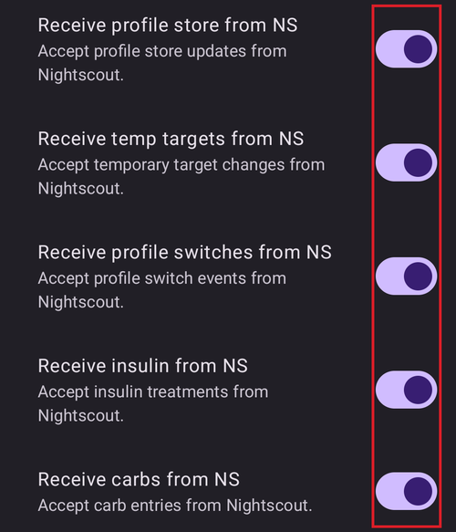
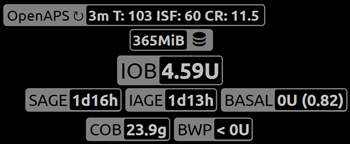

# Nightscout

(Nightscout-security-considerations)=

## Вопросы безопасности

Nightscout – это сервер отчетности и мониторинга для **AAPS**: **AAPS** загружает туда ваши данные, а вы или ваши опекуны смотрите их на сайте Nightscout или в приложениях для фолловеров. На нем хранятся ваши медицинские данные, профили и терапия, поэтому стоит подумать о защите вашего сайта Nightscout.

В **AAPS** 4 удаленное управление не идет через сайт Nightscout. Пока включено управление с клиента ([защищенный режим](#client-master-control-hardened-mode)), терапия или цели, введенные прямо в Nightscout, **не применяются** в **AAPS**. Вместо этого удаленные команды приходят из сопряженного **AAPSClient** – смотрите [Управление «основной телефон ↔ клиент»](#client-master-control).

Будьте предельно осторожны, если используете Nightscout как источник данных ГК для AAPS.

### Nightscout settings

Доступ посторонних к сайту Nightscout может быть запрещен при помощи [ролей верификации](https://nightscout.github.io/nightscout/security): делитесь своим URL-адресом с token (маркером) `для чтения`, но не `для администрирования`.

`API_SECRET `для Nightscout является главным паролем вашего сайта: не делитесь им публично.

(Nightscout-aaps-settings)=

### Настройки AAPS

Прием данных из Nightscout (изменения профиля, терапия, ...) не обязателен и по умолчанию выключен. Переключатели, описанные ниже, скрыты, пока включено управление с клиента (защищенный режим), а также в [простом режиме](#preferences-simple-mode).

* Откройте настройки **Синхронизация** модуля NSClientV3 одним из способов: 1) **Настройки** (значок шестеренки на главном экране) -> **NSClientV3** -> **Синхронизация**, или 2) **Конфигурация** (меню ☰) -> **Связь** -> «**Настройки**» под NSClientV3.
* Включите «Загружать данные в NS».
* «Загрузить данные ГК в Nightscout» находится в настройках вашего источника ГК (**Конфигурация → Источник ГК → Настройки**). Включите его, если только источник данных ГК для AAPS не Nightscout: в этом случае **не** включайте его.
* Не включайте «Получать данные CGM из NS», если только Nightscout не является вашим источником данных ГК.

#### Не синхронизировать с Nightscout

Если все параметры «Получать … из NS» выключены, AAPS не будет использовать никакие изменения из Nightscout:

#### Принимать изменения Nightscout

Если включить эти параметры, можно менять настройки AAPS через Nightscout: изменять и переключать профили, задавать временные цели и добавлять углеводы, которые AAPS будет учитывать. Они показаны, только когда управление с клиента и простой режим выключены.  
Учтите, что инсулин будет использоваться только для расчетов, как при «Не вводить болюс, только записать».

### Дополнительные параметры защиты

Поддерживайте ПО телефона в актуальном состоянии как это описано в разделе [безопасность на первом месте](#preparing-safety-first).

(Nightscout-manual-nightscout-setup)=

## Установка Nightscout вручную

Предполагается, что у вас уже есть сайт Nightscout. Если нет, полные инструкции по настройке смотрите на странице [Nightscout](http://nightscout.github.io/nightscout/new_user/). Ниже приведены настройки, которые вам также нужно добавить на ваш сайт Nightscout. Ваш сайт Nightscout должен быть версии 15 или выше. Проверьте, что у вас установлена [последняя версия](https://nightscout.github.io/update/update/#updating-your-site-to-the-latest-version), иначе приложение AAPS покажет сообщение об ошибке.

* [Редактирование переменных](https://nightscout.github.io/nightscout/setup_variables/#nightscout-configuration)

* Добавьте или измените переменные следующим образом:
  
  * `ENABLE` = `careportal boluscalc food bwp cage sage iage iob cob basal dbsize pushover pump openaps`
  * ` DEVICESTATUS_ADVANCED ` = ` true `
  * `SHOW_FORECAST` = `openaps`
  * `PUMP_FIELDS` = `reservoir battery clock`
  * Для [ мониторинга помпы ](https://github.com/nightscout/cgm-remote-monitor#pump-pump-monitoring) можно задать различные оповещения, в частности, рекомендуется % заряда батареи: 
    * ` PUMP_WARN_BATT_P ` = ` 51 `
    * ` PUMP_URGENT_BATT_P ` = ` 26 ` 

* Сохраните изменения. Ваш сайт Nightscout теперь должен разрешитьотображение таблеток. Можно принудительно отобразить их по умолчанию, добавив их в `SHOW_PLUGINS`.
  
  * `SHOW_PLUGINS` = `careportal boluscalc food bwp cage sage iage iob cob basal dbsize pushover pump openaps`
  
  

## Nightscout как оплачиваемый SaaS (Software в качестве услуги)

Используйте веб-интерфейс поставщика сервиса для внесения переменных. При необходимости свяжитесь со службой поддержки поставщика.