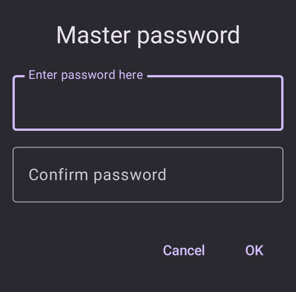
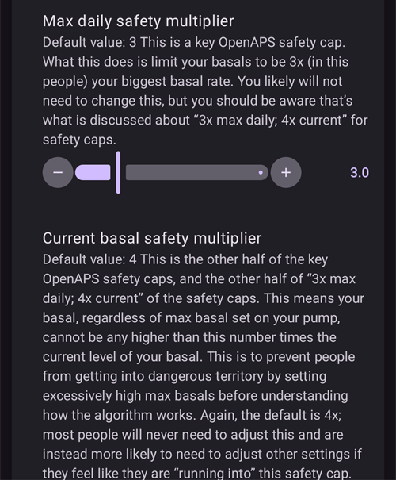
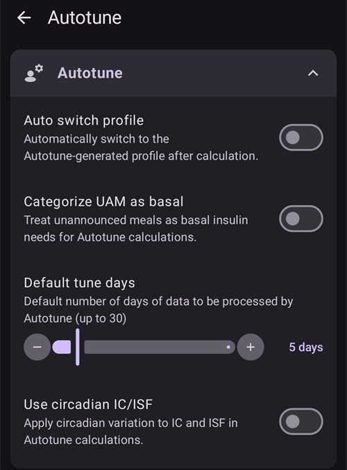
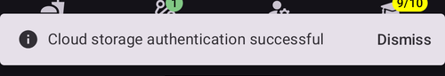
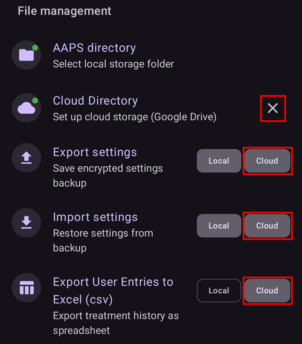

# Настройки

В **AAPS** v4 настройки находятся на экране **Настройки**. Открыть их можно тремя способами — подробнее см. [Изменение конфигурации AAPS](../SettingUpAaps/ChangeAapsConfiguration.md):

1. Нажмите значок **Настройки** (шестеренка) в правом верхнем углу главного экрана: все настройки, сгруппированные в раскрывающиеся разделы.
2. В **Конфигурации** нажмите «**Настройки**» под включенным модулем: только настройки этого модуля.
3. Используйте **строку поиска** вверху главного экрана: просто начните вводить часть текста, который ищете. Так можно найти отдельные настройки (даже те, которых не видно на экране настроек), диалоги и документацию.


- **Разделы** открываются и закрываются нажатием. Какие разделы вы видите, зависит от включенных модулей и от [простого режима](#preferences-simple-mode).


```{contents}
:backlinks: entry
:depth: 2
```

(Preferences-general)=
## General


**Единицы**

- Выберите единицы ммоль/л или мг/дл, как вам удобно.

**Language**

- По умолчанию **AAPS** использует язык телефона (рекомендуется).

- Если вы хотите, чтобы язык **AAPS** отличался от языка телефона, выберите его здесь. В Android 13 и новее **AAPS** регистрирует его в Android как собственный язык приложения, поэтому все его экраны, главный экран, виджеты и формат чисел следуют ему.
- The setting is always called **Language**, and each language is listed in its own name (for example *Deutsch*, *Français* or *Polski*). So you can find your language again, even when **AAPS** is set to a language you cannot read.

- Когда вы меняете язык, тексты **AAPS** сразу переключаются на новый язык. Если некоторые тексты все еще на старом языке, перезапустите **AAPS**.
- В Android 12 эта настройка не показана: **AAPS** всегда использует язык телефона.
- Настройка скрыта в [простом режиме](#preferences-simple-mode).

(preferences-simple-mode)= **Простой режим**

**Простой режим** включен по умолчанию при первой установке **AAPS**. В **простом режиме** многие настройки скрыты, а вместо них используются заранее заданные значения. Выключите простой режим, когда освоитесь с интерфейсом и настройками **AAPS**.

**Insulin concentration support**

- Включает поддержку разных концентраций инсулина (U50, U200, ...). Включайте это, только если вы действительно используете концентрацию, отличную от U100, и внимательно прочитайте предупреждения.
- Настройка скрыта в [простом режиме](#preferences-simple-mode).

**Keep screen on**

- Заставляет Android постоянно держать экран включенным. This is useful for presentations etc. But it consumes a lot of battery power. Therefore, it is recommended to connect the smartphone to a charger cable.

**Имя экземпляра**

- Имя человека, который пользуется этим телефоном. Оно позволяет отличить этот экземпляр **AAPS** в отчетах и при синхронизации, например если в вашей семье **AAPS** пользуются двое детей с диабетом 1 типа.
- Используется в именах файлов экспортированных настроек.
- Показывается на [циферблате Dual](../WearOS/WearOsSmartwatch.md).

(Preferences-skin)=
### Skin

Выбора темы оформления из **AAPS** 3.x (Original, Low resolution, Large display...) в **AAPS** 4 больше нет. Новый интерфейс сам подстраивается под ваш экран, а цветовую схему можно изменить в разделе [Оформление](#preferences-appearance).

(preferences-appearance)=
## Оформление


(Preferences-range-for-visualization)=
### Range for visualization

Задайте верхнюю и нижнюю границы для графика ГК на главном экране **AAPS** и на смарт-часах. Эти значения используются только для отображения на графике, это не целевой диапазон ГК. Пример: 70 - 180 мг/дл или 3,9 - 10 ммоль/л

(Preferences-show-notes-field-in-treatments-dialogs)=
### Show notes in dialogs

Дает возможность добавить короткие примечания к терапии (мастер болюса, углеводы, инсулин...)

Настройка скрыта в [простом режиме](#preferences-simple-mode).

### App Color Scheme

Выберите светлую тему, темную тему или тему по системной настройке телефона.

(Preferences-protection)=
## Защита


Whatever protection you choose (custom password, PIN or biometric), the prompt also accepts your **master password**. If you forget a custom password or PIN, enter the master password instead.

A custom password or PIN that you never entered counts as no protection: **AAPS** does not ask for it.

(Preferences-master-password)=
### Master password

Обязательно, чтобы можно было выполнить [экспорт настроек](../Maintenance/ExportImportSettings.md), так как начиная с версии 2.7 они шифруются.

Если вы забыли главный пароль, см. [Как сбросить главный пароль?](#FAQ-reset-master-password)

**Biometric protection may not work on OnePlus phones. This is a known issue of OnePlus on some phones.**



(Preferences-settings-protection)=
### Settings protection

- Защитите настройки паролем или биометрической аутентификацией телефона (например, если [**AAPS** пользуется ребенок](../RemoteFeatures/RemoteMonitoring.md)). Если включить эту функцию, при каждом открытии любого экрана, связанного с настройками, будет запрашиваться аутентификация.

- Экраны управления (**Профиль**, **Настройки инсулина**, **Временная цель**, **Мастер быстрых настроек**) тогда открываются **только для чтения**. Вы по-прежнему можете включить или использовать запись, но добавление, редактирование, копирование и удаление скрыты, пока вы не разблокируете настройки. См. [Защита настроек теперь блокирует и экраны управления](#v4changes-read-only-management).

- Настраиваемый пароль нужен, если вы хотите использовать главный пароль только для защиты [экспортированных настроек](../Maintenance/ExportImportSettings.md), а для изменения настроек использовать другой.

- Если вы используете настраиваемый пароль, нажмите на строку «Пароль настроек», чтобы задать пароль, как описано [выше](#Preferences-master-password).

### Application protection

Если приложение защищено, для открытия **AAPS** нужно ввести пароль или использовать биометрическую аутентификацию телефона, а также снова, когда вы возвращаетесь в приложение после окончания [тайм-аута защиты](#Preferences-password-and-pin-retention). Until you do, the screen stays covered: your BG, IOB and graphs cannot be read behind the prompt.

If you cancel the prompt or the authentication fails, **AAPS** shows *Authorization failed* and closes its screen. It still runs in the background if it was opened successfully before.

### Bolus protection

- Защита болюса может быть полезна, если **AAPS** пользуется маленький ребенок, а вы подаете [болюс через SMS](../RemoteFeatures/SMSCommands.md).

- **Защиту болюсов** можно выбрать, только когда задана **Защита настроек** (уровень 2).

- В примере ниже защита болюсов использует **Главный пароль**: **AAPS** запрашивает его перед открытием диалога терапии, например **Инсулин**. При выборе **Биометрия**, если биометрическая аутентификация не работает, вместо нее можно ввести главный пароль.


(Preferences-password-and-pin-retention)=
### Удержание пароля и ПИН-кода

**Тайм-аут защиты** задает, как долго (в секундах) настройки или функции болюса остаются разблокированными после успешного ввода пароля.

## Безопасность терапии


(preferences-patient-type)=
### Patient age

- Ограничения безопасности устанавливаются на основе возраста, который вы выбираете в этом параметре.
- Если вы начинаете достигать верхних ограничений (как например максимальный болюс) пора подняться на один шаг вверх (например, от ребенка перейти к подростку - прим. перев.).
- Выбирать возраст выше реального — плохая идея: это может привести к передозировке при вводе неверного значения в диалоге инсулина (например, если пропустить десятичный разделитель).
- Если вы хотите знать точные значения этих жестко заданных ограничений безопасности, найдите функцию алгоритма, которую вы используете, на [этой странице](../DailyLifeWithAaps/KeyAapsFeatures.md).

(Preferences-maximum-bolus)=
### Максимальный болюс

- Задает максимальное количество болюсного инсулина в единицах, которое **AAPS** может подать за один раз.
- Эта настройка существует как ограничение безопасности для предотвращения подачи чрезмерного болюса из-за случайного ввода или ошибки пользователя.
- Рекомендуется установить это значение как разумный предел, приблизительно соответствующий максимальному количеству болюсного инсулина, который вы когда-либо можете подать на еду или на коррекцию.
- Это ограничение также налагается на результаты калькулятора болюса.

### Максимум углеводов

- Задает максимальное количество углеводов в граммах, на которое калькулятор болюса **AAPS** может рассчитать дозу.
- Эта настройка существует как ограничение безопасности для предотвращения подачи чрезмерного болюса из-за случайного ввода или ошибки пользователя.
- Рекомендуется установить это значение как разумный предел, приблизительно соответствующий максимальному количеству углеводов, которые вам когда-либо понадобится на еду.

## Источник ГК

Настройки выбранного [источника ГК](#Config-Builder-bg-source) показываются в отдельном разделе. Например, для **ГК с xDrip+**:


- **Загружать данные ГК в Nightscout**: **AAPS** загружает полученные значения ГК в Nightscout. Включайте это, только если само приложение CGM их еще не загружает.
- **Записывать замену сенсора**: автоматически создавать событие терапии «замена сенсора», когда сенсор установлен.

## Главный экран

В **AAPS** 3.x эти настройки были собраны в разделе «Overview». В **AAPS** 4 они настраиваются прямо из элементов главного экрана, к которым относятся.

(Preferences-buttons)=
### Кнопки быстрого запуска

Задайте, какие кнопки действий видны на главном экране: нажмите маленькую **шестеренку** внизу по центру главного экрана («Настроить быстрый запуск») и **добавьте** действия, к которым нужен быстрый доступ (терапия, действия CGM, записи портала терапии...).


(Preferences-quick-wizard)=
### Мастер быстрых настроек

Создайте свои кнопки для определенных стандартных блюд или перекусов, которые будут показаны на главном экране. Удобно для стандартных блюд, которые вы часто едите.

Для каждой кнопки вы задаете углеводы и способ расчета болюса. Затем задайте, в какой период времени кнопка будет видна на главном экране — только одна кнопка на период. Кнопка не будет видна вне заданного периода времени или если у вас достаточно IOB, чтобы покрыть углеводы, заданные в кнопке мастера быстрых настроек. Если для разных приемов пищи заданы разные периоды, на главном экране всегда будет подходящая кнопка стандартного блюда в зависимости от времени суток.

Чтобы управлять предустановками мастера быстрых настроек, введите «QuickWizard» в строке поиска на главном экране и откройте **Мастер быстрых настроек - Управление предустановками мастера быстрых настроек**.

Если нажать кнопку мастера быстрых настроек, **AAPS** рассчитает и предложит болюс на эти углеводы по вашим текущим коэффициентам (с учетом значения ГК или активного инсулина, если это настроено).

Это предложение должно быть подтверждено перед подачей инсулина.

(Preferences-default-temp-targets)=
### Default temp targets

[Временные цели (ВЦ)](../DailyLifeWithAaps/TempTargets.md) позволяют изменить целевое значение ГК на определенное время. Если задать ВЦ по умолчанию, вы сможете легко изменить цель для нагрузки, перед едой и т. д.

Нажмите на **целевой диапазон** на главном экране, чтобы открыть экран **Временная цель**. Пролистайте карточки предустановок (Ожидаемый прием пищи, Нагрузка, Гипо) и измените цель и длительность каждой предустановки в разделе **Настройки предустановки**. Preset values are:

* Ожидаемый прием пищи: цель 90 мг/дл / 5,0 ммоль/л, длительность 45 мин
* Нагрузка: цель 140 мг/дл / 7,8 ммоль/л, длительность 90 мин
* Гипо: цель 160 мг/дл / 8,9 ммоль/л, длительность 60 мин


Узнайте, как [включить временную цель](#TempTargets-where-can-i-select-a-temp-target).

### Стандартные количества инсулина для прайма/заполнения

Если вы хотите заполнить трубку или катетер через **AAPS**, используйте кнопки **Прайм/заполнение** в развернутой панели состояния на главном экране.

Количества по умолчанию для трех кнопок заполнения можно задать в настройках **Прайм/заполнение** в зависимости от длины вашего катетера. Чтобы открыть их, введите «prime» в строке поиска на главном экране.


(Preferences-status-lights)=
### Индикаторы состояния

Status lights give a visual warning for:

- сколько времени отработал сенсор
- сколько времени прошло с момента установки резервуара
- об уровне заполнения резервуара (в единицах)
- сколько времени прошло с момента установки канюли
- Срок работы батареи помпы
- Уровень заряда батареи помпы (%)

Если превышен порог предупреждения, значения показываются желтым. Если превышен критический порог, значения показываются красным.

Чтобы изменить пороги, разверните панель состояния на главном экране (стрелка справа от строки состояния) и нажмите маленький значок **Настройки** рядом с «Статус»:


Нажмите на элемент (**Катетер помпы**, **Инсулин**, **Сенсор** или **Батарея помпы**), чтобы открыть его пороги предупреждения и критический порог:


Последний параметр позволяет импортировать эти настройки из Nightscout, если они там заданы. Подробнее см. в [документации Nightscout](https://nightscout.github.io/nightscout/setup_variables/#age-pills).

(Preferences-deliver-this-part-of-bolus-wizard-result)=
### Настройки мастера болюса

Введите «bolus» в строке поиска на главном экране, чтобы открыть настройки **Мастера болюса**:


**Процент болюса** задает [процент по умолчанию](#AapsScreens-section-j) от болюса, рассчитанного в мастере болюса.

По умолчанию 100%: без коррекции. Даже если вы зададите здесь другое значение, его все равно можно изменить при каждом использовании мастера болюса. Если этот параметр равен 75% и нужен болюс 10 ед., мастер болюса предложит болюс на еду всего 7,5 ед.

При использовании [SMB](#objectives-objective9) многие подают на еду не 100% нужного инсулина, а только часть (например, 75%), а остальное делает SMB с UAM (непредвиденный прием пищи). Значение меньше 100% здесь может быть полезно:
* для людей с медленным пищеварением: если подать весь болюс сразу, может быть гипо, потому что инсулин действует быстрее, чем переваривается пища.
* чтобы оставить **AAPS** больше места самому справляться с **ростом ГК**. В обоих случаях **AAPS** восполнит недостающую часть болюса с помощью SMB, если и когда сочтет это нужным.

**Use bolus advisor**

Если параметр включен и вы используете мастер болюса при гипергликемии, вы получите предупреждение с предложением сделать предварительный болюс и поесть позже, когда **ГК** вернется в целевой диапазон.

(Preferences-advanced-settings-overview)=
### Superbolus

Параметра «Суперболюс» из **AAPS** 3.x в **AAPS** 4 больше нет в настройках.

## Замкнутый цикл

Чтобы сейчас изменить режим цикла, см. [Экраны AAPS > Главный экран > Статус цикла](#AapsScreens-loop-status).

(Preferences-minimal-request-change)=
### Минимальное изменение в открытом цикле

В режиме **Открытый цикл** вы будете получать уведомление каждый раз, когда **AAPS** рекомендует изменить базальную скорость. Чтобы уменьшить количество уведомлений, можно использовать [более широкий целевой диапазон ГК](#profile-glucose-targets) или увеличить процент в настройке «**Минимальное изменение в открытом цикле**». Он определяет относительное изменение, необходимое для активации уведомления.


## Улучшенный ассистент приема пищи (AMA) или Супер Микро Болюс (SMB)

В зависимости от настроек в [Конфигурация > APS](../SettingUpAaps/ConfigBuilder.md) можно выбрать один из двух алгоритмов:

- [Улучшенный ассистент приема пищи (OpenAPS AMA)](#Open-APS-features-advanced-meal-assist-ama) — алгоритм в состоянии 2017 года
- [Супер микроболюс (OpenAPS SMB)](#Open-APS-features-super-micro-bolus-smb) — самый новый алгоритм, рекомендуется для начинающих

Начиная с [**AAPS** версии 3.3](#version3300) функция [Динамический ISF](../DailyLifeWithAaps/DynamicISF.md) перенесена в OpenAPS SMB.

### OpenAPS AMA

Все настройки OpenAPS AMA описаны в отдельном разделе [Основные функции AAPS > Улучшенный ассистент приема пищи (AMA)](#Open-APS-features-advanced-meal-assist-ama).

(Preferences-openaps-smb-settings)=
### OpenAPS SMB

Все настройки OpenAPS SMB описаны в отдельном разделе [Основные функции AAPS > Супер микроболюс (SMB)](#Open-APS-features-super-micro-bolus-smb).

Список настроек, которые вы видите, зависит от вашего прогресса в [целях](../SettingUpAaps/CompletingTheObjectives.md) и от [простого режима](#preferences-simple-mode). При новой установке показан только параметр **Использовать динамическую чувствительность**. Когда цели пройдены, раздел выглядит так:


**Дополнительные настройки** внизу раздела содержат значения, которые обычно не нужно менять:




## Настройки усваиваемости


(Preferences-min_5m_carbimpact)=
### SMB min 5m carbs impact (min_5m_carbimpact)

Настройка скрыта в [простом режиме](#preferences-simple-mode).

Алгоритм использует BGI (влияние на ГК), чтобы определить, когда [углеводы усвоены](../DailyLifeWithAaps/CobCalculation.md).

Когда усвоение углеводов нельзя рассчитать по реакции ГК, **AAPS** применяет к углеводам скорость усвоения по умолчанию. Basically, it is a failsafe. Это значение используется только при пропусках в данных **CGM** или когда физическая нагрузка «съедает» весь рост ГК, из-за которого **AAPS** иначе уменьшал бы COB.

Говоря по-простому, алгоритм "знает" как *должна* вести себя ГК при воздействии дозы инсулина и т. п. Каждый раз, когда есть положительное отклонение от ожидаемого поведения, считается, что часть углеводов усвоена. Большие изменения=много углеводов и т. д.

По умолчанию величина min_5m_carbimpact определяет поглощение углеводов за 5 минут. Полное описание параметра см. в [документации OpenAPS о настройках и параметрах безопасности](https://openaps.readthedocs.io/en/latest/docs/While%20You%20Wait%20For%20Gear/preferences-and-safety-settings.html?highlight=carbimpact#min-5m-carbimpact).

Standard value for AMA is 3, for SMB it's 8.

График COB на главном экране показывает, когда используется min_5m_carbimpact: вдоль верха кривой COB появляются оранжевые точки.


### Время отсечки усвоения

Время, после которого любой прием пищи считается усвоенным; оставшиеся углеводы будут отброшены. Если вы часто едите блюда с высоким содержанием жиров или белка, вам следует увеличить время усвоения пищи.

### Advanced settings - autosens ratio


- Задайте мин. и макс. коэффициент [autosens](#Open-APS-features-autosens).
- Обычно стандартные значения (макс. 1.2 и мин. 0.7) не должны меняться.

## Pump


### BT Watchdog

При необходимости включите BT Watchdog (например, для помп Dana). Он выключает Bluetooth на одну секунду, если нет связи с помпой. Это может помочь на некоторых телефонах, где зависает стек Bluetooth.

## Настройки помпы

Параметры здесь зависят от того, какой драйвер помпы выбран в [Конфигурация > Помпа](#Config-Builder-pump). Выполните сопряжение и настройте помпу по [инструкциям для вашей помпы](../Getting-Started/CompatiblePumps.md).

Например, для **Виртуальной помпы** раздел называется **Настройки виртуальной помпы**. Вы выбираете **Тип помпы**, который имитирует виртуальная помпа, и загружается ли ее состояние в Nightscout:


## Tidepool

Подробнее на странице [Tidepool](../SettingUpAaps/Tidepool.md).

(Preferences-nsclient)=
## Клиент NSV3


Модуль NSClient (в меню конфигурации называется **NSClientV3**) синхронизирует ваши данные с Nightscout. Он использует Nightscout API v3.

```{admonition} Data uploaders
:class: warning

При использовании NSClientV3 все загрузчики должны использовать Nightscout API v3. Если другой загрузчик (например, ваше приложение CGM) не поддерживает API v3, **разрешите AAPS загружать все данные** (ГК, терапию, ...) в Nightscout и отключите этот загрузчик.
```

- Введите ваш *URL Nightscout* (например, <https://yoursitename.yourplatform.dom>).
- **Убедитесь, что URL-адрес БЕЗ /api/v1/ в конце.**
- В Nightscout создайте *[токен администратора (Admin token)](https://nightscout.github.io/nightscout/security/#create-a-token)* (для V3 API нужен [Nightscout 15](https://nightscout.github.io/update/update/)) и введите его в поле **Код доступа Nightscout** (не ваш API Secret!). В **AAPSClient** вместо этого можно отсканировать QR-код основного телефона: так клиент получит свой собственный токен. Клиент, сопряженный по ПИН-коду, получает свой токен от основного телефона после сопряжения. См. [Собственный токен Nightscout у клиента](#client-master-control-own-token).
- Это позволяет читать и записывать данные между сайтом Nightscout и **AAPS**.
- Если вы застряли на Цели 1, еще раз проверьте поля с адресом и паролем на наличие опечаток.
- Оставьте параметр «Использовать websockets» включенным (рекомендуется). Websockets **обязательны** для удаленного управления из **AAPSClient** на обоих телефонах.

(Preferences-nsclient-synchronization)=
### Synchronization


Выбор синхронизации зависит от того, как вы хотите использовать **AAPS**.

Вы можете выбрать, какие данные [загружать в Nightscout и скачивать из него](#Nightscout-aaps-settings).

Пока управление с клиента включено (в простом режиме всегда), эти настройки скрыты: **AAPS** тогда работает в [защищенном режиме](#client-master-control-hardened-mode), не принимает изменения, сделанные напрямую в Nightscout, и загружает все свои данные.

### Alarm options


- Опции звуковых оповещений позволяют выбрать оповещения Nightscout по умолчанию для использования через приложение. **AAPS** подаст сигнал тревоги, когда срабатывает сигнал тревоги Nightscout.
- Для того, чтобы работали оповещения, следует настроить значения переменных для Чрезвычайно Высокой, Высокой, Низкой и Чрезвычайно Низкой ГК в переменных [Nightscout](https://nightscout.github.io/nightscout/setup_variables/#alarms).
- Они работают, только пока есть связь с Nightscout, и предназначены для родителей и опекунов.
- Если источник **CGM** находится у вас на телефоне (например, xDrip или BYODA), используйте его сигналы тревоги вместо сигналов Nightscout.
- Оповещения NS будут повторять [оповещения](https://nightscout.github.io/nightscout/discover/#announcement) Nightscout в уведомлениях **AAPS**.
- Вы можете изменять порог срабатывания оповещений при отсутствии данных от Nightscout в течение определенного времени.

### Удаленное управление

Переключателя «**Разрешить управление с клиентов**» больше нет в этих настройках: он находится вверху экрана **Управление → Авторизованные клиенты**, где управляются сопряженные клиенты. См. отдельную страницу [Управление «основной телефон ↔ клиент» (подписанное удаленное управление)](../RemoteFeatures/ClientMasterControl.md), в том числе о [защищенном режиме](#client-master-control-hardened-mode), который включает этот переключатель.

### Connection settings


- Настройки подключения определяют, когда включено соединение с Nightscout.
- Ограничьте загрузку в Nightscout только через Wi-Fi или даже через Wi-Fi SSID.
- Если вы хотите использовать только определенную сеть Wi-Fi, введите ее SSID.
- Несколько идентификаторов SSID разделяются точкой с запятой.
- Чтобы удалить все SSID, введите в поле пробел.

(Preferences-advanced-settings-nsclient)=
### Дополнительные настройки (NSClientV3)


Параметры в расширенных настройках понятны без пояснений.

## СМС-коммуникатор

Подробнее на странице [SMS команды](../RemoteFeatures/SMSCommands.md).

(preferences-wear)=
## Смарт-часы Wear

Этот раздел показан, когда модуль **Смарт-часы Wear** включен в [Конфигурация > Связь](#Config-Builder-wear). Подробнее на страницах [Настройка AAPS на часах Wear OS](../WearOS/WearOsSmartwatch.md) и [Работа AAPS с помощью смарт-часов на базе Wear OS](../RemoteFeatures/RemoteControlWearOS.md).


- **Управление с часов**: разрешить отправлять с часов терапию и другие действия. Без этого часы только показывают данные: телефон отклоняет любую команду с часов, а нажатие на дополнение, которое должно открыть экран управления, вместо этого открывает меню **AAPS** на часах.

**Настройки мастера болюса для Wear** задают, какие расчеты входят в результат мастера болюса на часах. На часах вы вводите только углеводы; эти переключатели заменяют выбор, который вы делаете в мастере болюса на телефоне:

- **Учитывать ГК в калькуляторе**: добавить коррекцию на разницу между текущей ГК и вашей целью.
- **Учитывать временную цель в калькуляторе**: для этой коррекции использовать текущую временную цель вместо цели профиля.
- **Учитывать тренд в калькуляторе**: учитывать текущий тренд ГК.
- **Учитывать COB в калькуляторе**: добавить инсулин на углеводы, которые еще не усвоены.
- **Учитывать IOB в калькуляторе**: вычесть инсулин, который еще действует.


**Настройка циферблатов** содержит параметр **Разрешить пользовательские циферблаты**. Файл пользовательского циферблата может содержать значения некоторых настроек часов. Если этот переключатель включен, при загрузке такого циферблата эти настройки на часах могут измениться; если выключен, циферблат загружается, но настройки остаются прежними:


**Общие настройки** содержат параметр **Уведомлять о SMB**, чтобы получать уведомление на часах при каждой подаче SMB:


## Autotune

Этот раздел показан, когда модуль **Autotune** включен в [Конфигурация > Общее](#Config-Builder-autotune). Настройки описаны на отдельной странице [Как пользоваться модулем Autotune](../AdvancedOptions/Autotune.md).



## Автоматизация


Select which location service shall be used:

- Использовать пассивное определение местоположения: **AAPS** получает местоположение, только когда его запрашивают другие приложения
- Использовать расположение сети: расположение вашего Wifi
- Используйте локатор GPS (Внимание! Может привести к чрезмерной разрядке аккумулятора!)

## Локальные оповещения


Настройки самоочевидны.

**Игнорировать режим «Не беспокоить»** (включено по умолчанию): сигналы тревоги **AAPS** звучат, даже когда телефон в беззвучном режиме или в режиме «Не беспокоить». Выключите этот параметр, если **AAPS** должен учитывать эти режимы: тогда сигналы тревоги не звучат, а в режиме «Не беспокоить» только вибрируют — на телефоне и на часах. Предложения цикла, которые приходят в режиме «Не беспокоить», показываются без звука.

Когда звучит сигнал тревоги, на экране сигнала есть кнопки **Отключить уведомления на 5 минут**, **Отключить звук** (экран остается открытым, чтобы можно было прочитать сообщение) и **Отключить звук и закрыть**. Если смахнуть уведомление о сигнале тревоги в панели уведомлений, звук сигнала отключится. Когда вы позже откроете **AAPS**, сигнал тревоги, на который вы не ответили, будет показан снова.

(preferences-alarm-sound-volume-vibration)=
### Звук, громкость и вибрация сигналов тревоги

- **Звук**: звуки сигналов тревоги **AAPS** встроены, их нельзя изменить.
- **Громкость**: у **AAPS** нет своей настройки громкости. Если **Игнорировать режим «Не беспокоить»** включено, сигналы тревоги звучат с громкостью будильника телефона. Если выключено — с громкостью уведомлений.
- **Постепенно увеличивать громкость уведомлений** (включено по умолчанию): сигнал начинается тихо и становится громче. Выключите этот параметр, чтобы сигнал сразу звучал на полной громкости.
- **Вибрация**: в настройках телефона откройте **Приложения** > **AAPS** > **Уведомления**. Список **Сигналы тревоги AAPS** появляется там после первого сигнала тревоги. Нажмите на сигнал тревоги, чтобы включить или выключить для него **Вибрацию**. Не отключайте эти сигналы тревоги.

 

- Сигналы тревоги ГК (высокая, низкая, нет данных) приходят из вашего приложения CGM или из Nightscout: настройте их звук и вибрацию там.

(preferences-maintenance-settings)=
## Параметры обслуживания


**Получатель e-mail**: стандартный получатель журналов — <logs@aaps.app>.

**Количество отправляемых журналов**: сколько последних файлов журналов прикрепляется при отправке журналов.

**Data Choices**


Вы можете помочь развитию **AAPS**, отправляя разработчикам отчеты о сбоях.

**Автоматический экспорт настроек**<br/> Если включить эту функцию, **AAPS** сможет экспортировать настройки без участия пользователя. Для этого главный пароль надежно сохраняется на вашем телефоне (и только там) при следующем ручном экспорте. Сохраненный пароль будет использоваться до 4 недель. Через 4 недели вы получите уведомление, что срок действия пароля скоро закончится. В течение льготного периода в 1 неделю пароль можно обновить, выполнив экспорт настроек вручную из меню обслуживания.

Когда льготный период в 1 неделю пройдет, срок действия сохраненного пароля закончится, и любой автоматический экспорт настроек будет прерван, а пользователь получит уведомление с просьбой снова ввести пароль. [(**Автоматический экспорт настроек**)](../DailyLifeWithAaps/Automations.md#automating-preference-settings-export) будет записываться в списки **AAPS** «Портал терапии» и «Запись пользователя» в разделе «Терапия».

После включения этого параметра обязательно выполните экспорт настроек вручную: у вас будет запрошен пароль, и **AAPS** сможет его сохранить.

### Log files

AAPS сохраняет журналы для поиска неисправностей.

Не выключайте эту функцию: она поможет понять причины, если что-то пойдет не так.

Если нужно отправить журналы разработчикам, точно опишите проблему в письме. Журналы лучше отправлять только по запросу, после [сообщения о проблеме на GitHub](https://github.com/nightscout/AndroidAPS/issues).

Журналы AAPS находятся в памяти телефона -> Android -> data -> info.nightscout.androidaps -> files.

Работа с журналами (настройки журналов, отправка и удаление журналов) и управление файлами находятся на экране **Обслуживание**, который открывается из **меню** (☰) в левом верхнем углу главного экрана:


(preferences-maintenance-logdirectory)=

### Выбор локальной папки AAPS

На экране **Обслуживание** также есть пункт **Папка AAPS**. Эта настройка позволяет выбрать на телефоне папку, где **AAPS** будет хранить настройки, журналы и другие файлы. Когда папка выбрана, ее путь (например, `Documents/AAPS`) показан под **Папка AAPS**, так что вы всегда видите, где сохраняются ваши файлы.

Настоятельно рекомендуется использовать папку прямо в корне памяти телефона. По умолчанию это AAPS.


Если выбрать вложенную папку внутри AAPS, вы увидите сообщение об ошибке. Нажмите «OK» и попробуйте снова, выбрав правильную папку (на уровень выше). Не выбирайте «DISMISS», если вы не уверены точно в том, что делаете.


Android может незаметно отозвать разрешение на папку, например после переустановки **AAPS** или очистки его данных. В этом случае **AAPS** показывает постоянное уведомление **Доступ к папке AAPS утрачен**, и локальный экспорт настроек не работает, пока вы не вернетесь сюда и не выберете папку снова. Сделайте это сразу, иначе резервные копии на телефоне перестанут обновляться.

(preferences-maintenance-cloud)=

### Выбор облачной папки

Вы можете экспортировать настройки, журналы и данные CSV в облачный сервис.

1. Откройте **меню** (☰), выберите **Обслуживание** и нажмите **Облачная директория** (в разделе **Управление файлами**).

   

2. В окне **Выберите тип хранилища** выберите **Диск Google**.

   

3. Откроется страница входа Google. Выберите аккаунт Google, в котором будут храниться резервные копии (можно использовать [отдельный аккаунт Google](../UsefulLinks/DedicatedGoogleAccountForAaps.md)).

   

4. Проверьте, что это нужный аккаунт, и нажмите **Продолжить**, чтобы дать **AAPS** доступ. Если вы уже настраивали облачную папку раньше, на странице будет сказано, что у **AAPS** уже есть некоторый доступ.

   

5. В **AAPS** внизу главного экрана появится сообщение **Аутентификация в облаке прошла успешно**:

   

   В меню **Обслуживание** у пункта **Облачная директория** теперь зеленая точка, и доступны кнопки **Облако** рядом с **Отправить журналы**, **Экспорт настроек**, **Импортировать настройки** и **Экспорт пользовательских записей в Excel (csv)**.

   

Чтобы прекратить экспорт в облако, нажмите значок **✕** (**Очистить настройки**) в конце строки **Облачная директория** в меню **Обслуживание** (он показан, когда облачный сервис настроен) и подтвердите **Очистить настройки облака**. Так снова включается локальное хранение, а авторизация удаляется.

## Проект Open Humans

Вы можете помочь науке, поделившись данными с исследовательскими проектами! Подробности описаны на странице [Загрузчик Open Humans](../SupportingAaps/OpenHumans.md).

В **Настройки → Проект Open Humans** можно задать, когда загружать данные
- только при подключении к Wi-Fi
- только при зарядке
