# Настройки

In **AAPS** v4 the preferences are found on the **Settings** screen. There are three routes to reach them — see [Making changes to your AAPS' configuration](../SettingUpAaps/ChangeAapsConfiguration.md) for details:

1. Tap the **Settings** (gear) icon in the top-right corner of the main screen: all settings, grouped into expandable sections.
2. In **Configuration**, tap "**Settings**" underneath an active plugin: only that plugin's settings.
3. Use the **search bar** on top of the main screen: just start typing part of the text you are looking for. This finds individual settings (even those not visible in the Settings screen), dialogs and documentation.

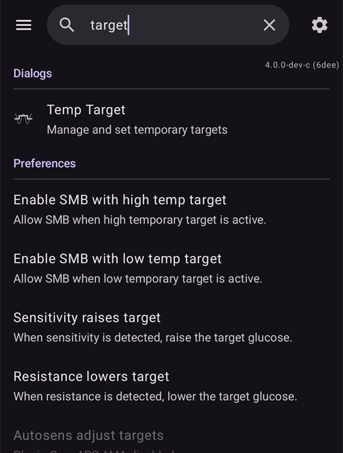

- **Sections** are opened and closed by tapping them. The sections you see depend on the plugins you have enabled and on [Simple mode](#preferences-simple-mode).


```{contents}
:backlinks: entry
:depth: 2
```

(Preferences-general)=
## General

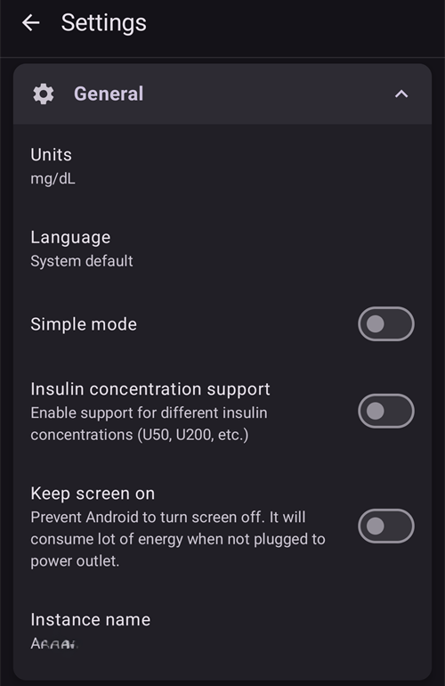

**Единицы**

- Set units to mmol/L or mg/dL depending on your preferences.

**Language**

- By default **AAPS** follows the language of the phone (recommended).

- If you want **AAPS** in another language than the phone, choose it here. On Android 13 and newer, **AAPS** registers it as its own app language in Android, so all its screens, the main screen, the widgets and the way numbers are written follow it.

- When you change the language, the texts of **AAPS** switch to the new language straight away. If some texts still show the old language, restart **AAPS**.
- On Android 12 this setting is not shown: **AAPS** always uses the language of the phone.
- Настройка скрыта в [простом режиме](#preferences-simple-mode).

(preferences-simple-mode)= **Простой режим**

**Простой режим** включен по умолчанию при первой установке **AAPS**. В **простом режиме** многие настройки скрыты, а вместо них используются заранее заданные значения. Выключите простой режим, когда освоитесь с интерфейсом и настройками **AAPS**.

**Insulin concentration support**

- Enables support for different insulin concentrations (U50, U200, ...). Only enable this if you really use a concentration other than U100, and read the warnings carefully.
- Настройка скрыта в [простом режиме](#preferences-simple-mode).

**Keep screen on**

- Forces Android to keep the screen on at all times. This is useful for presentations etc. But it consumes a lot of battery power. Therefore, it is recommended to connect the smartphone to a charger cable.

**Instance name**

- The name of the person using this phone. It tells this **AAPS** instance apart in reports and synchronization, for example if two children with type 1 diabetes in your family use **AAPS**.
- Used in the names of exported settings files.
- Показывается на [циферблате Dual](../WearOS/WearOsSmartwatch.md).

(Preferences-skin)=
### Skin

The skin selection from **AAPS** 3.x (Original, Low resolution, Large display...) no longer exists in **AAPS** 4. The new interface adapts to your screen automatically, and the color scheme can be changed in [Appearance](#preferences-appearance).

(preferences-appearance)=
## Appearance

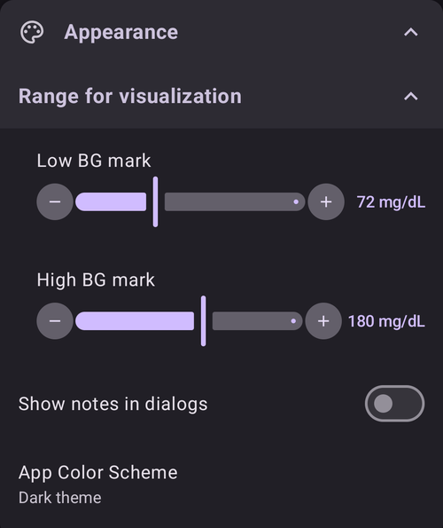

(Preferences-range-for-visualization)=
### Range for visualization

Choose the high and low marks for the BG-graph on **AAPS** main screen and smartwatch. Эти значения используются только для отображения на графике, это не целевой диапазон ГК. Example: 70 - 180 mg/dL or 3.9 - 10 mmol/L

(Preferences-show-notes-field-in-treatments-dialogs)=
### Show notes in dialogs

Дает возможность добавить короткие примечания к терапии (мастер болюса, углеводы, инсулин...)

Настройка скрыта в [простом режиме](#preferences-simple-mode).

### App Color Scheme

Choose between the light theme, the dark theme, or following the phone's system setting.

(Preferences-protection)=
## Защита

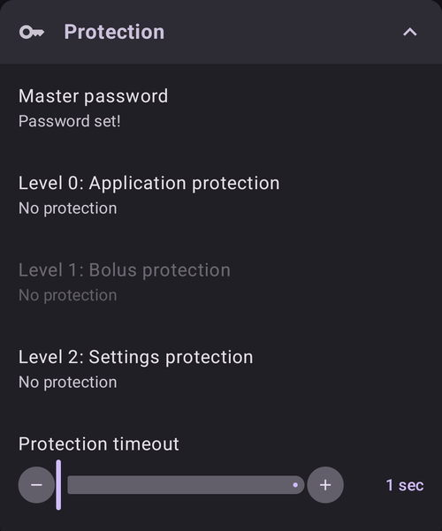

(Preferences-master-password)=
### Master password

Обязательно, чтобы можно было выполнить [экспорт настроек](../Maintenance/ExportImportSettings.md), так как начиная с версии 2.7 они шифруются.

If you forgot your master password, see [How to reset the master password?](#FAQ-reset-master-password)

**Biometric protection may not work on OnePlus phones. This is a known issue of OnePlus on some phones.**


(Preferences-settings-protection)=
### Settings protection

- Защитите настройки паролем или биометрической аутентификацией телефона (например, если [**AAPS** пользуется ребенок](../RemoteFeatures/RemoteMonitoring.md)). If you enable this feature, you will be prompted for authentication each time you want to access any Settings related view.

- The management screens (**Profile**, **Insulin settings**, **Temp Target**, **QuickWizard**) then open **read-only**. You can still activate or use an entry, but adding, editing, cloning and deleting are hidden until you unlock your settings. See [Settings protection now also locks the management screens](#v4changes-read-only-management).

- Custom password should be used if you want to use master password just for securing [exported settings](../Maintenance/ExportImportSettings.md), and use a different one for editing the settings.

- Если вы используете настраиваемый пароль, нажмите на строку «Пароль настроек», чтобы задать пароль, как описано [выше](#Preferences-master-password).

### Application protection

If the app is protected, you must enter the password or use the phone's biometric authentication to open **AAPS**, and again when you come back to it after the [protection timeout](#Preferences-password-and-pin-retention).

**AAPS** сразу закроется, если ввести неверный пароль, но продолжит работать в фоне, если до этого был успешно открыт.

### Bolus protection

- Защита болюса может быть полезна, если **AAPS** пользуется маленький ребенок, а вы подаете [болюс через SMS](../RemoteFeatures/SMSCommands.md).

- **Bolus protection** can only be selected once **Settings protection** (Level 2) is set.

- In the example below, bolus protection uses the **Master password**: **AAPS** asks for it before opening a treatment dialog such as **Insulin**. With **Biometric**, if biometric authentication does not work, you can enter the master password instead.

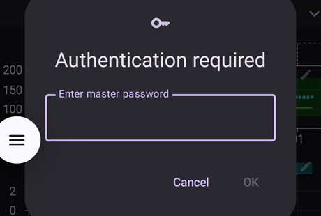

(Preferences-password-and-pin-retention)=
### Удержание пароля и ПИН-кода

**Protection timeout** defines how long (in seconds) the settings or bolus functionalities remain unlocked after you successfully enter the password.

## Безопасность терапии

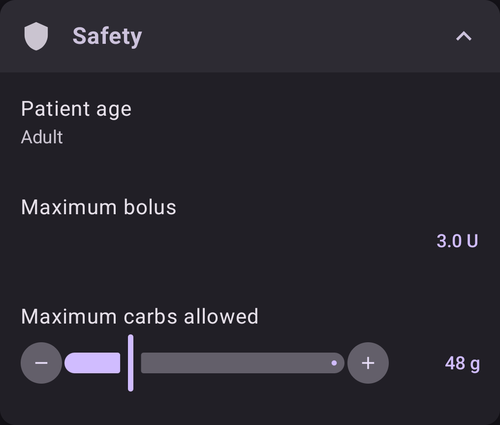

(preferences-patient-type)=
### Patient age

- Ограничения безопасности устанавливаются на основе возраста, который вы выбираете в этом параметре.
- Если вы начинаете достигать верхних ограничений (как например максимальный болюс) пора подняться на один шаг вверх (например, от ребенка перейти к подростку - прим. перев.).
- It's a bad idea to select higher than real age because it can lead to overdosing by entering the wrong value in the insulin dialog (by skipping the decimal separator, for example).
- Если вы хотите знать точные значения этих жестко заданных ограничений безопасности, найдите функцию алгоритма, которую вы используете, на [этой странице](../DailyLifeWithAaps/KeyAapsFeatures.md).

(Preferences-maximum-bolus)=
### Maximum bolus

- Задает максимальное количество болюсного инсулина в единицах, которое **AAPS** может подать за один раз.
- Эта настройка существует как ограничение безопасности для предотвращения подачи чрезмерного болюса из-за случайного ввода или ошибки пользователя.
- Рекомендуется установить это значение как разумный предел, приблизительно соответствующий максимальному количеству болюсного инсулина, который вы когда-либо можете подать на еду или на коррекцию.
- Это ограничение также налагается на результаты калькулятора болюса.

### Maximum carbs allowed

- Задает максимальное количество углеводов в граммах, на которое калькулятор болюса **AAPS** может рассчитать дозу.
- Эта настройка существует как ограничение безопасности для предотвращения подачи чрезмерного болюса из-за случайного ввода или ошибки пользователя.
- Рекомендуется установить это значение как разумный предел, приблизительно соответствующий максимальному количеству углеводов, которые вам когда-либо понадобится на еду.

## BG source ( Источник данных ГК )

The settings of your selected [BG source](#Config-Builder-bg-source) appear as their own section. For example with **xDrip+ BG**:

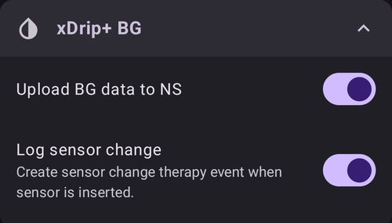

- **Upload BG data to NS**: let **AAPS** upload the received BG values to Nightscout. Only enable this if the CGM app itself is not already uploading them.
- **Log sensor change**: create a sensor change therapy event automatically when the sensor is inserted.

## The main screen

In **AAPS** 3.x these settings were grouped in an "Overview" section. In **AAPS** 4 they are configured directly from the main screen elements they belong to.

(Preferences-buttons)=
### QuickLaunch buttons

Define which action buttons are visible on the main screen: tap the small **gear** at the bottom center of the main screen ("Configure QuickLaunch") and **Add** the actions you want quick access to (treatments, CGM actions, careportal entries...).

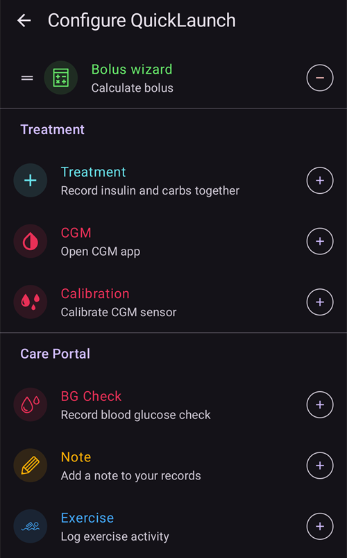

(Preferences-quick-wizard)=
### Мастер быстрых настроек

Create customized buttons for certain standard meals or snacks which will be displayed on the main screen. Удобно для стандартных блюд, которые вы часто едите.

Для каждой кнопки вы задаете углеводы и способ расчета болюса. Then, you define during which time period the button will be visible on your main screen - just one button per period. Кнопка не будет видна вне заданного периода времени или если у вас достаточно IOB, чтобы покрыть углеводы, заданные в кнопке мастера быстрых настроек. If different times are specified for the different meals you will always have the appropriate standard meal button on the main screen, depending on the time of day.

To manage your Quick Wizard presets, type "QuickWizard" in the main screen search bar and open **QuickWizard - Manage quick wizard presets**.

Если нажать кнопку мастера быстрых настроек, **AAPS** рассчитает и предложит болюс на эти углеводы по вашим текущим коэффициентам (с учетом значения ГК или активного инсулина, если это настроено).

Это предложение должно быть подтверждено перед подачей инсулина.

(Preferences-default-temp-targets)=
### Default temp targets

[Временные цели (ВЦ)](../DailyLifeWithAaps/TempTargets.md) позволяют изменить целевое значение ГК на определенное время. Если задать ВЦ по умолчанию, вы сможете легко изменить цель для нагрузки, перед едой и т. д.

Tap the **target range** on the main screen to open the **Temp Target** screen. Swipe through the preset cards (Eating Soon, Activity, Hypo) and change the target and the duration of each preset under **Preset Settings**. Preset values are:

* Eating soon: target 90 mg/dL / 5.0 mmol/L, duration 45 min
* Activity: target 140 mg/dL / 7.8 mmol/L, duration 90 min
* Hypo: target 160 mg/dL / 8.9 mmol/L, duration 60 min

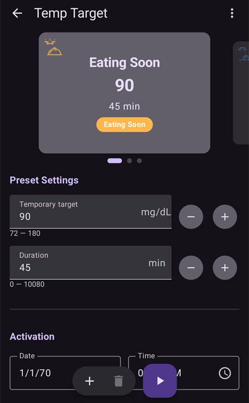

Узнайте, как [включить временную цель](#TempTargets-where-can-i-select-a-temp-target).

### Стандартные количества инсулина для прайма/заполнения

If you want to fill the tube or prime the cannula through **AAPS** you can do this with the **Prime/Fill** buttons in the expanded status panel of the main screen.

The default amounts of the three fill buttons can be defined in the **Prime/Fill** settings, depending on the length of your catheter. Type "prime" in the main screen search bar to open them.

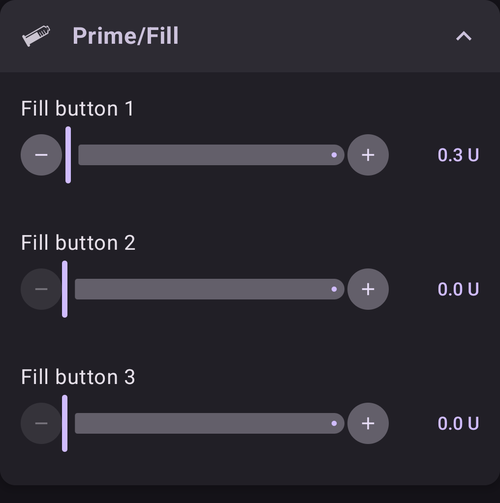

(Preferences-status-lights)=
### Индикаторы состояния

Status lights give a visual warning for:

- сколько времени отработал сенсор
- сколько времени прошло с момента установки резервуара
- об уровне заполнения резервуара (в единицах)
- сколько времени прошло с момента установки канюли
- Срок работы батареи помпы
- Уровень заряда батареи помпы (%)

Если превышен порог предупреждения, значения показываются желтым. Если превышен критический порог, значения показываются красным.

To change the thresholds, expand the status panel on the main screen (chevron on the right of the status row) and tap the small **Settings** icon next to "Status":

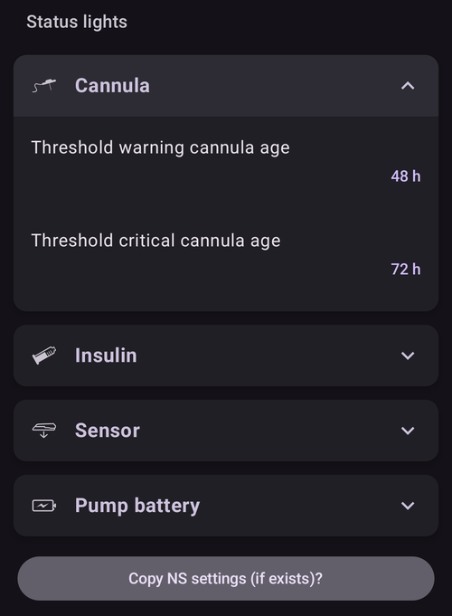

Tap an item (**Cannula**, **Insulin**, **Sensor** or **Pump battery**) to open its warning and critical thresholds:

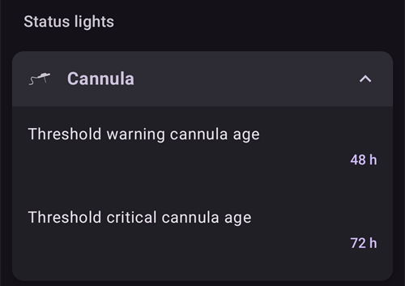

Последний параметр позволяет импортировать эти настройки из Nightscout, если они там заданы. Подробнее см. в [документации Nightscout](https://nightscout.github.io/nightscout/setup_variables/#age-pills).

(Preferences-deliver-this-part-of-bolus-wizard-result)=
### Bolus wizard settings

Type "bolus" in the main screen search bar to open the **Bolus wizard** settings:

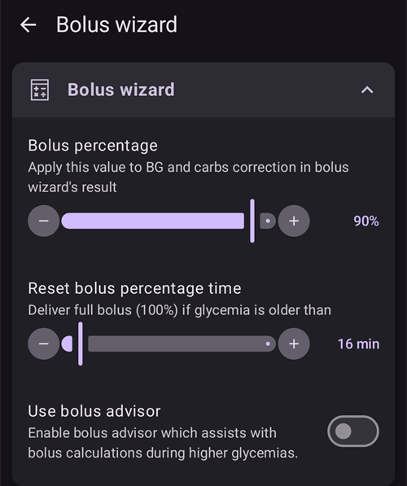

**Bolus percentage** sets the [default percentage](#AapsScreens-section-j) of the bolus calculated when using the bolus wizard.

По умолчанию 100%: без коррекции. Даже если вы зададите здесь другое значение, его все равно можно изменить при каждом использовании мастера болюса. Если этот параметр равен 75% и нужен болюс 10 ед., мастер болюса предложит болюс на еду всего 7,5 ед.

При использовании [SMB](#objectives-objective9) многие подают на еду не 100% нужного инсулина, а только часть (например, 75%), а остальное делает SMB с UAM (непредвиденный прием пищи). Значение меньше 100% здесь может быть полезно:
* для людей с медленным пищеварением: если подать весь болюс сразу, может быть гипо, потому что инсулин действует быстрее, чем переваривается пища.
* чтобы оставить **AAPS** больше места самому справляться с **ростом ГК**. В обоих случаях **AAPS** восполнит недостающую часть болюса с помощью SMB, если и когда сочтет это нужным.

**Use bolus advisor**

When enabled, if you use the bolus wizard while you are in hyperglycemia, you will get a warning, prompting you if you wish to pre-bolus and eat later, when your **BG** gets back in range.

(Preferences-advanced-settings-overview)=
### Superbolus

The Superbolus option of **AAPS** 3.x is not available as a setting in **AAPS** 4.

## Замкнутый цикл

See [AAPS screens > The main screen > Loop status](#AapsScreens-loop-status) to change loop mode now.

(Preferences-minimal-request-change)=
### Open mode minimum change

В режиме **Открытый цикл** вы будете получать уведомление каждый раз, когда **AAPS** рекомендует изменить базальную скорость. To reduce the number of notifications you can either use a [wider bg target range](#profile-glucose-targets) or increase the percentage of the "**Open mode minimum change**" setting. Он определяет относительное изменение, необходимое для активации уведомления.

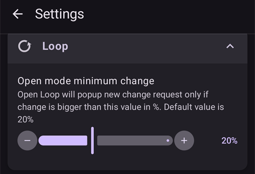

## Улучшенный ассистент приема пищи (AMA) или Супер Микро Болюс (SMB)

Depending on your settings in [Configuration > APS](../SettingUpAaps/ConfigBuilder.md) you can choose between two algorithms:

- [Улучшенный ассистент приема пищи (OpenAPS AMA)](#Open-APS-features-advanced-meal-assist-ama) — алгоритм в состоянии 2017 года
- [Супер микроболюс (OpenAPS SMB)](#Open-APS-features-super-micro-bolus-smb) — самый новый алгоритм, рекомендуется для начинающих

As of [**AAPS** version 3.3](#version3300), the [Dynamic ISF](../DailyLifeWithAaps/DynamicISF.md) feature has been moved into OpenAPS SMB.

### OpenAPS AMA

Все настройки OpenAPS AMA описаны в отдельном разделе [Основные функции AAPS > Улучшенный ассистент приема пищи (AMA)](#Open-APS-features-advanced-meal-assist-ama).

(Preferences-openaps-smb-settings)=
### OpenAPS SMB

Все настройки OpenAPS SMB описаны в отдельном разделе [Основные функции AAPS > Супер микроболюс (SMB)](#Open-APS-features-super-micro-bolus-smb).

The list of settings you see depends on your progress in the [Objectives](../SettingUpAaps/CompletingTheObjectives.md) and on [Simple mode](#preferences-simple-mode). On a new installation only **Use dynamic sensitivity** is shown. Once the objectives are completed, the section looks like this:

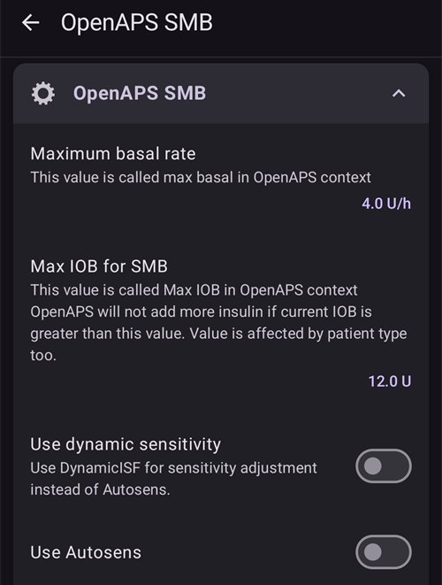

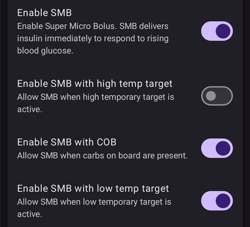

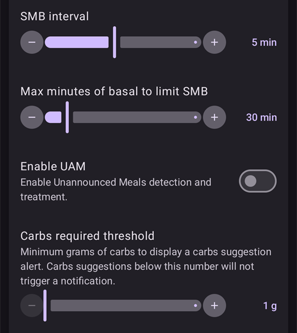

**Advanced Settings** at the bottom of the section holds values that you normally do not have to change:

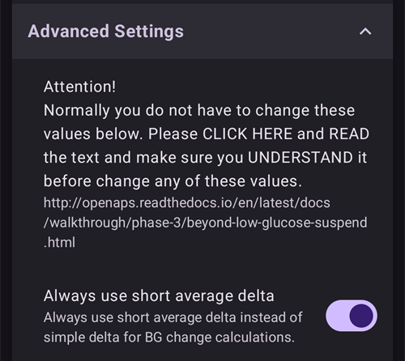


## Настройки усваиваемости

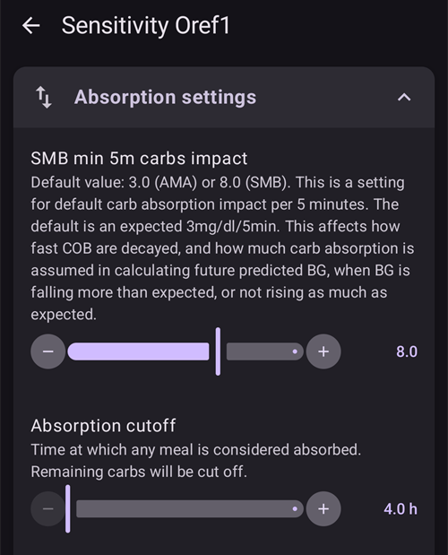

(Preferences-min_5m_carbimpact)=
### SMB min 5m carbs impact (min_5m_carbimpact)

Настройка скрыта в [простом режиме](#preferences-simple-mode).

Алгоритм использует BGI (влияние на ГК), чтобы определить, когда [углеводы усвоены](../DailyLifeWithAaps/CobCalculation.md).

Когда усвоение углеводов нельзя рассчитать по реакции ГК, **AAPS** применяет к углеводам скорость усвоения по умолчанию. Basically, it is a failsafe. Это значение используется только при пропусках в данных **CGM** или когда физическая нагрузка «съедает» весь рост ГК, из-за которого **AAPS** иначе уменьшал бы COB.

Говоря по-простому, алгоритм "знает" как *должна* вести себя ГК при воздействии дозы инсулина и т. п. Whenever there is a positive deviation from the expected behavior, some carbs are absorbed/decayed. Большие изменения=много углеводов и т. д.

По умолчанию величина min_5m_carbimpact определяет поглощение углеводов за 5 минут. For the full parameter reference see [OpenAPS's preferences and safety settings documentation](https://openaps.readthedocs.io/en/latest/docs/While%20You%20Wait%20For%20Gear/preferences-and-safety-settings.html?highlight=carbimpact#min-5m-carbimpact).

Standard value for AMA is 3, for SMB it's 8.

The COB graph on the main screen indicates when min_5m_carbimpact is being used by putting orange dots along the top of the COB curve.

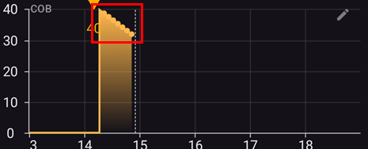

### Absorption cutoff

Time at which any meal is considered absorbed; remaining carbs will be cut off. Если вы часто едите блюда с высоким содержанием жиров или белка, вам следует увеличить время усвоения пищи.

### Advanced settings - autosens ratio


- Задайте мин. и макс. коэффициент [autosens](#Open-APS-features-autosens).
- Обычно стандартные значения (макс. 1.2 и мин. 0.7) не должны меняться.

## Pump


### BT Watchdog

При необходимости включите BT Watchdog (например, для помп Dana). It switches off Bluetooth for one second if no connection to the pump is possible. This may help on some phones where the Bluetooth stack freezes.

## Настройки помпы

The options here will vary depending on which pump driver you have selected in [Configuration > Pump](#Config-Builder-pump). Pair and set up your pump according to the [pump-related instructions](../Getting-Started/CompatiblePumps.md).

For example with the **Virtual Pump**, the section is called **Virtual pump settings**. You choose the **Pump type** the virtual pump imitates, and whether its status is uploaded to Nightscout:

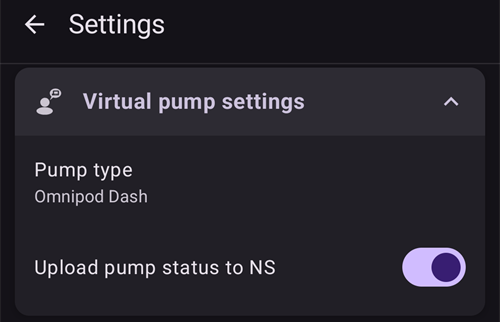

## Tidepool

Подробнее на странице [Tidepool](../SettingUpAaps/Tidepool.md).

(Preferences-nsclient)=
## Клиент NSV3


The NSClient plugin (shown as **NSClientV3** in the configuration menu) synchronizes your data with Nightscout. It uses the Nightscout API v3.

```{admonition} Data uploaders
:class: warning

When using NSClientV3, all uploaders must use the Nightscout API v3. If another uploader (for example your CGM app) is not API v3 compliant, **let AAPS upload all data** (BG, treatments, ...) to Nightscout and disable that uploader.
```

- Set your *Nightscout URL* (i.e. <https://yoursitename.yourplatform.dom>).
- **Убедитесь, что URL-адрес БЕЗ /api/v1/ в конце.**
- In Nightscout, create an *[Admin token](https://nightscout.github.io/nightscout/security/#create-a-token)* (requires [Nightscout 15](https://nightscout.github.io/update/update/) to use the V3 API) and enter it in the **Nightscout access token** (not your API Secret!). On **AAPSClient** you can scan the main phone's QR code instead, which sets up a token of the client's own. A client paired with the PIN gets its own token from the main phone after pairing. See [The client's own Nightscout token](#client-master-control-own-token).
- Это позволяет читать и записывать данные между сайтом Nightscout и **AAPS**.
- Если вы застряли на Цели 1, еще раз проверьте поля с адресом и паролем на наличие опечаток.
- Leave "Use websockets" enabled (recommended). Websockets are **mandatory** for remote control from **AAPSClient**, on both phones.

(Preferences-nsclient-synchronization)=
### Synchronization


Выбор синхронизации зависит от того, как вы хотите использовать **AAPS**.

Вы можете выбрать, какие данные [загружать в Nightscout и скачивать из него](#Nightscout-aaps-settings).

While client control is on (always in Simple Mode), these settings are hidden: **AAPS** is then in [hardened mode](#client-master-control-hardened-mode), takes no changes made directly in Nightscout and uploads all its data.

### Alarm options

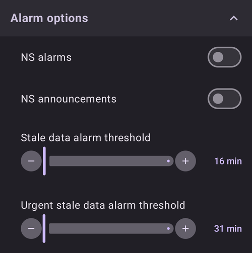

- Опции звуковых оповещений позволяют выбрать оповещения Nightscout по умолчанию для использования через приложение. **AAPS** подаст сигнал тревоги, когда срабатывает сигнал тревоги Nightscout.
- Для того, чтобы работали оповещения, следует настроить значения переменных для Чрезвычайно Высокой, Высокой, Низкой и Чрезвычайно Низкой ГК в переменных [Nightscout](https://nightscout.github.io/nightscout/setup_variables/#alarms).
- They will only work while you have a connection to Nightscout and are intended for parent/caregivers.
- If you have the **CGM** source on your phone (i.e. xDrip or BYODA) then use those alarms instead of Nightscout Alarms.
- NS announcements will echo Nightscout [announcements](https://nightscout.github.io/nightscout/discover/#announcement) in the **AAPS** notifications.
- Вы можете изменять порог срабатывания оповещений при отсутствии данных от Nightscout в течение определенного времени.

### Удаленное управление

The switch "**Allow client control**" is no longer in these settings: it is at the top of **Manage → Authorized clients**, where the paired clients are managed. See the dedicated [Client / Master control](../RemoteFeatures/ClientMasterControl.md) page, including [hardened mode](#client-master-control-hardened-mode), which this switch turns on.

### Connection settings

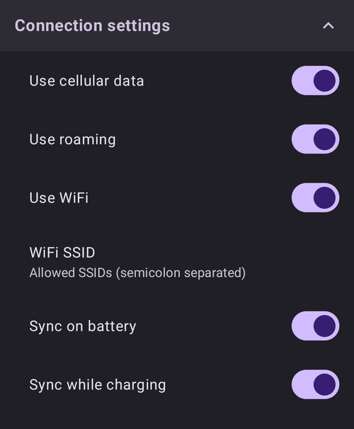

- Настройки подключения определяют, когда включено соединение с Nightscout.
- Ограничьте загрузку в Nightscout только через Wi-Fi или даже через Wi-Fi SSID.
- Если вы хотите использовать только определенную сеть Wi-Fi, введите ее SSID.
- Несколько идентификаторов SSID разделяются точкой с запятой.
- Чтобы удалить все SSID, введите в поле пробел.

(Preferences-advanced-settings-nsclient)=
### Advanced settings (NSClientV3)

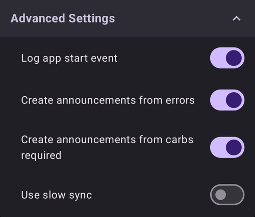

Параметры в расширенных настройках понятны без пояснений.

## СМС-коммуникатор

Подробнее на странице [SMS команды](../RemoteFeatures/SMSCommands.md).

(preferences-wear)=
## Смарт-часы Wear

This section is shown when the **Wear** plugin is enabled in [Configuration > Communication](#Config-Builder-wear). More information on the dedicated [Wear OS smartwatch](../WearOS/WearOsSmartwatch.md) and [Operation of AAPS via your Wear OS smartwatch](../RemoteFeatures/RemoteControlWearOS.md) pages.

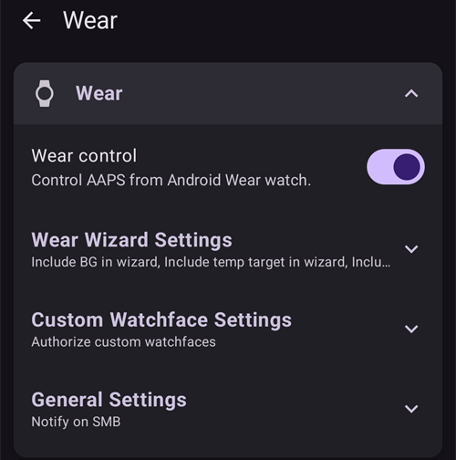

- **Wear control**: allow treatments and other actions to be sent from the watch. Without it, the watch only displays data: the phone refuses any command from the watch, and tapping a complication that would open a control screen opens the **AAPS** menu on the watch instead.

**Wear Wizard Settings** defines which calculations are included in the result of the bolus wizard on the watch. On the watch you only enter the carbs; these switches replace the choices you would make in the bolus wizard on the phone:

- **Include BG in wizard**: add a correction for the difference between your current glucose and your target.
- **Include temp target in wizard**: use the running temp target instead of the profile target for this correction.
- **Include trend in wizard**: take the current glucose trend into account.
- **Include COB in wizard**: add insulin for the carbs that are still on board.
- **Include IOB in wizard**: subtract the insulin that is still on board.

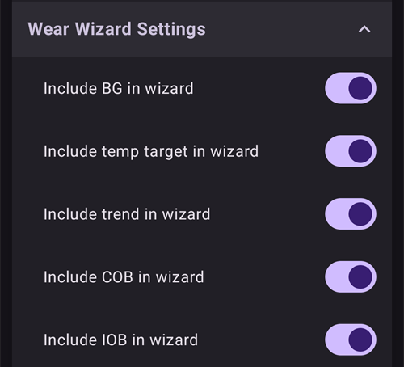

**Custom Watchface Settings** contains **Authorize custom watchfaces**. A custom watchface file can include values for some watch settings. When this switch is on, loading such a watchface is allowed to change those settings on the watch; when it is off, the watchface is loaded but the settings stay as they are:

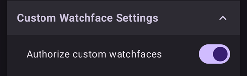

**General Settings** contains **Notify on SMB**, to get a notification on the watch each time an SMB is delivered:

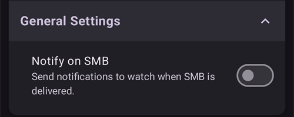

## Autotune

This section is shown when the **Autotune** plugin is enabled in [Configuration > General](#Config-Builder-autotune). The settings are described on the dedicated [Autotune](../AdvancedOptions/Autotune.md) page.


## Автоматизация

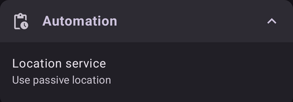

Select which location service shall be used:

- Использовать пассивное определение местоположения: **AAPS** получает местоположение, только когда его запрашивают другие приложения
- Использовать расположение сети: расположение вашего Wifi
- Используйте локатор GPS (Внимание! Может привести к чрезмерной разрядке аккумулятора!)

## Локальные оповещения


Настройки самоочевидны.

**Override Do Not Disturb mode** (on by default): the **AAPS** alarms ring even when the phone is silent or in Do Not Disturb. Turn it off if **AAPS** should respect those modes: the alarms do not ring then, and in Do Not Disturb they only vibrate, on the phone and on the watch. Loop suggestions that arrive during Do Not Disturb are shown without a sound.

When an alarm rings, the alarm screen offers **Mute for 5 minutes**, **Silence alarm** (the screen stays open, so you can read the message) and **Silence and close**. Swiping the alarm notification away in the notification tray mutes the alarm. When you open **AAPS** later, an alarm you did not answer is shown again.

(preferences-alarm-sound-volume-vibration)=
### Alarm sound, volume and vibration

- **Sound**: the **AAPS** alarm sounds are built in and cannot be changed.
- **Volume**: **AAPS** has no volume setting of its own. With **Override Do Not Disturb mode** on, the alarms follow the phone's alarm volume. With it off, they follow the notification volume.
- **Gradually increase notification volume** (on by default): the alarm starts quietly and gets louder. Turn it off to ring at full volume right away.
- **Vibration**: in the phone's settings, go to **Apps** > **AAPS** > **Notifications**. The **AAPS alarms** list appears there after the first alarm. Tap an alarm to turn its **Vibration** on or off. Keep these alarms turned on.

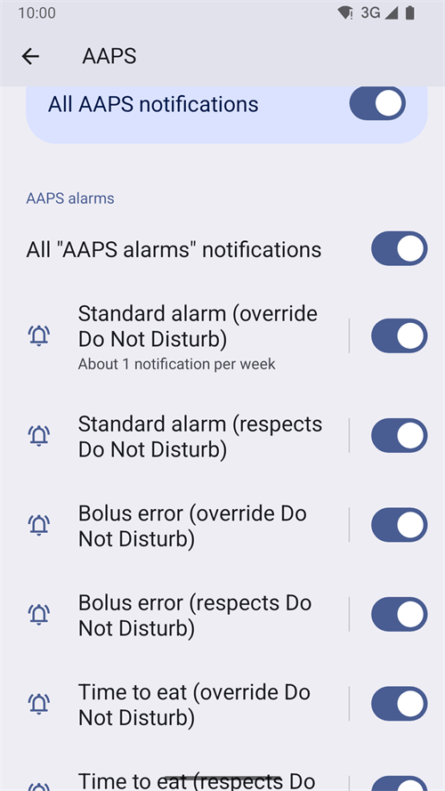 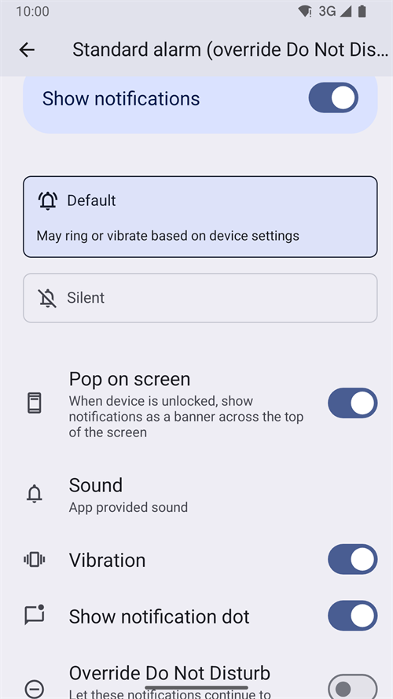

- Glucose alarms (high, low, no data) come from your CGM app or Nightscout: set their sound and vibration there.

(preferences-maintenance-settings)=
## Параметры обслуживания

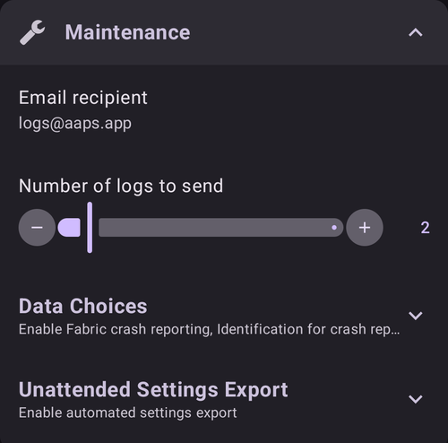

**Получатель e-mail**: стандартный получатель журналов — <logs@aaps.app>.

**Number of logs to send**: how many of the most recent log files are attached when you send logs.

**Data Choices**

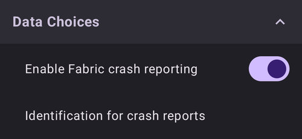

Вы можете помочь развитию **AAPS**, отправляя разработчикам отчеты о сбоях.

**Автоматический экспорт настроек**<br/> Если включить эту функцию, **AAPS** сможет экспортировать настройки без участия пользователя. For this the master password is securely stored on your phone (only) at the next manual export. Сохраненный пароль будет использоваться до 4 недель. Через 4 недели вы получите уведомление, что срок действия пароля скоро закончится. В течение льготного периода в 1 неделю пароль можно обновить, выполнив экспорт настроек вручную из меню обслуживания.

Когда льготный период в 1 неделю пройдет, срок действия сохраненного пароля закончится, и любой автоматический экспорт настроек будет прерван, а пользователь получит уведомление с просьбой снова ввести пароль. [(**Automated settings exports**)](../DailyLifeWithAaps/Automations.md#automating-preference-settings-export) will be logged to the **AAPS** 'Careportal' and 'User entry' lists under Treatments.

После включения этого параметра обязательно выполните экспорт настроек вручную: у вас будет запрошен пароль, и **AAPS** сможет его сохранить.

### Log files

AAPS сохраняет журналы для поиска неисправностей.

Не выключайте эту функцию: она поможет понять причины, если что-то пойдет не так.

If you need to send the logs to the developers, make sure you accurately describe the issue in the email. Журналы лучше отправлять только по запросу, после [сообщения о проблеме на GitHub](https://github.com/nightscout/AndroidAPS/issues).

Журналы AAPS находятся в памяти телефона -> Android -> data -> info.nightscout.androidaps -> files.

Log handling (log settings, sending and deleting logs) and file management are found on the **Maintenance** screen, opened from the **menu** (☰) in the top-left corner of the main screen:

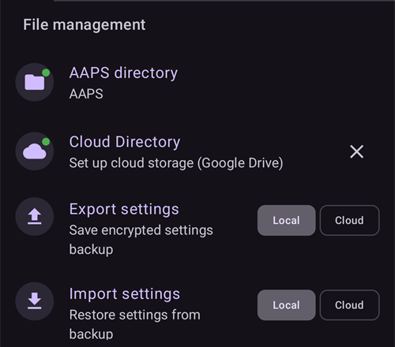

(preferences-maintenance-logdirectory)=

### Выбор локальной папки AAPS

The **Maintenance** screen also includes the **AAPS directory**. Эта настройка позволяет выбрать на телефоне папку, где **AAPS** будет хранить настройки, журналы и другие файлы. Once a directory is chosen, its path (for example `Documents/AAPS`) is shown below **AAPS directory**, so you can always see where your files are saved.

Настоятельно рекомендуется использовать папку прямо в корне памяти телефона. По умолчанию это AAPS.

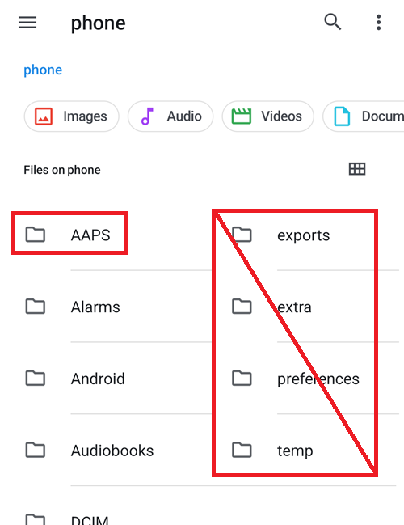

Если выбрать вложенную папку внутри AAPS, вы увидите сообщение об ошибке. Нажмите «OK» и попробуйте снова, выбрав правильную папку (на уровень выше). Не выбирайте «DISMISS», если вы не уверены точно в том, что делаете.

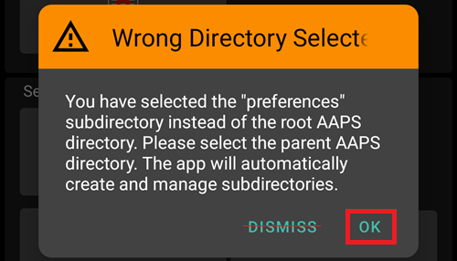

Android can silently take the directory permission away, for example after you reinstall **AAPS** or clear its storage. When that happens, **AAPS** shows a persistent **Access to the AAPS directory was lost** notification and local settings export stops working until you come back here and select the directory again. Do this promptly, otherwise your backups on the phone are no longer refreshed.

(preferences-maintenance-cloud)=

### Выбор облачной папки

Вы можете экспортировать настройки, журналы и данные CSV в облачный сервис.

1. Open the **menu** (☰), select **Maintenance** and tap **Cloud Directory** (under **File management**).

   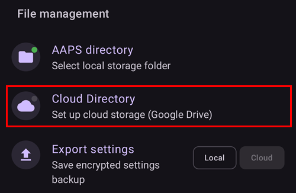

2. In **Select Storage Type**, select **Google Drive**.

   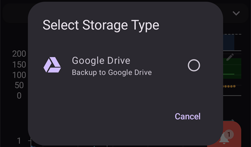

3. A Google sign-in page opens. Choose the Google account that will hold your backups (you can use a [dedicated Google account](../UsefulLinks/DedicatedGoogleAccountForAaps.md)).

   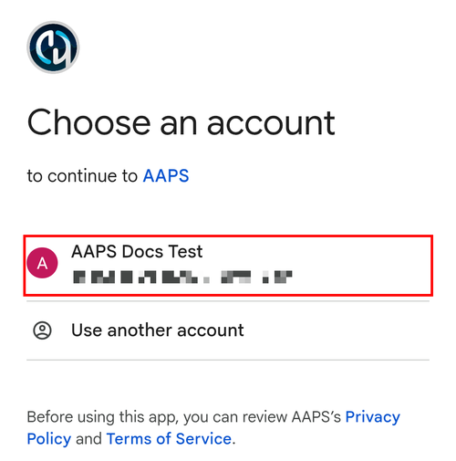

4. Check that the account is the right one and tap **Continue** to give **AAPS** access. If you set up the cloud directory before, the page says that **AAPS** already has some access.

   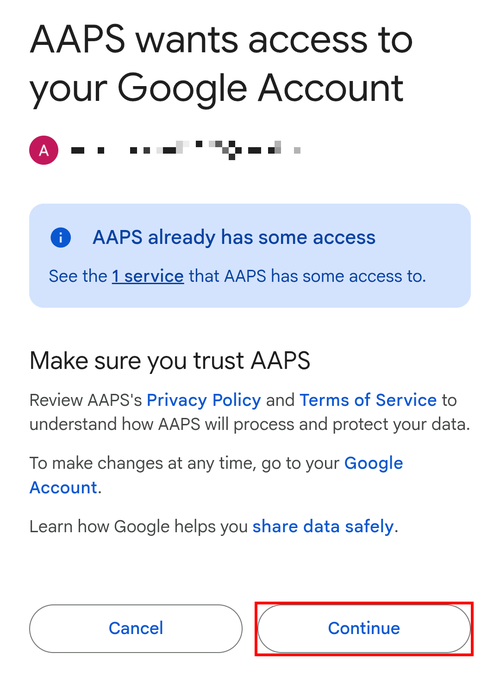

5. Back in **AAPS**, the message **Cloud storage authentication successful** appears at the bottom of the main screen:

   

   In the **Maintenance** menu, **Cloud Directory** now has a green dot, and the **Cloud** buttons next to **Send logs**, **Export settings**, **Import settings** and **Export User Entries to Excel (csv)** are available.

   

To stop exporting to the cloud, tap the **✕** (**Clear Settings**) icon at the end of the **Cloud Directory** row in the **Maintenance** menu (it is shown once a cloud service is set up) and confirm **Clear Cloud Settings**. This switches back to local storage and clears the authorization.

## Проект Open Humans

Вы можете помочь науке, поделившись данными с исследовательскими проектами! Подробности описаны на странице [Загрузчик Open Humans](../SupportingAaps/OpenHumans.md).

In **Settings → Open Humans**, you can define when data shall be uploaded
- только при подключении к Wi-Fi
- только при зарядке
