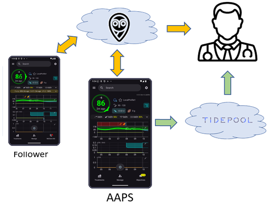

# Настройка сервера отчетности

Сейчас с **AAPS** можно использовать два сервера отчетности:

- [Nightscout](https://nightscout.github.io/)
- [Tidepool](https://www.tidepool.org/)



Мы рекомендуем использовать Nightscout.

(SettingUpTheReportingServer-nightscout)=
## Nightscout

Nightscout – это веб-приложение, которое может записывать и показывать данные вашего CGM и **AAPS**, а также создает отчеты. Это мощная платформа, которая уже много лет интегрирована в **AAPS**. С ней пользователи и опекуны могут следить за данными пациента о диабете почти в реальном времени (между получением данных и их показом может пройти всего несколько секунд, если у всех участвующих компонентов достаточно хорошее подключение к интернету). Через него также идут удаленные команды, которые опекуны отправляют в **AAPS** из **AAPSClient** (см. [Управление «основной телефон ↔ клиент»](#client-master-control)).

Nightscout существует как программное обеспечение с открытым исходным кодом. Любой человек может создать и управлять сервером Nightscout используя либо бесплатные, либо платные сервисы.

Больше информации можно найти на [сайте проекта Nightscout](http://nightscout.github.io/).

### Вариант 1 - Настройте сервер Nightscout самостоятельно

Создание сервера Nightscout может потребовать одного или нескольких веб-приложений, которые будут нуждаться в обслуживании. Чтобы получить совершенно бесплатную услугу, вам придется переносить сайт и данные Nightscout, если провайдер прекратит бесплатное обслуживание.

Описание того, как настроить Nightscout, с преимуществами и недостатками разных вариантов работы, включая оценку затрат, можно найти [здесь](https://nightscout.github.io/nightscout/new_user/#free-diy).

### Вариант 2 - Оплата хостинга Nightscout

Есть также варианты от различных поставщиков услуг, которые размещают Nightscout за ежемесячную плату. Расходы посильные, а преимущество размещения у поставщика в том, что не нужно разбираться в IT-технологиях или иметь собственную инфраструктуру.


Существующие пользователи Nightscout могут время от времени пересматривать, где и как размещен их сервер Nightscout, и переходить на другой, более подходящий вариант.

Некоторые сервисы с размещением Nightscout перечислены [здесь](https://nightscout.github.io/nightscout/new_user/#vendors-comparison-table).

### Дальнейшая настройка Nightscout

Когда ваш экземпляр Nightscout будет установлен и запущен, прочитайте [страницу настройки Nightscout](../SettingUpAaps/Nightscout.md), где описаны дополнительные моменты.

(SettingUpTheReportingServer-tidepool)=
## Tidepool

Tidepool доступен в **AAPS** начиная с версии 3.2, которая вышла в конце 2023 г.

```{admonition} Tidepool with **AAPS** is only for reporting
:class: danger
Так как при использовании **AAPS** между поступлением данных и их показом в отчетах проходит три часа, Tidepool не подходит для передачи информации опекунам в реальном времени.  
On the other hand, Tidepool can be a great solution for sharing reports with a patient's endocrinologist if Nightscout is not an accepted solution.  
```

Tidepool – это проект с [открытым исходным кодом](https://github.com/tidepool-org). Он предлагает бесплатную учетную запись на серверах Tidepool.

Больше информации о настройке Tidepool с AAPS [здесь](../SettingUpAaps/Tidepool.md).

```{admonition} **AAPS** has the uploader for Tidepool integrated
:class: note
Вам **не** нужно использовать приложение-загрузчик для Tidepool: **AAPS** сам загрузит данные о глюкозе крови, терапии и базале. You only need a personal account with Tidepool. Do not upload your data with the separate Tidepool uploader tool as it will lead to duplicate values.  
```

## Следующий шаг

Когда сервер отчетности будет настроен, вы можете настроить **AAPS** на телефоне с помощью [Мастера установки](./SetupWizard.md), который также свяжет **AAPS** с вашим сервером отчетности.