# Мастер установки AAPS

```{contents} In this page
:backlinks: entry
:depth: 2
```

Когда вы запускаете **AAPS** в первый раз, вас ведет «**Мастер установки**», чтобы быстро и за один раз настроить все основные параметры приложения. **Мастер установки** ведет вас по шагам, чтобы вы не забыли ничего важного. Например, **настройки разрешений** очень важны для правильной настройки **AAPS**.

Однако не обязательно настраивать всё полностью при первом запуске **Мастера установки**: вы можете легко выйти из мастера и вернуться к нему позже. После **Мастера установки** есть три способа дополнительно оптимизировать или изменить конфигурацию. О них расскажем в следующем разделе. Итак, если пропустить некоторые этапы в мастере установки, их можно легко выполнить позже.

Во время работы с **Мастером установки** и сразу после нее вы можете не заметить в **AAPS** никаких заметных изменений. Чтобы включить цикл **AAPS**, нужно проходить **Цели** и включать функции одну за другой. В конце работы Мастера установки вы начнете **Цель 1**. Вы управляете **AAPS**, а не наоборот.

```{admonition} Preview Objectives
:class: note
Если вы хотите узнать, как устроены цели, прочитайте [Прохождение целей](../SettingUpAaps/CompletingTheObjectives.md), но затем вернитесь сюда и сначала пройдите Мастер установки.

```

По опыту мы знаем, что новички часто торопятся настроить **AAPS** как можно быстрее. Это может привести к разочарованию, потому что учиться придется многому.

Поэтому не спешите с настройкой цикла: польза от хорошо работающего цикла **AAPS** огромна.

```{admonition} Ask for Help
:class: note
Если вы нашли ошибку в документации или знаете, как объяснить что-то лучше, вы можете обратиться за помощью к сообществу, как описано в разделе [Где получить помощь?](../GettingHelp/WhereCanIGetHelp.md).
```
## Приветственное сообщение

Когда открывается Мастер установки, он приветствует вас коротким сообщением и сразу показывает панель «**Требуются разрешения**» внизу экрана (см. следующий раздел).

Когда вы дадите разрешения, панель закроется, и на экране приветствия появится кнопка «**Далее**». Нажмите «**Далее**», чтобы продолжить:

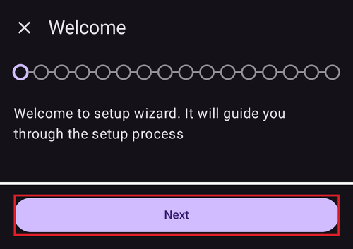

## Необходимые разрешения

Для правильной работы **AAPS** нужно несколько разрешений. Мастер собирает их на одной панели «**Требуются разрешения**», у каждого есть своя кнопка «**Предоставить**». Дайте их по одному — когда разрешение дано, значок рядом с ним меняется на галочку.

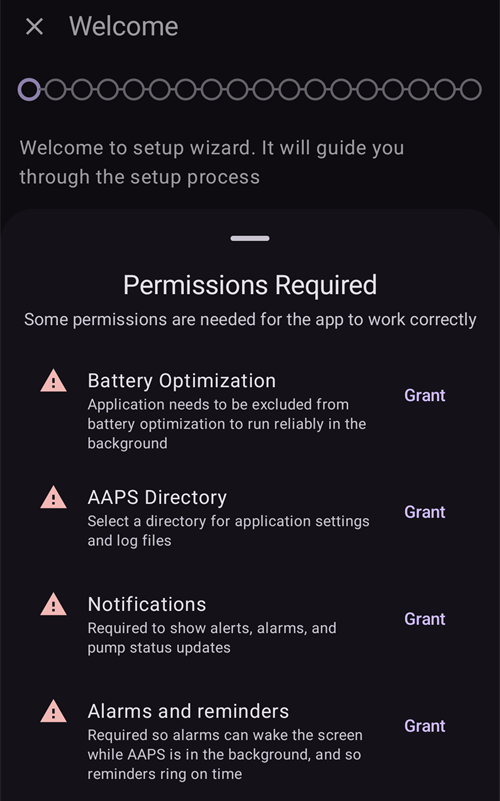

### Оптимизация батареи

Расход батареи на смартфонах важен, так как возможности батарей всё еще довольно ограничены. Поэтому операционная система Android на смартфоне ограничивает работу приложений и их использование процессора, а значит и заряда батареи.

Однако **AAPS** должен работать регулярно, _например_, чтобы получать значения глюкозы каждые несколько минут, а затем применять алгоритм и решать, что делать с уровнем глюкозы на основе ваших настроек. Поэтому его нужно исключить из оптимизации батареи.

Нажмите «**Предоставить**» рядом с «**Оптимизация батареи**», затем выберите «**Разрешить**» в окне «Разрешить приложению всегда работать в фоновом режиме?»:


(SetupWizard-StoragePermission)=

### Папка AAPS

**AAPS** должен хранить свои настройки и журналы в постоянной памяти смартфона. Постоянная память означает, что информация будет доступна даже после перезагрузки телефона. Остальная информация теряется, поскольку она не сохраняется в постоянной памяти.

Нажмите «**Предоставить**» рядом с «**Папка AAPS**». Откроется файловая система телефона, где вы можете выбрать, где **AAPS** будет хранить свою информацию.

```{tip}
Рекомендуется выбрать папку AAPS по умолчанию.</br>
**Не** выбирайте подпапку внутри AAPS.
```

Папка по умолчанию — **AAPS**, но вы можете использовать любую отдельную папку на ваш выбор. При необходимости создайте папку, откройте ее и выберите «**ИСПОЛЬЗОВАТЬ ЭТУ ПАПКУ**»:

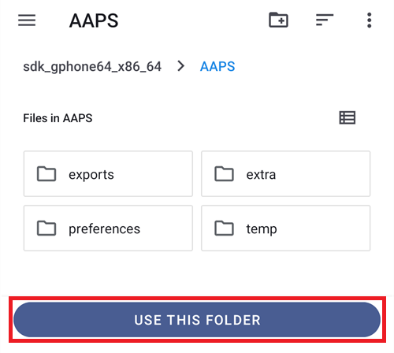

Подтвердите кнопкой «**РАЗРЕШИТЬ**», что даете **AAPS** доступ к выбранной папке:

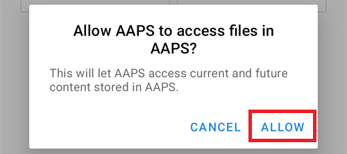

### Notifications

Android требует специального разрешения для уведомлений от приложений.

Отключать уведомления, _например_ от приложений соцсетей, — полезная возможность, но **AAPS** обязательно должен иметь право отправлять вам уведомления.

Нажмите «**Предоставить**» рядом с «**Уведомления**» и выберите «**Разрешить**» в системном запросе:

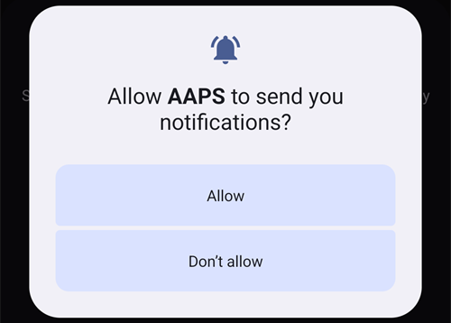

### Будильники и напоминания

На **Android 14 и новее** **AAPS** нужно разрешение «**Будильники и напоминания**», чтобы сигналы тревоги могли включать экран, пока **AAPS** работает в фоне, и чтобы напоминания (например, из **Автоматизации**) срабатывали вовремя.

Этот пункт показывается, только пока он нужен. Когда **AAPS** исключен из оптимизации батареи (см. выше), Android автоматически дает разрешение на точные будильники, и пункт исчезает. Если он всё еще в списке, нажмите «**Предоставить**» рядом с «**Будильники и напоминания**». Откроется экран системных настроек для **AAPS**; включите переключатель и вернитесь в **AAPS**. На Android 13 и старше этот пункт не появляется, и ничего делать не нужно.

Когда у всех разрешений появится галочка (у трех, а на Android 14 и новее — у четырех), панель «**Требуются разрешения**» закроется сама, и вы сможете нажать «**Далее**» на экране приветствия, чтобы продолжить.

(setup-wizard-bluetooth-battery-optimisation)=
### Оптимизация батареи для Bluetooth

```{admonition} Extra Android setting, not part of the Wizard
:class: note
Ниже описана дополнительная настройка Android, которая выполняется вне Мастера установки. Это не одна из кнопок «Предоставить» выше, но она важна для надежного соединения с помпой.
```

В новых версиях Android оптимизация батареи применяется и к системному приложению Bluetooth.

Кроме отключения оптимизации батареи для **AAPS**, скорее всего, нужно отключить ее и для системного приложения Bluetooth. Если этого не сделать, соединение с помпой может прерываться и возникнут проблемы.

***ПРИМЕЧАНИЕ: в документации xDrip описано, как это сделать: [документация xDrip](https://navid200.github.io/xDrip/docs/BluetoothBatteryOpt.html)***

Выполните эти шаги на Android 16; в других версиях экраны будут немного отличаться от снимков ниже:

1. Откройте настройки Android, найдите **Приложения** и откройте настройки приложений.

   

2. Вы увидите настройки приложений, но нужно развернуть список, чтобы увидеть все приложения: нажмите **Показать все приложения**.

   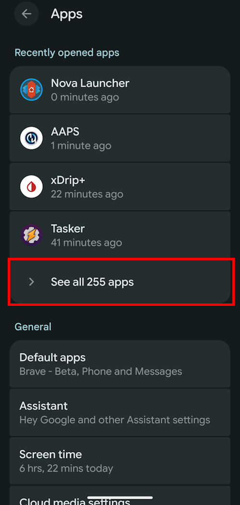

3. Приложение Bluetooth системное и по умолчанию скрыто, поэтому нужно показать системные приложения. Нажмите на **три точки** (⋮) в правом верхнем углу (1). Затем нажмите **Показать системные процессы** (2).

   

4. Найдите приложение `Bluetooth` и нажмите на `Bluetooth` и/или `Legacy Bluetooth`; если есть оба, выполните эти шаги для обоих.

   ***ПРИМЕЧАНИЕ: `Bluetooth MIDI Service` можно не трогать, AAPS его не использует***

   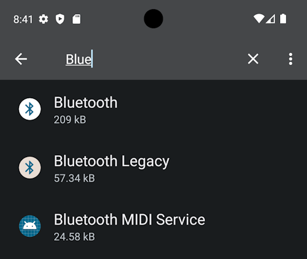    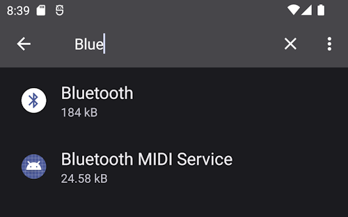    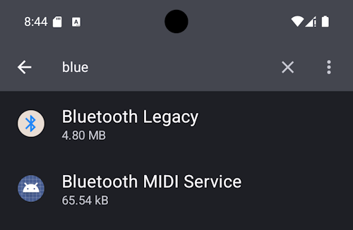

   1. На Android 12 нажмите `Батарея`, на Android 13+ нажмите `Расход заряда батареи приложением` (App battery usage).

   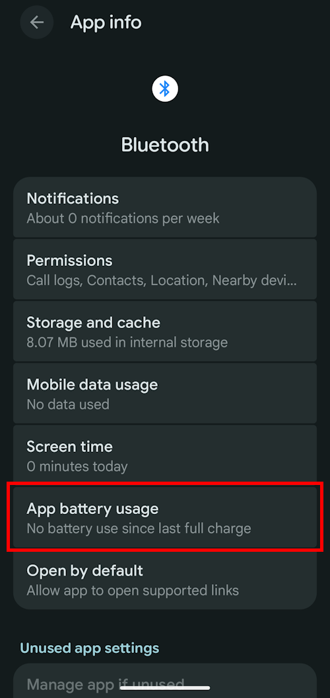   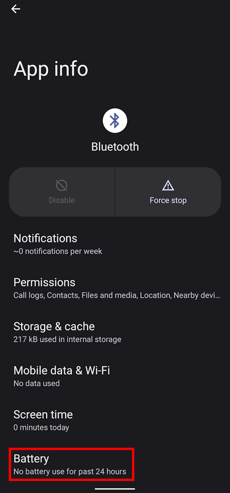

5. На Android 12+ выберите вариант `Без ограничений`, на Android 15+ нужно развернуть настройку `Разрешить работу в фоновом режиме` (Allow background usage): нажмите на раздел, выделенный красным, а затем выполните шаг 6.

   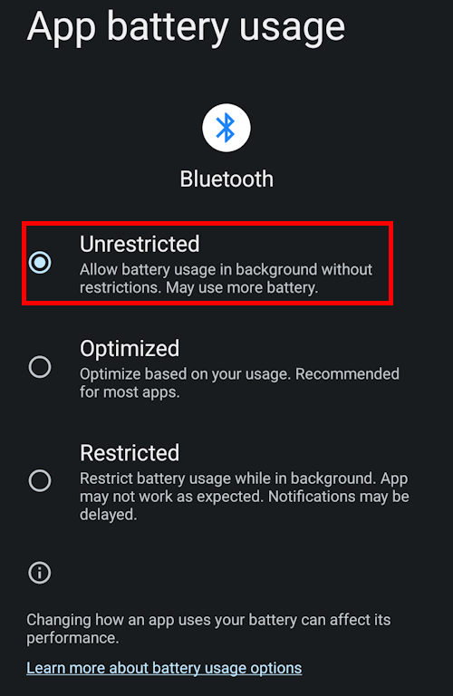    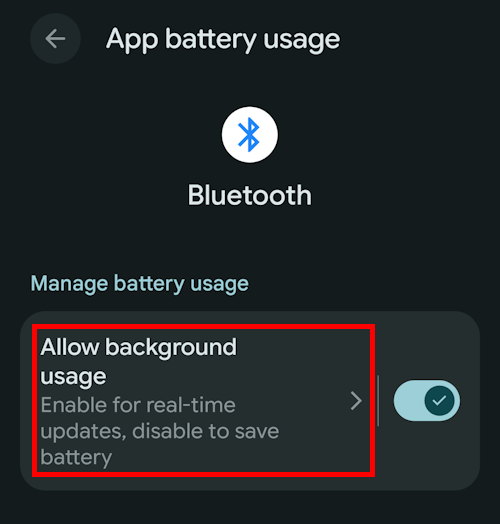

6. На Android 16 выберите `Без ограничений`

   

## Лицензионное соглашение

В лицензионном соглашении с конечным пользователем есть важная информация о правовых аспектах использования **AAPS**. Внимательно изучите его.

Если вы не понимаете лицензионное соглашение или не можете с ним согласиться, не используйте **AAPS** совсем!

Если вы понимаете и согласны, нажмите кнопку «**я понимаю и принимаю**» и следуйте указаниям Мастера установки:

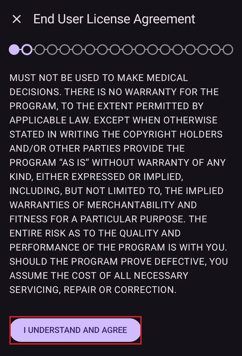

После согласия появится кнопка «**Далее**». Нажмите «**Далее**».

На следующем экране, «**Разрешения**», снова показан список разрешений. У всех должна быть галочка, так как вы дали их в начале. Если какого-то не хватает, нажмите «**Предоставить**» рядом с ним. Нажмите «**Далее**», чтобы продолжить:

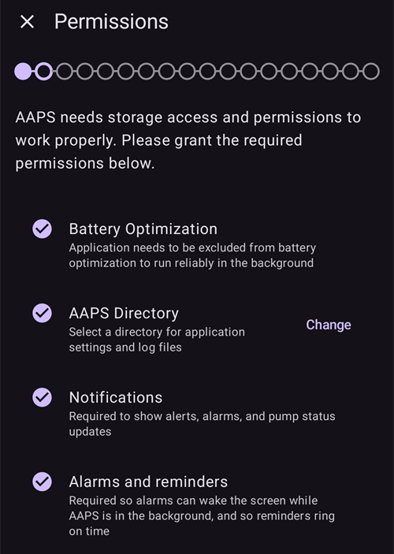

## Master password

Конфигурация **AAPS** содержит конфиденциальные данные (_например_, токен доступа к вашему серверу Nightscout), поэтому она шифруется паролем, который вы задаете здесь.

Мастер показывает «**Пароль не задан**». Нажмите «**Задать**»:

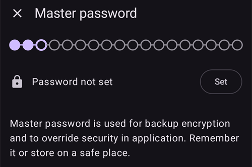

Откроется экран «**Защита**». Нажмите «**Главный пароль**» (под ним написано «Пароль не задан»):

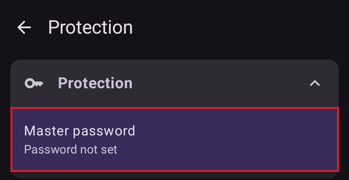

Введите один и тот же пароль в оба поля и нажмите «**OK**»:

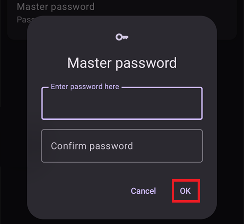

Вернитесь назад стрелкой в левом верхнем углу. Теперь Мастер показывает «**Пароль задан!**»:

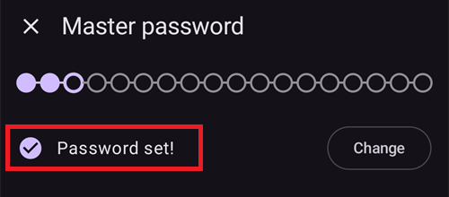

```{admonition} Do not lose your Master Password
:class: danger
**НЕ ПОТЕРЯЙТЕ ГЛАВНЫЙ ПАРОЛЬ**. Запишите его, _например_, на Google Диске: это хорошее место, так как Google делает для вас резервную копию. Телефон или ПК могут выйти из строя, и у вас может не оказаться актуальной копии. Если вы забыли главный пароль, то будет трудно восстановить конфигурацию профиля и прохождение **Целей**. См. [Как сбросить главный пароль?](#FAQ-reset-master-password)
```

Когда закончите, нажмите «**Далее**», чтобы перейти к следующему экрану.

(setup-wizard-import-settings)=
## Выполните импорт настроек

Этот экран показывается, только если **AAPS** находит ранее экспортированные настройки в папке **AAPS** («Найдены сохраненные параметры»), например, когда вы переустанавливаете приложение или переходите на новый телефон.

- Чтобы восстановить прежнюю конфигурацию, нажмите «**Импортировать настройки**» — см. [Создание и восстановление резервных копий](../Maintenance/ExportImportSettings.md).
- Чтобы начать с новой конфигурации, нажмите «**Далее**» и продолжайте работу с Мастером.

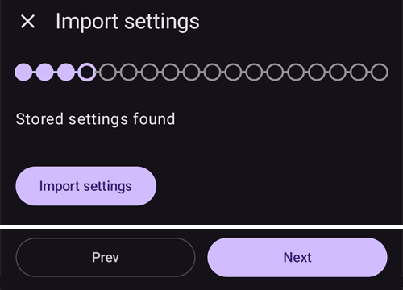

## Единицы (мг/дл <-> ммоль/л)

Выберите, в каких единицах ваши значения глюкозы — мг/дл или ммоль/л, затем нажмите кнопку «**Далее**»:

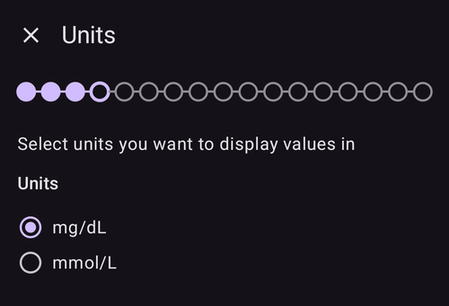

## Display Settings

Здесь вы задаете «**отметка НИЗКИЙ**» и «**Отметка ВЫСОКИЙ**» для отображения глюкозы сенсора. Значения глюкозы между этими двумя отметками показываются как «в диапазоне». Пока можно оставить значения по умолчанию (72 и 180 мг/дл) и изменить их позже.

Эти значения влияют только на графическое отображение ГК и больше ни на что.

Ваша целевая глюкоза, _например_, настраивается отдельно в профиле.

Величины для анализа TIR (времени в целевом диапазоне) конфигурируются отдельно при создании отчетов на сервере отчетов.

При необходимости измените отметки кнопками «−» / «+», затем нажмите кнопку «**Далее**»:

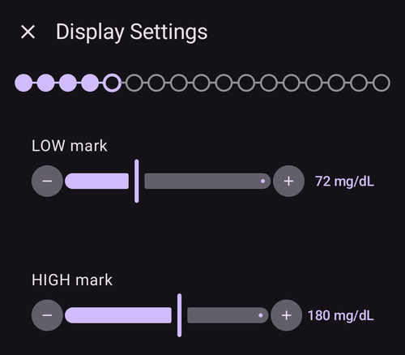

(SetupWizard-synchronization-with-the-reporting-server-and-more)=
## Связь

На экране «**Связь**» показаны модули для загрузки, синхронизации и передачи ваших данных:

- **SMS коммуникатор** – удаленное управление **AAPS** с помощью SMS-команд
- **NSClientV3** – синхронизирует ваши данные с Nightscout через API v3
- **Tidepool** – загружает данные в Tidepool
- **xDrip** – отправляет данные в xDrip
- **Open Humans** – загрузка и передача ваших данных о диабете в научные проекты
- **Wear** – мониторинг и управление **AAPS** со смарт-часов WearOS
- **Внешние приложения-компаньоны** – передача данных в различные внешние приложения
- **Garmin** – связь с устройством Garmin

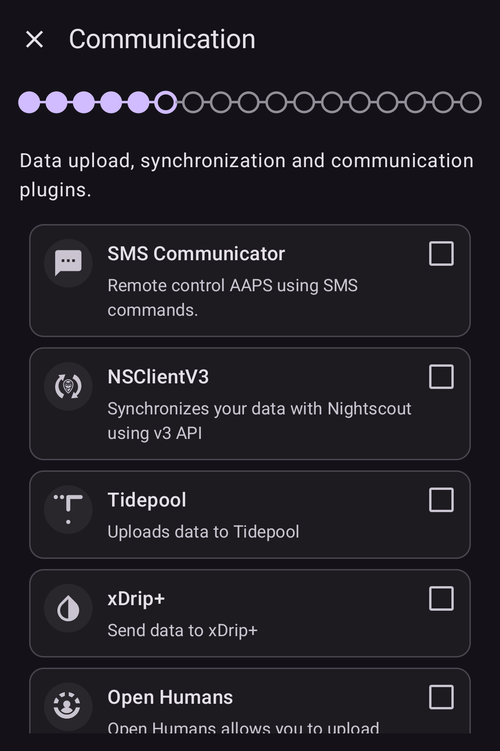

Прокрутите вниз, чтобы увидеть остальную часть списка:

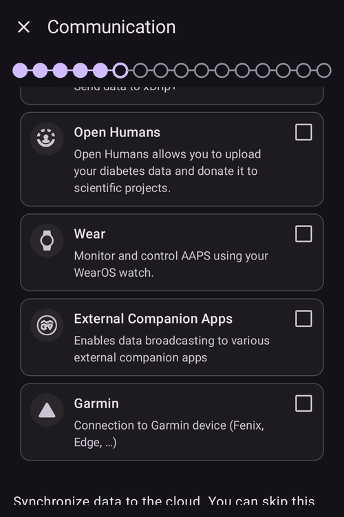

Сейчас можно настроить несколько из них, но при первом запуске мы займемся только сервером отчетности. Если сейчас вы не можете его настроить, пока пропустите этот шаг — его можно настроить позже.

В этом примере мы используем Nightscout как сервер отчетности. Поставьте галочку справа от «**NSClientV3**», чтобы включить его. Для Tidepool проще, так как требуются только персональные данные для входа.

После включения нажмите «**Настройки**» под NSClientV3, чтобы настроить его:

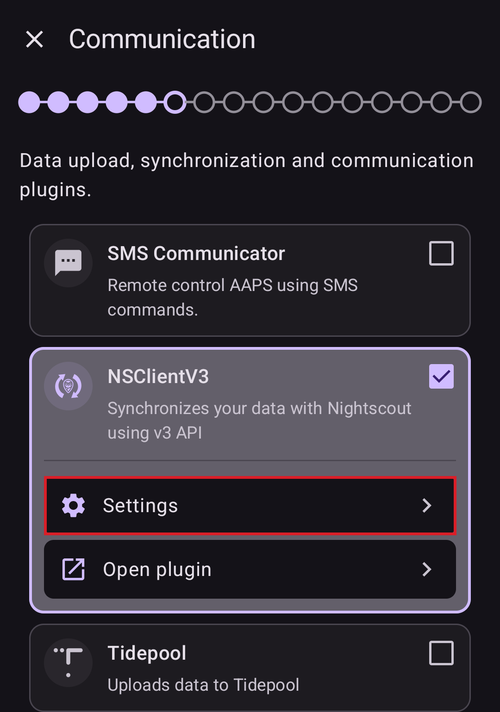

Здесь вы настраиваете сервер отчетности Nightscout. Настройки NSClientV3 показаны на одной странице с прокруткой:

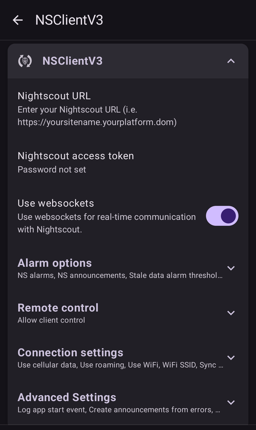

Нажмите «**URL-адрес Nightscout**» и введите адрес вашего сервера Nightscout (URL, который вы настроили сами или получили от вашего поставщика услуг). Подтвердите кнопкой «**OK**».

Нажмите «**Код доступа Nightscout**» и введите токен доступа к вашему серверу Nightscout. Без него доступа не будет. Если у вас его еще нет, посмотрите документацию по настройке сервера отчетности.

Оставьте «**Использовать websockets**» включенным для связи с Nightscout в реальном времени. Websockets **обязательны** для удаленного управления из **AAPSClient** на обоих телефонах.

Остальные разделы пока можно оставить по умолчанию. Они описаны здесь, чтобы вы знали, где их найти позже:

**опции оповещения** — сигналы тревоги Nightscout, оповещения и пороги устаревших данных. Пока оставьте переключатели выключенными; мы открываем их только для того, чтобы вы знали об этих параметрах.

**Параметры подключения** — выберите, как передаются данные. Опекуны должны включить «**Использовать мобильные данные**», иначе телефон человека, о котором они заботятся (_например_, ребенка), не сможет загружать данные вне зоны Wi-Fi, _например_, по дороге в школу. Другие пользователи могут отключить передачу через мобильную сеть, чтобы сэкономить трафик или заряд батареи. Если сомневаетесь, оставьте всё включенным.

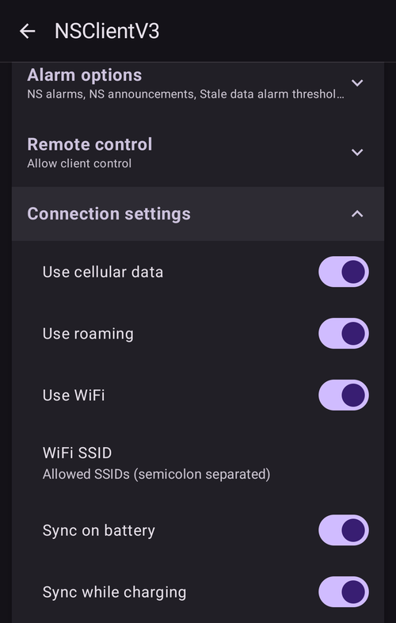

**Дополнительные настройки** — включите «**Записывать событие запуска приложения**», если хотите видеть в Nightscout, когда приложение перезапускается (полезно для опекунов). Оставьте включенными «**Создавать оповещения из ошибок**» и «**Создавать оповещения о необходимых углеводах**». Оставьте «**Использовать медленную синхронизацию**» выключенным; она нужна, только если сервер Nightscout медленно обрабатывает большой объем данных.

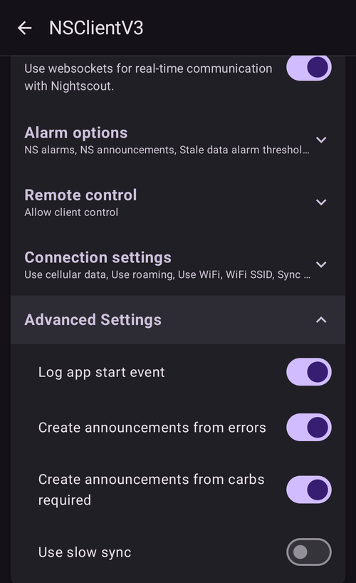

Вернитесь к списку модулей и нажмите «**Далее**», чтобы перейти к следующему экрану.

## Управление клиентами

Начиная с версии 4 **AAPS** клиентские устройства с **AAPSClient** можно **сопрячь** с этим телефоном (**основным телефоном**) и управлять им с помощью подписанных команд, которые передаются через Nightscout. Это новый рекомендуемый способ удаленного управления **AAPS** — полное описание и настройку см. в разделе [Управление «основной телефон ↔ клиент»](../RemoteFeatures/ClientMasterControl.md).

На этом экране сейчас ничего настраивать не нужно; сопрячь клиентов можно в любое время позже в **Управление → Авторизованные клиенты**. Там вы добавляете клиента с помощью **QR-кода** (он также настраивает Nightscout на клиенте) или **PIN-кода** и назначаете ему **роль**.

- «**Авторизованные клиенты**» — управление сопряженными клиентскими устройствами, которым разрешено управлять этим основным телефоном.
- «**Прием данных из Nightscout**» — прием терапии и данных, введенных прямо в Nightscout (старый, менее безопасный способ), теперь по умолчанию выключен. Открывайте эти настройки, только если это вам еще нужно, _например_, чтобы вводить данные через Nightscout или сторонние приложения.

Если управление клиентами уже включено — а в [Простом режиме](#preferences-simple-mode) оно включено всегда, — этот телефон находится в [защищенном режиме](#client-master-control-hardened-mode): он принимает изменения только от сопряженных клиентов, поэтому вместо настроек «**Прием данных из Nightscout**» на экране объясняется защищенный режим.

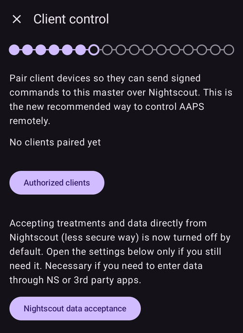

«**Прием данных из Nightscout**» открывает настройки «**Синхронизация**», где для каждого вида данных, получаемых из Nightscout, есть свой переключатель:


Нажмите «**Далее**», чтобы перейти к следующему экрану.

(setup-wizard-instance-name)=
## Кто пользуется этим телефоном?

Здесь вы вводите имя человека, который пользуется этим телефоном. Оно отличает этот экземпляр **AAPS** от других в отчетах и при синхронизации, например, если в вашей семье **AAPS** пользуются двое детей. Оно также используется в названиях файлов экспортированных настроек и показывается на часах.

Можете выбрать любое. Его можно изменить позже в **Настройки → Общее → Имя экземпляра**.

Нажмите «**Далее**», чтобы перейти к следующему экрану.

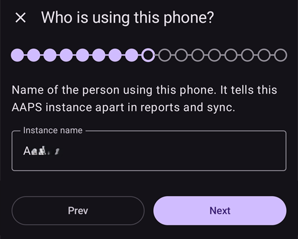

## Patient type

Здесь вы выбираете «Тип пациента». Это важно, потому что в программе **AAPS** разные ограничения в зависимости от возраста пациента. Это важно по соображениям безопасности и как мера предосторожности.

Здесь же вы настраиваете **максимально допустимый болюс** на прием пищи. То есть, самый большой болюс, который можно ввести на свои обычные блюда. Это функция безопасности, которая помогает избежать случайной передозировки, когда вы вводите болюс на еду.

Второе ограничение аналогично по концепции, но относится к максимальному ожидаемому потреблению углеводов.

Задав эти значения, нажмите «**Далее**», чтобы перейти к следующему экрану:

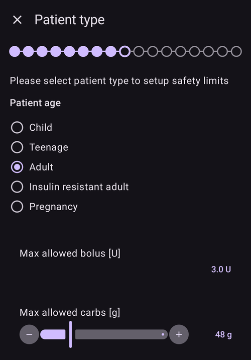

## Инсулин

Здесь вы настраиваете инсулин, который используется в вашей помпе. Для новых профилей инсулина нужно **DIA не меньше 5 ч**.

Нажмите кнопку «**Инсулин**», чтобы открыть редактор инсулина:

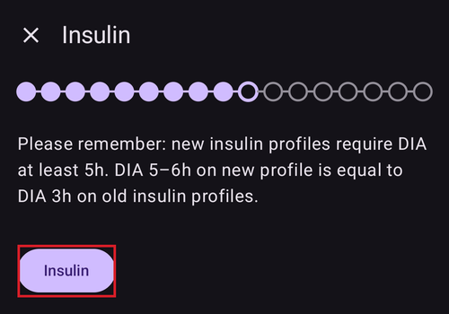

В редакторе можно дать инсулину **краткое имя** и задать его **Пик** (в минутах) и **DIA** (в часах). Быстрее всего загрузить готовое значение через «**Загрузить пик из**» — выберите **Novorapid**, **Fiasp** или **Lyumjev**, и пик будет заполнен за вас. График внизу заранее показывает получившуюся кривую активности инсулина.

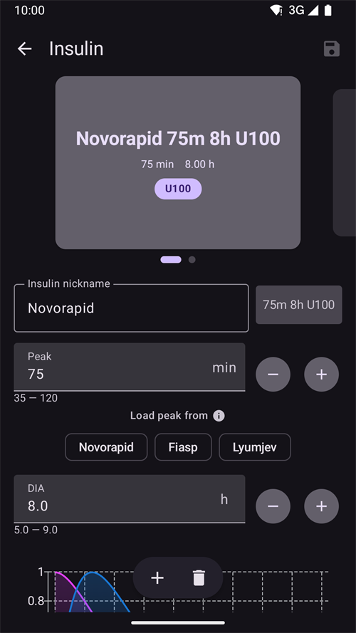

Выберите готовое значение, которое подходит вашему инсулину, например **Fiasp**:

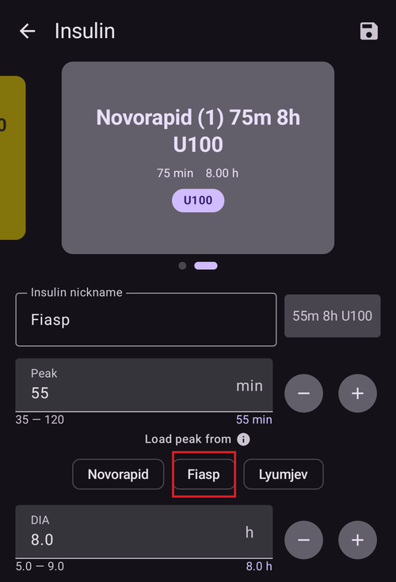

```{admonition} Use your insulin brand's preset peak
:class: danger
Не меняйте пик, если вы не эксперт — обычно готовые значения хорошо подходят для каждой марки инсулина.
```

Если вы новый пользователь **AAPS**, установите **DIA** 9 часов — почему, см. в разделе [Время действия инсулина (DIA) и пик](#Config-Builder-insulin-dia).

```{admonition} "Insulin configuration changed" dialog
:class: note
Если сопряженный клиент (_например_, другой телефон) изменил настройки инсулина, появится окно. Нажмите **OK**, чтобы загрузить его изменения, или **Отменить**, чтобы продолжить редактирование (ваше следующее сохранение перезапишет его изменения).
```

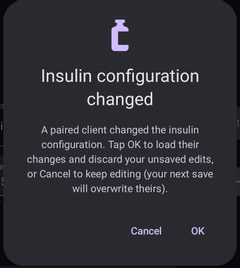

Нажмите значок сохранения (вверху справа), затем нажмите «**Далее**», чтобы перейти к следующему экрану.

## Источник ГК

Здесь вы выбираете, откуда **AAPS** получает данные глюкозы. Прочитайте документацию для вашего [источника ГК](../Getting-Started/CompatiblesCgms.md).

Доступно много источников — прокрутите список и выберите тот, которым пользуетесь:

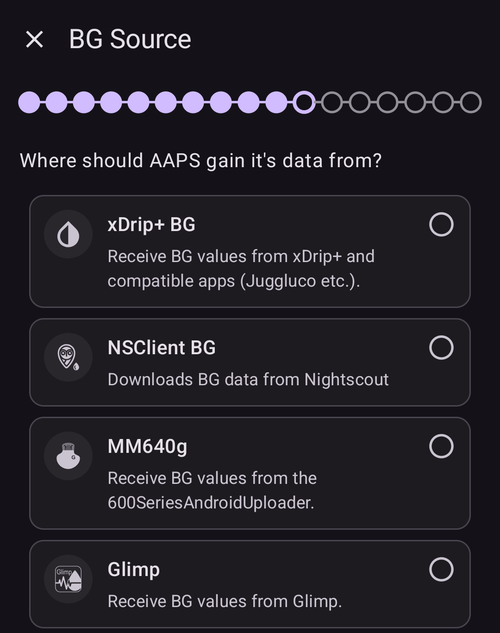

Когда вы выбираете источник, его карточка раскрывается и показывает две кнопки: «**Настройки**», чтобы настроить прием данных, и «**Открыть модуль**», чтобы открыть собственный экран источника. В примере ниже выбран **BYODA**. У некоторых источников на этом этапе нечего настраивать, поэтому обычно можно сразу перейти к следующему экрану:

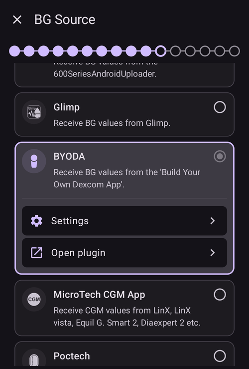

Сделав выбор, нажмите «**Далее**», чтобы перейти к следующему экрану.

(setup-wizard-profile)=
## Профиль

Теперь мы переходим к очень важной части мастера установки.

Прочитайте документацию о [профилях](../SettingUpAaps/YourAapsProfile.md), прежде чем вводить данные профиля на следующем экране.

```{admonition} Working profile required - no exceptions here !
:class: danger
Для безопасной работы **AAPS** нужен точный профиль.

It's required that you have determined and discussed your profile with your doctor, and that it has been proven to work by successful basal rate, ISF and IC testing!

If a robot has an incorrect input it will fail - consistently. **AAPS** can only work with the information it is given. Если профиль слишком сильный, вы рискуете получить гипогликемию, а если слишком слабый, то гипергликемию. 
```

Нажмите кнопку «**Профиль**», чтобы открыть редактор профиля:

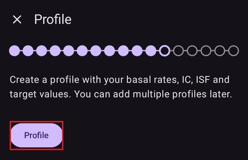

Редактор открывается пустым («Нет доступных записей»). Нажмите кнопку «**+**» внизу, чтобы создать новый профиль:

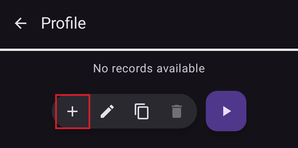

В дальнейшем при необходимости можно настроить несколько профилей. Мы здесь создадим только один.

```{admonition} Profile only for tutorial - not for your usage
:class: note
Профиль в этом примере только показывает, как вводить данные.

Это не точный и не хорошо оптимизированный профиль, потому что потребности у всех людей очень разные.

Не используйте его для реальной работы цикла!
```

У нового профиля (например, «**LocalProfile1**») четыре вкладки: **IC**, **ISF**, **БАЗА** и **ЦЕЛЬ**. Нажмите на карандаш рядом с названием профиля, чтобы переименовать его. Заполните каждую вкладку — вкладка остается красной и показывает сообщение об ошибке, пока в ней нет правильных значений:

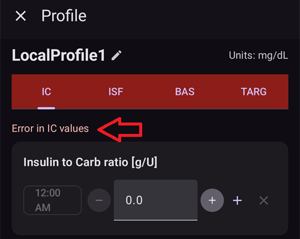

Нажмите «**IC**» и введите значения [IC](#your-aaps-profile-insulin-to-carbs-ratio). Кнопкой «**+**» добавьте другие периоды времени:


Нажмите «**ISF**» и введите [значения ISF](#your-aaps-profile-insulin-sensitivity-factor):

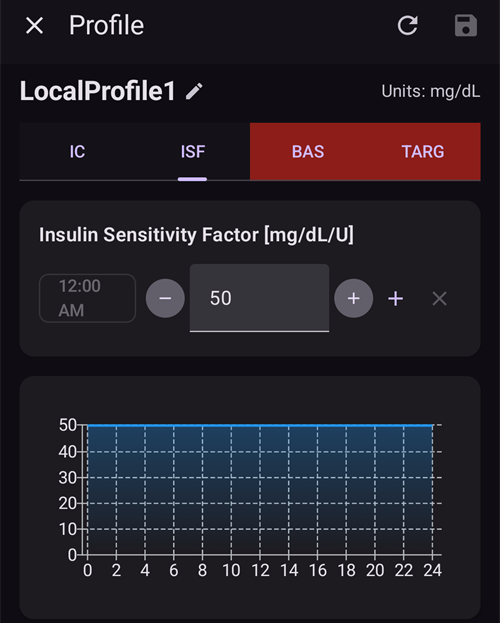

Нажмите «**БАЗА**» и введите [значения базала](#your-aaps-profile-basal-rates):


Нажмите «**ЦЕЛЬ**» и введите целевые значения ГК.

Для открытого цикла цель может быть более широким диапазоном, иначе **AAPS** будет постоянно уведомлять вас о необходимости изменить временную базальную скорость или другой параметр, а это утомляет.

Позднее для замкнутого цикла у вас обычно будет одно значение для верхней и нижней границы. Так **AAPS** легче попадать в цель, и в целом вы лучше контролируете диабет.

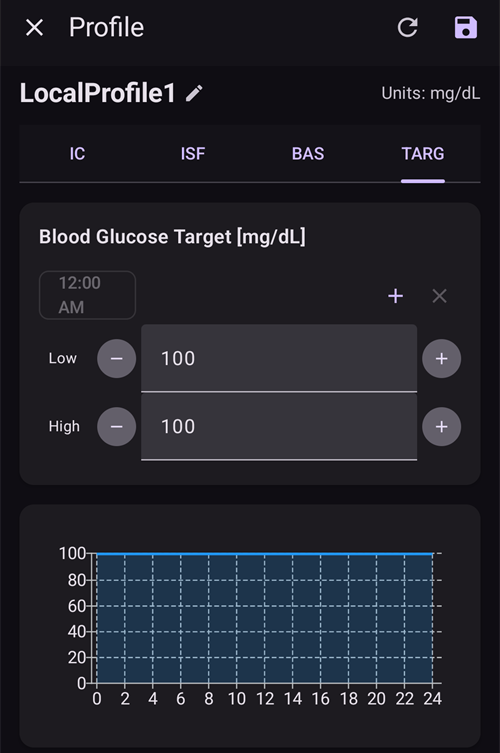

Когда все четыре вкладки заполнены правильно, **значок сохранения** (вверху справа) становится активным. Нажмите его, чтобы сохранить профиль:

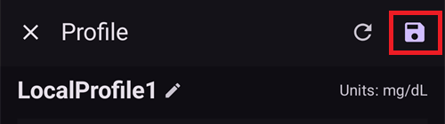

Закройте редактор кнопкой «**X**» в левом верхнем углу. Затем в сводке профиля видны его название, общий суточный базал (∑), единицы, а также значения IC и ISF с графиками:

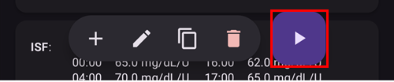

```{admonition} Several defined but only one active profile
:class: note
Можно создать несколько профилей, но в каждый момент времени активен только один.
```

Нажмите кнопку «**▶**» (активировать) в правом нижнем углу. Откроется экран «**Активировать**». Так как инсулин еще не используется, сначала вас попросят выбрать инсулин, которым вы пользуетесь, чтобы он был записан при переключении профиля. Пока вы этого не сделаете, кнопка «**Активировать**» остается серой:

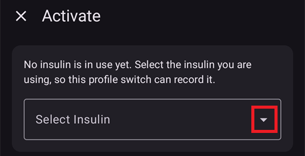

Нажмите «**Укажите инсулин**» и выберите инсулин, который вы настроили раньше. Оставьте процент 100% и нажмите «**Активировать**»:

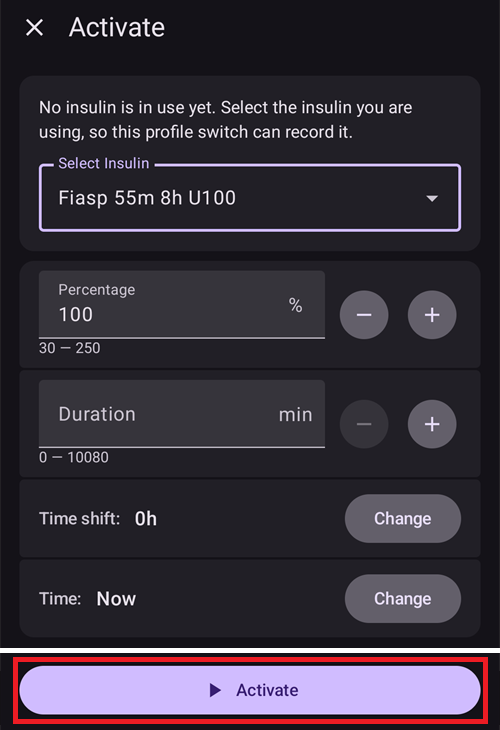

Появится окно переключения профиля. В этом случае оставьте всё как есть и подтвердите кнопкой «**OK**»:

```{admonition} Profile switch dialog
:class: note
Позже вы узнаете, как использовать это общее окно в таких ситуациях, как болезнь или спорт, когда нужно изменить профиль под обстоятельства.
```

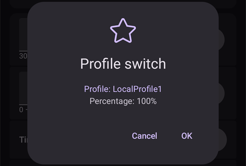

Теперь ваш профиль активен. Нажмите «**Далее**», чтобы перейти к следующему экрану.

## Инсулиновая помпа

Теперь выберите вашу инсулиновую помпу. Прочитайте документацию для вашей [инсулиновой помпы](../Getting-Started/CompatiblePumps.md).

Прокрутите список и выберите вашу помпу. В этом примере мы используем «**Виртуальная помпа**»: она полезна, пока вы еще учитесь и не подключили настоящую помпу:

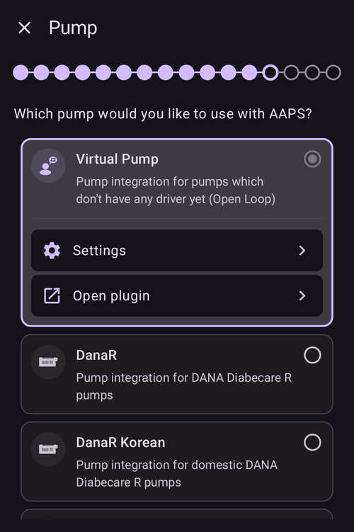

Поддерживается много помп — прокрутите список вниз, чтобы найти вашу:

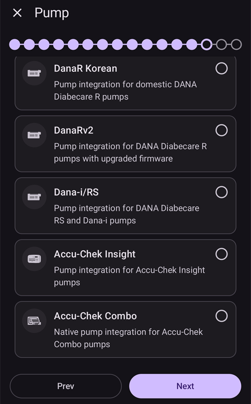

Когда вы выбираете настоящую помпу, **AAPS** просит подтверждения, потому что он скопирует базальные скорости из вашего профиля в помпу и перезапишет базальные скорости, сохраненные в ней. Нажимайте «**OK**», только если базальные скорости в вашем профиле **AAPS** правильные; иначе нажмите «**Отменить**» и переключитесь на помпу позже:

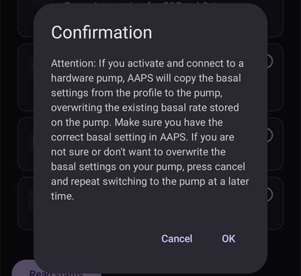

Если выбранная помпа связывается по Bluetooth, **AAPS** после завершения Мастера попросит разрешение на подключение к устройствам поблизости (см. [Разрешение Bluetooth](#setup-wizard-bluetooth-permission)).

Если вы уже настроили профиль и знаете, как подключить помпу, можете подключить ее сейчас. Иначе пока оставьте **Виртуальная помпа** — ее можно изменить в любое время, или выйдите из Мастера установки стрелкой в левом верхнем углу и дайте **AAPS** сначала показать вам несколько значений ГК.

Нажмите «**Далее**», чтобы перейти к следующему экрану.

## APS algorithm

Примените алгоритм OpenAPS SMB. Несмотря на название, функция SMB алгоритма выключена, пока вы не освоите AAPS и не пройдете первые цели. В любом случае OpenAPS SMB новее и в целом лучше, чем OpenAPS AMA.

В начале SMB выключен, потому что функция SMB быстрее реагирует на рост ГК: она использует супер микроболюс вместо увеличения процента базальной скорости. Обычно в начале ваш профиль не так хорош, как после некоторого опыта, поэтому сначала эта функция выключена.

```{admonition} Only use the older algorithm **OpenAPS AMA** if you know what you are doing
:class: note
OpenAPS AMA — самый простой алгоритм, он не поддерживает микроболюсы для коррекции высоких значений. There might be circumstances where it is better to use this algorithm but it is not the recommendation.
```

Выберите «**OpenAPS SMB**», затем нажмите «**Настройки**», чтобы увидеть подробности:


Единственный параметр здесь — «**Использовать динамическую чувствительность**». Оставьте его выключенным и пока ничего не меняйте — просто прочитайте текст.

Из-за ограничений, которые накладывают **Цели**, сейчас вы всё равно не можете использовать ни «замкнутый цикл», ни «функции SMB».

Вернитесь назад и нажмите «**Далее**», чтобы перейти к следующему экрану:


## Определение чувствительности

Оставьте выбранным «**Чувствительность Oref1**» как стандартный модуль чувствительности:


Если нажать «**Настройки**», можно посмотреть настройки усвоения; значения по умолчанию (_например_, предельное время усвоения 6 ч) пока подходят.


Нажмите «**Далее**», чтобы перейти к следующему экрану.

## Начните выполнение Цели 1

Теперь вы переходите к Целям — это допуск к другим функциям **AAPS**.

Нажмите «**Открыть Цели**»:


Здесь мы запускаем цель 1, даже если на данный момент наши настройки не полностью готовы к завершению этой цели. Но это – начало.

Нажмите кнопку «**Начать**» у **Цели 1**:


Цель раскрывается и показывает отдельные проверки. Видно, что вы уже кое-что сделали, а другие пункты еще нужно выполнить:


Вернитесь назад, затем нажмите «**ГОТОВО**», чтобы завершить Мастер установки:


После нажатия «**ГОТОВО**» вы попадете на главный экран **AAPS**. Может открыться панель «**Уведомление**» с информационными сообщениями, например о только что выполненном переключении профиля, — нажмите «**Скрыть**» под каждым сообщением, чтобы убрать его.

Если вы случайно вышли из Мастера установки, вы можете просто запустить мастер снова или изменить [конфигурацию цикла AAPS](../SettingUpAaps/ChangeAapsConfiguration.md) вручную.

(setup-wizard-bluetooth-permission)=
## Разрешение Bluetooth

Если вы выбрали помпу, которая подключается по Bluetooth (например, **Omnipod Dash**), баннер напомнит, что **AAPS** нужно разрешение Bluetooth. Пока можно нажать «**Скрыть**» — разрешение дается после завершения Мастера:


После завершения Мастера установки на главном экране **AAPS** появится панель «**Требуются разрешения**». Остальные разрешения уже даны; нажмите «**Предоставить**» рядом с «**Bluetooth**»:


Выберите «**Разрешить**», чтобы **AAPS** мог находить вашу помпу и подключаться к ней:


Если цикл **AAPS** теперь полностью настроен, переходите к следующему разделу [«Прохождение целей»](../SettingUpAaps/CompletingTheObjectives.md).
