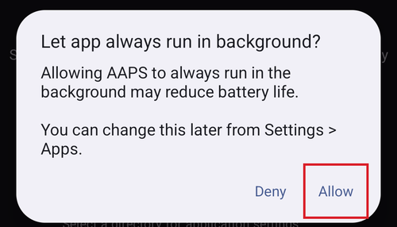
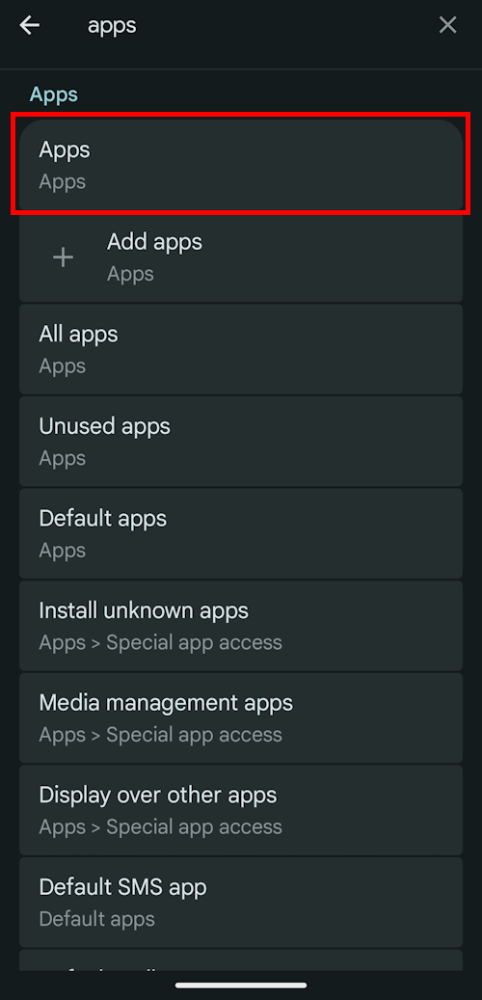
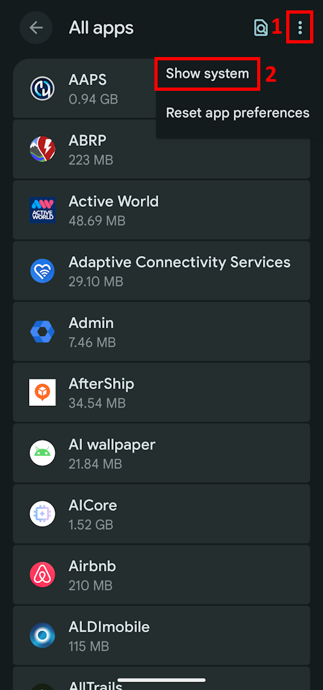
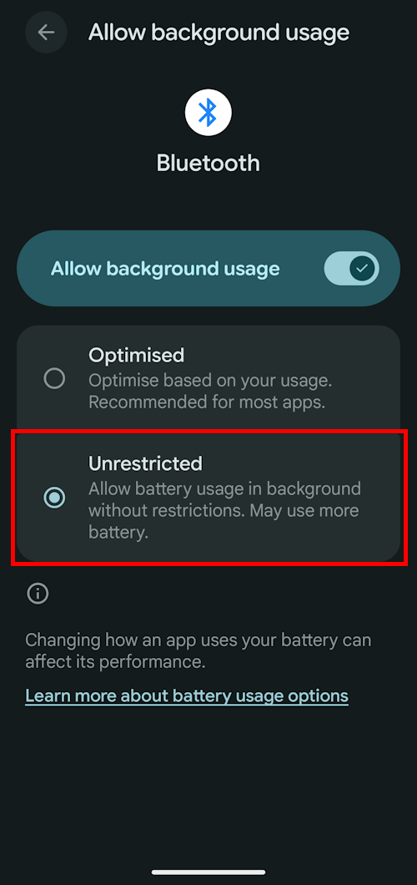
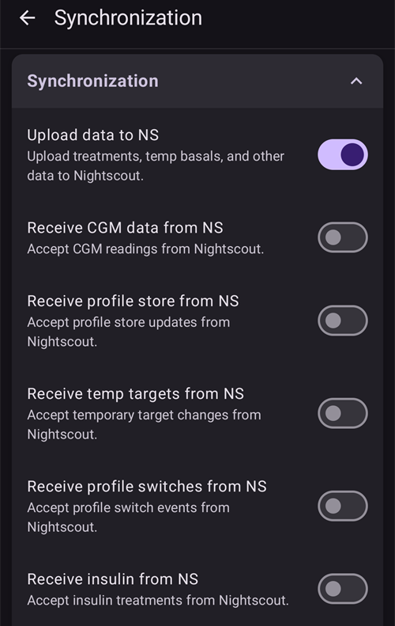
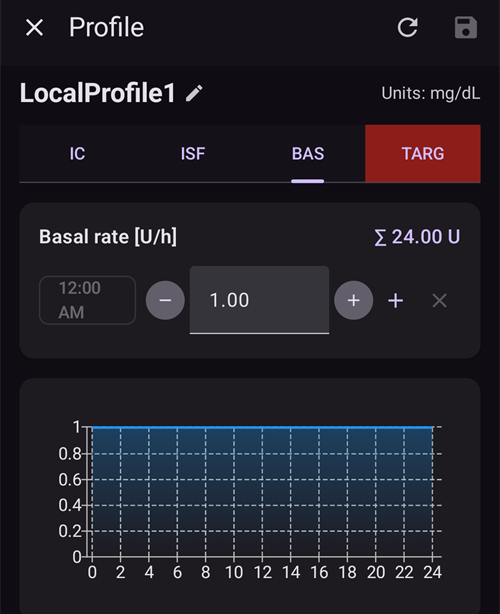
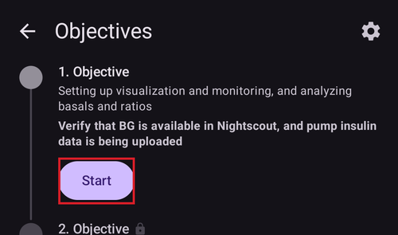

# Мастер установки AAPS

```{contents} In this page
:backlinks: entry
:depth: 2
```

Когда вы запускаете **AAPS** в первый раз, вас ведет «**Мастер установки**», чтобы быстро и за один раз настроить все основные параметры приложения. **Мастер установки** ведет вас по шагам, чтобы вы не забыли ничего важного. Например, **настройки разрешений** очень важны для правильной настройки **AAPS**.

Однако не обязательно настраивать всё полностью при первом запуске **Мастера установки**: вы можете легко выйти из мастера и вернуться к нему позже. There are three routes available after the **Setup Wizard** to further optimize/change the configuration. О них расскажем в следующем разделе. Итак, если пропустить некоторые этапы в мастере установки, их можно легко выполнить позже.

Во время работы с **Мастером установки** и сразу после нее вы можете не заметить в **AAPS** никаких заметных изменений. Чтобы включить цикл **AAPS**, нужно проходить **Цели** и включать функции одну за другой. В конце работы Мастера установки вы начнете **Цель 1**. Вы управляете **AAPS**, а не наоборот.

```{admonition} Preview Objectives
:class: note
Если вы хотите узнать, как устроены цели, прочитайте [Прохождение целей](../SettingUpAaps/CompletingTheObjectives.md), но затем вернитесь сюда и сначала пройдите Мастер установки.

```

По опыту мы знаем, что новички часто торопятся настроить **AAPS** как можно быстрее. Это может привести к разочарованию, потому что учиться придется многому.

Поэтому не спешите с настройкой цикла: польза от хорошо работающего цикла **AAPS** огромна.

```{admonition} Ask for Help
:class: note
Если вы нашли ошибку в документации или знаете, как объяснить что-то лучше, вы можете обратиться за помощью к сообществу, как описано в разделе [Где получить помощь?](../GettingHelp/WhereCanIGetHelp.md).
```
## Приветственное сообщение

When the Setup Wizard opens, it greets you with a short welcome message and immediately shows a "**Permissions Required**" panel at the bottom of the screen (see next section).

Once you have granted the permissions, the panel closes and the welcome screen shows a "**Next**" button. Press "**NEXT**" to continue:


## Необходимые разрешения

**AAPS** needs a few permissions to operate correctly. The Wizard groups them on a single "**Permissions Required**" panel, each with its own "**Grant**" button. Grant them one by one — the icon next to each item turns into a tick once it is done.


### Battery optimization

Расход батареи на смартфонах важен, так как возможности батарей всё еще довольно ограничены. Поэтому операционная система Android на смартфоне ограничивает работу приложений и их использование процессора, а значит и заряда батареи.

Однако **AAPS** должен работать регулярно, _например_, чтобы получать значения глюкозы каждые несколько минут, а затем применять алгоритм и решать, что делать с уровнем глюкозы на основе ваших настроек. Therefore it must be excluded from battery optimization.

Press "**Grant**" next to "**Battery Optimization**", then select "**Allow**" on the "Let app always run in background?" dialog:



(SetupWizard-StoragePermission)=

### Папка AAPS

**AAPS** needs to store its settings and log information on the permanent storage of your smartphone. Постоянная память означает, что информация будет доступна даже после перезагрузки телефона. Остальная информация теряется, поскольку она не сохраняется в постоянной памяти.

Press "**Grant**" next to "**AAPS Directory**". This opens the file system on your phone and lets you choose where **AAPS** stores its information.

```{tip}
Рекомендуется выбрать папку AAPS по умолчанию.</br>
**Не** выбирайте подпапку внутри AAPS.
```

Папка по умолчанию — **AAPS**, но вы можете использовать любую отдельную папку на ваш выбор. Create the directory if necessary, enter it and choose "**USE THIS FOLDER**":


Confirm with "**ALLOW**" that you wish to grant access to **AAPS** to the selected directory:


### Notifications

Android требует специального разрешения для уведомлений от приложений.

While it is a good feature to disable notifications _e.g._ from social media apps, it is essential that you allow **AAPS** to send you notifications.

Press "**Grant**" next to "**Notifications**" and select "**Allow**" at the system prompt:


### Alarms and reminders

On **Android 14 and newer**, **AAPS** needs the "**Alarms and reminders**" permission so that alarms can wake the screen while **AAPS** is in the background, and so that reminders (for example from an **Automation**) ring on time.

This item is only shown while it is needed. Once **AAPS** is excluded from battery optimization (see above), Android grants exact alarms automatically and the item disappears. If it is still listed, press "**Grant**" next to "**Alarms and reminders**". This opens a system settings screen for **AAPS**; enable the toggle and return to **AAPS**. On Android 13 and older this item does not appear and no action is needed.

Once all the permissions show a tick (three, or four on Android 14 and newer), the "**Permissions Required**" panel closes by itself and you can press "**NEXT**" on the welcome screen to continue.

(setup-wizard-bluetooth-battery-optimisation)=
### Bluetooth battery optimization

```{admonition} Extra Android setting, not part of the Wizard
:class: note
The following is additional Android configuration done outside of the Setup Wizard. It is not one of the "Grant" buttons above, but it is important for a reliable pump connection.
```

Newer versions of Android have added battery optimization to the system Bluetooth application too.

As well as disabling battery optimization for **AAPS**, you will likely need to also disable this for the Bluetooth system app. Если этого не сделать, соединение с помпой может прерываться и возникнут проблемы.

***ПРИМЕЧАНИЕ: в документации xDrip описано, как это сделать: [документация xDrip](https://navid200.github.io/xDrip/docs/BluetoothBatteryOpt.html)***

Follow these steps on Android 16; other versions will vary slightly from the provided screenshots:

1. Откройте настройки Android, найдите **Приложения** и откройте настройки приложений.

   

2. Вы увидите настройки приложений, но нужно развернуть список, чтобы увидеть все приложения: нажмите **Показать все приложения**.

   

3. As the Bluetooth app is a system app, it's hidden by default, so we need to show system apps. Click on the **three dots** (⋮) on the top right (1). Then click on **Show system** (2).

   

4. Найдите приложение `Bluetooth` и нажмите на `Bluetooth` и/или `Legacy Bluetooth`; если есть оба, выполните эти шаги для обоих.

   ***ПРИМЕЧАНИЕ: `Bluetooth MIDI Service` можно не трогать, AAPS его не использует***

           

   1. On Android 12 click on `Battery`, on Android 13+ click on `App battery usage`.

      

5. На Android 12+ выберите вариант `Без ограничений`, на Android 15+ нужно развернуть настройку `Разрешить работу в фоновом режиме` (Allow background usage): нажмите на раздел, выделенный красным, а затем выполните шаг 6.

       

6. На Android 16 выберите `Без ограничений`

   

## Лицензионное соглашение

В лицензионном соглашении с конечным пользователем есть важная информация о правовых аспектах использования **AAPS**. Внимательно изучите его.

Если вы не понимаете лицензионное соглашение или не можете с ним согласиться, не используйте **AAPS** совсем!

If you understand and agree, please press the "**I UNDERSTAND AND AGREE**" button and follow the Setup Wizard:


A "**Next**" button appears once you have agreed. Press "**NEXT**".

The next screen, "**Permissions**", lists the permissions again. They should all show a tick, as you granted them at the start. If one is missing, press "**Grant**" next to it. Press "**NEXT**" to continue:


## Master password

As the configuration of **AAPS** contains some sensitive data (_e.g._ the access token for your Nightscout server) it is encrypted by a password you set here.

The Wizard shows "**Password not set**". Press "**Set**":


This opens the "**Protection**" screen. Press "**Master password**" (shown as "Password not set"):


Enter the same password in both fields and press "**OK**":


Go back with the arrow in the top left corner. The Wizard now shows "**Password set!**":


```{admonition} Do not lose your Master Password
:class: danger
Please **DO NOT LOSE YOUR MASTER PASSWORD**. Make a note of it _e.g._ on Google Drive, which is a good place as it is backed up by Google for you. Телефон или ПК могут выйти из строя, и у вас может не оказаться актуальной копии. Если вы забыли главный пароль, то будет трудно восстановить конфигурацию профиля и прохождение **Целей**. See [How to reset the master password?](#FAQ-reset-master-password)
```

When you are done, press "**NEXT**" to go to the next screen.

(setup-wizard-import-settings)=
## Выполните импорт настроек

This screen is only shown when **AAPS** finds settings exported earlier in the **AAPS** directory ("Stored settings found"), for example when you reinstall the app or move to a new phone.

- To restore your previous configuration, press "**Import settings**" — see [Export & import settings](../Maintenance/ExportImportSettings.md).
- To start with a new configuration, press "**NEXT**" and continue with the Wizard.


## Единицы (мг/дл <-> ммоль/л)

Please select if your glucose values are in mg/dL or mmol/L, then press the "**NEXT**" button:


## Display Settings

Here you set the "**LOW mark**" and "**HIGH mark**" for the sensor glucose display. Glucose values between these two marks are shown as "in range". You can leave the default values (72 and 180 mg/dL) for now, and edit them later.

Эти значения влияют только на графическое отображение ГК и больше ни на что.

Ваша целевая глюкоза, _например_, настраивается отдельно в профиле.

Величины для анализа TIR (времени в целевом диапазоне) конфигурируются отдельно при создании отчетов на сервере отчетов.

Adjust the marks with the "−" / "+" buttons if needed, then press the "**NEXT**" button:


(SetupWizard-synchronization-with-the-reporting-server-and-more)=
## Communication

The "**Communication**" screen lists the plugins used to upload, synchronize and broadcast your data:

- **SMS Communicator** – remote control of **AAPS** using SMS commands
- **NSClientV3** – synchronizes your data with Nightscout using the v3 API
- **Tidepool** – uploads data to Tidepool
- **xDrip** – sends data to xDrip
- **Open Humans** – upload and donate your diabetes data to scientific projects
- **Wear** – monitor and control **AAPS** from a WearOS watch
- **External Companion Apps** – data broadcasting to various external apps
- **Garmin** – connection to a Garmin device


Scroll down to see the rest of the list:


You could configure several of these now, but for the first run we will just focus on the reporting server. If you are not able to set it up at the moment, skip it for now — you can configure it later.

In this example we use Nightscout as reporting server. Tick the box on the right of "**NSClientV3**" to enable it. Для Tidepool проще, так как требуются только персональные данные для входа.

Once enabled, press "**Settings**" below NSClientV3 to configure it:


Here you configure the Nightscout reporting server. The NSClientV3 settings are shown as one scrollable page:


Press "**Nightscout URL**" and enter your personal Nightscout server address (the URL you set up yourself, or were given by your service provider). Confirm with "**OK**".

Press "**Nightscout access token**" and enter the access token for your Nightscout server. Без него доступа не будет. If you don't have it yet, please check the documentation for setting up the reporting server.

Leave "**Use websockets**" enabled for real-time communication with Nightscout. Websockets are **mandatory** for remote control from **AAPSClient**, on both phones.

The remaining sections can be left at their defaults for now. They are described here so you know where to find them later:

**Alarm options** — Nightscout alarms, announcements and stale-data thresholds. Leave the switches off for now; we only open them so you are aware of the options.

**Connection settings** — choose how data is transferred. Caregivers must enable "**Use cellular data**", otherwise the phone of the person they care for (_e.g._ a child) cannot upload outside Wi-Fi range, _e.g._ on the way to school. Other users can disable cellular transfer to save data or battery. If in doubt, leave everything enabled.


**Advanced Settings** — enable "**Log app start event**" if you want to see in Nightscout when the app restarts (useful for caregivers). Keep "**Create announcements from errors**" and "**Create announcements from carbs required**" enabled. Leave "**Use slow sync**" off; you would only use it if the Nightscout server is slow to process a large amount of data.


Go back to the list of plugins and press "**NEXT**" to go to the next screen.

## Client control

From **AAPS** version 4, client devices running **AAPSClient** can be **paired** with this phone (the **master**) and control it with signed commands sent over Nightscout. This is the new recommended way to control **AAPS** remotely — see [Master ↔ Client control](../RemoteFeatures/ClientMasterControl.md) for the full explanation and setup.

There is nothing you have to configure on this screen now; you can pair clients at any time later from **Manage → Authorized clients**. There you add a client with a **QR code** (it sets up Nightscout on the client too) or with a **PIN**, and give it a **role**.

- "**Authorized clients**" — manage the paired client devices allowed to control this master.
- "**Nightscout data acceptance**" — accepting treatments and data entered directly in Nightscout (the old, less secure way) is now turned off by default. Only open these settings if you still need it, _e.g._ to enter data through Nightscout or third-party apps.

When client control is already on — always in [Simple Mode](#preferences-simple-mode) — this phone is in [hardened mode](#client-master-control-hardened-mode): it takes changes only from paired clients, so the screen explains hardened mode instead of offering the "**Nightscout data acceptance**" settings.


"**Nightscout data acceptance**" opens the "**Synchronization**" settings, where each kind of data received from Nightscout has its own switch:



Press "**NEXT**" to go to the next screen.

(setup-wizard-instance-name)=
## Who is using this phone?

Here you enter the name of the person using this phone. It tells this **AAPS** instance apart from others in reports and when synchronizing, for example if two children in your family use **AAPS**. It is also used in the names of exported settings files and shown on the watch.

Можете выбрать любое. You can change it later in **Settings → General → Instance name**.

Press "**NEXT**" to go to the next screen.


## Patient type

Здесь вы выбираете «Тип пациента». Это важно, потому что в программе **AAPS** разные ограничения в зависимости от возраста пациента. Это важно по соображениям безопасности и как мера предосторожности.

Здесь же вы настраиваете **максимально допустимый болюс** на прием пищи. То есть, самый большой болюс, который можно ввести на свои обычные блюда. It's a security feature to help avoid accidentally overdosing when you are bolusing for a meal.

Второе ограничение аналогично по концепции, но относится к максимальному ожидаемому потреблению углеводов.

After setting these values, press "**NEXT**" to go to the next screen:


## Инсулин

Here you configure the insulin used in your pump. New insulin profiles require a **DIA of at least 5 h**.

Press the "**Insulin**" button to open the insulin editor:


In the editor you can give the insulin a **nickname** and set its **Peak** (in minutes) and **DIA** (in hours). The quickest way is to load a preset with "**Load peak from**" — choose **Novorapid**, **Fiasp** or **Lyumjev** — and the peak is filled in for you. The graph at the bottom previews the resulting insulin activity curve.


Pick the preset that matches your insulin, for example **Fiasp**:


```{admonition} Use your insulin brand's preset peak
:class: danger
Please don't change the peak unless you are an expert — usually the preset values work well for each branded insulin.
```

If you are a new **AAPS** user, set **DIA** to 9 hours — see [Duration of insulin action (DIA) and peak](#Config-Builder-insulin-dia) to understand why.

```{admonition} "Insulin configuration changed" dialog
:class: note
If a paired client (_e.g._ another phone) has changed the insulin configuration, a dialog appears. Press **OK** to load their changes, or **Cancel** to keep editing (your next save will overwrite theirs).
```


Press the save icon (top right), then press "**NEXT**" to go to the next screen.

## Источник ГК

Here you select where **AAPS** gets its glucose data from. Прочитайте документацию для вашего [источника ГК](../Getting-Started/CompatiblesCgms.md).

Many sources are available — scroll through the list and select the one you use:


Once you select a source, its card expands and shows two buttons: "**Settings**" to adjust how the data is received, and "**Open plugin**" to open the source's own screen. In the example below, **BYODA** is selected. Some sources have nothing to configure at this stage, so you can usually go straight to the next screen:


After making your selection, press "**NEXT**" to go to the next screen.

(setup-wizard-profile)=
## Профиль

Теперь мы переходим к очень важной части мастера установки.

Прочитайте документацию о [профилях](../SettingUpAaps/YourAapsProfile.md), прежде чем вводить данные профиля на следующем экране.

```{admonition} Working profile required - no exceptions here !
:class: danger
Для безопасной работы **AAPS** нужен точный профиль.

It's required that you have determined and discussed your profile with your doctor, and that it has been proven to work by successful basal rate, ISF and IC testing!

If a robot has an incorrect input it will fail - consistently. **AAPS** can only work with the information it is given. Если профиль слишком сильный, вы рискуете получить гипогликемию, а если слишком слабый, то гипергликемию. 
```

Press the "**Profile**" button to open the profile editor:


The editor opens empty ("No records available"). Press the "**+**" button at the bottom to create a new profile:


В дальнейшем при необходимости можно настроить несколько профилей. Мы здесь создадим только один.

```{admonition} Profile only for tutorial - not for your usage
:class: note
The example profile here is only to show you how to enter data.

It is not intended to be an accurate profile or something very well optimized, because each person's needs are so different.

Не используйте его для реальной работы цикла!
```

The new profile (for example "**LocalProfile1**") has four tabs: **IC**, **ISF**, **BAS** and **TARG**. Press the pencil next to the profile name to rename it. Fill in every tab — a tab stays red and shows an error message until it contains valid values:


Press "**IC**" and enter your [IC](#your-aaps-profile-insulin-to-carbs-ratio) values. Use the "**+**" button to add more time blocks:


Press "**ISF**" and enter your [ISF values](#your-aaps-profile-insulin-sensitivity-factor):


Press "**BAS**" and enter your [basal values](#your-aaps-profile-basal-rates):



Press "**TARG**" and enter your blood sugar target values.

Для открытого цикла цель может быть более широким диапазоном, иначе **AAPS** будет постоянно уведомлять вас о необходимости изменить временную базальную скорость или другой параметр, а это утомляет.

Позднее для замкнутого цикла у вас обычно будет одно значение для верхней и нижней границы. Так **AAPS** легче попадать в цель, и в целом вы лучше контролируете диабет.


When all four tabs are valid, the **save icon** (top right) becomes active. Press it to save the profile:


Close the editor with the "**X**" in the top left corner. The profile summary then shows its name, its total daily basal (∑), the units and the IC and ISF values with their graphs:


```{admonition} Several defined but only one active profile
:class: note
You can have several profiles defined, but only one activated profile running at any given time.
```

Press the "**▶**" (activate) button at the bottom right. The "**Activate**" screen opens. As no insulin is in use yet, it first asks you to select the insulin you are using, so that the profile switch can record it. The "**Activate**" button stays greyed out until you do:


Press "**Select Insulin**" and choose the insulin you configured earlier. Leave the percentage at 100 % and press "**Activate**":


A profile switch dialog appears. In this case let it stay as preset and confirm with "**OK**":

```{admonition} Profile switch dialog
:class: note
You will learn later how to use this general dialog to handle situations like illness or sport, where you need to change your profile to suit the circumstances.
```


Your profile is now active. Press "**NEXT**" to go to the next screen.

## Инсулиновая помпа

Now you select your insulin pump. Прочитайте документацию для вашей [инсулиновой помпы](../Getting-Started/CompatiblePumps.md).

Scroll the list and select your pump. In this example we use the "**Virtual Pump**", which is useful while you are still learning and have not connected a real pump yet:


Many pumps are supported — scroll down to find yours:


When you select a real pump, **AAPS** asks for a confirmation, because it will copy the basal rates of your profile to the pump and overwrite the basal rates stored there. Press "**OK**" only if the basal rates in your **AAPS** profile are correct; otherwise press "**Cancel**" and switch to the pump later:


If the pump you select communicates over Bluetooth, **AAPS** asks for permission to connect to nearby devices once you finish the Wizard (see [Bluetooth permission](#setup-wizard-bluetooth-permission)).

If you have already set up your profile and know how to connect your pump, feel free to connect it now. Otherwise leave it on **Virtual Pump** for the moment — you can change it anytime, or leave the Setup Wizard using the arrow in the top left corner and let **AAPS** first show you some blood glucose values.

Press "**NEXT**" to go to the next screen.

## APS algorithm

Примените алгоритм OpenAPS SMB. Despite the name, the SMB feature of the algorithm is disabled until you are familiar with AAPS and have worked through the first objectives. OpenAPS SMB is newer and generally better than OpenAPS AMA anyway.

SMB is disabled at the start because the SMB feature reacts faster to a blood sugar increase, using a Super Micro Bolus instead of increasing the basal rate percentage. Because your profile is generally not as good in the beginning as it is after some experience, the feature is disabled at first.

```{admonition} Only use the older algorithm **OpenAPS AMA** if you know what you are doing
:class: note
OpenAPS AMA is the most basic algorithm which does not support micro boluses to correct high values. There might be circumstances where it is better to use this algorithm but it is not the recommendation.
```

Select "**OpenAPS SMB**", then press "**Settings**" to see the details:


The only option here is "**Use dynamic sensitivity**". Leave it off and change nothing for now — just read the text.

Из-за ограничений, которые накладывают **Цели**, сейчас вы всё равно не можете использовать ни «замкнутый цикл», ни «функции SMB».

Go back and press "**NEXT**" to go to the next screen:


## Определение чувствительности

Leave "**Sensitivity Oref1**" selected as the standard sensitivity plugin:


If you press "**Settings**" you can review the absorption settings; the defaults (_e.g._ a 6 h absorption cutoff) are fine for now.


Press "**NEXT**" to go to the next screen.

## Начните выполнение Цели 1

You are now entering the Objectives — the qualification for access to further **AAPS** features.

Press "**Open Objectives**":


Здесь мы запускаем цель 1, даже если на данный момент наши настройки не полностью готовы к завершению этой цели. Но это – начало.

Press the "**Start**" button of **Objective 1**:



The objective expands to show its individual checks. You can see that you already made some progress, while other items are still to be done:


Go back, then press "**FINISH**" to complete the Setup Wizard:


After pressing "**FINISH**" you arrive at the main screen of **AAPS**. A "**Notification**" panel may open with information messages, for example about the profile switch you just made — press "**Dismiss**" below each message to clear it.

Если вы случайно вышли из Мастера установки, вы можете просто запустить мастер снова или изменить [конфигурацию цикла AAPS](../SettingUpAaps/ChangeAapsConfiguration.md) вручную.

(setup-wizard-bluetooth-permission)=
## Bluetooth permission

If you select a pump that connects over Bluetooth (for example **Omnipod Dash**), a banner reminds you that **AAPS** needs Bluetooth permission. You can press "**Dismiss**" for now — the permission is granted after you finish the Wizard:


Once the Setup Wizard is finished, the **AAPS** main screen shows a "**Permissions Required**" panel. The other permissions are already granted; press "**Grant**" next to "**Bluetooth**":


Select "**Allow**" so **AAPS** can find and connect to your pump:


Если цикл **AAPS** теперь полностью настроен, переходите к следующему разделу [«Прохождение целей»](../SettingUpAaps/CompletingTheObjectives.md).
