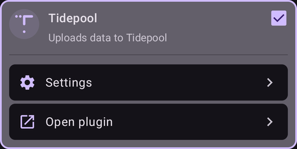
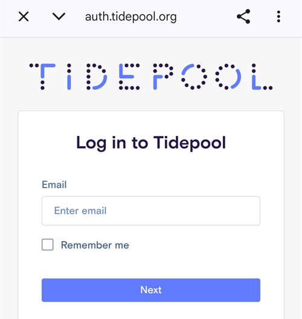
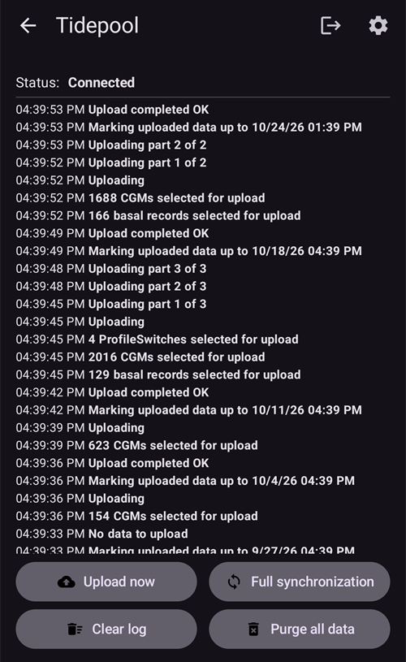
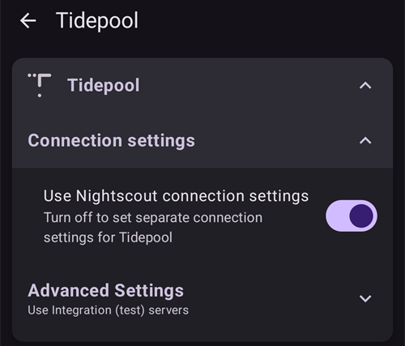
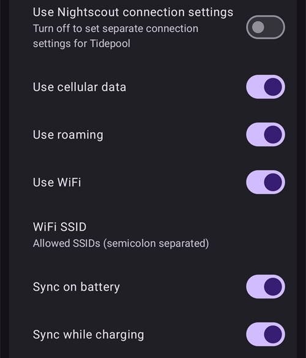
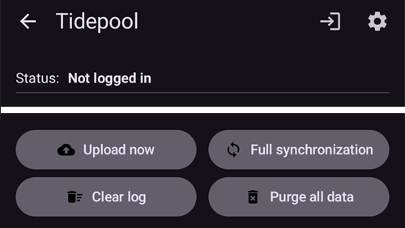

# Tidepool

Tidepool — это сторонний инструмент. Он собирает данные о ГК, инсулине и углеводах (и примечания, которые вы добавляете к терапии) и позволяет анализировать эти данные и делиться ими с вашей медицинской командой. Начиная с версии AAPS 3.2, Tidepool можно использовать вместо Nightscout для выполнения части Цели 1. Его также можно использовать вместе с Nightscout как дополнительную платформу отчетов, которая хорошо подходит для работы с врачами. Это может быть удобно для детей с AAPS: родители хотят иметь удаленный мониторинг и управление через Nightscout, но им нужна платформа отчетов, с которой их медицинской команде удобнее работать.

Важно понимать, что Tidepool служит только для отчетов. Это НЕ приложение для слежения в реальном времени. Если вам нужны фолловеры помимо основного телефона с AAPS, нужно также настроить Nightscout.

Примечание: организация Tidepool вывела на рынок продукт iOS Loop с одобрением FDA. Это никак не связано с их платформой отчетов или с AAPS.

## Шаг 1 – Создайте учетную запись Tidepool

- Перейдите на [tidepool.org](https://www.tidepool.org/)

- Выберите «Personal Sign Up» или «Sign Up» (регистрация)

- Придумайте и запишите адрес эл. почты и пароль

- Выберите «Personal Account» (личная учетная запись) и нажмите «Continue»

- Заполните данные пациента и примите условия использования

- Подтвердите адрес эл. почты по инструкции, которая придет вам на почту

## Шаг 2 – Подключите AAPS к Tidepool

- Откройте **меню** (☰) в левом верхнем углу главного экрана и выберите «**Конфигурация**»

- Откройте категорию «**Связь**» и включите «**Tidepool**»:

- Нажмите «**Открыть модуль**» под Tidepool, затем нажмите значок **Логин** (стрелка, входящая в дверь) в правом верхнем углу

- Откроется окно браузера со страницей входа Tidepool. Войдите с адресом эл. почты и паролем, которые вы создали в шаге 1 выше:

- После успешного входа браузер закроется, а экран Tidepool покажет состояние «**Подключено**»; в журнале ниже видны загрузки данных. Если войти не удалось, проверьте, верны ли данные для входа и подтвердили ли вы адрес эл. почты в Tidepool.

- В «**Настройки**» модуля Tidepool откройте «**Параметры подключения**». По умолчанию параметр «**Использовать настройки подключения Nightscout**» включен, поэтому Tidepool загружает данные при тех же условиях, что вы задали для Nightscout. Выключите его, если для Tidepool нужны свои условия, например загружать в Tidepool только по Wi-Fi и во время зарядки, а Nightscout пусть использует и мобильные данные.

 

Подробнее о том, как работать с данными после загрузки в Tidepool, читайте здесь: [https://www.tidepool.org/viewing-your-data](https://www.tidepool.org/viewing-your-data)

(tidepool-menu)=
## Кнопки Tidepool

В правом верхнем углу экрана Tidepool:

- Значок **Логин** или **Выход из системы** — подключиться к учетной записи Tidepool или отключиться от нее. Показан только один из них: **Логин**, когда вы не вошли, и **Выход из системы**, когда вы вошли. **AAPS** попросит подтверждение, прежде чем выполнить выход.
- Значок шестеренки — настройки Tidepool.

Кнопки внизу экрана Tidepool:

- «**Выгрузить (передать данные) сейчас**» — сразу загрузить новые данные, не дожидаясь следующей автоматической загрузки.
- «**Полная синхронизация**» — снова загрузить все данные, хранящиеся в **AAPS**.
- «**Удалить все данные**» — удалить **все** данные, которые **AAPS** загрузил в вашу учетную запись Tidepool. Это действие нельзя отменить. Используйте его только для удаления неверных или повторяющихся данных, затем запустите «**Полная синхронизация**», чтобы снова загрузить данные.
- «**Очистить журнал**» — очистить журнал на экране Tidepool.

В Tidepool данные, загруженные **AAPS** 4, показаны под именем устройства **AAPS**. Если вы пользовались Tidepool со старой версией, см. [Что изменилось в AAPS v4](#v4changes-tidepool). 
