# Перенос и установка AAPS на смартфон

В предыдущем разделе, [Сборка **AAPS**](../SettingUpAaps/BuildingAaps.md), вы собрали приложение **AAPS** (это файл .apk) на компьютере.

Следующие шаги: **перенести** APK-файл **AAPS** (а также другие нужные приложения, например BYODA, xDrip или другое приложение-приемник CGM) на смартфон Android, а затем **установить** приложение(-я). После установки **AAPS** на смартфон вы сможете перейти к [**настройке цикла AAPS**](../SettingUpAaps/SetupWizard.md).

На этой странице также описана [проверка разработчиков Android](#android-developer-verification) – изменение, которое Google вводит с сентября 2026 года. Оно затрагивает установку самостоятельно собранных приложений. Также описаны [бесплатные способы установки](#android-developer-verification-free-methods), которые будут работать и после этого изменения.

```{contents} Table of contents
:depth: 1
:local: true
```

## Установка AAPS нажатием на APK-файл

Сейчас **AAPS** устанавливают так: переносят APK-файл на телефон и открывают его (нажимают на него). Есть несколько способов перенести APK-файл **AAPS** с компьютера на смартфон. Здесь мы объясняем два различных способа:

* Способ 1 - при помощи Google диска (Gdrive)
* Способ 2 - при помощи USB-кабеля

Обратите внимание, что передача по почте не рекомендуется.

```{admonition} Android developer verification
:class: warning
Google вводит [проверку разработчиков Android](#android-developer-verification) с сентября 2026 года (сначала в Бразилии, Индонезии, Сингапуре и Таиланде; во всем мире – в 2027 году). Там, где проверка действует, установка APK нажатием на файл (как описано в обоих способах ниже) заблокирована. В этом случае используйте один из [бесплатных способов установки](#android-developer-verification-free-methods) ниже на этой странице.
```

### Вариант 1. Использовать диск Google для передачи файлов

Откройте [Google.com](https://www.google.com/) в браузере и войдите в свой аккаунт Google.

В правой верхней части выберите приложение Drive в меню Google.

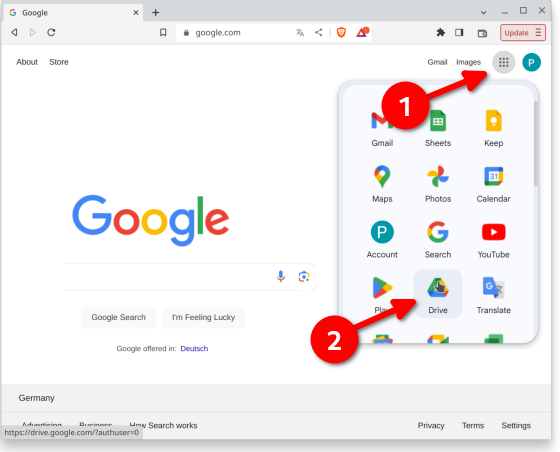

Нажмите **New** (Создать) в левом верхнем углу (или щелкните правой кнопкой мыши по пустому месту под файлами и папками) и выберите **File upload** (Загрузить файлы).

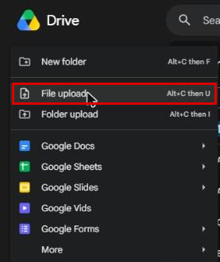

Файл apk будет загружен на Google Drive.

#### Запустите установку apk-файла через приложение Google Диск

Перейдите в мобильный телефон и запустите приложение Google Drive. Это предварительно установленное приложение и находится где расположены другие приложения Google, а также может быть найдено утилитой поиска.

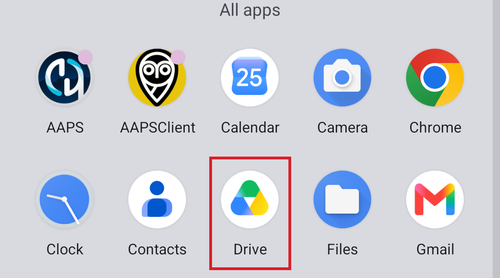

Запустите установку apk, нажав на имя файла в приложении Google Диск на телефоне.

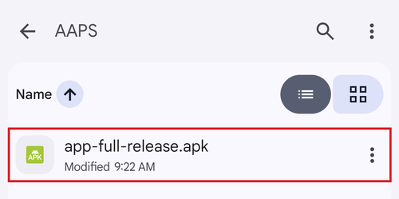

Если появится предупреждение безопасности, что сейчас нельзя устанавливать приложения из Google Диска, нажмите «Настройки» и разрешите установку на короткое время. Потом снова запретите ее: оставлять это разрешение включенным все время небезопасно.

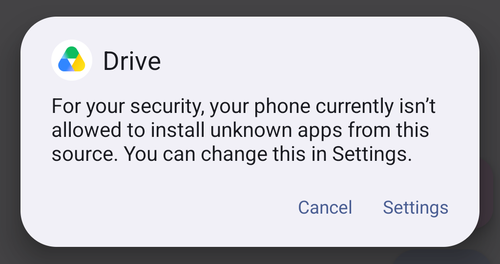

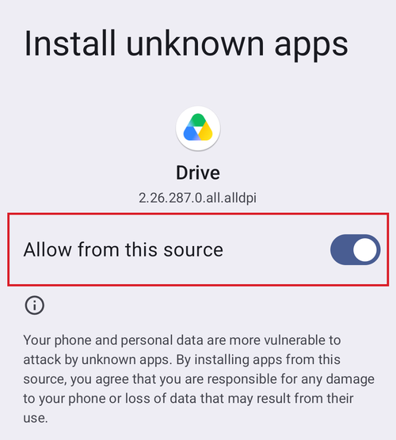

Когда установка завершится, этот шаг выполнен.

Вы должны увидеть значок **AAPS** и сможете открыть приложение.

```{warning}
**ВАЖНОЕ ПРЕДУПРЕЖДЕНИЕ О БЕЗОПАСНОСТИ**
Вы не забыли снова запретить установку из Google Диска?
```

Перейдите к [настройке цикла AAPS](../SettingUpAaps/SetupWizard.md).

### Вариант 2. Использовать кабель USB для передачи файлов

Второй способ перенести apk-файл AAPS – с помощью [USB-кабеля](https://support.google.com/android/answer/9064445?hl=en).

Переместите файл с места расположения на компьютере в папку "Загрузки" на телефоне.

На телефоне необходимо разрешить установку из неизвестных источников. Объяснения, как это сделать, можно найти в интернете (_например,_ [здесь](https://www.expressvpn.com/de/support/vpn-setup/enable-apk-installs-android/) или [здесь](https://www.androidcentral.com/unknown-sources)).

Когда вы перетащите файл на телефон, откройте на телефоне папку «Загрузки» и нажмите на apk-файл AAPS:

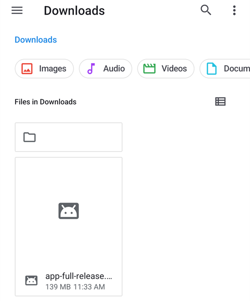

В первый раз Android сообщит, что телефону запрещено устанавливать неизвестные приложения из этого источника. Нажмите «**Настройки**»:

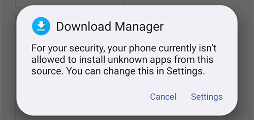

Включите «**Разрешить установку из этого источника**» (Allow from this source), затем вернитесь назад:

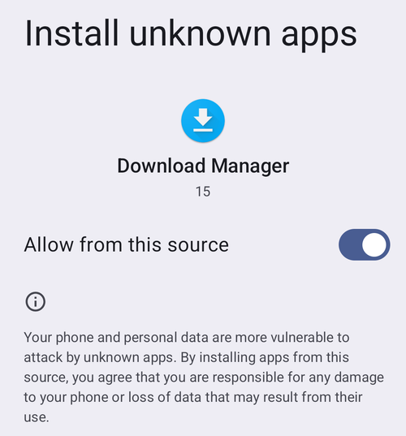

Снова нажмите на apk-файл и выберите «**Установить**»:

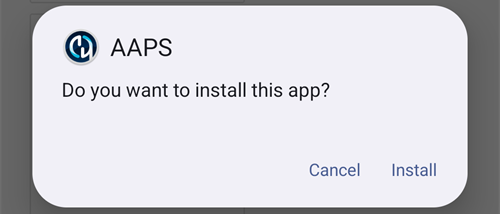

Когда установка завершится, нажмите «**Открыть**», чтобы запустить **AAPS**, или «**Готово**», чтобы открыть его позже:

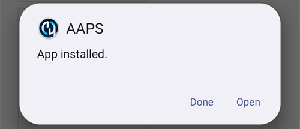

```{warning}
**ВАЖНОЕ ПРЕДУПРЕЖДЕНИЕ О БЕЗОПАСНОСТИ**
Не забудьте после установки снова выключить «Разрешить установку из этого источника»: оставлять это разрешение включенным все время небезопасно.
```

Перейдите к [настройке цикла AAPS](../SettingUpAaps/SetupWizard.md).

(transferring-installing-play-protect-warning)=
## Предупреждение Google Play Защиты

При установке **AAPS** Google Play Защита может предупредить, что приложение небезопасно, создано для старой версии Android и не содержит новейших средств защиты конфиденциальности.

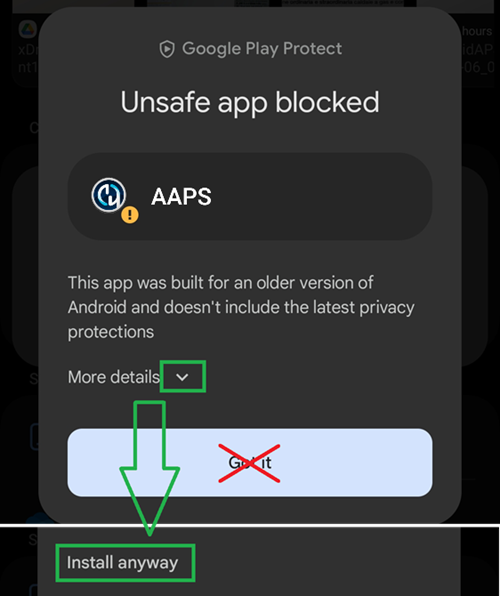

Для приложения, которое вы собрали сами, это ожидаемо. Нажмите **Подробнее** (More details), затем **Все равно установить** (Install anyway).

Если установка **заблокирована** с сообщением о непроверенном разработчике (а не просто предупреждение), см. раздел [Проверка разработчиков Android](#android-developer-verification) ниже.

(android-developer-verification)=

## Проверка разработчиков Android

Google вводит **проверку разработчиков Android**: на большинстве телефонов Android будут устанавливаться только приложения, которые зарегистрировал в Google проверенный разработчик. Это касается и приложений, установленных из APK-файла («sideloading»), а именно так вы устанавливаете приложение **AAPS**, собранное вами.

### Что меняется

Когда вы устанавливаете **AAPS** на телефон с сервисами Google («сертифицированное» устройство Android – практически любой телефон, который продается с Play Маркетом), Android проверит, получено ли приложение от разработчика, зарегистрированного в Google. Если нет, обычная установка нажатием на APK-файл блокируется.

**Проверка выполняется при установке или обновлении приложения.** Уже установленные и работающие приложения она не удаляет.

Google вводит это постепенно:

| When             | Что происходит                                                                                                                                                                            |
| ---------------- | ----------------------------------------------------------------------------------------------------------------------------------------------------------------------------------------- |
| August 2026      | Бесплатные аккаунты разработчика для «ограниченного распространения» (limited distribution) доступны во всем мире, и на телефоны начинает поступать «расширенный процесс» (advanced flow) |
| 30 сентября 2026 | Проверка действует в **Бразилии, Индонезии, Сингапуре и Таиланде** для приложений, установленных из Google Play и некоторых других магазинов приложений                                   |
| 2027             | Проверка распространяется на **остальной мир** и на **все установки**, включая APK-файлы                                                                                                  |

Подробности Google публикует на страницах [Android developer verification](https://developer.android.com/developer-verification), включая [FAQ](https://developer.android.com/developer-verification/guides/faq). Google еще может изменить сроки и детали; эта страница будет обновляться по мере внедрения.

### Касается ли это меня?

- **Сборку AAPS это совсем не затрагивает.** [Сборка через браузер](#browser-build), [сборка в Android Studio](ComputerBuild.md) и [сборка из командной строки](CLIBuild.md) работают точно так же, как раньше, и ваше хранилище ключей не меняется.
- **Ваш текущий AAPS продолжает работать.** Проверка выполняется только при установке или обновлении приложения.
- **Если вы живете в Бразилии, Индонезии, Сингапуре или Таиланде:** с 30 сентября 2026 года проверка действует для приложений, установленных из Google Play и некоторых других магазинов приложений. Google сообщает, что прямая установка APK-файла на этом первом этапе не затрагивается, поэтому **AAPS** должен устанавливаться как обычно. Тем не менее подготовьте уже сейчас один из [бесплатных способов установки](#android-developer-verification-free-methods) ниже, чтобы не оказаться застигнутым врасплох, если это изменится.
- **Если вы живете в другой стране:** до 2027 года для вас ничего не меняется, и пока ничего не делать – вполне допустимый выбор. Но настройте один из [бесплатных способов установки](#android-developer-verification-free-methods) ниже, пока все работает. Плохо узнать о блокировке в день, когда обновление не устанавливается, а впереди еще 24 часа ожидания [расширенного процесса](#android-developer-verification-advanced-flow).
- **Старые телефоны:** проверка действует на телефонах с Android 7 и выше, то есть на всех телефонах, на которых может работать **AAPS**.

(android-developer-verification-free-methods)=

## Бесплатные способы установки AAPS

Вам **не** нужно ничего платить Google, чтобы продолжать пользоваться **AAPS**. Есть несколько бесплатных способов; выберите тот, который подходит вам.

```{admonition} Which method should I use?
:class: tip
- У вас есть **компьютер** (неважно, каким способом вы собрали **AAPS**): используйте [ADB](#android-developer-verification-adb) или, если не хотите работать с командной строкой, [веб-установщик](#android-developer-verification-web). Оба способа не требуют проверки, не имеют ограничений и не требуют аккаунта Google.
- У вас **совсем нет компьютера**: используйте [расширенный процесс](#android-developer-verification-advanced-flow) на телефоне.
- Вы хотите зарегистрироваться в Google, чтобы обычная установка нажатием на APK продолжала работать: для этого есть [бесплатный аккаунт ограниченного распространения](#android-developer-verification-limited-account), но с **AAPS** он не проверен.
```

(android-developer-verification-adb)=

### Способ 1: Установка через ADB (нужен компьютер)

ADB (Android Debug Bridge) – официальный инструмент Google для установки приложений с компьютера на телефон через USB-кабель. Google подтвердил, что **приложения, установленные через ADB, не требуют проверки**: нет ни периода ожидания, ни ограничения числа устройств, ни регистрации.

Подготовка (один раз):

1. На телефоне включите скрытые параметры разработчика: откройте **Настройки** > **О телефоне** (на некоторых телефонах **Сведения о ПО**) и нажмите семь раз на **Номер сборки**, пока телефон не сообщит, что вы стали разработчиком.
1. Вернитесь в главное меню **Настройки**, откройте новый пункт **Для разработчиков** и включите **Отладка по USB**.
1. На компьютере убедитесь, что ADB доступен:
   - Если вы используете **Android Studio**, ADB уже установлен вместе с ней.
   - Иначе скачайте бесплатные [SDK Platform Tools](https://developer.android.com/tools/releases/platform-tools) от Google и распакуйте папку. Устанавливать ничего не нужно: ADB – это программа `adb` в этой папке.

Установка (и последующие обновления) **AAPS**:

1. Подключите телефон к компьютеру USB-кабелем. Сначала переносить APK-файл на телефон не нужно: ADB отправляет его прямо с компьютера.
1. На телефоне подтвердите запрос **Разрешить отладку по USB?** (только в первый раз).
1. На компьютере откройте терминал (командную строку) в папке, где находятся ADB и APK-файл **AAPS**, и выполните:

   ```
   adb install -r app-full-release.apk
   ```

   Замените `app-full-release.apk` на настоящее имя вашего APK-файла. Параметр `-r` обновляет уже установленный **AAPS** и сохраняет все его данные и настройки.

1. Дождитесь сообщения `Success`. Теперь **AAPS** установлен на вашем телефоне.

Эта же команда используется для всех будущих обновлений. На [страницах о Wear OS](../WearOS/WearOsSmartwatch.md) ADB уже используется так же для установки приложения на часы.

Если вы не хотите пользоваться кабелем: на Android 11 и выше **отладка по Wi-Fi** (тоже в разделе **Для разработчиков**) делает то же самое через Wi-Fi после однократного сопряжения с кодом, который показывает телефон.

(android-developer-verification-web)=

### Способ 2: Установка с веб-страницы (компьютер, без командной строки)

Если командная строка вам не подходит, веб-страница может сделать то же самое, что и ADB, прямо из браузера. Она связывается с телефоном тем же механизмом, что и ADB, поэтому на нее действует **то же исключение из проверки**. Но ничего не нужно скачивать, распаковывать или вводить команды.

Это самый простой путь, если вы использовали [сборку через браузер](#browser-build) и никогда не открывали командную строку.

1. Включите **Отладка по USB** на телефоне (шаги 1 и 2 [способа ADB](#android-developer-verification-adb) выше – настройка один раз).
1. Откройте в браузере **[Веб-установщик AAPS](#web-installer)**.
1. Подключите телефон USB-кабелем и следуйте инструкциям на странице: подключите телефон, выберите APK-файл и установите.

Три важных момента:

- Это работает только в **Chrome, Edge или Opera**. Firefox и Safari не умеют работать с USB-устройствами.
- Подключение ADB телефона может использовать только одна программа одновременно, поэтому перед подключением **закройте Android Studio** (и все другие программы, которые используют ADB).
- Веб-страница, подключенная таким образом, получает полный контроль над вашим телефоном. **Используйте только адрес выше** из документации **AAPS** – никогда не используйте страницу установщика, найденную через поисковую систему. Веб-установщик **AAPS** работает полностью в вашем браузере: ваш APK-файл никуда не загружается.

```{admonition} No computer? A second phone works too
:class: tip
Веб-установщик работает и из **Chrome на другом телефоне Android** с кабелем USB-C – USB-C. Так родитель может установить **AAPS** на телефон ребенка, даже если дома нет компьютера.
```

(android-developer-verification-advanced-flow)=

### Способ 3: «Расширенный процесс» (advanced flow) на телефоне (компьютер не нужен)

Для опытных пользователей, которые понимают риски установки непроверенных приложений, Google предлагает обходной путь – **расширенный процесс** (advanced flow). Google начал выпускать его на телефоны в августе 2026 года, еще до начала проверки, поэтому вы можете настроить его уже сейчас. Это однократная настройка на самом телефоне, и она **занимает 24 часа**:

1. Включите скрытые параметры разработчика (см. шаг 1 способа ADB выше), затем откройте **Настройки** > **Для разработчиков** > **Приложения от непроверенных разработчиков** (Apps from unverified developers).
1. Включите **Разрешить приложения от непроверенных разработчиков** (Allow apps from unverified developers). Телефон запросит блокировку экрана, чтобы убедиться, что это вы.
1. Телефон спросит, не просит ли вас кто-то включить эту настройку, и объяснит, что банки, государственные органы или полиция никогда не просят об этом. Прочитайте предупреждение и подтвердите, что никто на вас не давит и не руководит вами (это защита от мошенников).
1. **Перезагрузите телефон.** Это запускает однократный **период ожидания 24 часа**.
1. Через 24 часа снова откройте **Настройки** > **Для разработчиков** > **Приложения от непроверенных разработчиков**, чтобы завершить настройку.
1. Выберите, разрешить непроверенные приложения на **7 дней** или **бессрочно**. Для **AAPS** выберите **бессрочно**, иначе ваше следующее обновление будет заблокировано, когда пройдут 7 дней.

После этой настройки установка или обновление APK **AAPS** работает как сейчас, но с одним дополнительным предупреждением, что приложение от непроверенного разработчика – нажмите **Все равно установить** (Install anyway).

Полезно знать:

- Потом можно снова выключить **Для разработчиков**: расширенный процесс останется включенным. Google также не дает приложениям (например, банковским) никакой возможности узнать, что расширенный процесс включен.
- Если вы выключите расширенный процесс, установка **или обновление** **AAPS** снова блокируется (установленный **AAPS** продолжает работать). У вас есть 10 минут, чтобы снова его включить; после этого 24-часовой период ожидания начинается заново.
- Изменение часов на телефоне не сокращает период ожидания, и ADB не может его пропустить.
- Google сообщает, что ваш выбор переходит вместе с аккаунтом Google на другие ваши устройства, поэтому на новом телефоне не придется снова ждать 24 часа.
- Если вы не можете найти **Приложения от непроверенных разработчиков** в параметрах разработчика, ваш телефон еще не получил эту функцию. Ее доставляет системный компонент **Android Developer Verifier**, который Google постепенно распространяет через Play Маркет. Можно ускорить это, открыв **Android Developer Verifier** в Play Маркете.

```{note}
Google называет это первой версией и еще может изменить экраны и шаги; этот раздел будет дополнен снимками экрана, когда выйдет окончательная версия.
```

(android-developer-verification-limited-account)=

### Способ 4: Регистрация в Google (бесплатный аккаунт ограниченного распространения)

Google предлагает **бесплатный** тип аккаунта разработчика для любителей и личного использования – **аккаунт ограниченного распространения** (limited distribution account). С августа 2026 года он доступен всем:

- **Не нужен паспорт или другой документ** и **не нужно платить** (в отличие от платного аккаунта разработчика, который для личного использования **AAPS** не нужен). Нужны аккаунт Google с двухэтапной аутентификацией, платежный профиль Google с вашим полным именем и адресом, а также адрес электронной почты для связи.
- Вы регистрируете имя пакета приложения в Android Developer Console от Google и разрешаете телефоны, на которые его можно устанавливать, – до **20 устройств**. Для этого телефон и консоль связываются через QR-код или ссылку.
- После регистрации на разрешенных телефонах снова работает обычная установка (нажатием на APK-файл), без ADB и без расширенного процесса.
- Аккаунт ограниченного распространения позже можно перевести в полный аккаунт, но не наоборот.

```{warning}
Google не объяснил, как работает регистрация, когда многие люди собирают одно и то же приложение с открытым исходным кодом: каждый самостоятельно собранный **AAPS** использует одно и то же имя пакета (`info.nightscout.androidaps`) с разными ключами подписи. В FAQ Google сказано, что имя пакета, которое уже используют другие, нельзя просто забрать себе – для этого нужна дополнительная проверка. Результат такой проверки неизвестен, и платный аккаунт разработчика ($25 и документ, удостоверяющий личность) здесь не помогает: оплата снимает только ограничение в 20 устройств, но не проверку имени пакета.

Поэтому пошаговую инструкцию пока написать нельзя. Этот раздел будет дополнен, когда регистрация будет проверена с **AAPS**. Пока надежными альтернативами остаются ADB, веб-установщик и расширенный процесс, описанные выше.
```

## Что не меняется

- Самостоятельная сборка **AAPS** любым из трех [способов сборки](BuildingAaps.md).
- Ваш аккаунт GitHub, ваш репозиторий сборки (AAPS Builder) или fork и ваше хранилище ключей.
- Установленное приложение **AAPS**, ваши настройки и ваши [цели](CompletingTheObjectives.md).
- Телефоны без сервисов Google и [установки через ADB](#android-developer-verification-adb) в целом.

## Куда обращаться за помощью

1. **Читайте** [FAQ Google о проверке разработчиков](https://developer.android.com/developer-verification/guides/faq), если у вас вопросы о самой проверке.
2. **Спрашивайте** в канале *#AAPS* в [Discord](https://discord.gg/4fQUWHZ4Mw) или в одном из других [каналов сообщества](../GettingHelp/WhereCanIGetHelp.md), если установка заблокирована.
3. Когда просите о помощи, укажите производителя и модель телефона, версию Android, вашу страну и точный текст сообщения, которое появляется при ошибке установки.

```{toctree}
:hidden:

Веб-установщик AAPS <WebInstaller.md>
```
