# Ваш профиль AAPS

Ваш **профиль AAPS** — это набор из четырех ключевых параметров, которые определяют, как **AAPS** должен подавать инсулин в ответ на уровень глюкозы по сенсору. Это основные параметры, на которых построена работа **AAPS**. По мере прохождения **Целей** вам станут доступны дополнительные параметры (например, настройки SMB), но эти функции работают хорошо, только если ваш **Профиль** настроен правильно. **Профиль** включает:
* [целевые значения ГК](#profile-glucose-targets),
* [базальные скорости](#your-aaps-profile-basal-rates) (BR),
* [факторы чувствительности к инсулину](#your-aaps-profile-insulin-sensitivity-factor) (ISF) и
* [углеводные коэффициенты](#your-aaps-profile-insulin-to-carbs-ratio) (IC или ICR).

```{admonition} Where did DIA go?
:class: note
**Время действия инсулина (DIA)** больше не входит в ваш **Профиль**. Теперь оно задается для каждого инсулина — см. [Управление → Настройки инсулина](#Config-Builder-insulin-dia).
```

При работе с **AAPS** пользователям нужно постоянно оценивать и внимательно проверять точность настроек своего **Профиля**. Рекомендуется настраивать параметры в том порядке, в каком они описаны здесь. Старайтесь выверить одну настройку прежде чем переходить к другой. Двигайтесь небольшими шагами, не вносите большие изменения сразу. Не забудьте активировать новый профиль после каждого изменения. Регулярно [делайте резервную копию настроек **Профиля**](#YourAapsProfile_Profile-backup) с помощью экспорта настроек.

Настройки вашего **Профиля** влияют друг на друга: у вас могут быть «неправильные» настройки, которые хорошо работают вместе в одних условиях, но не работают в других. Например, если слишком высокий базал совпадает по времени со слишком высоким **CR**. Поэтому нужно рассматривать каждую настройку отдельно и проверять, что они хорошо работают вместе в разных условиях.

Можно использовать автонастройку [Autotune](https://autotuneweb.azurewebsites.net/) которая даст общее направление, но принимайте рекомендации не вслепую и не во всех ситуациях.

```{admonition} Your diabetes may vary
:class: note
**Профили** у разных людей сильно отличаются.

Для базальных скоростей (BR), факторов чувствительности к инсулину (ISF) и углеводных коэффициентов (IC или ICR) абсолютные значения и изменения потребности в инсулине сильно отличаются у разных людей. Они зависят от вашего организма, пола, возраста, физической формы и т. д., а также от краткосрочных факторов, например болезни или недавней физической нагрузки. Подробнее об этом можно прочитать в отличной книге [“Bright Spots and Landmines”](https://diatribe.org/bright-spots-and-landmines/) Адама Брауна (Adam Brown).

```

Четыре последних параметра (целевые значения ГК, базальные скорости, факторы чувствительности к инсулину и углеводные коэффициенты) можно задать разными значениями в течение 24 часов, при необходимости с изменением каждый час.


Ниже показаны снимки экрана **AAPS** с _примером_ профиля. Обратите внимание: пример профиля ниже содержит много временных точек. Когда вы только начинаете пользоваться **AAPS**, ваш профиль, скорее всего, будет гораздо проще.

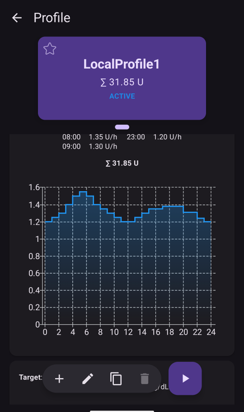

(profile-glucose-targets)=
## Glucose targets

### Description

Ваша **целевая ГК** — это основное значение, и все расчеты **AAPS** основаны на нем. Она отличается от целевого диапазона, в котором вы обычно стараетесь держать значения ГК. Цель используется в расчетах **AAPS**: если **AAPS** прогнозирует, что ваша **ГК** выйдет за пределы целевого диапазона, он примет меры, чтобы вернуть вас в этот диапазон.

Целевые значения можно задать в этих пределах:

|          | _Нижняя_ цель            | _Верхняя_ цель             |
| -------- | ------------------------ | -------------------------- |
| Минимум  | 4,4 ммоль/л или 80 мг/дл | 5 ммоль/л или 90 мг/дл     |
| Максимум | 10 ммоль/л или 180 мг/дл | 11,1 ммоль/л или 200 мг/дл |

### Impact

Если цель в вашем **Профиле** очень широкая (например, 3 ммоль/л или больше [50 мг/дл или больше]), **AAPS** часто будет мало что делать. Причина в том, что прогноз **ГК** будет где-то в этом широком диапазоне, поэтому **AAPS** вряд ли будет устанавливать временный базал.

### Как настроить

**На рисунке ниже** показан пример того, как можно задать цель в профиле **AAPS**.

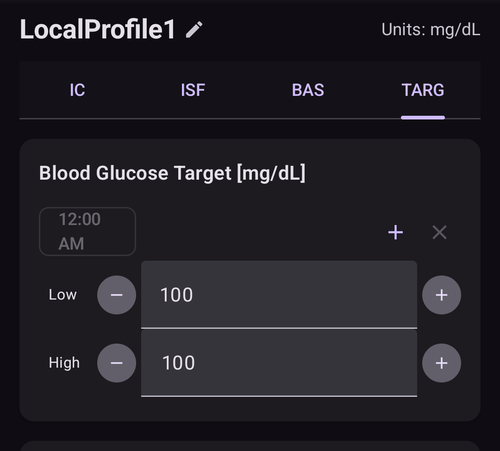

Целевые значения **ГК** задаются по вашим личным предпочтениям и потребностям. Например, если вы боитесь гипо ночью, можно задать цель немного выше, 117 мг/дл (6,5 ммоль/л), с 21:00 до 7:00. Если вы хотите, чтобы утром перед болюсом на завтрак у вас было достаточно активного инсулина (IOB), можно установить нижнюю цель 81 мг/дл (4,5 ммоль/л) с 7 до 8 утра.

В режиме [Открытый цикл](#KeyAapsFeatures-OpenLoop), особенно когда вы проходите [первые цели](../SettingUpAaps/CompletingTheObjectives.md), широкий целевой диапазон может быть хорошим вариантом, пока вы изучаете, как работает **AAPS**, и настраиваете свой **Профиль**.<br/> В режиме [Замкнутый цикл](#KeyAapsFeatures-ClosedLoop) (начиная с **[Цели 6](#objectives-objective6)**) рекомендуется сужать диапазон, пока у вас не будет одна цель на каждое время дня (_Нижняя_ цель = _Верхняя_ цель), чтобы **AAPS** быстро реагировал на колебания **ГК**.

(your-aaps-profile-basal-rates)=

## Базальные скорости

### Description

Базальная скорость инсулина (ед./час) обеспечивает фоновый инсулин, поддерживая нужную гликемию в отсутствие пищи или физических упражнений.

Инсулиновая помпа подает небольшое количество быстродействующего инсулина каждые несколько минут, не позволяя печени выделять слишком много глюкозы, и давая возможность глюкозе перемещаться в клетки организма. Базальный инсулин обычно составляет от 40 до 50% суточной дозы (TDD), в зависимости от диеты, и обычно следует суточному ритму, с одним пиком и одной долиной потребности в инсулине в течение 24 часов. Подробнее об этом очень полезно прочитать в главе 6 книги [“Think like a Pancreas”](https://amzn.eu/d/iVU0RGe) Гэри Шайнера (Gary Scheiner).

Большинство специалистов по обучению при диабете 1 типа (и людей с диабетом 1 типа!) согласны, что сначала нужно правильно настроить базальные скорости, а уже потом оптимизировать ISF и ICR.

### Impact

Точно подобранная базальная скорость позволяет просыпаться в целевом диапазоне и пропускать еду — или есть — раньше или позже в течение дня без высокой или низкой ГК.

Повышенная скорость подачи базала может привести к низкому уровню ГК. И наоборот.

**AAPS** считает от базальной скорости по умолчанию как от базовой линии. Если базал слишком высокий, то «нулевая временная скорость» будет определяться при большем отрицательном значении активного инсулина IOB, чем нужно. Из-за этого **AAPS** потом даст больше коррекций, чем нужно, чтобы в итоге вернуть IOB к нулю.

Поэтому слишком высокая базальная скорость приведет к низкой **ГК** и при обычной скорости, и через несколько часов, когда **AAPS** будет корректировать к цели.

И наоборот, слишком низкая базальная скорость может привести к высокой ГК и к тому, что ГК не будет снижаться до цели.

### Как настроить

**На рисунке ниже** показан пример того, как можно задать базальные скорости в профиле **AAPS**.

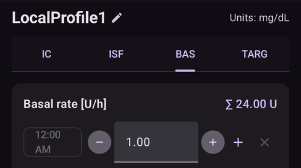

Правильные базальные скорости подбирают методом проб и ошибок, и делать это нужно вместе с вашей медицинской командой.

Есть методы проверки базала, при которых обычно наблюдают за базальными скоростями и потребностью в инсулине во время <u>прерывистого</u> голодания в течение 24 часов. Хотя базальные скорости нужно проверить для всего дня, не рекомендуется голодать 24 часа подряд. Причина в том, что организм запускает механизмы компенсации, например гормоны. Рекомендуемый способ — голодать в течение 8 часов в 3 разных дня.

Рекомендуемый способ — приостановить цикл (для безопасности можно перевести AAPS в режим [**LGS**](#KeyAapsFeatures-LGS), чтобы избежать гипо, как при прохождении [цели 6](#objectives-objective6)). Тогда будет подаваться ваша фоновая базальная скорость по умолчанию. Следите, как меняется ваша **ГК**: если она падает, базальная скорость слишком высокая. И наоборот.<br/> Другой способ (он может быть сложнее) — оставить цикл работать и смотреть, как меняется **IOB**. Если **IOB** отрицательный, ваша базальная скорость слишком высокая. И наоборот. Учтите, что этот способ опирается на **ISF** для коррекции **ГК**, поэтому он сработает, только если другие параметры тоже настроены достаточно хорошо.<br/> Еще один способ настроить базальные скорости — наблюдать за работой цикла ночью, когда все COB уже усвоились. Этот способ особенно полезен для детей, когда голодать трудно или потребность в инсулине часто меняется. [Доктор Салех Ади (Dr Saleh Adi) из Tidepool](https://www.youtube.com/watch?v=-fpWnGRhLSo) показывает полезные способы анализа ночных графиков ГК для оптимизации базальных скоростей.

[Здесь](../GettingHelp/ProfileTuning.md) описано, как подправить базальный профиль с помощью анализа закономерностей в замкнутом цикле.

Если вы меняете **Профиль** по результатам теста базала, изменения нужно делать за 1–2 часа (зависит от типа инсулина) до подъема/падения. Повторяйте тест, пока не будете уверены в настройках ваших **базальных скоростей**.

(your-aaps-profile-basal-not-compatible)=
#### Сообщение «Базальная скорость несовместима с текущей помпой»

У каждой помпы есть ограничения: самая низкая и самая высокая базальная скорость, которую она может подавать, а у некоторых помп (например, Dana, Accu-Chek Combo, Medtronic и Diaconn G8) базальная скорость может меняться только в начале часа. **AAPS** проверяет ваш профиль на совместимость с вашей помпой **после** применения выбранного вами процента.

Если базальная скорость выходит за эти пределы, экран **Активировать** показывает это сообщение, а кнопка **Активировать** остается серой:

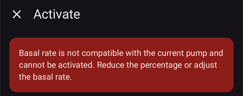

Например, при базальной скорости 0,10 ед/ч ночью и проценте профиля 35% **AAPS** пришлось бы подавать 0,035 ед/ч. Это меньше, чем может подать помпа Dana (0,04 ед/ч).

Чтобы решить проблему, сделайте одно из двух:

* выберите другой процент: **больший**, если базальная скорость становится слишком низкой, или **меньший**, если базальная скорость становится слишком высокой, или
* [отредактируйте профиль](#your-aaps-profile-create-and-edit-profiles) и измените базальную скорость.

Редактор профиля позволяет начинать базальные скорости только в начале часа. Базальная скорость, которая начинается, например, в 06:30, может быть только из старого профиля, например после перехода на помпу, которая этого не поддерживает.

(your-aaps-profile-insulin-sensitivity-factor)=

## Фактор чувствительности к инсулину (ISF)

### Description

Коэффициент чувствительности к инсулину (иногда называемый корректирующим фактором) - это то, насколько 1 единица инсулина понижает ваш уровень гликемии.

**В мг/дл:** Если ваш **ISF** равен 40, каждая единица инсулина снизит ГК примерно на 40 мг/дл (например, ГК упадет со 140 мг/дл до 100 мг/дл).

**В ммоль/л:** Если ваш **ISF** равен 1,5, каждая единица инсулина снизит ГК примерно на 1,5 ммоль/л (например, с 8 ммоль/л до 6,5 ммоль/л).

Из этих примеров видно: чем _меньше_ значение **ISF**, тем меньше ваша чувствительность к инсулину. Поэтому, если вы уменьшаете ISF с 40 до 35 (мг/дл) или с 1,5 до 1,3 (ммоль/л), это часто называют усилением **ISF**. И наоборот, увеличение значения **ISF** с 40 до 45 (мг/дл) или с 1,5 до 1,8 (ммоль/л) — это ослабление **ISF**.

### Impact

**Более низкий / сильный ISF** (например, 40 вместо 50) означает, что одна единица инсулина снижает вашу **ГК** меньше. Это приводит к более агрессивной / сильной коррекции со стороны цикла с **большим количеством инсулина**. Если ваш **ISF** слишком сильный (маленькое значение), это может привести к низкой **ГК**.

**Более высокий / слабый ISF** (например, 45 вместо 35) означает, что одна единица инсулина снижает вашу **ГК** больше. This leads to a less aggressive / weaker correction from the loop with **less insulin**. Если ваш **ISF** слишком слабый (большое значение), это может привести к высокой **ГК**.

**Example:**
* **ГК** равна 190 мг/дл (10,5 ммоль/л), цель — 100 мг/дл (5,6 ммоль/л).
* Значит, нужна коррекция на `190 - 100 = 90 mg/dL` или `10.5 - 5.6 = 4.9 mmol/L`
* Если `ISF = 30` -> `90 / 30 = 3` или `ISF = 1.63` -> `4.9 / 1.63 = 3`: 3 единицы инсулина
* Если `ISF = 45` -> `90 / 45 = 2` или `ISF = 2.45` -> `4.9 / 2.45 = 2`: 2 единицы инсулина

Слишком низкий **ISF** (а значит, более агрессивный; это бывает часто) может приводить к «перекоррекции», потому что **AAPS** рассчитывает, что для коррекции высокой **ГК** нужно больше инсулина, чем на самом деле. Это может приводить к «американским горкам» ГК (особенно натощак), как показано на рисунке ниже. В этом случае значение **ISF** нужно увеличить, чтобы **AAPS** был менее агрессивным. Тогда **AAPS** будет давать меньшие корректирующие дозы и не будет перекорректировать высокую **ГК** до низкой **ГК**.

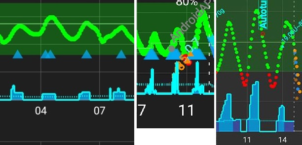

И наоборот, слишком высокий **ISF** может приводить к недостаточной коррекции, и ваша **ГК** остается выше цели — это особенно заметно ночью.

### Как настроить

**На рисунке ниже** показан пример того, как можно задать значения ISF в профиле **AAPS**.

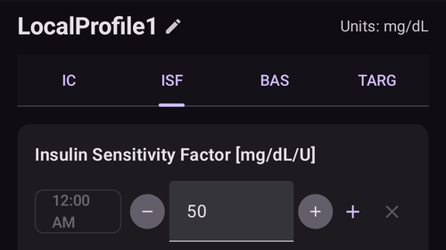

Основной отправной точкой для определения ISF в дневное время является суммарная суточная доза (TDD) и правило 1700 (94). Подробнее об этом написано в главе 7 книги [“Think like a Pancreas”](https://amzn.eu/d/iVU0RGe) Гэри Шайнера (Gary Scheiner).

| 1700 (для мг/дл) или 94 (для ммоль/л) / TDD = примерный ISF.<br/><br/>Пример: TDD = 40 ед<br/>Примерный ISF (мг/дл) = 1700/40 = 43<br/>Примерный ISF (ммоль/л) = 94/40 = 2,4 |
| ---------------------------------------------------------------------------------------------------------------------------------------------------------------------------------------------------- |
|                                                                                                                                                                                                      |

Если ваш базал настроен правильно, это можно проверить так: приостановите цикл, убедитесь, что **IOB** равен нулю, и примите несколько таблеток глюкозы, чтобы получить стабильно «высокий» уровень.

Затем введите предполагаемое количество инсулина (по текущему соотношению 1/ISF), чтобы прийти к целевой ГК.

Будьте осторожны, так как довольно часто величина слишком занижена. Слишком низкое значение означает, что 1 ед снизит ГК быстрее, чем ожидалось.

(your-aaps-profile-insulin-to-carbs-ratio)=

## Углеводный коэффициент (ICR)

### Description

**ICR** показывает, сколько граммов углеводов покрывает одна единица инсулина.

Некоторые также используют сокращение **I:C** вместо **ICR** или говорят об углеводном коэффициенте: **CR**.

Например, соотношение инсулина 1 к 10 (1:10) означает, что вам требуется 1 ед. инсулина на каждые 10 граммов съеденных углеводов. Еда из 25г углеводов потребует 2,5 ед. инсулина.

Если ваш **ICR** слабее (больше значение), например 1:20, вам нужно только 0,5 ед инсулина на 10 г углеводов. Еда из 25г углеводов потребует 25/20 = 1,25 ед. инсулина.

Часто **ICR** разный в разное время дня из-за уровня гормонов и физической активности. Многие замечают, что самый низкий/сильный **ICR** у них во время завтрака, потому что в это время у них обычно выше инсулинорезистентность. Например, у одного взрослого пользователя **ICR** может быть 1:8 на завтрак, 1:10 на обед и 1:10 на ужин. Но это не общее правило: у некоторых людей инсулинорезистентность выше во время ужина, и тогда им нужен более сильный/меньший **ICR**.

> **ПРИМЕЧАНИЕ:**
> 
> В некоторых европейских странах для определения количества инсулина, необходимого для компенсации пищи, использовались т. н. хлебные единицы. В начале 1 хлебная единица равнялась 12г углеводов, позже некоторые стали считать ее как 10 г.
> 
> В такой модели подсчетов количество углеводов было фиксированной величиной, а количество инсулина-переменной. ("Сколько инсулина нужно для того, чтобы компенсировать одну хлебную единицу?")
> 
> При использовании **ICR** количество инсулина фиксировано, а количество углеводов меняется. ("Сколько грамм углеводов может компенсироваться одной единицей инсулина?")
> 
> Example:
> 
> Коэффициент на хлебную единицу (ХЕ = 12 г углеводов): 2,4 ед/ХЕ -> Вам нужно 2,4 единицы инсулина, когда вы едите одну хлебную единицу.
> 
> Соответствующий **ICR**: 12 г / 2,4 ед = 5,0 г/ед -> одна единица инсулина покрывает 5,0 г углеводов.
> 
> Коэффициент ХЕ 2,4 ед / 12 г   ===>   IC = 12 г / 2,4 ед = 5,0 г/ед
> 
> Таблицы пересчета есть в интернете, например [здесь](https://www.mylife-diabetescare.com/files/media/03_Documents/11_Software/FAS/SOF_FAS_App_KI-Verha%CC%88ltnis_MSTR-DE-AT-CH.pdf).

### Impact

**Более низкий / сильный ICR** означает меньше еды на единицу, т. е. вы получаете больше инсулина на одно и то же количество углеводов. Может также назваться «более агрессивным». Если ваш IC слишком сильный, вы получаете слишком много инсулина, и это может привести к низкой **ГК**.

**Более высокий / слабый ICR** = больше еды на единицу, т. е. вы получаете меньше инсулина на одно и то же количество углеводов. Может также назваться «менее агрессивным». Если ваш IC слишком слабый, вы получаете меньше инсулина, чем нужно, и это может привести к высокой **ГК**.

### Как настроить

**На рисунке ниже** показан пример **ICR** пользователя и то, как его можно задать в **профиле AAPS**. При вводе этих значений мы вводим вторую часть соотношения, поэтому углеводный коэффициент 1:3,5 вводится просто как «3,5».

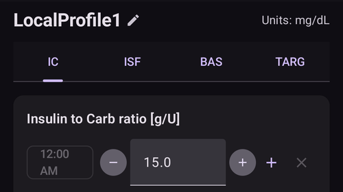

Если после того как еда усвоилась и **IOB** вернулся к нулю, ваша **ГК** остается выше, чем до еды, скорее всего, ваш **ICR** слишком слабый (_т. е._ число слишком большое и его нужно постепенно уменьшать). И наоборот, если ваша **ГК** ниже, чем до еды, **ICR** слишком сильный (_т. е._ число слишком маленькое и его нужно постепенно увеличивать).

Если ваши базальные скорости настроены правильно, проверить можно так: убедитесь, что **IOB** равен нулю и ГК в диапазоне, съешьте точно известное количество углеводов и введите предполагаемое количество инсулина по текущему углеводному коэффициенту. Лучше всего есть то, что вы обычно едите в это время дня, и точно посчитать углеводы.

## Частые вопросы о профиле

```{contents} Common questions related to the Profile
:depth: 1
:local: true
```

### Почему важно правильно настроить профиль

**Why should I try to get my profile settings right? Can’t the loop just take care of it?**

Гибридный замкнутый цикл _может_ пытаться корректировать подачу инсулина, чтобы уменьшить плохой контроль гликемии из-за неправильных значений **Профиля**. Например, он может не подавать инсулин, если вам грозит гипо. Однако контроль гликемии будет гораздо лучше, если настройки вашего **Профиля** уже как можно ближе к тому, что нужно вашему организму. Это одна из причин, почему в **AAPS** есть цели, которые проходят по шагам: от открытого цикла к гибридному замкнутому циклу. In addition, there will be times when you need to open the loop (sensor warmups, sensor failure _etc._), sometimes in the middle of the night, and you will want to have your settings right for these situations.

Если вы начинаете с **AAPS** после другой помповой системы с открытым или замкнутым циклом, вы уже примерно знаете, какие значения использовать для базальных скоростей (**BR**), факторов чувствительности к инсулину (**ISF**) и углеводных коэффициентов (**ICR**).

Если вы переходите с уколов (MDI) на **AAPS**, сначала полезно почитать, как перейти с уколов на помпу, и спланировать и выполнить переход осторожно, вместе с вашей медицинской командой. Очень полезны книги ["Pumping insulin"](https://amzn.eu/d/iaCsFa2) Джона Уолша и Рут Робертс (John Walsh & Ruth Roberts) и [“Think like a Pancreas”](https://amzn.eu/d/iVU0RGe) Гэри Шайнера (Gary Scheiner).

### What causes high postprandial peaks in closed loop?
Прежде всего проверьте вашу базальную скорость и проведите тест базала без углеводов. Если он правильный и ваша **ГК** снижается до цели после того, как углеводы полностью усвоились, попробуйте установить в **AAPS** временную цель «Ожидаемый прием пищи» за некоторое время до еды или обсудите с вашим эндокринологом подходящее время для преболюса. <br/> Если ваша **ГК** слишком высокая после еды и остается слишком высокой после того, как углеводы полностью усвоились, обсудите с вашим эндокринологом уменьшение **ICR**. Если ваша **ГК** слишком высокая, пока есть **COB**, и слишком низкая после того, как углеводы полностью усвоились, обсудите с вашим эндокринологом увеличение **ICR** и подходящее время для преболюса.

### У меня держится высокая ГК, и цикл ее не снижает
Возможные причины, почему **AAPS** дает недостаточно инсулина:
* **ISF** недостаточно сильный
* Базальная скорость может быть недостаточно сильной
* Может сработать настройка безопасности, например **maxIOB**. Или **SMB** в это время отключены, в зависимости от ваших настроек.
* Настроена автоматизация, и она переопределила действия **AAPS**.

См. также [Настройка профиля AAPS](../GettingHelp/ProfileTuning.md).

### У меня отрицательный IOB, это проблема?
Отрицательный **IOB** означает, что абсолютное количество инсулина (базал + болюс) в организме меньше, чем базал. Из-за этого **AAPS** будет подавать больше инсулина, как только **ГК** начнет расти, потому что считает, что инсулина не хватает. Это может привести к низкой **ГК** позже.

Вот некоторые причины отрицательного IOB и что делать:
* слишком сильный базал: подправьте ваш **Профиль**
* слишком большой болюс на предыдущую еду: подправьте ваш **Профиль** или проверьте, вовремя ли вы делаете болюс.
* DIA для вашего типа инсулина задано слишком коротким, и инсулин накапливается: измените его в разделе [Управление → Настройки инсулина](#Config-Builder-insulin-dia)
* физическая нагрузка: в следующий раз подумайте о том, чтобы во время нагрузки использовать меньший [процент профиля](../DailyLifeWithAaps/ProfileSwitch-ProfilePercentage.md), чтобы учесть повышенную чувствительность.

## Управление профилями

```{contents} Operations that you can perform on your **Profiles** in **AAPS**
:depth: 1
:local: true
```
(your-aaps-profile-create-and-edit-profiles)=
### Создание и редактирование профилей

В **AAPS** v4 ваши профили находятся на экране **Управление** (нижняя панель навигации) → **Профиль**. Они показаны как карусель карточек, которые можно пролистывать, с панелью действий (**➕ Добавить**, **✏️ Редактировать**, **⧉ Клонировать**, **🗑️ Удалить**, **▶ Активировать**). Как управлять профилем и активировать его, см. [Управление профилями и их активация](#ProfileSwitch-manage-v4). Переходите с **AAPS** v3, где у профилей была своя вкладка? См. [Что изменилось в AAPS v4](#v4changes-manage).

Нажатие **✏️ Редактировать** открывает редактор. Задайте **название** профиля и **единицы**, затем заполните четыре расписания на вкладках:

- **IC** — углеводный коэффициент (г/ед)
- **ISF** — фактор чувствительности к инсулину
- **БАЗА** — базальные скорости
- **ЦЕЛЬ** — целевой диапазон


Каждое расписание — это список **временных блоков**: добавьте блок, задайте время начала и значение, затем нажмите **Сохранить**.

Если вы меняете свой **Профиль**, убедитесь, что редактируете нужный **Профиль**: карточка используемого профиля отмечена **АКТИВНЫЙ**, но на экране может быть выбрана другая карточка.

(your-aaps-profile-profile-from-scratch-for-a-kid)=
### Создание профиля с нуля для ребенка

[Помощник профиля](#aaps-screens-profile-helper) (меню ☰ → **Помощник профиля**) может помочь создать профиль для ребенка (до 18 лет).

**Важное примечание:**

**Помощник профиля предназначен для того, чтобы помочь установить первоначальный профиль для вашего ребенка. Хотя помощник профиля основан на данных двух разных больниц, всегда обсуждайте новый профиль с вашей медицинской командой, прежде чем его использовать!**

Помощник профиля основан на данных двух различных детских больниц и рекомендуется для детей до 18 лет.

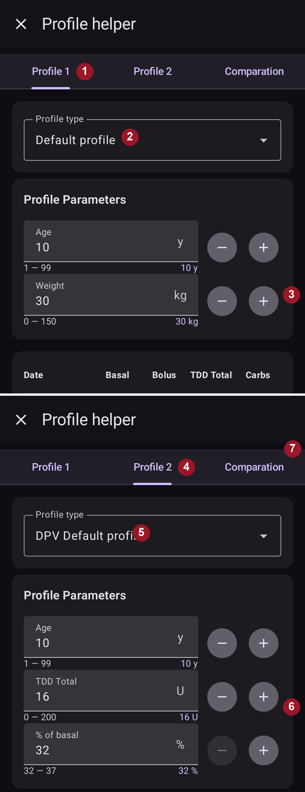

1. Убедитесь, что вы на вкладке **Профиль 1**.
2. В поле **Тип профиля** убедитесь, что выбран «Профиль по умолчанию».
3. Отрегулируйте профиль по умолчанию (на основе набора данных госпиталей), указав возраст ребенка либо суточную дозировку инсулина TDD **либо** вес.
4. Перейдите на вкладку **Профиль 2**.
5. Нажмите **Тип профиля** и выберите «Профиль по умолчанию DPV».
6. Настройте профиль по умолчанию DPV (на основе данных другой больницы): введите возраст ребенка, суточную дозу инсулина TDD и процент базала. Обратите внимание: данные DPV дают только **базальные скорости**, поэтому IC и ISF для этого профиля показаны как ноль.
7. Откройте вкладку **Сравнение**. Будет показано сравнение двух настроенных профилей (см. снимок экрана ниже).
8. Если вы хотите начать настройку своего профиля на основе одного из этих предложений, используйте кнопку **Клонировать** под сравнением.

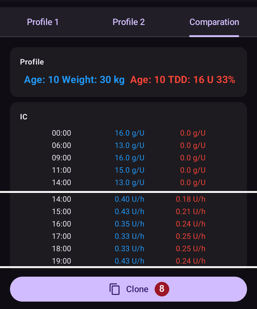

### Переключение профиля

См. [Переключение профиля и процент профиля](../DailyLifeWithAaps/ProfileSwitch-ProfilePercentage.md).

(your-aaps-profile-clone-profile-switch)=
### Клонирование переключения профиля в новый профиль


[История терапии](#aaps-screens-treatments) показывает все прошлые **переключения профиля**. На вкладке **Смена профиля** можно использовать прошлое **переключение профиля** как основу для нового **Профиля**. In this case, timeshift and percentage will be applied to the new local profile. Используйте кнопку **Клонировать** в строке **2**.

Теперь можно перейти на [экран профиля](#your-aaps-profile-create-and-edit-profiles) (**Управление → Профиль**) и отредактировать новый профиль.

(YourAapsProfile_Profile-backup)=
### Резервная копия профиля

**Профили** — это основная настройка вашей системы замкнутого цикла, они очень важны, и вы точно не захотите их потерять.

* Ваши **Профили** хранятся в базе данных **AAPS**.
* Если настроен **NSClientV3** (см. [Синхронизация](#SetupWizard-synchronization-with-the-reporting-server-and-more)), ваши **Профили** также автоматически загружаются в Nightscout.
* Они также входят в [экспорт настроек](../Maintenance/ExportImportSettings.md). So make sure to have a backup in a safe place.

### Редактирование профилей в Nightscout

Если эта функция включена, изменения **Профиля**, сделанные прямо в Nightscout, могут приниматься в **AAPS**. Эта настройка называется «**Получать хранилище профилей из NS**» и входит в параметры **Прием данных из Nightscout** (прием данных из Nightscout по умолчанию выключен, см. [шаг «Управление с клиента» в Мастере установки AAPS](../SettingUpAaps/SetupWizard.md)); ее можно быстро найти с помощью **строки поиска** на главном экране. Пока управление с клиента включено, эта настройка скрыта, и **AAPS** не принимает изменения профиля из Nightscout ([защищенный режим](#client-master-control-hardened-mode)); вместо этого отредактируйте профиль на сопряженном клиенте или загрузите его один раз с помощью **Полная синхронизация**.

Это может быть полезно, если вы собираетесь сделать большие изменения в объемном **Профиле**. Их проще вводить через веб-интерфейс, _например_, чтобы вручную скопировать данные из таблицы.

Но для этого важно клонировать в редакторе Nightscout всю **запись базы данных**, которая состоит из нескольких профилей (синяя стрелка на снимке экрана ниже). Новые записи базы данных тогда получают текущую дату. После сохранения измененный/новый **Профиль** можно активировать в **AAPS** обычным [переключением профиля](../DailyLifeWithAaps/ProfileSwitch-ProfilePercentage.md).

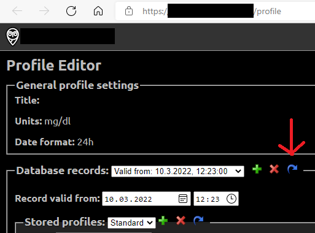

(your-aaps-profile-compare-profiles)=
### Сравнение двух профилей

Также можно использовать [Помощник профиля](#aaps-screens-profile-helper) (меню ☰ → **Помощник профиля**), чтобы сравнить два разных профиля или переключения профиля (процент одного из ваших профилей, который раньше использовался в [переключении профиля](../DailyLifeWithAaps/ProfileSwitch-ProfilePercentage.md)).

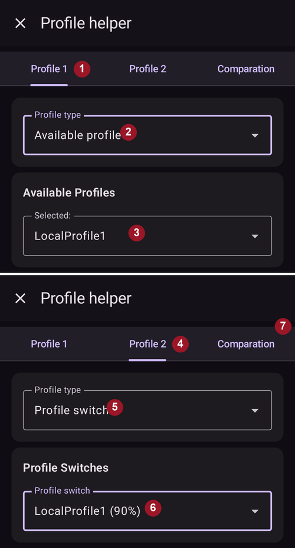

1. Убедитесь, что вы на вкладке **Профиль 1**.
2. В поле **Тип профиля** выберите «Доступный профиль», чтобы выбирать среди всех сохраненных **Профилей**.
3. Выберите **Профиль**, который вы хотите сравнить.
4. Перейдите на вкладку **Профиль 2**.
5. В поле **Тип профиля** выберите «Смена профиля», чтобы выбирать в истории всех ваших **переключений профиля**.
6. Выберите **Переключение профиля**, с которым вы хотите сравнить.
7. Откройте вкладку **Сравнение**. Будет показано сравнение двух профилей (см. снимок экрана ниже).

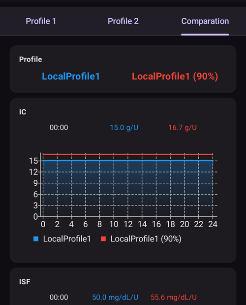
