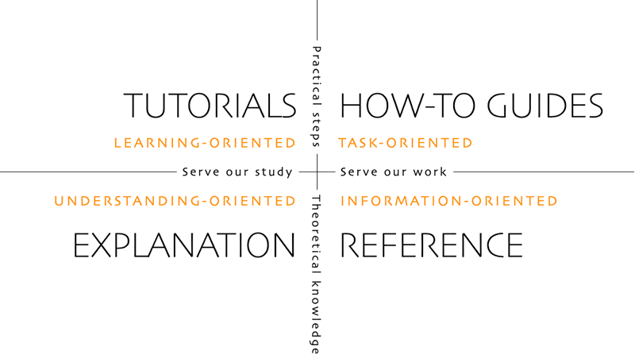

# Как редактировать документацию

**Это описание только для редактирования английской документации. Вся новая информация сначала должна быть добавлена на английском языке. Если вы хотите переводить на другие языки (спасибо!), используйте [crowdin](https://crowdin.com/project/androidapsdocs).**

Подсказки, как форматировать текст (заголовок, жирный...) и ставить ссылки, см. в разделе [«Синтаксис кода»](#edit-the-docs-code-syntax) на этой странице.

## General

С любыми вопросами, отзывами или новыми идеями вы можете связаться с командой документации в [discord](https://discord.gg/4fQUWHZ4Mw).

В какой-то момент вам предложат сделать pull request (PR) — так ваши изменения в документации на самом деле попадают на веб-страницы AAPS, которые хранятся на GitHub. Сделать PR на самом деле не так сложно, и это отличный способ помочь проекту. Вы читаете эту документацию прямо сейчас, потому что такие же люди, как вы, делали PR. Не бойтесь ошибиться или случайно отредактировать не тот документ. Ваши изменения проверяются, прежде чем их внесут в «официальный» репозиторий документации AAPS. Вы не сможете случайно испортить оригиналы во время этого процесса. Общий порядок действий:

- Вносите правки и улучшения в код или документацию, редактируя существующее содержимое.
- Еще раз проверьте, что ваши правки выглядят так, как вы хотите.
- Кратко запишите, что изменилось, чтобы другие люди поняли ваши правки.
- Создайте pull request (запрос на слияние), который просит администраторов принять ваши изменения.
- Они проверят его и либо (1) примут ваши изменения, (2) напишут вам комментарий к вашим изменениям, либо (3) начнут новый документ с вашими изменениями.

(Примечание: если вам удобнее учиться по видео, [здесь](https://youtu.be/4b6tsL0_kzg) есть видео на YouTube о процессе PR.)

В нашем примере мы внесем правку в AndroidAPSdocs. Это можно сделать на любом ПК с Windows, Mac и т. д. (на любом компьютере с доступом в интернет).

1. Перейдите на <https://github.com/openaps/AndroidAPSdocs> и нажмите Fork в правом верхнем углу, чтобы создать свою копию репозитория.


2. Откройте любую страницу и перейдите на страницу, которую хотите редактировать. Можно нажать на ссылку "Edit in GitHub" в правом верхнем углу. Это возможно только для английских страниц. 


Или нажмите на значок карандаша, который появляется в верхней панели содержимого редактируемой страницы. Для этого вы должны уже войти в свою учетную запись Github (если ее нет, создать ее несложно).


3. Любой из вариантов в шаге 2 создаст новую ветку в ВАШЕМ репозитории, где будут сохранены ваши правки. Внесите правки в файл.

Для страниц документации мы используем Markdown. Файлы имеют расширение ".md". Спецификация Markdown не зафиксирована, и сейчас для наших файлов Markdown мы используем myst_parser. Следите за правильным синтаксисом, как [описано ниже](#edit-the-docs-code-syntax).


4. Вы работали на вкладке "<>Edit file". Выберите вкладку "Preview changes", чтобы свежим взглядом убедиться, что все изменения выглядят так, как вы задумали (проверьте опечатки). Если вы видите, что нужно что-то улучшить, вернитесь на вкладку редактирования и внесите еще правки. 


5. Когда вы закончите правки, прокрутите страницу вниз. В поле внизу напишите свои комментарии в текстовом поле с надписью "Add an optional extended description...". Заголовок по умолчанию содержит имя файла. Постарайтесь добавить предложение, которое объясняет **причину** изменения. Если вы назовете причину, проверяющим будет легче понять, чего вы хотите добиться этим PR.


6. Нажмите зеленую кнопку "Propose file changes" или "Commit changes". На открывшейся странице нажмите "Create Pull Request" и на следующей странице снова нажмите "Create Pull Request".


7. На этом открытие pull request (PR) завершено. GitHub присваивает PR номер, который стоит после заголовка и знака решетки. Возвращайтесь на эту страницу, чтобы проверить отзывы (или, если уведомления GitHub приходят вам по электронной почте, вы будете получать письма о любых действиях в PR). Теперь правка будет в списке PR, которые команда проверит и, возможно, прокомментирует, прежде чем внести ее в основную документацию AAPS! Если вы хотите следить за ходом PR, нажмите на значок колокольчика в правом верхнем углу вашей учетной записи GitHub, и вы увидите все ваши PR.


P.S.: ваш fork и ветка останутся в вашей личной учетной записи GitHub. Когда вы получите уведомление, что ваш PR принят, можете удалить свою ветку, если она вам больше не нужна (в области уведомлений из шага 7 будет ссылка для удаления ветки, когда PR закрыт или принят). Если вы будете следовать этой процедуре и для будущих правок, они всегда будут начинаться с актуальной версии репозиториев AndroidAPSdocs. Если вы начинаете PR другим способом (например, редактируете, начиная с ветки master вашего fork), сначала нужно обновить ваш репозиторий: выполните "compare" (сравнение) и примите все изменения, сделанные с момента последнего обновления вашего fork. Люди часто забывают обновлять свои репозитории, поэтому мы советуем использовать описанный выше процесс PR, пока вы не научитесь выполнять "compare" (сравнение).

(edit-the-docs-code-syntax)=

## Синтаксис кода

Для страниц документации мы используем Markdown. Файлы имеют расширение ".md".

Markdown — очень простой язык форматирования текста, который отделяет содержимое текста от его оформления.

Автор, например, только отмечает заголовок как заголовок 1-го уровня, а обработчик Markdown при обработке создает нужный HTML-код, чтобы показать этот заголовок в HTML.

Идея в том, чтобы

- автор должен сначала думать о тексте, а не о форматировании,
- текст Markdown можно было переносить между разными инструментами Markdown, а не использовать, например, закрытые инструменты, такие как Microsoft Word, и
- можно было создавать несколько выходных форматов из одного файла Markdown.

Markdown — это не на 100% фиксированный стандарт, и мы стараемся держаться как можно ближе к стандарту, чтобы

- оставаться гибкими и менять инструменты Markdown, когда нужно или когда к этому вынудит дальнейшее развитие инструментов Markdown и SaaS-сервисов Markdown, и
- можно было использовать сервисы перевода для перевода с английского на другой язык, например на французский или немецкий. Они умеют работать с Markdown, но не со сложными кодами форматирования, потому что не могут отделить содержимое от оформления, а это может быть фатальным.

### Заголовки

- Заголовок 1: `# headline`
- Заголовок 2: `## headline`
- Заголовок 3: `### headline`
- Заголовок 4: `#### headline`

Мы стараемся не использовать больше уровней заголовков.

### Формат текста

- **жирный**: `**text**`
- *курсив*: `*text*`
- ***жирный курсив***: `***text***`

### Нумерованный список

    1. первый
    1. второй
    1. третий
    

1. первый
2. второй
3. третий

### Маркированный список

    - один элемент
    - другой элемент
    - и еще один элемент
    

- один элемент
- другой элемент
- и еще один элемент

### Многоуровневый список

Можно вставлять списки в списки: сдвиньте следующий уровень вправо на 4 пробела больше, чем предыдущий.

    1. первый
    1. второй
    1. третий
      1. один элемент
      1. другой элемент
      1. и еще один элемент
    1. четвертый
    1. пятый
    1. шестой
    

1. первый
2. второй
3. третий 
    1. один элемент
    2. другой элемент
    3. и еще один элемент
4. четвертый
5. пятый
6. шестой

### Изображения

Чтобы вставить изображение, используйте такой синтаксис Markdown.

- изображения: ``

Изображение должно быть в формате PNG или JPEG.

Названия изображений должны соответствовать одному из следующих правил. В примере я использую расширение png. Если вы используете JPEG, используйте расширение jpeg.

- `filename-image-xx.png`, где xx — уникальное двузначное число для изображений в этом файле.
- `filename-image-xx.png`, где xx — понятное имя, которое выбрал автор md-файла.

Изображения лежат в папке images для английского языка и автоматически переносятся в другие языки через Crowdin. Вам для этого ничего делать не нужно!

Сейчас мы не переводим изображения: на изображениях должно быть **как можно меньше текста**, чтобы они были понятны читателям, не знающим английского.

(make-a-PR-image-size)= Используйте разумный размер изображений: они должны быть читаемы на ПК, планшете и телефоне.

- Снимки экрана с веб-страниц должны быть шириной до **1050 пикселей**.
- Схемы процессов должны быть шириной до **1050 пикселей**.
- Снимки экрана приложения должны быть шириной до **500 пикселей**. Не размещайте их рядом друг с другом, если в этом нет необходимости.
- Снимки экрана со смарт-часов (**Wear OS**) должны быть шириной до **360 пикселей**. Никогда не увеличивайте снимок экрана, который меньше.

### Ссылки

#### Внешние ссылки

Внешние ссылки — это ссылки на внешние веб-сайты.

- внешняя ссылка: `[alt text](www.url.tld)`

#### Внутренние ссылки на начало md-файла

Внутренние ссылки на страницы — это ссылки на начало md-файла, который размещен на нашем собственном сервере.

- внутренняя ссылка на страницу .md: `[alt text](../folder/file.md)`

#### Внутренние ссылки на именованные метки в тексте

Внутренние ссылки на именованные метки — это ссылки на любое место md-файла, который размещен на нашем собственном сервере, где задана метка для ссылки.

Добавьте именованную ссылку (метку) в том месте целевого md-файла, куда нужно перейти.

`(name-of-my-md-file-this-is-my-fancy-named-reference)=`

Именованная метка должна быть уникальной во всех md-файлах AndroidAPSDocs, а не только в своем md-файле!

Поэтому лучше начинать ее с имени файла, а затем писать выбранное имя метки.

Используйте только строчные буквы и соединяйте слова дефисом.

Затем сошлитесь на эту метку в своем тексте с помощью ссылки такого вида.

- Внутренние ссылки на именованные метки: `[alt text](name-of-my-md-file-this-is-my-fancy-named-reference)`

### Примечания, предупреждения, сворачиваемые примечания

В документацию можно добавлять блоки примечаний и предупреждений.

Кроме того, можно добавлять сворачиваемые примечания с подробной информацией, чтобы пользователей, которым не интересны детали, они не отпугивали от чтения текста. Используйте их осторожно, потому что документация должна читаться как можно легче.

#### Примечания

    ```{admonition} Заголовок примечания
    :class: note
    Это примечание.
    ```
    

```{admonition} Заголовок примечания :class: note Это примечание.

    <br />#### Предупреждения
    
    ````
    ```{admonition} Предупреждение
    :class: warning
    Это предупреждение.
    

    ```{admonition} Заголовок предупреждения
    :class: warning
    Это предупреждение.
    ```
    
    #### Сворачиваемые примечания
    
    

    {admonition} подробная информация для интересующихся читателей
    :class: dropdown
    
    Это примечание свернуто,
    поэтому сюда можно добавить более длинный текст,
    и он не займет много места на странице.
    

````

```{admonition} подробная информация для интересующихся читателей :class: dropdown Это примечание свернуто, поэтому сюда можно добавить более длинный текст, и он не займет много места на странице.

```

## Таблицы

Избегайте таблиц с длинными текстами: их содержимое трудно оформить в Markdown, обычно они не помещаются по ширине экрана телефона и, скорее всего, будут выглядеть иначе после перевода.

## Руководство по стилю

### Contents

1. Советы по письму на английском языке

2. Заметки по написанию текстов для AAPS

3. Полезные ссылки

###  1\. Советы по письму на английском языке

#### Пишите языком, который подходит читателю

По возможности используйте простой английский язык. Это помогает читателям, для которых английский не родной, и облегчает перевод документов AAPS на другие языки. Пишите так, как будто разговариваете с пользователем: представьте, что человек, для которого вы пишете, сидит напротив вас за столом. Помните: у большинства пользователей AAPS нет опыта программирования. В самой теме диабета тоже много жаргона и сокращений. Помните, что у некоторых людей диабет мог быть выявлен недавно, у них может быть меньше опыта с диабетом, чем у вас, или их могли обучать по-другому. Если вы используете сокращение, при первом упоминании напишите его полностью, а сокращение укажите сразу после него в скобках, например “super micro bolus (SMB)”. Также дайте ссылку на глоссарий. Технические термины, которые могут быть незнакомы читателю, тоже можно пояснить в скобках.

Вместо: *“What causes high postprandial BG peaks in closed loop?”*

Пишите: *“What causes a high BG peak **after lunch** (postprandial) in closed loop?”*

##### Используйте простые слова, понятные всем

Список альтернативных слов от A до Z, которые сделают ваш текст понятнее, вы найдете здесь:

<https://www.plainenglish.co.uk/the-a-z-of-alternative-words.html>

#### Конфиденциальность и лицензии:

Особенно если вы записываете видео или делаете снимки экрана, не раскрывайте свои личные данные (ключ API, пароли). Убедитесь, что видео на YouTube не находится в открытом доступе и его можно посмотреть только по ссылке из документации. Не привлекайте внимание к материалам, нарушающим авторские права (BYODA и т. д.).

#### Пишите короткие предложения, говорите по существу

- В ясном тексте средняя длина предложения — от 15 до 20 слов.

- Это не значит, что все предложения должны быть одной длины. Пишите емко. Чередуйте короткие предложения (как предыдущее) с более длинными (как это).

- Держитесь одной главной мысли в предложении, плюс, возможно, еще одного связанного пункта.

- Иногда у вас все же получится длинное предложение, особенно когда вы объясняете что-то сложное. Но большинство длинных предложений можно как-то разбить.

- Убирайте слабые слова: “you can”, “there is/are/were”, “in order to”.

- Ставьте ключевые слова ближе к началу заголовков, предложений и абзацев.

- Используйте наглядность! По возможности добавляйте короткую схему, снимок экрана или видео.

#### Не бойтесь давать указания

Повелительная форма — самый быстрый способ дать указание, но авторы иногда боятся приказывать и пишут “you should do this” («вам следует сделать это») вместо простого “do this” («сделайте это»). Возможно, люди боятся, что повелительная форма звучит слишком резко. Часто это можно решить, добавив в начале слово 'please' («пожалуйста»). Но если что-то обязательно нужно сделать, лучше не писать ‘please’, потому что это оставляет читателю возможность отказаться.

Вместо: *“You should just think of it as a complete statement.”*

Пишите: *“Think of it as a complete statement.”*

#### Чаще используйте действительный залог, а не страдательный

Пример **действительного залога**:

- *“The pump (subject) delivers (verb) the insulin (object).” («Помпа (подлежащее) подает (глагол) инсулин (дополнение).»)*

Здесь “delivers” — глагол в действительном залоге. Предложение сначала говорит, что подает, а потом — что подается.

Пример **страдательного залога**:

- *“The insulin (subject) is delivered (verb) by the pump (object).” («Инсулин (подлежащее) подается (глагол) помпой (дополнение).»)*

Здесь *“delivered”* — глагол в страдательном залоге. Подлежащее и дополнение поменялись местами по сравнению с предложением в действительном залоге. Нам пришлось сделать предложение длиннее, добавив “is” и “by the”. Также подумайте о том, чтобы начать с глагола в действительном залоге.

Вместо: *“You can connect your pump with the phone through the AAPS pump menu, and there are a number of pumps available for you to connect with.”*

Пишите: *“Connect your desired pump to the phone through the AAPS pump menu.”*

Страдательный залог может создавать проблемы:

- Он может запутать.

- Он часто делает текст более многословным.

- Он делает текст менее живым.

##### Когда страдательный залог уместен

Иногда страдательный залог может быть уместен.

- Чтобы смягчить высказывание: 'this bill has not been paid' («этот счет не оплачен», страдательный залог) звучит мягче, чем 'you have not paid this bill' («вы не оплатили этот счет», действительный залог).

- Чтобы не перекладывать вину: 'a mistake was made' («была допущена ошибка», страдательный залог) вместо 'You made a mistake' («вы допустили ошибку», действительный залог).

- Когда вы не знаете, кто или что выполняет действие: 'the England team has been picked' («сборная Англии выбрана»).

- Если так просто звучит лучше.

#### Избегайте отглагольных существительных

Отглагольное существительное — это название чего-то, что не является физическим предметом, например процесса, метода или чувства. Отглагольные существительные образуются от глаголов.

Например:

| Глагол                 | Отглагольное существительное |
| ---------------------- | ---------------------------- |
| complete (завершить)   | completion (завершение)      |
| introduce (ввести)     | introduction (введение)      |
| provide (предоставить) | provision (предоставление)   |
| fail (не удаться)      | failure (неудача)            |

Их часто используют **вместо** глаголов, от которых они образованы, но из-за них может казаться, что ничего на самом деле не происходит. Если их слишком много, текст становится очень скучным и тяжелым для чтения.

Вместо: *“The implementation of the method has been done by a team.”*

Пишите: *“A team has implemented the method.”*

#### Используйте списки, где это уместно

Списки отлично подходят для разделения информации. Есть два основных вида списков:

- Сплошное предложение, в котором несколько пунктов выделены в начале, в середине или в конце.

- Отдельные пункты списка с вводной фразой.

В маркированном списке выше каждый пункт — законченное предложение, поэтому каждый начинается с заглавной буквы и заканчивается точкой. Используйте маркеры, а не цифры или буквы: они привлекают внимание к каждому пункту и не дают читателю лишней информации.

#### Развенчание мифов

- Предложение можно начинать с **and, but, because, so или however**.

- Можно разделять инфинитив. Поэтому можно сказать **“to boldly go”**.

- Предложение можно заканчивать предлогом. На самом деле это то, **we should stand up for** (что нам стоит отстаивать).

- И **вы** можете использовать одно и то же **слово** дважды в предложении, если **вы** не можете найти лучшее **слово**.

#### Выбор стиля текста в зависимости от цели

Чтобы документация была ясной и короткой, мы пишем разные разделы документации в разных стилях.

Стиль «объяснение» используется для введения, справочной информации и разделов, которые развивают знания.

Стиль «практическое руководство» (с минимумом объяснений) используется для сборки и настройки AAPS и для некоторых разделов по устранению неполадок.

Учебник помогает ученику получить базовые навыки. Пользователь будет **учиться на практике**.



#####  Учебники (например, учим ребенка взбивать яичные белки)

- рассказчик обращается прямо к читателю: «В этом учебнике **вы**...» (мы) в редких случаях можно использовать, чтобы передать ощущение «мы делаем это вместе»

- Будущее время -> чтобы показать конечную цель

- Повелительное наклонение -> чтобы выполнять задачи -> Конкретные шаги - избегайте абстрактных понятий

- Прошедшее время -> чтобы показать выполненные задачи -> Быстрые и сразу видимые результаты

- Минимум объяснений -> только то, что нужно для выполнения задачи - **что и зачем**

- Не упоминайте варианты/альтернативы/…. Никакой двусмысленности

- Переходы между шагами: заканчивайте шаг предложением, которое логично ведет к следующему шагу. Пример: *Вы установили клиент Let’s Encrypt, но перед получением сертификатов нужно убедиться, что все нужные порты открыты. Для этого на следующем шаге вы обновите настройки брандмауэра.*

- Заголовок **учебника** (заголовок 1-го уровня)

- Введение (без заголовка)

- Предварительные требования (заголовок 2-го уровня)

- Steps:

- Шаг 1 — Делаем первое (заголовок 2-го уровня)

- Шаг 2 — Делаем следующее (заголовок 2-го уровня)

- Шаг n — Делаем последнее (заголовок 2-го уровня)

- Заключение (заголовок 2-го уровня)
    
    - **Язык учебников**
        
        *В этом учебнике вы…*
        
        Опишите, чего добьется ученик (обратите внимание: не «вы узнаете…»).
        
        *Сначала сделайте x. Теперь сделайте y. Теперь, когда вы сделали y, сделайте z.*
        
        Никаких двусмысленностей и сомнений.
        
        *Мы всегда должны сделать x перед y, потому что… (подробнее см. в объяснении).*
        
        Объясняйте действия минимально и самым простым языком. Дайте ссылку на более подробное объяснение.
        
        *Результат должен выглядеть примерно так…*
        
        Дайте ученику ясные ожидания.
        
        *Обратите внимание, что… Помните, что…*
        
        Давайте ученику много подсказок, чтобы он мог убедиться, что идет правильным путем, и сориентироваться.
        
        *Вы собрали надежный трехслойный гиломорфный стазис-двигатель…*
        
        Опишите (и сдержанно похвалите) то, чего добился ученик (обратите внимание: не «вы научились…»)

#####  Практические руководства (например, рецепт)

Цель практического руководства — помочь уже опытному пользователю правильно выполнить определенную задачу.

- КАК сделать

- рассказчик обращается прямо к читателю: «В этом руководстве **вы**...»

- Будущее время -> чтобы показать конечную цель

- Условное повелительное наклонение -> чтобы получить X, сделайте y -> Конкретные шаги - избегайте абстрактных понятий

- Минимум объяснений -> только то, что нужно для выполнения задачи -> **что и зачем**

- Не упоминайте варианты/альтернативы/…. Никакой двусмысленности, но можно дать ссылку на справочный или объясняющий раздел

- **Как сделать**: заголовок (заголовок 1-го уровня)

- Вводный абзац

- Необязательные предварительные требования (абзац или заголовок 2-го уровня, если их больше одного)

- Steps:

- Шаг 1 — Делаем первое (заголовок 2-го уровня)

- Шаг 2 — Делаем следующее (заголовок 2-го уровня)

- Шаг n — Делаем последнее (заголовок 2-го уровня)

- Заключительный абзац
    
    - **Язык практических руководств**
        
        *Это руководство показывает, как…*
        
        Ясно опишите проблему или задачу, которую руководство помогает пользователю решить.
        
        *Если хотите x, сделайте y. Чтобы добиться w, сделайте z.*
        
        Используйте условное повелительное наклонение.
        
        *Полный список вариантов см. в справочнике по x.*
        
        Не загромождайте практическое руководство всем, что пользователь может сделать в связи с x.

#####  Объяснение (например, наука о том, почему яичные белки густеют при взбивании)

Объяснение проясняет, углубляет и расширяет понимание читателем темы.

- ПОЧЕМУ

- Начинайте с **About** («О...»)

- Дайте контекст, дайте ссылки на ВСЕ нужные источники

- Обсудите варианты/альтернативы

- Не давайте указаний и справочных данных (дайте на них ссылку)

- Укажите неизвестное, то, что еще меняется, и т. д.…

- Заголовок **About** (заголовок 1-го уровня)

- Введение (без заголовка)

- Необязательные предварительные требования (заголовок 2-го уровня)

- Подтема 1 (заголовок 2-го уровня)

- Заключение (заголовок 2-го уровня)
    
    - **Язык объяснений**
    
    *Причина x в том, что исторически y…*
    
    Объясняйте.
    
    *W лучше, чем z, потому что…*
    
    Где уместно, высказывайте суждения и даже мнения.
    
    *x в системе y аналогичен w в системе z. Однако…*
    
    Дайте контекст, который поможет читателю.
    
    *Некоторые пользователи предпочитают w (потому что z). Это может быть хорошим подходом, но…*
    
    Взвесьте альтернативы.
    
    *x взаимодействует с y следующим образом:…*
    
    Раскройте внутреннее устройство механизма, чтобы помочь понять, почему что-то работает именно так.

### 2\. Заметки по написанию и обновлению текстов для AAPS

#### Автор и редактор

Написание и обновление документации AAPS можно разделить на два этапа. Их может выполнять один и тот же человек в разное время или несколько человек.

**Автор (например, вы!)** пишет или редактирует раздел документации кратко и в разговорном тоне, а затем передает его редактору.

**Редактор (например, другой пользователь AAPS или человек, который получил pull request)** проверяет соответствие руководству по стилю, правит раздел, чтобы он был ясным и доступным, и убирает как можно больше слов (особенно в разделах-учебниках и практических руководствах). Может помочь чтение текста вслух.

#### Общие правила для AAPS

- Для значений глюкозы указывайте и мг/дл, и ммоль/л каждый раз (по возможности учитывайте это и для снимков экрана).

- Для единообразия пишите “AAPS”, а не “Android APS”.

- Четко укажите версию Android Studio/AAPS, для которой вы пишете или с которой сделаны снимки экрана.

### 3\. Полезные ссылки

<https://dev.readthedocs.io/en/latest/style-guide.html>

[Diátaxis (diataxis.fr)](https://diataxis.fr/)

[Technical Writer Style Guide Examples | Technical Writer HQ](https://technicalwriterhq.com/writing/technical-writing/technical-writer-style-guide/)

[DigitalOcean's Technical Writing Guidelines | DigitalOcean](https://www.digitalocean.com/community/tutorials/digitalocean-s-technical-writing-guidelines)

[Top 10 tips for Microsoft style and voice - Microsoft Style Guide | Microsoft Learn](https://learn.microsoft.com/en-us/style-guide/top-10-tips-style-voice?source=recommendations)

<https://www.plainenglish.co.uk/how-to-write-in-plain-english.html>

<https://developers.google.com/style>

<https://www.mongodb.com/docs/meta/style-guide/screenshots/screenshot-guidelines/>